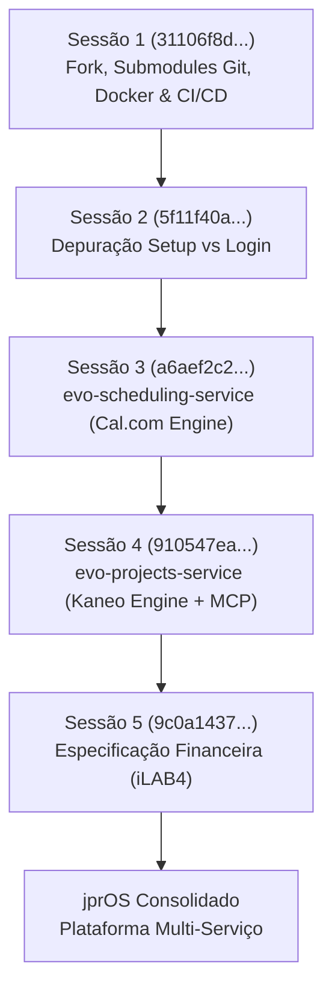
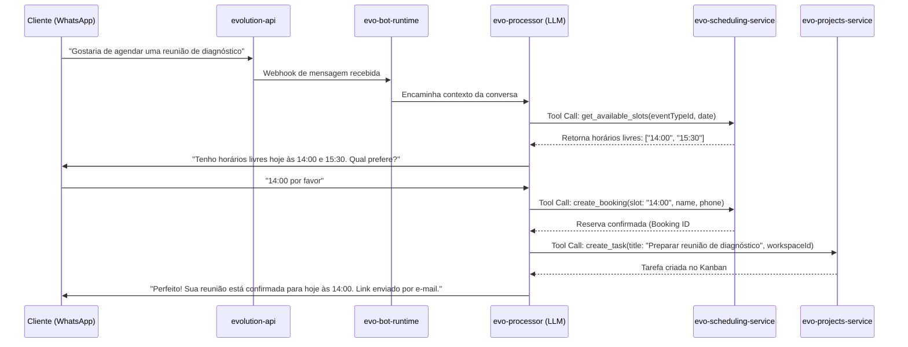

# Documentação Completa do Sistema jprOS

> **Versão da Plataforma:** v1.0.0-rc2 (jprOS Edition)  
> **Última Atualização:** Outubro de 2026  
> **Repositório Monorepo:** [jprOS (jeanpierreribeiro/evo-crm-community)](https://github.com/jeanpierreribeiro/evo-crm-community)

---

## Sumário
1. [Histórico e Evolução ("Como Chegamos Aqui")](#1-histórico-e-evolução-como-chegamos-aqui)
   - 1.1 [Sessão 1: O Fork, Ambientes e Orquestração Base](#11-sessão-1-o-fork-ambientes-e-orquestração-base)
   - 1.2 [Sessão 2: Diagnóstico do Fluxo de Setup e Autenticação](#12-sessão-2-diagnóstico-do-fluxo-de-setup-e-autenticação)
   - 1.3 [Sessão 3: Submódulo de Agendamentos Headless (evo-scheduling-service)](#13-sessão-3-submódulo-de-agendamentos-headless-evo-scheduling-service)
   - 1.4 [Sessão 4: Submódulo de Projetos, Multi-Workspace & MCP (evo-projects-service)](#14-sessão-4-submódulo-de-projetos-multi-workspace--mcp-evo-projects-service)
   - 1.5 [Sessão 5: Arquitetura e Especificação do Módulo Financeiro](#15-sessão-5-arquitetura-e-especificação-do-módulo-financeiro)
2. [Visão Geral do jprOS](#2-visão-geral-do-jpros)
   - 2.1 [O que é o jprOS](#21-o-que-é-o-jpros)
   - 2.2 [Princípios Arquiteturais e Paradigma Headless](#22-princípios-arquiteturais-e-paradigma-headless)
3. [Mapeamento Completo dos Módulos e Microsserviços](#3-mapeamento-completo-dos-módulos-e-microsserviços)
   - 3.1 [Infraestrutura Compartilhada](#31-infraestrutura-compartilhada)
   - 3.2 [Serviços do Núcleo Evo CRM (Evolution Platform)](#32-serviços-do-núcleo-evo-crm-evolution-platform)
   - 3.3 [Módulos Customizados Exclusivos jprOS](#33-módulos-customizados-exclusivos-jpros)
   - 3.4 [Gateway Nginx e Frontend Unificado](#34-gateway-nginx-e-frontend-unificado)
4. [Matriz de Portas, Rotas e Comunicação Interna](#4-matriz-de-portas-rotas-e-comunicação-interna)
5. [Integração com Inteligência Artificial e Model Context Protocol (MCP)](#5-integração-com-inteligência-artificial-e-model-context-protocol-mcp)
6. [Guia de Operação, Git Submodules e Desenvolvimento](#6-guia-de-operação-git-submodules-e-desenvolvimento)

---

## 1. Histórico e Evolução ("Como Chegamos Aqui")

A construção do **jprOS** partiu da necessidade de transformar uma plataforma de atendimento open-source (`evo-crm-community` da Evolution Foundation) em um verdadeiro **Sistema Operacional Empresarial Unificado**. O objetivo do autor (**Jean Pierre Ribeiro**) foi integrar em um mesmo ecossistema:
- Atendimento Omnichannel (WhatsApp / Chat / E-mail);
- Agentes Autônomos de Inteligência Artificial;
- Agendamento Inteligente com páginas públicas e regras de conflito;
- Gestão de Projetos, Tarefas, Multi-Workspace e Aprovação de entregas por clientes;
- Gestão Financeira interna completa (Fluxo de Caixa, DRE, Conciliação e Assinaturas).

A seguir está o resgate detalhado das cinco sessões que consolidaram o estado atual do projeto:



### 1.1 Sessão 1: O Fork, Ambientes e Orquestração Base
- **ID da Sessão:** `31106f8d-c996-45de-9cb7-18e9baf99364`
- **Contexto & Desafio:**
  O projeto base da Evolution Foundation era composto por múltiplos submódulos Git dependentes entre si. O usuário necessitava de um fork próprio no GitHub (`https://github.com/jeanpierreribeiro/`) que permitisse alterar qualquer parte do código (frontend, auth, crm, pipelines) sem perder a capacidade de sincronização com o código-fonte original (`upstream`).
- **Ações Técnicas Realizadas:**
  1. Criação do repositório principal e dos forks de cada submódulo no GitHub.
  2. Reconfiguração do arquivo `.gitmodules`, sincronizando as URLs para os repositórios remotos pessoais (`jeanpierreribeiro/*`) e registrando o `upstream` oficial (`evolution-foundation/*`).
  3. Configuração do ambiente local orquestrado via `docker-compose.yml`, trazendo containers de infraestrutura: PostgreSQL (pgvector 16), Redis, RabbitMQ, ClickHouse e MailHog.
  4. Execução do pipeline canônico de inicialização de dados: carga de schema do CRM (`bundle exec rails db:schema:load`), registro de migrações no `evo-auth` e aplicação de seeds iniciais.
  5. Criação da esteira de CI/CD para GitHub Actions (`.github/workflows/deploy-ci.yml`) e o arquivo de Swarm para deploy em produção (`docker-compose.prod.yml`).
  6. **Correção de Estrutura de Diretórios:** O projeto havia sido inicialmente alocado em pasta sincronizada do OneDrive (`OneDrive\Documentos\...`), provocando travamentos de lock em arquivos do Docker e Git. O repositório foi migrado com segurança para `C:\Users\pi3rr3\Documents\Projetos\jprOS`.
  7. **Ajuste de Acesso Administrativo:** Criação e reset da senha do primeiro administrador do sistema via script `rails runner` direto no container `evo-auth`.

### 1.2 Sessão 2: Diagnóstico do Fluxo de Setup e Autenticação
- **ID da Sessão:** `5f11f40a-c4bb-475b-9fa1-1b09e3bfaae1`
- **Contexto & Diagnóstico:**
  Ao tentar acessar `http://localhost:5173/setup`, a aplicação redirecionava o operador para a tela de login ao invés de abrir o assistente de primeiro cadastro ("Setup Wizard").
- **Resolução:**
  Inspecionando os containers `evo-frontend` e `evo-auth`, verificou-se a rota `/api/v1/setup/status`. Como o passo de `db:seed` executado na Sessão 1 já havia inserido papéis RBAC e criado as contas administrativas primárias no PostgreSQL, a rota de setup é intencionalmente bloqueada por segurança pelo core para evitar a substituição indevida do administrador do sistema. Esclareceu-se o fluxo de autenticação padrão e a rota de recuperação via MailHog (`http://localhost:18025`).

### 1.3 Sessão 3: Submódulo de Agendamentos Headless (evo-scheduling-service)
- **ID da Sessão:** `a6aef2c2-f7ef-4310-95c1-fb618489cc1a`
- **Contexto & Decisão de Design:**
  O ecossistema necessitava de um módulo de agendamento de reuniões e consultas com clientes. A referência técnica era o Cal.com (já rodando localmente na máquina). Porém, trazer o monorepo do Cal.com (Next.js, dezenas de dependências pesadas) inflaria drasticamente o jprOS.
  Optou-se pela **Abordagem Headless**: criar um microsserviço enxuto em Node.js/TypeScript (`evo-scheduling-service`) aproveitando a modelagem de dados e regras de slots do Cal.com, com interface implementada nativamente dentro do `evo-ai-frontend-community`.
- **Entregas Realizadas:**
  1. Criação do serviço `evo-scheduling-service` com Prisma ORM e PostgreSQL: tabelas `Schedule`, `Availability`, `EventType` e `Booking`.
  2. Implementação do algoritmo de geração de slots disponíveis (`slots.ts`), respeitando intervalos de atendimento, buffers antes/depois de reuniões e fusos horários (`dayjs`).
  3. Adição do container no `docker-compose.yml` (porta interna 3002 / externa 3012) e proxy reverso no Nginx (`/api/v1/scheduling`).
  4. Interface completa no frontend: item `📅 Agenda` no menu lateral com drawer retrátil (Compromissos, Tipos de Evento, Disponibilidade e Prévia Pública).
  5. Telas públicas responsivas para clientes agendarem (`/book/:slug` e `/book/:username/:eventSlug`), corrigindo guardas de rota pública que antes forçavam redirecionamento para login.
  6. Documentação de ferramentas para agentes de IA (`AI_AGENT_INTEGRATION.md` e `ai-tools.json`), permitindo que robôs no WhatsApp agendem horários automaticamente para leads.

### 1.4 Sessão 4: Submódulo de Projetos, Multi-Workspace & MCP (evo-projects-service)
- **ID da Sessão:** `910547ea-bf40-416f-88ba-5c745114a859`
- **Contexto & Decisão de Design:**
  Implementação de um módulo completo de Gestão de Projetos e Tarefas com base no sistema Kaneo (`C:\Users\pi3rr3\Documents\Projetos\kaneo`). Ao contrário do CRM tradicional, o módulo de projetos exigia arquitetura **Multi-Workspace** (isolamento total entre diferentes clientes/empresas atendidos).
- **Entregas Realizadas:**
  1. Criação do microsserviço `evo-projects-service` (Node.js/TypeScript + Fastify v5 + Prisma ORM na porta interna 3003, exposta em dev na 3013 e em produção exclusivamente via Nginx Gateway na 3030).
  2. Modelagem completa no Prisma: `Workspace`, `WorkspaceMember`, `UserProjection`, `ServicePrincipal`, `ServiceCredential`, `IntegrationGrant`, `Project`, `TaskColumn`, `Task`, `Subtask`, `TaskRelation` (dependências para Gantt), `TaskResource` (links para Figma, Drive), `Activity`, `Comment` e `Notification`.
  3. **Compartilhamento Seguro de Tarefas:** Rota pública com link seguro e PIN para leitura delimitada do entregável (`/p/task/:token`), com aposentadoria e contenção dos fluxos legados de aprovação/rejeição.
  4. **Servidor MCP Embutido (`Model Context Protocol`):** Exposição sob demanda via feature flag e autenticação estrita por Service Principals (`sp_*`) com grants granulares por workspace/projeto.
  5. Frontend nativo: Drawer retrátil com seletor de Workspace ativo no topo da tela, visões Kanban, Lista, Calendário, Backlog e Gantt (`timeline.ts`), além do card de tarefa rico com drawer lateral (`TaskDetailDrawer`).
  6. Resolução de tipagens estritas no build do frontend, migrações versionadas via `prisma migrate deploy` com job dedicado `evo-projects-migrate`, e inclusão no `docker-compose.yml`, `docker-compose.prod.yml`, `docker-compose.swarm.yaml` e Nginx (`/api/v1/projects`).

### 1.5 Sessão 5: Arquitetura e Especificação do Módulo Financeiro
- **ID da Sessão:** `9c0a1437-bbaa-42a7-9534-672759175ea7`
- **Contexto & Análise Crítica:**
  Com base no sistema iLAB4 Gestão Financeira (`C:\Users\pi3rr3\Documents\Projetos\gestao-financeira`), foi feita uma análise técnica da solicitação de implementação do futuro submódulo `evo-finance-service`.
- **Decisões Estratégicas Consolidadas:**
  - **Mono-Empresa:** Ao contrário de Projetos (que é multi-workspace), o Financeiro é **estritamente mono-empresa** (voltado para a gestão contábil, tributária e fluxo de caixa da própria holding/operação jprOS).
  - **Separação Contábil Rigorosa:** Divisão matemática entre `Valor Bruto`, `Taxa de Gateway` e `Valor Líquido Creditado` para conciliação bancária idêntica ao extrato e cálculo correto de DRE por competência.
  - **Expansões Incluídas na Especificação:** Conciliação bancária por arquivo OFX, faturamento de assinaturas/recorrência, suporte a multi-moeda (BRL, USD, EUR), vínculo com time-tracking faturável de Projetos e pagamento de reuniões da Agenda, além de ferramentas MCP para um CFO virtual.

---

## 2. Visão Geral do jprOS

### 2.1 O que é o jprOS
O **jprOS** é uma plataforma empresarial moderna e modular projetada para centralizar o ciclo de vida completo de um negócio digital:
1. **Atração e Atendimento (CRM & WhatsApp):** Canais unificados, caixas de entrada compartilhadas, histórico de interações do lead.
2. **Automação Cognitiva (IA & Bots):** Agentes de inteligência artificial executando tarefas, disparando fluxos, agendando reuniões e alterando status de tarefas via MCP.
3. **Conversão e Agenda (Scheduling):** Páginas de autoagendamento para reuniões de vendas, onboarding e suporte, integradas aos calendários dos consultores.
4. **Execução e Entrega (Projetos & Tarefas):** Gestão de projetos por cliente (Workspaces), acompanhamento visual (Kanban/Gantt) e aprovação formal de entregas pelo próprio cliente.
5. **Sustentação e Caixa (Financeiro):** Controle de contas a pagar, receber, extrato bancário, DRE e métricas financeiras.

```
+---------------------------------------------------------------------------------------+
|                                        jprOS                                          |
|                                                                                       |
|   +-------------------+   +--------------------+   +------------------------------+   |
|   |   ATENDIMENTO     |   |     OPERAÇÃO       |   |          GESTÃO              |   |
|   |  - CRM & Chats    |   |  - Agenda / Slots  |   |  - Multi-Workspace           |   |
|   |  - WhatsApp API   |   |  - Páginas /book   |   |  - Kanban / Gantt            |   |
|   |  - Bot Runtime    |   |  - Reservas Lead   |   |  - Validação do Cliente      |   |
|   |  - Agentes de IA  |   |  - Calendários     |   |  - Financeiro & Caixa (DRE)  |   |
|   +-------------------+   +--------------------+   +------------------------------+   |
+---------------------------------------------------------------------------------------+
```

### 2.2 Princípios Arquiteturais e Paradigma Headless
- **Monorepo com Submódulos Git:** Cada microsserviço mantém seu próprio versionamento e repositório Git, enquanto o monorepo raiz (`jprOS`) atua como agregador e orquestrador.
- **Isolamento e Headless Engine:** Os submódulos de Agenda (`evo-scheduling-service`) e Projetos (`evo-projects-service`) operam como motores de negócio puros via REST API. Não dependem de frontends acoplados antigos; todo o design é renderizado nativamente pelo `evo-ai-frontend-community`.
- **Autenticação Centralizada (SSO via JWT):** O `evo-auth-service-community` emite os tokens JWT compartilhados. Os microsserviços Node.js validam o token e derivam o usuário e permissões da sessão.
- **Roteamento Centralizado via Nginx:** Todas as requisições externas do navegador passam pelo Nginx API Gateway, que as distribui transparentemente por caminho (`/api/v1/auth`, `/api/v1/scheduling`, `/api/v1/projects`, etc.).
- **Compatibilidade com Docker Compose e Docker Swarm:** O mesmo código roda em desenvolvimento local com live rebuilds ou em cluster de produção Docker Swarm com imagens do Docker Hub.

---

## 3. Mapeamento Completo dos Módulos e Microsserviços

```mermaid
graph TB
    subgraph Frontend & Gateway
        UI["evo-frontend (React / Vite)<br>:5173"]
        NGX["nginx (API Gateway)<br>:3030"]
        UI --> NGX
    end

    subgraph Evolution Core Services
        AUTH["evo-auth (Rails)<br>:3011"]
        CRM["evo-crm (Rails)<br>:3010"]
        CORE["evo-core (Go)<br>:5565"]
        PROC["evo-processor (Python)<br>:8011"]
        BOT["evo-bot-runtime (Go)<br>:8092"]
        FLOW["evo-flow (Node.js)<br>:3334"]
        EVOAPI["evolution-api (WhatsApp)<br>:8080"]
    end

    subgraph jprOS Custom Services
        SCHED["evo-scheduling-service<br>(Node/Prisma) :3012"]
        PROJ["evo-projects-service<br>(Node/Prisma) :3013"]
        FIN["evo-finance-service<br>(Fastify/Prisma) :3014 (Futuro)"]
    end

    subgraph Infraestrutura
        PG[("PostgreSQL 16 (pgvector) :55434")]
        RD[("Redis :56381")]
        MQ[("RabbitMQ :55672")]
        CH[("ClickHouse :18123")]
        MH["MailHog :18025"]
    end

    NGX -->|/api/v1/super_admin, /setup| AUTH
    NGX -->|/api/v1/ (padrão)| CRM
    NGX -->|/api/v1/scheduling| SCHED
    NGX -->|/api/v1/projects| PROJ

    AUTH & CRM & SCHED & PROJ --> PG
    AUTH & CRM & BOT --> RD
    CRM & EVOAPI --> MQ
    CRM & PROC --> CH
    AUTH & CRM --> MH
```

### 3.1 Infraestrutura Compartilhada
| Container | Imagem Base | Porta Host | Finalidade no Ecossistema |
|---|---|---|---|
| `postgres` | `pgvector/pgvector:pg16` | `55434:5432` | Banco relacional compartilhado. Armazena schemas do CRM, Auth, Scheduling e Projects (e futuramente Financeiro), com suporte a vetores para IA. |
| `redis` | `redis:alpine` | `56381:6379` | Cache em memória de alta performance, armazenamento de sessões voláteis e filas do Sidekiq (Ruby). |
| `rabbitmq` | `rabbitmq:3-alpine` | `55672:5672` | Broker de mensageria assíncrona entre o WhatsApp (`evolution-api`), o CRM e os bots. |
| `clickhouse` | `clickhouse/clickhouse-server:latest` | `18123:8123` / `19000:9000` | Banco analítico orientado a colunas para logs massivos, eventos de conversação e auditoria de IA. |
| `mailhog` | `mailhog/mailhog` | `18025:8025` / `11025:1025` | Servidor SMTP fake e interface Web para interceptar e testar todos os e-mails transacionais em desenvolvimento. |

### 3.2 Serviços do Núcleo Evo CRM (Evolution Platform)
| Serviço | Diretório Submódulo | Stack | Papel no jprOS |
|---|---|---|---|
| `evo-auth-service-community` | `./evo-auth-service-community` | Ruby 3.4 / Rails 7.1 | Emissão e validação de tokens JWT, controle de permissões por roles (RBAC: `super_admin`, `account_owner`, `agent`), OAuth2. |
| `evo-ai-crm-community` | `./evo-ai-crm-community` | Ruby 3.4 / Rails 7.1 | Gestão de contatos, caixas de entrada (Inboxes), canais de atendimento, atribuição de conversas, pipelines e tags. |
| `evo-ai-core-service-community` | `./evo-ai-core-service-community` | Go / Gin | Núcleo de agentes de inteligência artificial, gerenciamento de chaves de API e diretórios de conhecimento. |
| `evo-ai-processor-community` | `./evo-ai-processor-community` | Python 3.10 / FastAPI | Motor de execução de agentes com suporte a LLMs, execução de ferramentas (Tools) e sessões cognitivas. |
| `evo-bot-runtime` | `./evo-bot-runtime` | Go / Gin | Pipeline de despacho de mensagens automáticas de robôs com controle de debounce e rate-limit. |
| `evo-flow-community` | `./evo-flow-community` | Node.js | Interface visual e executor de fluxos condicionais (árvores de decisão no estilo Typebot/n8n). |
| `evolution-api` / `evolution-go` | `./evolution-api` / `./evolution-go` | Node.js / Go | Conexão com instâncias de WhatsApp Web (Baileys/Go), envio/recebimento de áudios, mídias, textos e webhooks. |
| `evo-nexus` | `./evo-nexus` | TypeScript | Camada de orquestração multi-agente e colaboração inteligente. |

### 3.3 Módulos Customizados Exclusivos jprOS
Estes serviços foram projetados e adicionados pelo autor como microsserviços independentes:

#### A. Agenda Headless (`evo-scheduling-service`)
- **Diretório:** `./evo-scheduling-service`
- **Stack:** Node.js, TypeScript, Express, Prisma ORM, Dayjs.
- **Banco de Dados:** PostgreSQL (`schema.prisma`).
- **Principais Recursos:**
  - **Horários & Disponibilidade (`Schedule` / `Availability`):** Definição por atendente dos dias de trabalho e janelas horárias (ex: Seg-Sex das 09h às 18h).
  - **Tipos de Eventos (`EventType`):** Configuração de reuniões com tempo fixo (15min, 30min, 60min), buffer de descanso entre reuniões e slug público customizado.
  - **Algoritmo de Slots Livres:** Cálculo dinâmico em tempo real de horários válidos eliminando colisões com outros agendamentos existentes.
  - **Agendamento Público:** Endpoints anônimos permitindo a clientes externos reservarem horários com preenchimento de nome, e-mail e telefone.
  - **Pronto para IA:** Especificação em `docs/ai-tools.json` permitindo que os agentes no WhatsApp ofereçam horários e agendem diretamente na conversa.

#### B. Gestão de Projetos & Multi-Workspace (`evo-projects-service`)
- **Diretório:** `./evo-projects-service`
- **Stack:** Node.js 20, TypeScript, Fastify v5, Prisma ORM v6, jose (JWT).
- **Banco de Dados:** PostgreSQL sob schema dedicado `projects` com migrações versionadas (`prisma migrate deploy`).
- **Estado de Homologação:** **Módulo Completo 100% Concluído e Homologado (Gates 1, 2, 3, 4 e 5)**. Prontidão total para produção das Fases 1 a 4.
- **Principais Recursos Implementados e Auditados:**
  - **Multi-Workspace Real:** Isolamento completo por empresa atendida. Cada cliente possui seus próprios projetos, membros e permissões validados via `AccessService`.
  - **Controle de Concorrência Otimista (OCC):** Versionamento monotônico de tarefas (`version`) com rejeição `409 Conflict` (`VERSION_CONFLICT`) e preservação de rascunhos no frontend.
  - **Visões Operacionais de Alta Fidelidade:**
    - **Quadro Kanban:** Fluxo visual com reordenação de colunas administrativa e drag & drop transacional.
    - **Lista Avançada:** Busca textual (título, código semântico ou ID), filtros multinível (Coluna, Prioridade, Responsável) e ordenação estável clicável por todas as colunas.
    - **Gráfico de Gantt:** Invariante de fidelidade temporal (DP11/U0) sem síntese de datas falsas; barras de duração real, marcadores pontuais de prazo (milestones), alerta de conflitos de dependências (término-início) e rolagem sincronizada nativa via CSS `sticky`.
    - **Calendário:** Visão mensal com gaveta colapsável para tarefas ativas sem data de entrega (`tasksWithoutDueDate`).
    - **Triagem de Backlog:** Priorização ágil baseada na coluna configurada em `project.backlogColumnId`.
  - **Rota Canônica de Tarefas:** URL canônica `/projects/tasks/:taskId` com suporte a abertura direta, refresh por ID e breadcrumb contextual.
  - **Card de Tarefas Unificado (`TaskCardView`):** Suporta modos gaveta lateral e página inteira, edição inline com DTOs estritos, checklists, relações anti-ciclo (`BLOCKS`, `BLOCKED_BY`, `RELATES_TO`), links de recursos e menu de cópia avançada (URL, Markdown, ID).
  - **Anexos Seguros (20 MiB multipart / SHA-256):** Upload validado, proteção ativa contra extensões executáveis e injeções poliglotas nos primeiros 8 KB, download seguro com CSP/nosniff e isolamento estrito de confidencialidade (anexos de comentários nunca são expostos em links públicos).
  - **Campos Personalizados do Projeto:** Suporte a tipos `text`, `number`, `date` (calendário civil YYYY-MM-DD) e `select` (com IDs de opções estáveis `opt_<hash>`), flag `isPublicEligible` e isolamento I8.
  - **Apontamentos de Horas (`TimeEntry`):** Autoria estrita (T04 - apenas o autor ou ADMIN pode alterar/remover) e cálculo agregado em minutos e horas decimais.
  - **Compartilhamento de Leitura por PIN:** Emissão de links seguros com PIN de 6 dígitos (`crypto.randomInt(100000, 999999)`), seleção granular de anexos e campos elegíveis, proteção contra força bruta (lockout após 5 falhas) e revogação imediata em cascata.
  - **Transferência Transacional entre Projetos:** Prévia analítica de impactos (novo código projetado, dependências desfeitas e shares revogados) e execução atômica.
  - **Integração CRM Determinística (DP14):** Algoritmo determinístico de resolução de contexto por conversa, contato único e rota exclusiva de inbox. Ambiguidade ou ausência NUNCA escreve.
  - **Servidor MCP Homologado (Streamable HTTP `POST /mcp`):** Protocolo 2024-11-05 com handshake `initialize`, rate limiting, limites de concorrência, controle de `Origin` (403), DTOs restritos de atendimento (`TaskCustomerAgentDTO`), 3 modos de ator (`operator_assist`, `autonomous`, `customer_agent`) e resistência a prompt injection (T20).

#### C. Módulo Financeiro (`evo-finance-service` - Especificação Finalizada)
- **Documento Mestre:** `solicitacao-implementacao-financeiro.md`
- **Diretório Previsto:** `./evo-finance-service`
- **Stack:** Node.js, Fastify v5, Prisma v6, TypeScript.
- **Escopo Definido:**
  - **Operação Mono-Empresa:** Controle da saúde contábil e financeira interna do jprOS.
  - **DRE e Extrato por Competência:** Lançamentos com separação automática de valor bruto, taxa de gateway e valor líquido.
  - **Contas a Pagar e Receber:** Controle de vencimentos, alertas de inadimplência e baixa rápida.
  - **Conciliação Bancária:** Importação de extratos no formato OFX e conciliação assistida.
  - **Recorrência & Assinaturas:** Geração periódica automatizada de faturas para clientes de contratos contínuos.
  - **Multi-Moeda:** Faturamentos e relatórios em Real (BRL), Dólar (USD) e Euro (EUR).
  - **CFO Virtual (MCP):** Ferramentas para assistentes de IA apresentarem resumos de caixa, ponto de equilíbrio e alertas de liquidez.

### 3.4 Gateway Nginx e Frontend Unificado
- **Nginx API Gateway (`nginx/`):**
  - Configurado a partir de `nginx/default.conf.template`.
  - Atua como porta de entrada unificada (`http://localhost:3030`), encaminhando `/api/v1/scheduling` para `evo-scheduling:3002`, `/api/v1/projects` para `evo-projects:3003`, `/api/v1/super_admin` e `/setup` para `evo-auth:3001`, e demais requisições para `evo-crm:3000`.
- **Frontend SPA Unificado (`evo-ai-frontend-community`):**
  - Construído em **React, TypeScript, Vite e Tailwind CSS**.
  - **Navegação com Menu Lateral Retrátil (Dual Navigation):**
    - Menu Principal à esquerda com ícones principais.
    - Ao selecionar **Agenda** ou **Projetos**, abre-se o *Drawer Secundário*, permitindo navegar entre as sub-telas de cada módulo sem poluir a visão principal.
    - Rotas públicas protegidas contra redirecionamento indevido de login (`/book/:slug` e `/p/task/:token`).

---

## 4. Matriz de Portas, Rotas e Comunicação Interna

A tabela a seguir consolida todas as portas e mapeamentos do ecossistema:

| Serviço / Aplicação | Porta Host (Externa) | Porta Container (Interna) | Rota Proxy Nginx | Propósito |
|---|---|---|---|---|
| **evo-frontend** | `5173` | `80` | `/` (raiz frontend) | Interface Web do Operador e Páginas Públicas |
| **nginx (Gateway)** | `3030` | `3030` | — | Ponto de entrada unificado das APIs |
| **evo-crm** | `3010` | `3000` | `/api/v1/*` (default) | API Principal de Conversas, Contatos e Inboxes |
| **evo-auth** | `3011` | `3001` | `/api/v1/super_admin`, `/setup` | Autenticação, Usuários e RBAC |
| **evo-scheduling** | `3012` | `3002` | `/api/v1/scheduling/*` | Motor de Agendamento, Slots e Reservas |
| **evo-projects** | `3013` | `3003` | `/api/v1/projects/*` | Projetos, Tarefas, Workspaces e MCP |
| **evo-core** | `5565` | `5555` | `/api/v1/core/*` | Gestão de Agentes de IA e Chaves |
| **evo-processor** | `8011` | `8000` | `/api/v1/processor/*` | Execução Cognitiva dos Agentes de IA |
| **evo-bot-runtime** | `8092` | `8080` | `/api/v1/bots/*` | Despacho e Debounce de Mensagens Automáticas |
| **evo-flow** | `3334` | `3334` | `/api/v1/flows/*` | Executor de Automações Visuais |
| **PostgreSQL** | `55434` | `5432` | — | Banco de Dados Principal com extensão pgvector |
| **Redis** | `56381` | `6379` | — | Cache, Mensageria Rápida e Filas Sidekiq |
| **RabbitMQ** | `55672` | `5672` | — | Mensageria assíncrona entre WhatsApp e CRM |
| **ClickHouse** | `18123` / `19000` | `8123` / `9000` | — | Armazenamento Analítico de Logs e Sessões |
| **MailHog** | `18025` / `11025` | `8025` / `1025` | — | Webmail de visualização de e-mails em desenvolvimento |

---

## 5. Integração com Inteligência Artificial e Model Context Protocol (MCP)

O **jprOS** foi planejado desde a sua concepção para ser **IA-First**. A integração não se limita a um chat com LLM; a IA atua como uma operadora ativa em múltiplos níveis:



1. **Agendamento Assistido por Robô:**
   O arquivo `evo-scheduling-service/docs/ai-tools.json` disponibiliza esquemas prontos de ferramentas para:
   - `list_event_types`: Identificar tipos de serviços (ex: Reunião Comercial, Suporte Técnico).
   - `get_available_slots`: Consultar slots livres em determinada data e fuso horário.
   - `create_booking`: Efetivar o agendamento em nome do lead diretamente pela conversa do WhatsApp.

2. **Servidor MCP Streamable HTTP em Projetos (`evo-projects-service`):**
   - Implementado em `src/mcp/tools.ts`, `src/mcp/limits.ts` e exposto em `POST /mcp` e `/api/v1/projects/mcp` via Streamable HTTP (JSON-RPC 2.0).
   - Permite que qualquer agente compatível com a especificação MCP (como Claude, Cursor, Antigravity ou robôs internos do `evo-ai-processor`) consulte workspaces concedidos, liste projetos, crie/atualize tarefas sob escopo estrito, consulte prazos de entrega e emita links de compartilhamento com PIN de 6 dígitos.

3. **CFO Virtual no Módulo Financeiro (Em Especificação):**
   - Permitirá consultas em linguagem natural: *"Qual é a nossa previsão de saldo para o final da semana?"*, *"Existe alguma conta a pagar vencendo hoje sem saldo provisionado?"*.

---

## 6. Guia de Operação, Git Submodules e Desenvolvimento

### 6.1 Como Clonar o Repositório do jprOS
Como todos os módulos são submódulos Git apontando para os forks pessoais, o clone deve sempre ser recursivo:

```bash
git clone --recurse-submodules https://github.com/jeanpierreribeiro/evo-crm-community.git jprOS
cd jprOS
```

Caso já tenha clonado sem os submódulos:
```bash
git submodule update --init --recursive
```

### 6.2 Estrutura de Remotos dos Submódulos (Origin vs Upstream)
Para manter seus repositórios customizados sem perder updates do projeto original da Evolution Foundation:
- **`origin`**: Aponta para o seu fork pessoal (`https://github.com/jeanpierreribeiro/<submodulo>.git`).
- **`upstream`**: Aponta para o repositório oficial (`https://github.com/evolution-foundation/<submodulo>.git`).

Para sincronizar remotos de todos os submódulos de uma só vez:
```bash
git submodule foreach 'git remote -v'
```

### 6.3 Inicialização do Ambiente com Docker Compose
1. **Configurar variáveis de ambiente:**
   ```bash
   cp .env.example .env
   ```
2. **Iniciar a infraestrutura e os microsserviços:**
   ```bash
   docker compose up -d
   ```
3. **Verificar a saúde de todos os containers:**
   ```bash
   docker compose ps
   ```

### 6.4 Comandos de Manutenção dos Novos Microsserviços

#### Gerar Prisma Client e Rodar Migrações:
- **Scheduling:**
  ```bash
  cd evo-scheduling-service
  npx prisma generate
  npx prisma db push
  ```
- **Projects:**
  ```bash
  cd evo-projects-service
  npx prisma generate
  npx prisma db push
  ```

#### Executar Build dos Microsserviços e Frontend:
```bash
# Build do serviço de agendamento
cd evo-scheduling-service && pnpm run build

# Build do serviço de projetos
cd evo-projects-service && pnpm run build

# Build e validação do frontend
cd evo-ai-frontend-community && npm run build
```

---

## 7. Status do Roadmap de Implementação

| Módulo / Recurso | Status Atual | Referência / Sessão |
|---|---|---|
| **Infraestrutura Docker & CI/CD** | Concluído e Operacional | Sessão `31106f8d...` |
| **Auth JWT, RBAC & Setup** | Concluído e Operacional | Sessão `31106f8d...` & `5f11f40a...` |
| **CRM Omnichannel & Inboxes** | Concluído e Operacional | Núcleo Base Evolution |
| **Evolution API (WhatsApp)** | Concluído e Integrado | Núcleo Base Evolution |
| **Submódulo Agenda (`evo-scheduling-service`)** | Concluído e Operacional | Sessão `a6aef2c2...` |
| **Submódulo Projetos (`evo-projects-service`)** | Concluído e Homologado para Produção (Gates 1 a 5) | Sessão `910547ea...` e `211f7122...` |
| **Compartilhamento de Tarefas por PIN** | Concluído e Homologado (PIN 6 dígitos, Lockout e Seleção Granular) | Sessão `211f7122...` |
| **Servidor MCP embutido para Tarefas** | Concluído e Homologado (Streamable HTTP POST /mcp) | Sessão `910547ea...` e `211f7122...` |
| **Submódulo Financeiro (`evo-finance-service`)** | Especificação Completa Pronta para Código | Sessão `9c0a1437...` |

---
*Documentação gerada e validada para o projeto jprOS. Arquivo mantido sob controle de versão em `docs/DOCUMENTACAO-COMPLETA-JPROS.md`.*
