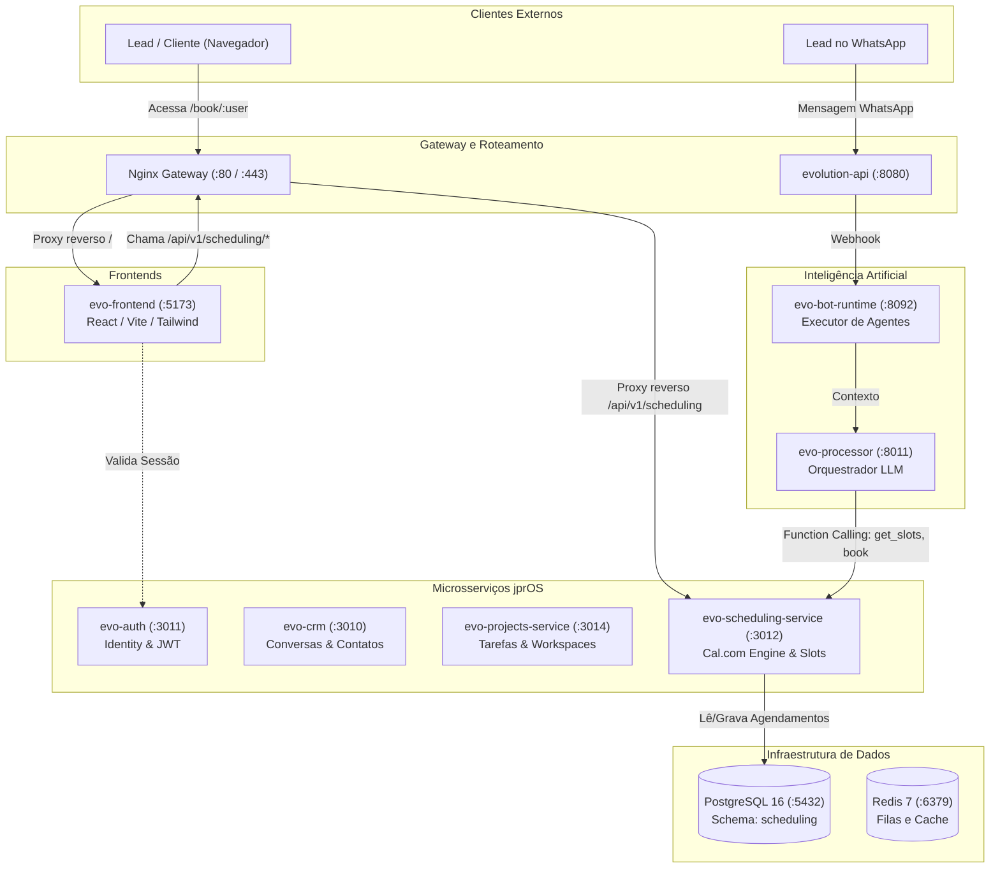
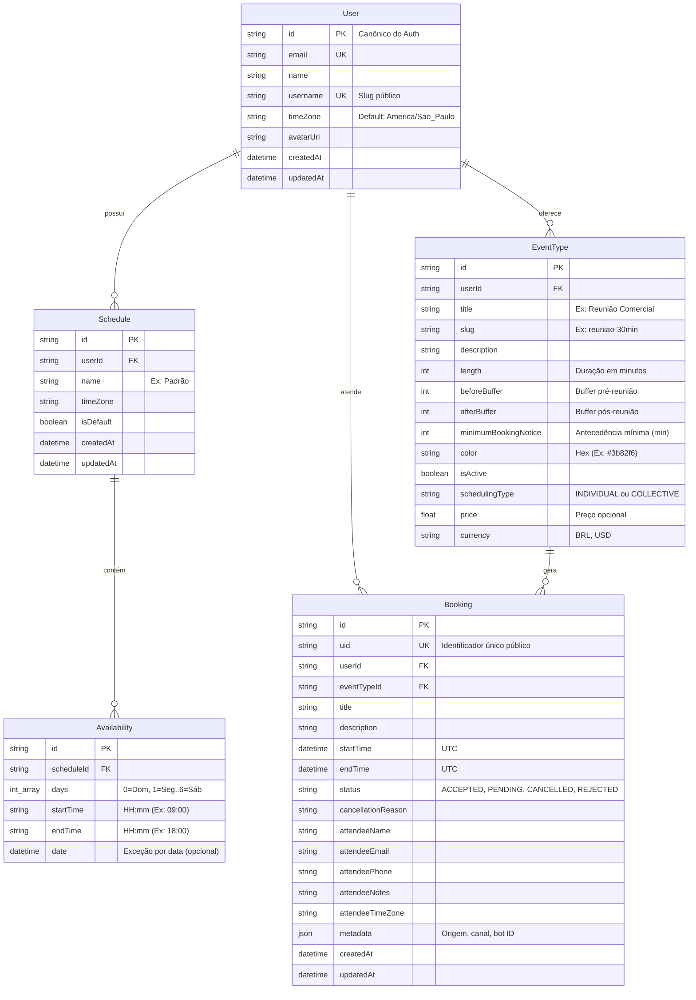
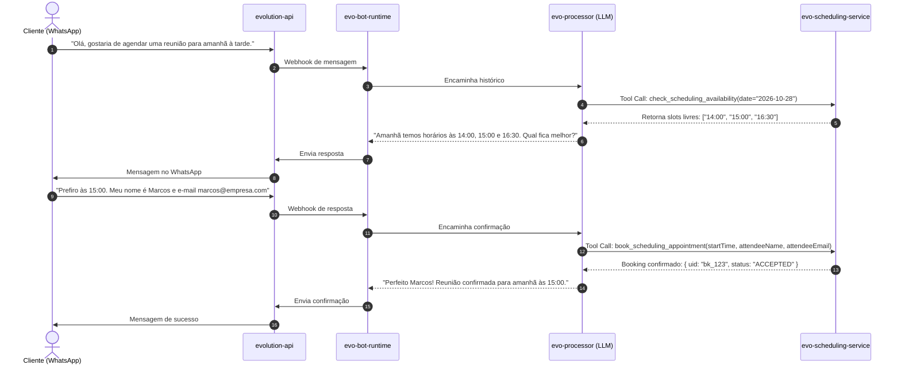

# Especificação Técnica Completa: Módulo de Agendamentos (`evo-scheduling-service`)

> **Documento Oficial de Engenharia e Mapeamento Arquitetural**  
> **Ecossistema:** jprOS (Evolution CRM Community Fork)  
> **Módulo:** Agenda / Agendamentos Headless  
> **Submódulo Git:** `evo-scheduling-service` (`https://github.com/jeanpierreribeiro/evo-scheduling-service.git`)  
> **Sessão de Criação:** `a6aef2c2-f7ef-4310-95c1-fb618489cc1a`  
> **Fonte de Referência:** Cal.com Engine (`C:\Users\pi3rr3\Documents\Projetos\cal.diy`)  
> **Status:** Concluído, Operacional em Produção/Dev e Versionado no GitHub

---

## 1. Visão Geral e Paradigma Headless

O módulo de **Agendamentos (`evo-scheduling-service`)** do ecossistema **jprOS** foi concebido para fornecer uma experiência de agendamento de reuniões, consultas e demonstrações comerciais comparável ao **Cal.com**, mantendo a arquitetura do jprOS extremamente leve, modular e desacoplada.

### O Paradigma Headless
Em vez de importar o monorepo do Cal.com (com Next.js, dezenas de dependências pesadas e banco próprio), adotamos o **Paradigma Headless**:
1. **Engine & API Dedicadas (`evo-scheduling-service`)**:
   - Microsserviço ultrarrápido em Node.js 20, TypeScript, Fastify e Prisma ORM.
   - Porta a lógica pura de disponibilidade, cálculo determinístico de slots, sobreposições de intervalos, buffers pré/pós e bloqueio anti-conflito do Cal.com.
   - Conecta-se ao PostgreSQL unificado do jprOS utilizando o schema dedicado `scheduling` (`?schema=scheduling`).
2. **Interface 100% Nativa (`evo-ai-frontend-community`)**:
   - Telas administrativas perfeitamente integradas ao Design System do Evo CRM (Menu Principal lateral + Drawer Secundário Retrátil).
   - Páginas públicas responsivas (`/book/:username` e `/book/:username/:eventSlug`) com suporte a temas claro/escuro.
3. **Disponibilização para IA & WhatsApp (`evo-bot-runtime` & `evolution-api`)**:
   - Endpoints otimizados e esquemas de Function Calling prontos para agentes autônomos no WhatsApp agendarem reuniões em linguagem natural.

---

## 2. Posicionamento no Ecossistema jprOS

O `evo-scheduling-service` opera como um serviço de primeira classe na malha de microsserviços do jprOS, orquestrado pelo Docker Compose e protegido pelo proxy reverso Nginx.



### Matriz de Rede e Portas
| Serviço | Container Docker | Porta Interna | Porta Host Local | Rota Nginx | Descrição |
|---|---|---|---|---|---|
| **evo-scheduling** | `jpros-evo-scheduling-1` | `3002` | `3012` | `/api/v1/scheduling/*` | Microsserviço de slots e bookings |
| **evo-frontend** | `jpros-evo-frontend-1` | `80` | `5173` | `/` e `/book/*` | Interface administrativa e páginas públicas |
| **postgres** | `jpros-postgres-1` | `5432` | `55434` | Direto | Banco com schema `scheduling` |
| **nginx** | `jpros-nginx-1` | `80` / `443` | `80` / `443` | Ingress | Roteador e proxy unificado |

---

## 3. Modelagem de Dados (Prisma ORM & PostgreSQL)

O modelo de dados reside em `evo-scheduling-service/prisma/schema.prisma` e opera isolado dentro do schema PostgreSQL `scheduling`.



### Detalhes das Entidades
1. **`User`**: Sincronizado do usuário principal do jprOS via rota `/api/v1/scheduling/users/sync`. O campo `username` serve como identificador de URL pública (`/book/:username`).
2. **`Schedule` & `Availability`**: Inspirados no Cal.com. A disponibilidade é semanal (array de inteiros `days` onde `0` é Domingo até `6` para Sábado) com horários de início e término (`HH:mm`), permitindo múltiplos blocos por dia (ex: 09:00-12:00 e 13:00-18:00).
3. **`EventType`**: Define as regras do serviço: duração (`length`), intervalo antes (`beforeBuffer`), intervalo depois (`afterBuffer`) e tempo mínimo de antecedência (`minimumBookingNotice`).
4. **`Booking`**: Registra o agendamento em UTC com validação estrita anti-conflito.

---

## 4. Engine de Disponibilidade & Cálculo de Slots

A engine está implementada em `evo-scheduling-service/src/engine/slots.ts` e utiliza `dayjs` com os plugins `utc` e `timezone`.

### Algoritmo Determinístico de Cálculo:
```
1. Recebe: Data solicitada (YYYY-MM-DD), EventType e Schedule do atendente.
2. Identifica o dia da semana da data solicitada no fuso horário do atendente.
3. Localiza os blocos de Availability cadastrados para aquele dia da semana.
4. Gera a grade base de intervalos candidatos com passo = eventType.length:
   Slot_i = [startTime + i * length, startTime + (i + 1) * length]
5. Filtra slots no passado em relação ao horário corrente (now() + minimumBookingNotice).
6. Para cada slot candidato, aplica as verificações de conflito contra Bookings existentes:
   - Expande os bloqueios dos agendamentos existentes adicionando:
     [booking.startTime - eventType.beforeBuffer, booking.endTime + eventType.afterBuffer]
   - Se o slot candidato interceptar qualquer intervalo bloqueado, ele é descartado.
7. Retorna a lista de slots disponíveis formatados tanto em UTC quanto no fuso horário do usuário.
```

### Validação por Testes Unitários
O arquivo `evo-scheduling-service/tests/slots.test.ts` implementa testes unitários que garantem a exatidão do cálculo de slots:
- Geração de slots no intervalo de trabalho padrão (ex: 09:00 às 17:00 com reuniões de 30 minutos).
- Remoção de horários que colidem com agendamentos existentes com status `ACCEPTED`.
- Respeito aos buffers pré e pós reunião (impedindo agendamentos adjacentes colados).
- Supressão de horários retroativos.

---

## 5. Especificação das Rotas REST (API Reference)

Todas as rotas são prefixadas por `/api/v1/scheduling`.

### 5.1 Rotas Administrativas e do Painel

#### `GET /api/v1/scheduling/slots`
Calcula os horários livres para uma data específica.
- **Query Params:**
  - `userId` (opcional se fornecido `username`)
  - `username` (slug do atendente)
  - `eventTypeId` ou `eventSlug` (identificador do serviço)
  - `date` (`YYYY-MM-DD`)
  - `timeZone` (ex: `America/Sao_Paulo`)
- **Exemplo de Resposta:**
```json
{
  "date": "2026-10-27",
  "timeZone": "America/Sao_Paulo",
  "slots": [
    {
      "time": "2026-10-27T14:00:00.000Z",
      "startTime": "2026-10-27T14:00:00.000Z",
      "endTime": "2026-10-27T14:30:00.000Z",
      "formattedTime": "11:00"
    },
    {
      "time": "2026-10-27T14:30:00.000Z",
      "startTime": "2026-10-27T14:30:00.000Z",
      "endTime": "2026-10-27T15:00:00.000Z",
      "formattedTime": "11:30"
    }
  ]
}
```

#### `GET /api/v1/scheduling/bookings`
Lista os agendamentos registrados.
- **Query Params:** `userId`, `status` (`ACCEPTED`, `PENDING`, `CANCELLED`), `from`, `to`, `limit`, `offset`.
- **Exemplo de Resposta:**
```json
{
  "total": 1,
  "limit": 50,
  "offset": 0,
  "data": [
    {
      "id": "cm3b1...",
      "uid": "bk_abc123",
      "title": "Reunião de Diagnóstico",
      "startTime": "2026-10-27T14:00:00.000Z",
      "endTime": "2026-10-27T14:30:00.000Z",
      "status": "ACCEPTED",
      "attendeeName": "Carlos Silva",
      "attendeeEmail": "carlos@exemplo.com",
      "eventType": {
        "title": "Reunião 30min",
        "color": "#3b82f6"
      }
    }
  ]
}
```

#### `POST /api/v1/scheduling/bookings`
Efetiva uma nova reserva com bloqueio anti-conflito.
- **Body:**
```json
{
  "userId": "eab2e18f-0f79-41be-a905-213ecb556574",
  "eventTypeId": "cm3et1...",
  "title": "Reunião de Demonstração",
  "startTime": "2026-10-27T14:00:00.000Z",
  "endTime": "2026-10-27T14:30:00.000Z",
  "attendeeName": "Carlos Silva",
  "attendeeEmail": "carlos@exemplo.com",
  "attendeePhone": "+5531999999999",
  "attendeeNotes": "Dúvidas sobre o jprOS",
  "metadata": {
    "channel": "whatsapp",
    "source": "evo-bot-runtime"
  }
}
```
- **Retorno de Erro em caso de Conflito (HTTP 409):**
```json
{
  "error": "O horário selecionado não está mais disponível ou colide com outro agendamento."
}
```

#### `PATCH /api/v1/scheduling/bookings/:id`
Reagenda ou cancela um agendamento.
- **Body para Cancelamento:**
```json
{
  "status": "CANCELLED",
  "cancellationReason": "Imprevisto pelo cliente"
}
```
- **Body para Reagendamento:**
```json
{
  "startTime": "2026-10-28T15:00:00.000Z",
  "endTime": "2026-10-28T15:30:00.000Z"
}
```

#### `GET` e `PUT /api/v1/scheduling/schedules/:userId`
Consulta e atualiza a grade de trabalho semanal do atendente.
- **Body do `PUT`:**
```json
{
  "name": "Horário Comercial",
  "timeZone": "America/Sao_Paulo",
  "availabilities": [
    { "days": [1, 2, 3, 4, 5], "startTime": "09:00", "endTime": "12:00" },
    { "days": [1, 2, 3, 4, 5], "startTime": "13:30", "endTime": "18:00" }
  ]
}
```

#### `GET`, `POST`, `PATCH`, `DELETE /api/v1/scheduling/event-types`
CRUD completo dos tipos de serviços/reuniões.

#### `POST /api/v1/scheduling/users/sync`
Garante a existência e sincronização do usuário logado na base do agendamento:
```json
{
  "id": "eab2e18f-0f79-41be-a905-213ecb556574",
  "email": "jeanpierreribeiro.br@gmail.com",
  "name": "Jean Pierre Gomes",
  "username": "jeanpierreribeiro-br"
}
```

### 5.2 Rotas Públicas (Acesso Anônimo)
- `GET /api/v1/scheduling/public/:username`: Retorna perfil do atendente e lista de `eventTypes` ativos.
- `GET /api/v1/scheduling/public/:username/:eventSlug`: Retorna detalhes do serviço e dados do atendente para a montagem do calendário público.

---

## 6. Integração no Frontend (`evo-ai-frontend-community`)

### 6.1 Estrutura de Código Criada
```
evo-ai-frontend-community/
├── src/
│   ├── components/
│   │   └── layout/
│   │       └── config/
│   │           └── menuItems.ts           # Item 📅 Agenda com subitens retráteis
│   ├── pages/
│   │   └── scheduling/
│   │       ├── BookingsPage.tsx           # Visão de Compromissos (Filtros, Ações)
│   │       ├── EventTypesPage.tsx         # Gestão de Tipos de Eventos (Cards, Duração)
│   │       ├── AvailabilityPage.tsx       # Editor de Grade Semanal e Fusos
│   │       ├── PublicPreviewPage.tsx      # Prévia e Cópia de Links Públicos
│   │       └── public/
│   │           ├── PublicProfilePage.tsx  # /book/:username (Landing page do atendente)
│   │           └── PublicBookingPage.tsx  # /book/:username/:eventSlug (Slots + Formulário)
│   ├── services/
│   │   └── scheduling/
│   │       ├── schedulingApi.ts           # Cliente Axios configurado com baseURL
│   │       └── schedulingService.ts       # Funções tipadas de consumo da API
│   ├── types/
│   │   └── scheduling/
│   │       └── index.ts                   # Interfaces TypeScript (Booking, Slot, EventType)
│   ├── guards/
│   │   └── RouterGuard.tsx                # Exceções de rota pública para usuários logados
│   ├── routes/
│   │   ├── PublicRoute.tsx                # Exceção de bypass de autenticação
│   │   └── index.tsx                      # Declaração das rotas no React Router
│   └── contexts/
│       └── AuthContext.tsx                # Supressão de verificação de token para visitantes
```

### 6.2 O Segredo dos Guardas de Rota do Evo CRM (Alerta para Desenvolvedores)
> [!IMPORTANT]
> **Comportamento Nativo do Evo CRM:**  
> O sistema possui uma proteção rígida em `RouterGuard.tsx` e `PublicRoute.tsx`: se um usuário logado no CRM tentar acessar rotas públicas convencionais (como `/login` ou `/auth`), ele é imediatamente redirecionado para `/conversations`.
> 
> Para que páginas públicas que o próprio atendente precisa abrir/testar (como formulários `/f/`, chats `/chat/` e agendamentos `/book/`) funcionem sem redirecionamento:
> 1. Em `RouterGuard.tsx`: A rota deve constar obrigatoriamente tanto em `SPECIAL_ROUTES.PUBLIC_ROUTES` quanto em `SPECIAL_ROUTES.AUTH_EXEMPT_ROUTES`.
> 2. Em `PublicRoute.tsx`: Deve haver a exceção explícita `location.pathname.startsWith('/book')` para retornar `<>{children}</>` sem disparar `<Navigate to="/" replace />`.
> 3. Em `AuthContext.tsx`: Adicionar `window.location.pathname.startsWith('/book')` para que visitantes anônimos não causem erros de validação de sessão 401.

### 6.3 Injeção de Variáveis em Runtime (Docker & Vite)
No frontend do jprOS, o build do Vite não recebe variáveis estáticas compiladas. O container substitui placeholders em tempo de inicialização via `docker-entrypoint.sh`.
- No `Dockerfile`:
  ```dockerfile
  ENV VITE_SCHEDULING_API_URL=VITE_SCHEDULING_API_URL_PLACEHOLDER
  ```
- No `docker-entrypoint.sh`:
  ```bash
  [ -n "$VITE_SCHEDULING_API_URL" ] && sed -i "s|VITE_SCHEDULING_API_URL_PLACEHOLDER|${VITE_SCHEDULING_API_URL}|g" "$file"
  ```
- No `schedulingApi.ts`:
  ```typescript
  const rawBaseUrl = import.meta.env.VITE_SCHEDULING_API_URL || 'http://localhost:3012';
  const baseURL = rawBaseUrl.endsWith('/api/v1/scheduling')
    ? rawBaseUrl
    : `${rawBaseUrl.replace(/\/+$/, '')}/api/v1/scheduling`;
  ```

---

## 7. Integração com Agentes de IA e WhatsApp

A integração com agentes autônomos no WhatsApp (`evo-bot-runtime` e `evolution-api`) está documentada em `evo-scheduling-service/docs/AI_AGENT_INTEGRATION.md` e os schemas em `evo-scheduling-service/docs/ai-tools.json`.

### Fluxo de Agendamento por Conversa:


### Ferramentas Catalogadas em `ai-tools.json`:
1. `list_event_types`: Lista os tipos de serviços disponíveis (id, slug, título, duração).
2. `check_scheduling_availability`: Consulta os horários disponíveis em uma data.
3. `book_scheduling_appointment`: Cria o agendamento no banco anti-conflito.
4. `cancel_scheduling_appointment`: Cancela um agendamento existente pelo `bookingId`.

---

## 8. Guia de Manutenção e Extensão para Novos Agentes

Se outro agente de IA ou desenvolvedor precisar estender este módulo, deve seguir rigorosamente as etapas abaixo:

### 8.1 Alterações no Banco de Dados (Prisma)
1. Modifique `evo-scheduling-service/prisma/schema.prisma`.
2. Gere o cliente Prisma:
   ```bash
   cd evo-scheduling-service
   npx prisma generate
   ```
3. Sincronize o banco de dados de desenvolvimento:
   ```bash
   # Dentro do container ou localmente com DATABASE_URL apontando para o Postgres:
   docker compose exec evo-scheduling npx prisma db push
   ```

### 8.2 Execução de Testes Unitários
Antes de commitar qualquer alteração no cálculo de slots ou na lógica de buffers:
```bash
cd evo-scheduling-service
npm test
```
*Todos os testes em `tests/slots.test.ts` devem permanecer 100% verdes.*

### 8.3 Reconstrução dos Containers
Sempre que fizer alterações no código do microsserviço ou no frontend:
```bash
# Rebuild apenas do serviço de agendamento:
docker compose up -d --no-deps --build evo-scheduling

# Rebuild apenas do frontend:
docker compose up -d --no-deps --build evo-frontend
```

### 8.4 Próximas Extensões Planejadas no Roadmap:
- **Sincronização Bidirecional com Google Calendar / Outlook**:
  - Salvar tokens OAuth na tabela `User` ou criar tabela `ConnectedCalendar`.
  - Consultar eventos do calendário externo dentro de `src/engine/slots.ts` para bloquear horários da agenda pessoal do atendente.
- **Cobranças Nativas no Agendamento**:
  - Integração com Stripe / Mercado Pago via campos `price` e `currency` de `EventType`.
- **Agendamento Round-Robin (Equipes)**:
  - Distribuir leads entre atendentes de uma mesma equipe conforme menor número de agendamentos no dia.
