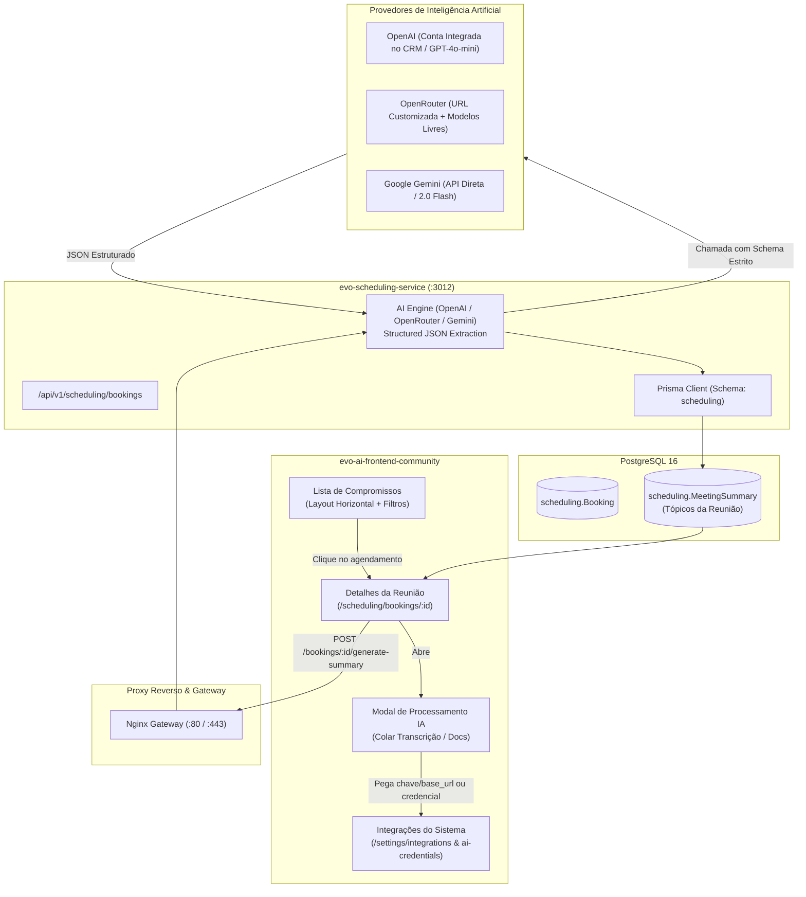
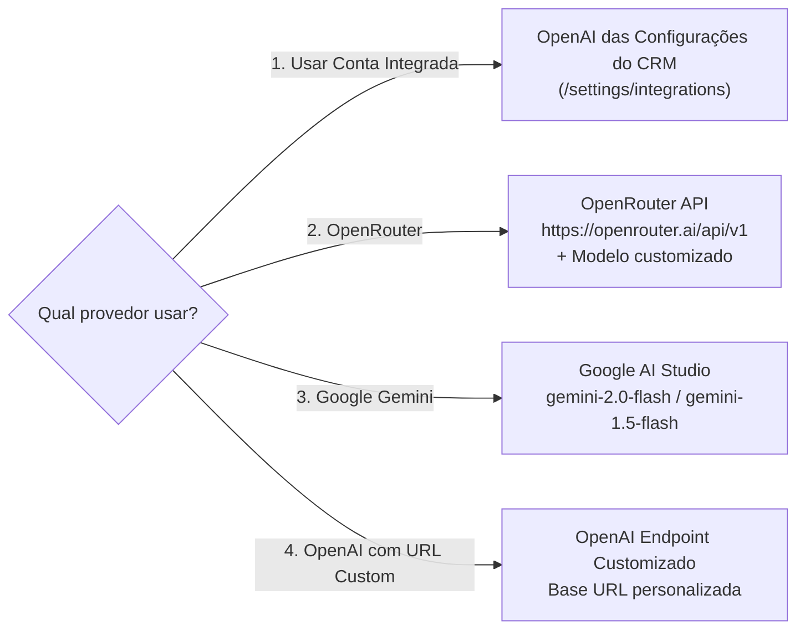

# Planejamento e Especificação Técnica: Ajustes da Agenda & Inteligência de Reuniões

> **Ecossistema:** jprOS (Evolution CRM Community Fork)  
> **Módulos Envolvidos:** `evo-scheduling-service` (Backend) & `evo-ai-frontend-community` (Frontend)  
> **Status:** Especificado / Pronto para Execução  
> **Referências de Design & UX:**
> - Listagem e Detalhes da Reunião da Tsuria (`https://chat.tsuria.com.br/operacao/reunioes`)
> - Motor Headless de Agendamentos Cal.com (`C:\Users\pi3rr3\Documents\Projetos\cal.diy`)
> - Hub de Integrações e Credenciais de IA do Evo CRM (`/settings/integrations` & `/settings/ai-credentials`)

---

## 1. Visão Geral e Objetivos do Projeto

O submódulo de **Agenda** do jprOS passará por uma evolução estrutural com dois grandes objetivos:

1. **Refatoração da Visão de Compromissos (`/scheduling/bookings`)**:
   - Transição do layout de grade com cards curtos para uma **lista vertical executiva (linhas horizontais full-width)**.
   - Implementação de **filtros avançados** no topo: intervalo de datas (`De` / `Até`), `Tipo de Evento` e `Busca Textual` por título, cliente, e-mail ou telefone.
2. **Página de Detalhes da Reunião com IA (`/scheduling/bookings/:id`)**:
   - Criação de tela dedicada para cada reunião.
   - Processamento de transcrições e resumos gerados pelo Gemini / Google Meet através de modelos de LLM (OpenAI, OpenRouter ou Google Gemini com suporte a `baseURL` customizada).
   - Extração automática e persistência em banco da seção **"Tópicos da Reunião"** dividida em 8 blocos analíticos.
   - **Escopo delimitado:** A seção de tarefas/pendências foi expressamente excluída deste módulo.

---

## 2. Diagrama Arquitetural da Solução



---

## 3. Especificação do Frontend (`evo-ai-frontend-community`)

### 3.1. Visão de Lista de Compromissos (`BookingsPage.tsx`)

#### A. Barra de Filtros Superior
Seguindo o design da referência da Tsuria:

```
┌────────────────────────────────────────────────────────────────────────────────────────────────────────┐
│ [De: 27/09/2026 📅]   [Até: 27/10/2026 📅]   [Tipo de Evento: Todos ▾]   [🔍 Título, cliente ou e-mail...]│
└────────────────────────────────────────────────────────────────────────────────────────────────────────┘
  [Todos]   [Confirmados]   [Pendentes]   [Cancelados]
```

- **Campo `De` (`startDate`)**: Input date no tema escuro/claro nativo do Evo CRM.
- **Campo `Até` (`endDate`)**: Input date limitando o fim do intervalo.
- **Dropdown `Tipo de Evento`**: Lista os eventos do atendente (ex: *"Reunião de Alinhamento"*, *"Demonstração Comercial"*, *"Suporte"*).
- **Campo `Busca`**: Input de busca rápida em tempo real (debounced) que busca em:
  - Título da reunião.
  - Nome do participante (`attendeeName`).
  - E-mail (`attendeeEmail`).
  - Telefone (`attendeePhone`).
- **Abas de Status**: Pills de atalho rápido mantidas logo abaixo dos inputs (`Todos`, `Confirmados`, `Pendentes`, `Cancelados`).

#### B. Layout dos Itens da Lista (Horizontal Full-Width)
Cada agendamento deixará o grid de 2 colunas e passará a ocupar uma linha horizontal completa:

```
┌─────────────────────────────────────────────────────────────────────────────────────────────────────────┐
│ 📅 seg., 26 de out. de 2026, 09:00 • 🔵 REUNIÃO DE ALINHAMENTO                       [● Confirmado]     │
│                                                                                                         │
│ Reunião de Alinhamento com Teste                                                                        │
│ Observações: "Gostaria de tirar dúvidas sobre a integração com WhatsApp e IA..."                       │
│                                                                                                         │
│ 👤 Carlos Silva   ✉️ carlos@exemplo.com   📱 31985444371 (WhatsApp)              [Ver Detalhes / IA ↗] │
│                                                                                  [Reagendar] [Cancelar] │
└─────────────────────────────────────────────────────────────────────────────────────────────────────────┘
```

- **Clique no Card/Linha**: Navega diretamente para a nova tela de detalhes: `/scheduling/bookings/:id`.
- **Atalho WhatsApp**: O número de telefone renderiza link direto `https://wa.me/55...` abrindo o WhatsApp do atendente.
- **Badges de Status**:
  - `Confirmado`: Fundo verde translúcido + texto verde + ponto verde.
  - `Pendente`: Fundo âmbar translúcido + texto âmbar + ponto âmbar.
  - `Cancelado`: Fundo vermelho translúcido + texto vermelho + motivo do cancelamento exposto.

---

### 3.2. Nova Tela de Detalhes da Reunião (`BookingDetailPage.tsx`)

Rota: `/scheduling/bookings/:id` (declarada no React Router e com exceções nos guards).

#### A. Cabeçalho da Página
- Botão `← Voltar para reuniões`.
- **Título da Reunião**: Texto com tipografia H1 e botão de edição inline (lápis) para renomear caso necessário.
- **Data e Hora**: `📅 26/10/2026, 18:43`.
- **Links Externos de Referência (Canto Superior Direito)**:
  - Botão `✨ Resumo completo ↗`: Abre em nova aba o link do Google Docs do resumo (se cadastrado).
  - Botão `📄 Transcrição ↗`: Abre em nova aba o link da transcrição bruta (se cadastrado).
  - Botão `⚙️ Gerar / Atualizar Tópicos com IA`: Dispara o modal de processamento.

#### B. Seção "✨ Tópicos da Reunião"
Renderiza exatamente os 8 blocos de inteligência extraídos:

1. **ASSUNTO**:
   - Card com borda sutil contendo um parágrafo objetivo com o escopo e o tema da conversa.
2. **PARTICIPANTES**:
   - Badges/pills com ícone de usuário para cada participante identificado (`👤 Rubem`, `👤 Henrique`, `👤 Jean`).
3. **PRINCIPAIS PONTOS**:
   - Lista em marcadores (bullets) detalhando as discussões mais relevantes.
4. **DECISÕES**:
   - Lista em marcadores com as resoluções, definições e alinhamentos finais.
5. **APRENDIZADOS**:
   - Lista em marcadores com insights, recomendações preventivas ou lições contratuais/operacionais.
6. **FATOS E NÚMEROS**:
   - Lista em marcadores destacando valores financeiros (R$), prazos, alíquotas de impostos, quantidades e datas.
7. **PRÓXIMOS PASSOS**:
   - Lista em marcadores das ações práticas de quem faz o quê e prazos.
8. **CLIENTES E PROJETOS CITADOS**:
   - Badges/pills com nomes de clientes, parceiros ou projetos citados durante a conversa.

---

## 4. Integração com Provedores de IA (OpenAI, OpenRouter e Gemini)

O usuário poderá escolher a origem da inferência de acordo com a sua preferência:

### 4.1. Estratégia Híbrida de Conexão



1. **Opção 1: Conta OpenAI Integrada no Evo CRM (`/settings/integrations`)**:
   - O sistema recupera a credencial de IA registrada na conta (`integration_hooks` / `ai_api_keys`).
   - Se configurada, o usuário pode utilizá-la com um clique, sem precisar redigitar chaves.
2. **Opção 2: OpenRouter com URL Personalizada**:
   - Chave API do OpenRouter (`sk-or-...`).
   - Base URL padrão: `https://openrouter.ai/api/v1` (com suporte a customização).
   - Permite escolher modelos de ponta com custo reduzido (ex.: `google/gemini-2.0-flash-exp:free`, `anthropic/claude-3.5-sonnet`, `meta-llama/llama-3.3-70b-instruct`).
3. **Opção 3: Google Gemini API Direta**:
   - Chave da Google AI Studio (`AIzaSy...`).
   - Base URL oficial ou proxy dedicado.
   - Modelo padrão: `gemini-2.0-flash` (otimizado para grandes volumes de contexto de transcrições).
4. **Opção 4: Endpoint OpenAI-Compatible Customizado**:
   - Permite apontar para qualquer proxy local, vLLM, Ollama, LM Studio ou Gateway corporativo.

---

## 5. Modelagem de Dados no Backend (`evo-scheduling-service`)

### 5.1. Atualização do `schema.prisma`

Adicionamos a entidade `MeetingSummary` no schema `scheduling`:

```prisma
model Booking {
  id                 String          @id @default(cuid())
  uid                String          @unique @default(cuid())
  userId             String
  eventTypeId        String?
  title              String
  description        String?         @db.Text
  startTime          DateTime
  endTime            DateTime
  status             BookingStatus   @default(ACCEPTED)
  cancellationReason String?         @db.Text
  attendeeName       String
  attendeeEmail      String
  attendeePhone      String?
  attendeeNotes      String?         @db.Text
  attendeeTimeZone   String?
  metadata           Json?
  createdAt          DateTime        @default(now())
  updatedAt          DateTime        @updatedAt

  user               User            @relation(fields: [userId], references: [id], onDelete: Cascade)
  eventType          EventType?      @relation(fields: [eventTypeId], references: [id], onDelete: SetNull)
  summary            MeetingSummary?

  @@index([userId])
  @@index([startTime])
  @@index([status])
  @@map("bookings")
}

model MeetingSummary {
  id              String   @id @default(cuid())
  bookingId       String   @unique
  booking         Booking  @relation(fields: [bookingId], references: [id], onDelete: Cascade)

  // Links externos opcionais (Google Docs / Drive)
  summaryUrl      String?  @db.Text
  transcriptUrl   String?  @db.Text

  // Conteúdo estruturado extraído pela IA
  subject         String?  @db.Text
  participants    String[] // Nomes dos participantes
  mainPoints      String[] // Bullets dos tópicos principais
  decisions       String[] // Bullets de acordos e deliberações
  learnings       String[] // Bullets de aprendizados e lições
  factsAndNumbers String[] // Bullets de valores, datas e dados quantitativos
  nextSteps       String[] // Bullets de quem faz o quê e prazos
  citedEntities   String[] // Badges de clientes ou projetos citados

  // Histórico e auditoria
  rawContent      String?  @db.Text // Transcrição original fornecida
  aiProvider      String?  // 'openai' | 'openrouter' | 'gemini' | 'custom'
  aiModel         String?  // Ex: 'gpt-4o-mini', 'gemini-2.0-flash'
  createdAt       DateTime @default(now())
  updatedAt       DateTime @updatedAt

  @@map("meeting_summaries")
}
```

---

## 6. Especificação das Rotas da API (`evo-scheduling-service`)

### 6.1. `GET /api/v1/scheduling/bookings` (Com Novos Filtros)
- **Query Params Suportados:**
  - `userId` (string)
  - `status` (`ACCEPTED`, `PENDING`, `CANCELLED`, `REJECTED`)
  - `from` (string ISO ou YYYY-MM-DD)
  - `to` (string ISO ou YYYY-MM-DD)
  - `eventTypeId` (string)
  - `search` (string): Busca com `mode: 'insensitive'` no título, `attendeeName`, `attendeeEmail` e `attendeePhone`.
  - `limit` (número, default 50)
  - `offset` (número, default 0)

### 6.2. `GET /api/v1/scheduling/bookings/:id`
- Retorna o agendamento completo com seu `eventType`, dados do `user` e a relação `summary`.

### 6.3. `POST /api/v1/scheduling/bookings/:id/summary/generate`
Gera os tópicos da reunião através do motor de IA.
- **Request Body:**
```json
{
  "rawText": "Texto completo da transcrição ou resumo da reunião...",
  "summaryUrl": "https://docs.google.com/document/d/1lyd.../edit",
  "transcriptUrl": "https://docs.google.com/document/d/1yRi.../edit",
  "aiConfig": {
    "provider": "openrouter",
    "apiKey": "sk-or-v1-...",
    "baseUrl": "https://openrouter.ai/api/v1",
    "model": "google/gemini-2.0-flash-exp:free"
  }
}
```
- **Processamento:**
  - Valida o schema da requisição.
  - Envia para a API configurada com prompt de sistema forçando o retorno estrito em JSON (`response_format: { type: "json_object" }`).
  - Salva ou atualiza os dados na tabela `MeetingSummary`.
  - Retorna o objeto persistido.

### 6.4. `PUT /api/v1/scheduling/bookings/:id/summary`
Permite edição manual de qualquer campo dos tópicos ou dos links externos.

---

## 7. Prompt e Schema de Extração da Inteligência Artificial

O prompt de sistema é projetado para garantir exatidão, sem criar tarefas nem alucinações:

### 7.1. System Prompt
```markdown
Você é um assistente de inteligência executiva especializado em analisar reuniões de negócios.
Sua função é ler a transcrição/resumo fornecido e extrair estritamente os tópicos da reunião no formato JSON definido.

Diretrizes obrigatórias:
1. Responda APENAS em JSON válido, sem texto introdutório ou markdown externo.
2. Seja claro, factual e profissional.
3. Não crie tarefas automáticas ou gerenciamento de pendências.
4. Não invente nomes ou informações que não estejam explícitas no texto.

Campos requeridos:
- subject: Resumo conciso do assunto da reunião em 1 parágrafo.
- participants: Lista com os nomes dos participantes identificados.
- mainPoints: Lista em bullets dos tópicos e discussões principais.
- decisions: Lista de decisões e acordos tomados.
- learnings: Lições aprendidas, boas práticas e recomendações citadas.
- factsAndNumbers: Dados quantitativos, valores em R$, porcentagens, alíquotas e datas mencionadas.
- nextSteps: Ações combinadas de quem faz o quê e prazos acordados.
- citedEntities: Nomes de clientes, empresas parceiras ou projetos mencionados.
```

### 7.2. JSON Schema de Retorno
```json
{
  "subject": "Alinhamento entre sócios sobre minuta de contrato e divisão de dividendos.",
  "participants": ["Rubem", "Henrique", "Jean"],
  "mainPoints": [
    "Estruturação da minuta do contrato para o projeto do aplicativo.",
    "Alinhamento sobre validação jurídica com o advogado do cliente."
  ],
  "decisions": [
    "Entregar a minuta já estruturada para validação rápida.",
    "Adotar cláusula de confidencialidade bilateral."
  ],
  "learnings": [
    "Entregar minutas prontas reduz custos advocatícios de pesquisa ampla."
  ],
  "factsAndNumbers": [
    "Alíquota de 6% sobre o valor do projeto.",
    "Valor líquido de R$ 7.893,18 dividido entre 3 sócios.",
    "Prazo final acordado para envio até 11h de 27/10/2026."
  ],
  "nextSteps": [
    "Jean realizar as alterações na minuta na manhã de 27/10/2026.",
    "Rubem e Henrique enviarem cartões CNPJ."
  ],
  "citedEntities": ["Gleison", "RS Refrigeração", "MG Bus & Facin"]
}
```

---

## 8. Plano de Execução em Fases Incrementais

A implementação será executada de forma modular, permitindo testes a cada etapa:

### Fase 1: Refatoração da Lista de Compromissos (`/scheduling/bookings`)
1. Implementação dos parâmetros `search`, `from`, `to` e `eventTypeId` em `bookings.routes.ts`.
2. Criação do componente de filtros no topo de [BookingsPage.tsx](file:///c:/Users/pi3rr3/Documents/Projetos/jprOS/evo-ai-frontend-community/src/pages/scheduling/BookingsPage.tsx).
3. Substituição do grid de cards pela lista em linhas horizontais full-width.
4. Adição de links do WhatsApp e botão para abrir detalhes da reunião.

### Fase 2: Modelagem e Motor de IA no Backend (`evo-scheduling-service`)
1. Adição da tabela `MeetingSummary` no [schema.prisma](file:///c:/Users/pi3rr3/Documents/Projetos/jprOS/evo-scheduling-service/prisma/schema.prisma) e execução de `prisma db push`.
2. Implementação do serviço de IA com suporte flexível:
   - OpenAI (nativo / custom baseUrl).
   - OpenRouter (com custom baseUrl e escolha de modelo).
   - Google Gemini (API oficial).
3. Criação dos endpoints `POST /bookings/:id/summary/generate`, `GET /bookings/:id/summary` e `PUT /bookings/:id/summary`.

### Fase 3: Criação da Tela de Detalhes da Reunião no Frontend
1. Criação do componente `src/pages/scheduling/BookingDetailPage.tsx`.
2. Registro da rota `/scheduling/bookings/:id` com proteção no `RouterGuard`.
3. Construção visual dos 8 blocos de **Tópicos da Reunião** no padrão escuro idêntico à referência da Tsuria.
4. Adição dos botões de links externos (`✨ Resumo completo ↗` e `📄 Transcrição ↗`).

### Fase 4: Modal de Conexão de IA e Integração com Configurações
1. Criação do modal para colar o texto da transcrição ou fornecer o link do documento.
2. Integração com a conta OpenAI existente em `/settings/integrations` (ou input para OpenRouter/Gemini com Base URL).
3. Testes end-to-end com uma transcrição real e validação da persistência em banco.
