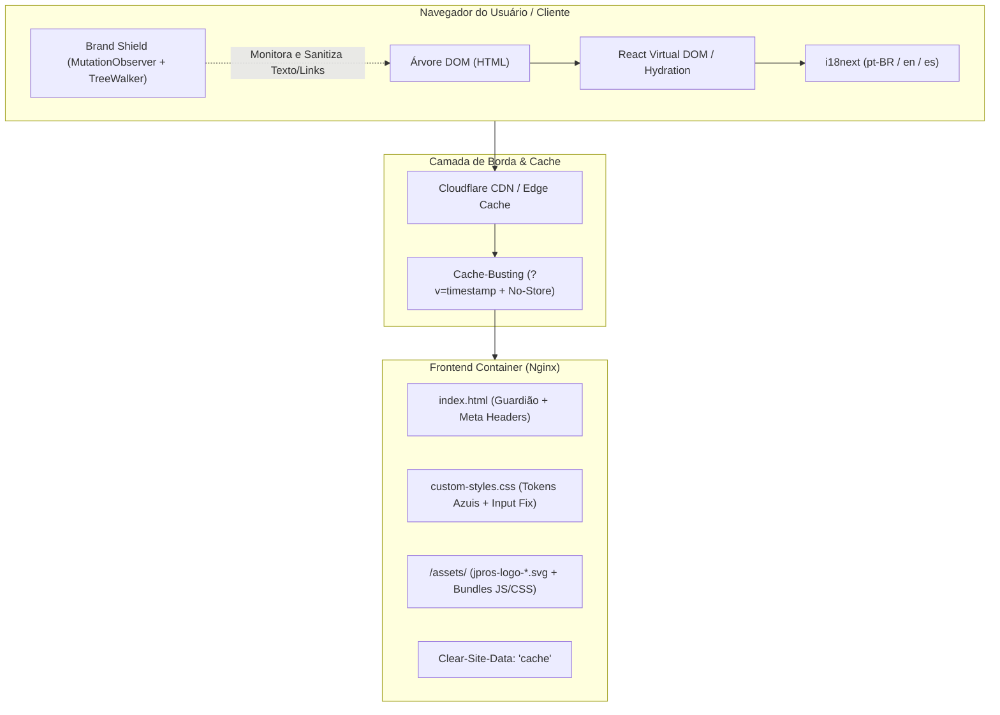

# System Design: Camada de Identidade Visual Proprietária (White-Label) & Brand Shield no jprOS

> **Documento:** Arquitetura do Sistema e Especificação Técnica de White-Label  
> **Status:** Aprovado e Homologado em Produção  
> **Versão:** 1.0.0 (jprOS Edition)  
> **Data:** Novembro de 2026  
> **Autor / Mantenedor:** Jean Pierre Ribeiro  

---

## 1. Visão Geral e Requisitos de Negócio

### 1.1 Contexto
O **jprOS** utiliza o núcleo de código aberto do Evolution Platform (`evo-crm-community`). Para distribuição comercial, demonstrações com clientes corporativos e operação enterprise, é um **requisito inegociável de negócio** desvincular 100% da identidade visual, nomes, logos, links de documentação e contatos da marca mantenedora original (*Evo CRM* / *Evolution Foundation*).

### 1.2 Requisitos Funcionais (FR)
- **FR-01 (Identidade Vetorial)**: Substituir todos os logotipos matriciais e vetoriais pelo logotipo oficial em vetor SVG do **jprOS** (suporte nativo a tema escuro e tema claro, além de favicon próprio).
- **FR-02 (Paleta de Cores da Marca)**: O verde neon/esmeralda padrão (`#00ffa7` / oklch 150-160) deve ser substituído pelo azul degradê da marca jprOS (`#3B82F6` com hover `#2563EB`).
- **FR-03 (Destaque Ativo de Navegação)**: O menu lateral ativo deve apresentar fundo translúcido em tom azul (`rgba(59, 130, 246, 0.15)`) e borda indicadora lateral `#3B82F6`.
- **FR-04 (Higienização de Rodapé & Copyright)**: 
  - Texto padrão: `jprOS © [Ano Atual] jprOS. Todos os direitos reservados.`.
  - Remoção total dos links para documentação externa (`https://docs.evolutionfoundation.com.br/`) e do WhatsApp de suporte externo.
- **FR-05 (Consistência Multilíngue)**: A higienização de marca deve ter efeito idêntico independentemente do idioma ativo da interface (`pt-BR`, `pt`, `en`, `es`, `fr`, `it`).
- **FR-06 (Base de Demonstração / Seeding)**: Capacidade de popular o ambiente com dados ricos (agentes de IA, funis, produtos, contatos, conversas e eventos de métricas de 14 dias) para demonstrações ao vivo sem depender de clientes reais.

### 1.3 Requisitos Não-Funcionais (NFR)
- **NFR-01 (Zero Regressão de Usabilidade em Formulários)**: A substituição de cores não pode, sob nenhuma hipótese, ofuscar ou alterar o contraste dos campos de entrada (`<input>`, `<textarea>`, `<select>`), garantindo digitação e autofill legíveis no Dark Mode.
- **NFR-02 (Bypass de Cache de Borda e Navegador)**: Estratégia de cache-busting agressiva (`Clear-Site-Data: "cache"`, query strings `?v=...`, `Cache-Control: no-cache, no-store, must-revalidate`) para assegurar que nenhum usuário veja o visual antigo por retenção de cache.
- **NFR-03 (Tolerância a Re-hidratação React)**: Interceptação reativa no DOM para prevenir que re-renderizações assíncronas do React ou carregamento tardio de arquivos de i18n tragam de volta os textos antigos.

---

## 2. Diagrama de Arquitetura da Solução



---

## 3. Especificação Detalhada dos Componentes

### 3.1 Camada 1: Ativos Gráficos Vetoriais (SVG Assets)
Os logotipos foram construídos em SVG responsivo e leve, utilizando tipografia nativa e degradê linear:

- **`jpros-logo-dark.svg`**:
  - `jpr` em negrito estilizado com `linearGradient` de `#3B82F6` para `#60A5FA`.
  - `OS` em tipografia branca pura `#FFFFFF`.
  - Ponto de acento azul `#3B82F6`.
- **`jpros-logo-light.svg`**:
  - `jpr` com degradê de `#2563EB` para `#3B82F6`.
  - `OS` em ardósia escura `#0F172A`.
  - Ponto de acento azul `#2563EB`.
- **`favicon.svg`**:
  - Ícone de aba e bookmark escalável a partir da logo dark.

> **Estratégia de Sobrescrita nos Bundles:**
> O instalador renomeia os novos arquivos e executa substituição textual via `sed` diretamente nos arquivos `.js` compilados pelo Vite, substituindo hashes antigos (como `EVO_CRM-BPOP0TvS.svg`) pelos novos caminhos.

---

### 3.2 Camada 2: Design Tokens & Prevenção de Colisão CSS (Input Fix)

#### A Causa Raiz do Bug de Colisão de Classes
No Tailwind v4 utilizado pelo `@evoapi/design-system`, o componente `<Input>` carrega nativamente:
```html
<input class="... selection:bg-primary selection:text-primary-foreground ..." />
```
Se for utilizado um seletor CSS genérico de substring, como:
```css
/* ❌ PROIBIDO: Seletor Perigoso */
[class*="bg-primary"] {
  background-color: #3B82F6 !important;
}
```
O seletor combinará com o atributo `selection:bg-primary` do `<input>`, pintando o interior do campo de **azul sólido** e tornando o texto invisível (visível apenas sob foco ou hover).

#### A Regra de Isolamento Arquitetural (Aprovada)
Os estilos devem isolar explicitamente elementos de formulário e restringir classes utilitárias:

```css
/* ✅ ARQUITETURA CORRETA */

/* 1. Tokens Semânticos Globais */
:root, .dark, html, body, [data-theme] {
  --primary: #3B82F6 !important;
  --primary-foreground: #ffffff !important;
  --color-primary: #3B82F6 !important;
  --color-primary-foreground: #ffffff !important;
  --sidebar-primary: #3B82F6 !important;
  --sidebar-ring: #3B82F6 !important;
}

/* 2. Botões e Elementos Primários (Exceto Inputs) */
button.bg-primary,
.bg-primary:not(input):not(textarea):not(select),
.dark button.bg-primary,
.dark .bg-primary:not(input):not(textarea):not(select),
.bg-\[\#00ffa7\],
.bg-\[\#00FFA7\] {
  background-color: #3B82F6 !important;
  color: #ffffff !important;
}

button.bg-primary:hover,
.hover\:bg-primary\/90:hover:not(input),
.bg-primary:hover:not(input) {
  background-color: #2563EB !important;
  color: #ffffff !important;
}

/* 3. Destaque do Menu Lateral Ativo */
.bg-primary\/10,
.bg-primary\/15,
.bg-primary\/20,
a.bg-primary\/15 {
  background-color: rgba(59, 130, 246, 0.15) !important;
  color: #3B82F6 !important;
  border-left-color: #3B82F6 !important;
}

/* 4. Proteção Absoluta de Campos de Entrada (Dark Mode) */
input:not([type="button"]):not([type="submit"]):not([type="reset"]),
textarea,
select {
  background-color: rgba(255, 255, 255, 0.05) !important;
  color: #f8fafc !important;
  border-color: rgba(255, 255, 255, 0.15) !important;
}

input:not([type="button"]):not([type="submit"]):not([type="reset"]):focus,
textarea:focus,
select:focus {
  background-color: rgba(255, 255, 255, 0.08) !important;
  color: #ffffff !important;
  border-color: #3B82F6 !important;
  outline: none !important;
  box-shadow: 0 0 0 2px rgba(59, 130, 246, 0.25) !important;
}

/* 5. Prevenção de Glitch no Autofill do Navegador */
input:-webkit-autofill,
input:-webkit-autofill:hover, 
input:-webkit-autofill:focus {
  -webkit-text-fill-color: #ffffff !important;
  -webkit-box-shadow: 0 0 0px 1000px #0f172a inset !important;
  transition: background-color 5000s ease-in-out 0s !important;
}
```

---

### 3.3 Camada 3: Brand Shield Reativo no DOM (`index.html`)

Mesmo com bundles estáticos alterados, o React carrega dicionários de tradução dinâmicos (`locales/pt-BR/layout.json`, `locales/en/layout.json`) e renderiza componentes através de hooks (`useLanguage`). Para garantir proteção total em qualquer idioma ou re-renderização assíncrona, foi introduzido o **Brand Shield**:

1. **Expurgo de Links**: Remove automaticamente nós `<a>` contendo referências para `evolutionfoundation.com.br`, suporte whatsapp legado ou termos como `documentação` / `preciso de suporte`.
2. **Sanitização de Texto por TreeWalker**: Varre diretamente nós de texto (`NodeFilter.SHOW_TEXT`), substituindo qualquer instância de `Evo CRM` e `Evolution Foundation` por `jprOS`.
3. **Observer Ativo**: Combina `MutationObserver` (reatividade a mudanças do DOM) com `setInterval(500ms)` de reforço em segundo plano.

---

### 3.4 Camada 4: Infraestrutura & Cache-Busting (Nginx + Cloudflare)

Arquivos JavaScript em SPAs sofrem cacheamento agressivo de borda (por padrão Cloudflare define `max-age=31536000, immutable`). A solução aplica uma estratégia de três frentes:

1. **Header Clear-Site-Data**: Adicionado no Nginx para forçar navegadores a descartarem caches de workers e assets na resposta de `index.html`:
   ```nginx
   add_header Clear-Site-Data '"cache"' always;
   add_header Cache-Control "no-store, no-cache, must-revalidate";
   ```
2. **Versionamento Dinâmico nos Tags**: O script de instalação injeta a query string com timestamp (`?v=[unix_epoch]`) nas tags `<script>` e `<link>` do `index.html`.
3. **Desativação de Cache para SVGs**: Configuração explícita para que `.svg` não sejam retidos em cache estático de longo prazo.

---

## 4. Matriz de Localização e Versionamento do Pacote

| Artefato | Localização no Repositório | Localização na Instância Local (`D:`) | Localização no Servidor Host |
|---|---|---|---|
| **Logos Vetoriais** | `custom-branding-jpros/assets/` | `D:\Projetos\jpr-server\jprOS\assets\` | `/home/pi3rr3/custom-branding-jpros/assets/` |
| **Estilos CSS Custom** | `custom-branding-jpros/custom-styles.css` | `D:\Projetos\jpr-server\jprOS\custom-styles.css` | `/home/pi3rr3/custom-branding-jpros/custom-styles.css` |
| **Instalador Automático** | `custom-branding-jpros/install-branding.sh` | `D:\Projetos\jpr-server\jprOS\install-branding.sh` | `/home/pi3rr3/custom-branding-jpros/install-branding.sh` |
| **Guia do Agente de IA** | `custom-branding-jpros/GUIA_AGENTE.md` | `D:\Projetos\jpr-server\jprOS\GUIA_AGENTE.md` | `/home/pi3rr3/custom-branding-jpros/GUIA_AGENTE.md` |
| **Especificação Arquitetural** | `docs/SYSTEM-DESIGN-WHITE-LABEL-BRANDING.md` | `D:\Projetos\jpr-server\jprOS\docs\SYSTEM-DESIGN-...` | `/home/pi3rr3/custom-branding-jpros/SYSTEM-DESIGN-...` |

---

## 5. Procedimento de Recuperação & Reaplicação

Sempre que uma nova instância do Evo CRM for provisionada (ou após atualizações de versão de imagem Docker do frontend), o agente de implantação deve executar apenas:

```bash
# 1. Transferir o pacote para o container de frontend da nova instância
docker cp /caminho/custom-branding-jpros/. <container_frontend>:/tmp/branding/

# 2. Disparar a rotina de instalação
docker exec -it <container_frontend> bash /tmp/branding/install-branding.sh
```

A rotina executa todas as 6 etapas descritas nesta arquitetura em menos de 10 segundos, entregando uma plataforma 100% white-label sob a marca **jprOS**.
