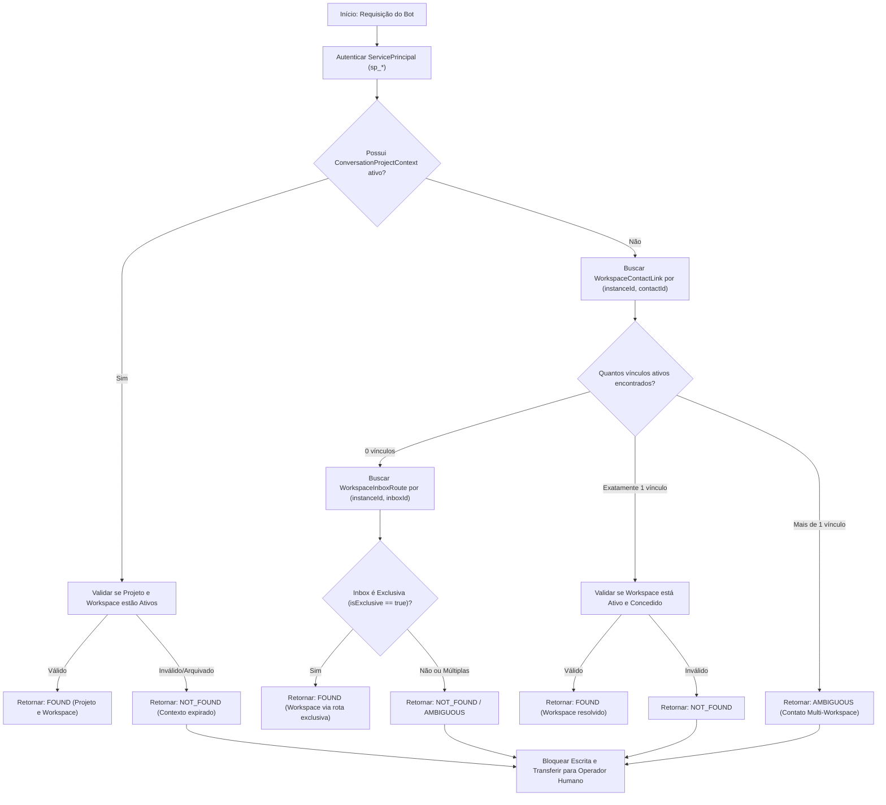

# ADR — Contrato de Integração CRM e Resolução de Contexto (Entrega 4.0-b)

- **Status**: Aprovado e Homologado
- **Decisores**: Equipe de Arquitetura jprOS, Engenharia de IA e Dono do Produto
- **Data**: 27/10/2026
- **Contexto**: Fase 4 — CRM e Agentes Interoperáveis (`solicitacao-ajustes-projetos-v2.0.md`, Seções 9.1, 9.2, 9.3 e Etapa E4.0)

---

## 1. Contexto e Desafio de Arquitetura

No ecossistema jprOS, os atendimentos aos clientes ocorrem através do canal WhatsApp (via `Evolution API` e `evo-crm` / base Chatwoot). Agentes de inteligência artificial (`evo-bot-runtime` e `evo-ai-processor`) precisam consultar prazos, criar solicitações ou gerar links públicos de acompanhamento diretamente no submódulo de Projetos (`evo-projects-service`).

Como o submódulo de Projetos é **Multi-Workspace** (cada cliente atendido pela holding possui seu próprio ambiente isolado), surge o risco crítico de vazamento de dados caso um agente consulte ou grave tarefas em um workspace incorreto.

### Decisão Fundamental de Produto (DP14)
> **Ambiguidade ou ausência de vínculo NUNCA escreve.**
> O modelo de inteligência artificial nunca "adivinha", nunca escolhe por ordem de cadastro e nunca assume um workspace sem vínculo comprovado. Na dúvida, o sistema retorna `AMBIGUOUS` ou `NOT_FOUND` e o atendimento é encaminhado a um operador humano.

---

## 2. Identificadores Estáveis do CRM

A integração baseia-se em quatro identificadores estáveis fornecidos pelo CRM:

| Identificador | Significado | Exemplo | Confiabilidade |
|---|---|---|---|
| `crmInstanceId` / `crmAccountId` | Namespace isolador da instância/conta no CRM | `"inst_jpros_prod"` ou `"1"` | **Mandatório**. Impede colisão de IDs entre instalações |
| `crmContactId` | Identificador único do contato cadastrado no CRM | `"cnt_98124"` | Fornecido pelo CRM, imutável durante a conversa |
| `crmInboxId` | Identificador do canal/caixa de entrada (ex: número WhatsApp) | `"inbox_wpp_comercial"` | Fornecido pelo CRM |
| `crmConversationId` | Identificador da sessão de conversa em andamento | `"conv_77412"` | Fornecido pelo CRM |

### Fonte Confiável de Identidade (Stop Criterion)
- **Origem dos Dados**: Os identificadores acima são gerados pelo backend do CRM (`evo-crm`) e repassados ao `evo-bot-runtime` via webhooks assinados.
- **Injeção no Runtime**: Ao chamar o servidor MCP do `evo-projects-service`, o runtime injeta esses identificadores em cabeçalhos HTTP autenticados:
  - `x-crm-instance-id: <instanceId>`
  - `x-crm-contact-id: <contactId>`
  - `x-crm-inbox-id: <inboxId>`
  - `x-crm-conversation-id: <conversationId>`
- **Vedação Estrita**: O modelo de linguagem (LLM) **NUNCA** inventa, escolhe ou manipula esses identificadores. Argumentos fornecidos pelo modelo em prompts são tratados como seletores não-confiáveis e validados contra os cabeçalhos autenticados do transporte.

---

## 3. Modelo de Dados de Vínculos CRM (Prisma Schema - E4.1)

Para materializar o contrato, o schema do banco de dados de projetos receberá quatro entidades relacionais sob o schema `projects`:

1. **`WorkspaceContactLink`**:
   - Vínculo entre um contato do CRM e um Workspace de Projetos.
   - Campos: `id`, `workspaceId`, `crmInstanceId`, `crmContactId`, `createdAt`, `createdByUserId`.
   - **Constraint**: `@@unique([workspaceId, crmInstanceId, crmContactId])`.
   - **Cardinalidade**: Um contato pode ter vínculos em mais de um workspace (contato multi-empresa).

2. **`WorkspaceInboxRoute`**:
   - Rota de fallback mapeando uma caixa de entrada do CRM a um Workspace padrão.
   - Campos: `id`, `workspaceId`, `crmInstanceId`, `crmInboxId`, `isExclusive Boolean`, `createdAt`.
   - **Regra**: Só atua como fallback determinístico se `isExclusive === true`. Se a mesma inbox for associada a múltiplos workspaces, torna-se ambígua.

3. **`ConversationProjectContext`**:
   - Fixação explícita de uma conversa específica a um Projeto de destino.
   - Campos: `id`, `projectId`, `workspaceId`, `crmInstanceId`, `crmConversationId`, `expiresAt`, `createdAt`.
   - **Constraint**: `@@unique([crmInstanceId, crmConversationId])`.

4. **`TaskCrmLink`**:
   - Registro de autoria e rastreabilidade da tarefa gerada a partir do atendimento.
   - Campos: `id`, `taskId`, `crmInstanceId`, `crmContactId`, `crmConversationId`, `createdAt`.
   - **Constraint**: `@@unique([taskId])`.

---

## 4. Algoritmo Determinístico de Resolução de Contexto (E4.2)

O serviço expõe o motor de resolução em `src/crm/resolve.ts` executando o fluxo abaixo:

### Regras Invioláveis do Algoritmo:
1. **Zero Adivinhação**: Se houver mais de um workspace vinculado ao contato, o resultado é **estritamente `AMBIGUOUS`**. O sistema não usa ordem alfabética nem `createdAt desc`.
2. **Telefone e E-mail não são Credenciais**: O número de WhatsApp é usado exclusivamente como chave de busca inicial no diretório de contatos, nunca como autorizador de escrita.
3. **Validação Prévia à Mutação**: O método `create_task` ou `create_task_share` checa novamente se o resultado resolvido é `FOUND` antes de emitir qualquer gravação no banco.

---

## 5. Invalidação de Contexto e Ciclo de Vida

- **Fusão de Contatos**: Quando contatos são mesclados no CRM, um evento de webhook invalida os vínculos do contato secundário.
- **Arquivamento**: Se um projeto for arquivado (`isArchived: true`), qualquer `ConversationProjectContext` associado é invalidado imediatamente.
- **Revogação de Grant**: Se o `IntegrationGrant` do Service Principal for revogado ou expirar, a resolução de contexto rejeita chamadas com `403 Forbidden` (`INTEGRATION_GRANT_REVOKED`).
- **Memória do Bot**: O bot não deve persistir o contexto de workspace em cache indefinido; a cada nova sessão ou após inatividade de 24 horas, o contexto é reavaliado.

---

## 6. Conclusão e Próximos Passos
Com este contrato firmado e a matriz MCP aprovada, a **Etapa E4.0** está consolidada, liberando a modelagem do banco de dados na **Etapa E4.1** (`WorkspaceContactLink`, `WorkspaceInboxRoute`, `ConversationProjectContext` e `TaskCrmLink`).
