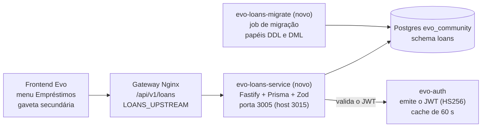

# Plano de Projeto — Submódulo Empréstimos (jprOS)

Data: 2026-10-28

## Resumo executivo

Recomendo construir o Empréstimos como um serviço isolado no padrão Evo (`evo-loans-service`, schema `loans`), modelando primeiro o que a planilha já faz e só depois o que o protótipo acrescenta.

A planilha controla a operação em 14 colunas, uma linha por parcela, com duas regras de cálculo que o sistema precisa reproduzir ao centavo: parcela única com taxa fixa sobre o período e parcelas múltiplas pela tabela Price (PMT).

**Decisões centrais do plano**

1. **Dados isolados.** Clientes, contatos e documentos vivem no schema `loans`, sem chave estrangeira para o CRM ou para outros módulos.
2. **Status derivado.** Vencido, a vencer e pago são calculados de datas e pagamentos, nunca digitados. Na planilha isso é a principal fonte de erro.
3. **Pagamento é um lançamento, não um "PAGO".** A operação real tem pagamento só de juros, pagamento parcial e encargos embutidos na parcela.
4. **Migração com reconciliação.** A planilha só é desligada depois que o sistema reproduzir os totais conferidos linha a linha.

O roteiro tem 7 fases (0 a 6), cada uma com entregas, gate e testes numerados, seguindo o formato de evidências dos módulos Financeiro e Projetos. O calendário depende da capacidade da equipe, que ainda não foi informada; por isso as fases estão dimensionadas por tamanho relativo.

## Como a planilha funciona hoje

A planilha tem três abas, mas só a EMPRESTIMOS guarda os dados de verdade. A VENCIMENTOS é uma agenda derivada dela, e a aba PAINEL foi deixada de fora desta análise por decisão do dono.

| Aba | Papel | Como se comporta |
| --- | --- | --- |
| EMPRESTIMOS | Base de dados: uma linha por parcela de cada contrato | Digitada à mão; fórmulas só em parte das colunas |
| VENCIMENTOS | Agenda de recebimentos por data, com subtotal por dia | Lista estática a partir de 10/09/2026 |

**Colunas da aba EMPRESTIMOS (14)**

| Coluna | Significado | No sistema |
| --- | --- | --- |
| NOME DO CLIENTE | Nome, muitas vezes com etiqueta livre entre parênteses ("CONTRATO NOVO", "ACORDO 1", apelidos) | Cliente + campos próprios de tipo/etiqueta do contrato |
| CPF | Identificador do tomador | Documento do cliente, único e validado |
| DATA DO EMPRESTIMO | Data de concessão | Contrato |
| VALOR DO EMPRESTIMO | Principal | Contrato (principal) |
| TAXA DE JUROS | Percentual do contrato (ex.: 13,9%, 20%, 30%) | Contrato (taxa e base: período) |
| QTD DE PARCELAS | Número de parcelas | Contrato |
| PARCELA | Numeração no formato "01 03" | Parcela (sequência) |
| VENCIMENTO DA PARCELA | Data de vencimento | Parcela |
| VALOR DA PARCELA | Valor previsto | Parcela (valor devido) |
| VALOR FINAL DO EMPRESTIMO | Parcela × quantidade | Calculado |
| SITUAÇÃO | "PAGO" e similares, digitado | Derivado dos pagamentos |
| DIAS DE VENCIMENTO | Dias até/desde o vencimento, parece depender da data atual | Calculado na consulta |
| STATUS DA PARCELA | Vencido / a vencer | Derivado de data + pagamentos |
| OBSERVAÇÃO | Texto livre com fatos operacionais | Notas e lançamentos estruturados |

**Regras de cálculo confirmadas contra os dados**

- **Parcela única:** parcela = principal × (1 + taxa), com a taxa aplicada ao período inteiro, seja qual for o prazo. Exemplo: R$ 700,00 a 20% vira R$ 840,00. Bate em 460 de 467 contratos desse tipo.
- **Várias parcelas:** parcela fixa pela tabela Price, com taxa por período (mensal ou semanal). Exemplo: R$ 1.000,00 a 13,9% em 3 parcelas dá R$ 430,01 e total de R$ 1.290,03. Bate em 258 de 283 contratos desse tipo.
- **Valor final:** parcela × quantidade em 746 de 750 contratos reconstruídos. As exceções vêm de ajustes manuais e arredondamento.

O exemplo de 13,9% em 3 parcelas é uma linha real da planilha e é o mesmo que aparece na tela Novo Empréstimo do protótipo, o que confirma que o protótipo foi desenhado a partir desta operação.

**Práticas operacionais que aparecem nas observações**

- Pagamento só de juros para rolar o contrato (ex.: "PAGOU SO JUROS 140,00" sobre um principal de R$ 700,00).
- Pagamento parcial e encargos embutidos na parcela (multa e itens avulsos).
- Empréstimos semanais (cerca de 54 contratos) e mensais (cerca de 141), com periodicidade inferida das datas.
- Acordos e contratos novos sobre dívidas anteriores, indicados por etiqueta no nome.
- Origem do capital ("aplicação"), origem do cliente e indicação de terceiros.
- Contratos grandes a 0% que na prática são financiamento de bem, não empréstimo.

## Achados e problemas de qualidade de dados

A planilha não pode ser importada como está: o status se contradiz, há linhas de template vazias e os dados de identificação são inconsistentes. Cada item abaixo vira uma regra de validação ou uma etapa da migração.

| Achado | Evidência | Tratamento |
| --- | --- | --- |
| Status contraditório | 25 parcelas futuras marcadas como VENCIDO; 166 parcelas pagas aparecem como "A VENCER"; parcelas pagas antigas aparecem como VENCIDO | Eliminar status digitado; derivar de data e pagamento |
| Linhas vazias de template | 611 linhas com `#NUM!` | Descartar na importação |
| Datas | Formatos mistos e erros de digitação (4 linhas) | Parser tolerante com relatório de correções |
| CPF inválido | 84 de 241 CPFs não passam no dígito verificador | Importar com pendência de saneamento, sem bloquear o histórico |
| Mesmo CPF com rótulos diferentes | 20 CPFs aparecem com mais de um nome ou etiqueta | Unificar em um cliente; etiqueta vira atributo do contrato |
| Etiqueta no nome | Cerca de 41% das linhas usam o nome como campo livre | Extrair para tipo de contrato e notas |
| Parcelas faltando | 95 contratos têm menos linhas que a quantidade de parcelas | Reconstituir pela regra de cálculo e marcar como "gerada na migração" |
| Numeração inconsistente | Formatos "01 03" e "2 03" na mesma coluna | Normalizar sequência |
| Sem dados de contato | Nenhum telefone, e-mail ou endereço | Coleta posterior; notificações só após cadastro |

## Escopo e requisitos

O escopo da primeira entrega é o que a planilha já faz, com as correções que ela não consegue fazer; o que o protótipo e o PRD acrescentam entra depois, por fase. Só as funcionalidades do protótipo foram consideradas: cores, marca e layout seguem o padrão Evo dos outros módulos.

| ID | Requisito | Origem | Fase |
| --- | --- | --- | --- |
| RF-01 | Cadastro de cliente isolado (nome, CPF, contatos, endereço, origem, indicador, notas) | Planilha + protótipo | 1 |
| RF-02 | Contrato com tipo (empréstimo, acordo, financiamento de bem), método (parcela única fixa ou Price) e periodicidade (semanal ou mensal) | Planilha | 1 |
| RF-03 | Simulação em tempo real com cronograma antes de confirmar; salvar rascunho | Protótipo | 1 |
| RF-04 | Geração automática das parcelas, com ajuste manual justificado e auditado | Planilha | 1 |
| RF-05 | Registro de pagamento: total, parcial e só juros; meio (PIX, transferência, dinheiro); comprovante | Planilha + protótipo | 2 |
| RF-06 | Multa e juros de mora calculados na data do pagamento, com valor editável e justificativa | Protótipo | 2 |
| RF-07 | Encargos avulsos na parcela (descrição e valor) | Planilha | 2 |
| RF-08 | Status derivado de parcelas, contratos e clientes | Planilha (corrige) | 2 |
| RF-09 | Renegociação e acordo ligados ao contrato de origem | Planilha | 2 |
| RF-10 | Central de parcelas: filtros (todas, vence hoje, vencidas, pagas), período, valor, busca; ações em lote | Protótipo + VENCIMENTOS | 3 |
| RF-11 | Ficha do cliente: contratos, parcelas, pagamentos, notas | Protótipo | 3 |
| RF-12 | Painel com os indicadores-chave K1 a K8 (seção Indicadores-chave) | Protótipo | 4 |
| RF-13 | Relatórios: fluxo de caixa de 6 meses, distribuição por status, maiores devedores, faixas de valor; exportação em Excel e PDF | Protótipo | 4 |
| RF-14 | Importação da planilha com relatório de saneamento e reconciliação | Planilha | 5 |
| RF-15 | Notificações automáticas (3 dias antes, no vencimento, 1 e 7 dias após) por WhatsApp e e-mail, com fila, edição e envio manual | Protótipo | 6 |
| RF-16 | Configurações: taxa, método, multa e mora padrão; usuários e papéis (administrador, operador, visualizador); backup; auditoria | Protótipo | 1 a 4 |

**Fora de escopo nesta versão**

- Webhook de PIX e portal do tomador (fases 2 e 3 do roadmap do PRD).
- Integração com CRM, Financeiro ou qualquer outro módulo: os dados ficam isolados.
- Score de crédito automático. As estrelas do protótipo viram, no máximo, uma classificação manual de 1 a 5.
- Módulo de Investimentos (aparece no menu do protótipo). A planilha só pede registrar a origem do capital em cada contrato.
- Carência: aparece no protótipo, mas não há caso na planilha; entra atrás de feature flag se for confirmada.

## Modelo de domínio

A planilha mistura contrato e parcela numa única linha; o modelo separa as duas coisas e trata cada pagamento como um lançamento que se aloca em parcelas. Todas as tabelas ficam no schema `loans`.

| Entidade | Para que serve | Campos principais |
| --- | --- | --- |
| Cliente | Tomador, com cadastro próprio | nome, CPF (único), RG, nascimento, telefone, WhatsApp, e-mail, endereço, origem, indicador, classificação manual, sinalizador de CPF pendente |
| Indicador | Quem indicou o cliente ("IND." na planilha) | nome, contato |
| Contrato | Operação de crédito | cliente, tipo, método, periodicidade, principal, taxa, nº de parcelas, data de concessão, 1º vencimento, origem do capital, etiqueta, contrato de origem, status, versão |
| Parcela | Cada vencimento do contrato | contrato, sequência, vencimento, valor devido, parte de principal e de juros, ajuste manual com motivo |
| Encargo avulso | Item embutido na parcela (multa, taxa, produto) | parcela, descrição, valor |
| Pagamento | Dinheiro recebido | contrato, data, valor, meio, tipo (total, parcial, só juros), comprovante, chave de idempotência, estornado |
| Alocação | Como um pagamento abateu cada parcela | pagamento, parcela, valor por componente (principal, juros, multa, mora, encargos, desconto) |
| Renegociação | Liga contrato antigo e novo | contrato de origem, contrato novo, saldo transferido, motivo |
| Nota e anexo | Observações e documentos | texto estruturado; arquivo com sha256 e tipo verificado |
| Notificação | Regras, modelos e fila de envio | regra, canal, modelo, status, tentativas |
| Auditoria | Histórico de alterações | quem, quando, entidade, antes e depois (com dados sensíveis ocultados) |
| Configuração | Padrões do sistema | taxa padrão, método padrão, multa, mora, dados da empresa |

Três decisões de modelagem decorrem da planilha:

1. O texto livre da coluna OBSERVAÇÃO vira lançamento estruturado quando descreve dinheiro (só juros, encargo, desconto) e nota quando é contexto.
2. Etiquetas no nome ("CONTRATO NOVO", "ACORDO 1") viram tipo e etiqueta do contrato; o cliente fica único por CPF.
3. Valores monetários usam `Decimal` com arredondamento `ROUND_HALF_UP` em duas casas, como no Financeiro v3.

## Regras de negócio

As regras abaixo seguem a numeração RN-xx, no mesmo estilo das regras FIN-xx do Financeiro, e cada uma vira ao menos um teste numerado na fase em que é entregue.

**Cálculo do contrato**

- **RN-01 Parcela única fixa.** O valor devido é o principal acrescido da taxa do período inteiro, sem considerar o prazo.

```latex
parcela = P \times (1 + i)
```

- **RN-02 Parcelas múltiplas pela Price.** Parcelas iguais, com a taxa aplicada ao período (mês ou semana).

```latex
PMT = P \cdot \frac{i}{1 - (1 + i)^{-n}}
```

- **RN-03 Valor final.** Parcela × quantidade, como na planilha. Não há ajuste de resíduo na última parcela.
- **RN-04 Ajuste manual.** A planilha tem divergências vindas de ajustes à mão; o sistema permite alterar o valor de uma parcela só com motivo, permissão específica e auditoria.
- **RN-05 Datas.** Mensal: mesmo dia do mês, ajustado ao último dia quando o mês for mais curto. Semanal: de 7 em 7 dias.

**Atraso e encargos**

- **RN-06 Multa e mora.** Multa fixa de 2% sobre o valor da parcela e mora de 1% ao mês, proporcional aos dias de atraso (base de 30 dias). Os dois percentuais são configuráveis e podem ser sobrescritos por contrato. Os padrões vêm do protótipo e devem ser confirmados pelo dono (D3).

```latex
mora = valor \times i_{mora} \times \frac{dias}{30}
```

- **RN-07 Encargo avulso.** Soma-se ao devido da parcela e é identificado por descrição.

**Pagamentos**

- **RN-08 Alocação.** O pagamento abate a parcela em aberto mais antiga; dentro da parcela, a ordem é multa, mora, encargos e depois o valor da parcela. Pagamento parcial reduz o saldo e não recalcula as demais parcelas.
- **RN-09 Só juros (rolagem).** O pagamento de juros não amortiza o principal; o principal é prorrogado com novo vencimento. O tratamento exato depende de decisão do dono (ver decisões em aberto).
- **RN-10 Estorno.** Pagamento não se edita nem se apaga: o estorno gera lançamento inverso e reabre o saldo.
- **RN-11 Idempotência.** Registrar pagamento exige `Idempotency-Key`; repetir a chamada devolve o mesmo resultado.

**Status**

- **RN-12 Parcela.** Paga (saldo zero), parcial, vence hoje, a vencer ou vencida (vencimento anterior a hoje com saldo). Calculado na data de São Paulo.
- **RN-13 Contrato.** Ativo, inadimplente (qualquer parcela vencida), quitado, renegociado ou cancelado.
- **RN-14 Cliente.** Ativo, inadimplente ou quitado, derivado dos contratos.

**Integridade**

- **RN-15 Cliente.** CPF único. CPF inválido só entra pela importação, marcado como pendente.
- **RN-16 Contrato confirmado.** Principal, taxa e parcelas não se editam; correções passam por cancelamento justificado ou renegociação.
- **RN-17 Renegociação.** O saldo devedor do contrato antigo vira o principal do novo; o antigo passa a renegociado e os dois ficam ligados.
- **RN-18 Financiamento de bem a 0%.** Tipo próprio; fica fora dos indicadores de juros e pode ser filtrado nos de inadimplência.
- **RN-19 Concorrência.** Campo `version` (conflito devolve 409) e transação com bloqueio nas operações de pagamento.
- **RN-20 Exclusão.** Exclusão lógica com retenção de 90 dias.

**Exemplos conferidos por cálculo**

| Caso | Entrada | Resultado |
| --- | --- | --- |
| Parcela única | R$ 700,00 a 20% | R$ 840,00 |
| Price | R$ 1.000,00 a 13,9% em 3 parcelas | R$ 430,01 por parcela; total R$ 1.290,03 |
| Atraso de 21 dias | Parcela de R$ 430,01, multa de 2% e mora de 1% a.m. | Multa R$ 8,60 + mora R$ 3,01 = R$ 441,62 |

## Indicadores-chave

Oito indicadores bastam para operar esta carteira: quanto capital está na rua, quanto entra nos próximos 30 dias, quanto está atrasado e há quanto tempo, e se os juros recebidos compensam o capital aplicado. Eles alimentam o painel (RF-12) e são calculados só de principal, parcelas e pagamentos, sem depender da planilha.

| # | Indicador | Como se calcula | Decisão que apoia |
| --- | --- | --- | --- |
| K1 | Capital na rua | Principal em aberto dos contratos ativos e inadimplentes. Price: saldo de principal do cronograma; parcela única: o principal inteiro até quitar | Quanto do capital está emprestado e exposto |
| K2 | A receber em 30 dias | Saldo devido das parcelas em aberto com vencimento de hoje até hoje + 30 dias, sem multa e mora | Planejar caixa e novas concessões |
| K3 | Vencido por faixa de atraso | Saldo das parcelas vencidas nas faixas de 1 a 7, 8 a 30, 31 a 90 e mais de 90 dias, com número de parcelas e de clientes | Quem cobrar hoje e com que urgência |
| K4 | Carteira em risco (PAR 30) | Principal em aberto dos contratos com alguma parcela vencida há mais de 30 dias ÷ capital na rua | Saúde da carteira; meta configurável (o protótipo usa 10% como exemplo) |
| K5 | Eficiência de recebimento do mês | Recebido das parcelas que venceram no mês, até hoje ÷ devido dessas parcelas | A cobrança está funcionando? |
| K6 | Juros recebidos no mês | Componente de juros dos pagamentos do mês; multa e mora aparecem à parte | Quanto a operação realmente rendeu |
| K7 | Rentabilidade mensal | Juros recebidos no mês ÷ capital médio na rua no mês | As taxas praticadas compensam o capital e o risco? |
| K8 | Concentração | Capital na rua dos 10 maiores clientes ÷ capital na rua | Dependência de poucos devedores |

**Como ler**

- Data de referência: hoje, no fuso de São Paulo. Todos os indicadores podem ser filtrados por tipo de contrato e periodicidade; o financiamento de bem a 0% (RN-18) fica fora de K6 e K7.
- K5 a K7 dependem da data de pagamento. O histórico migrado tem data estimada, então esses três só são confiáveis a partir do corte. K1 a K4 e K8 dependem de saldos e vencimentos e valem desde a migração.
- K6 não desconta perdas enquanto não existir baixa por perda (decisão D11).
- Ficam fora do painel de propósito: total emprestado acumulado, número de clientes e de contratos, e nota de crédito, porque não mudam nenhuma decisão do dia a dia.
- Os demais gráficos do protótipo ficam nos Relatórios (RF-13): fluxo de caixa de concedido e recebido em 6 meses, distribuição por status, maiores devedores e faixas de valor.

## Arquitetura no padrão Evo

O Empréstimos entra no jprOS como um serviço novo, `evo-loans-service`, que repete o desenho de Agenda, Projetos e Financeiro: um schema por módulo, migração por job, rota própria no gateway e item de menu no frontend nativo.



Frontend, gateway, auth e Postgres já existem no jprOS; o serviço e o job de migração são os componentes novos. Não há chaves estrangeiras nem consultas entre o schema `loans` e os demais módulos.

| Item | Decisão | Observação |
| --- | --- | --- |
| Serviço | `evo-loans-service`: Node 20, TypeScript, Fastify v5, Prisma v6, Zod e jose | Mesma pilha dos serviços headless existentes |
| Banco | Banco `evo_community`, schema `loans` (`?schema=loans`), papéis de DDL e DML separados | Ver decisão D4 |
| Migração | Job `evo-loans-migrate` com `prisma migrate deploy`, que roda antes do serviço | Padrão do `evo-projects-migrate` |
| Porta | 3005 interna, publicada em `127.0.0.1:3015` | Segue 3002→3012, 3003→3013 e 3004→3014; confirmar (D9) |
| Gateway | Bloco `^/api/v1/loans` no Nginx, com variável `LOANS_UPSTREAM` | Mesmo formato de `finance` e `projects` |
| Frontend | Item `customer-loans` no menu com gaveta secundária, páginas em `src/pages/loans`, serviços em `src/services/loans`, textos em i18n | Mesma estrutura de Projetos |
| Design | Componentes e tokens do Evo; nada da identidade visual do protótipo | Pedido explícito do dono |
| Liberação | Módulo atrás de feature flag até o gate da Fase 5 | Padrão dos outros módulos |
| Evidências | Log por fase, com gates e testes numerados | Formato de `solicitacao-implementacao-financeiro-v3.1.md` |

O Financeiro v3.1 é o precedente mais próximo para liquidações com juros, multa e desconto, estorno e idempotência. Vale reaproveitar o desenho, não o código nem o schema, para manter o isolamento.

## API, segurança e LGPD

O módulo reaproveita o que os serviços Fastify do jprOS já padronizam, e acrescenta controles específicos para CPF, documentos e dados de crédito, que são o ativo mais sensível deste módulo.

**Padrões herdados dos outros módulos**

- Autenticação por JWT do `evo-auth` (HS256, emissor `evo-auth-service`), com revogação consultada em `POST /api/v1/auth/validate` e cache de 60 segundos.
- AccessService central, com papéis próprios do módulo.
- DTOs estritos com Zod; erros no formato `{code, message, requestId}`.
- Controle otimista com `version` (409 em conflito), `Idempotency-Key` nas escritas sensíveis, transações com bloqueio e nova tentativa.
- Auditoria transacional com campos sensíveis substituídos por `[REDACTED]`.
- Anexos com sha256 e verificação de tipo pelos bytes iniciais (PDF, PNG e JPG, até 5 MB, como no protótipo).
- Migrações versionadas por job `evo-loans-migrate` (`prisma migrate deploy`), com papéis de banco separados para DDL e DML.

**Papéis e permissões**

Os três perfis vêm da tela de configurações do protótipo; as permissões sensíveis são proposta deste plano.

| Permissão | Administrador | Operador | Visualizador |
| --- | --- | --- | --- |
| Ver clientes, contratos, parcelas e relatórios | Sim | Sim | Sim |
| Ver CPF e documentos completos | Sim | Sim | Não (mascarado) |
| Criar cliente e contrato | Sim | Sim | Não |
| Registrar pagamento | Sim | Sim | Não |
| Estornar pagamento, ajustar parcela, cancelar contrato | Sim | Não | Não |
| Exportar relatórios e dados | Sim | Não | Não |
| Configurações, usuários, auditoria, importação | Sim | Não | Não |

**Grupos de endpoints em `/api/v1/loans`**

| Grupo | Operações |
| --- | --- |
| `clients` | listar com busca e filtros, criar, editar, ficha, notas, anexos |
| `contracts` | simular, salvar rascunho, confirmar, cancelar, renegociar, consultar cronograma |
| `installments` | listar com filtros, ajustar valor com motivo, encargos avulsos |
| `payments` | registrar (com `Idempotency-Key`), registrar em lote, estornar, comprovante |
| `dashboard` e `reports` | indicadores, fluxo de caixa, distribuições, maiores devedores, exportação |
| `notifications` | regras, modelos, fila, envio manual |
| `settings` e `users` | padrões do sistema, usuários e papéis |
| `imports` | importar planilha, relatório de reconciliação |

**Proteção de dados pessoais (LGPD)**

- CPF e RG guardados cifrados, com índice cego (HMAC) para busca e unicidade; chave fora do banco, em segredo do ambiente. É proposta deste plano, a confirmar na Fase 0.
- CPF mascarado por padrão na interface e nos logs; exibição completa exige permissão e gera registro de auditoria.
- Minimização: coletar só o necessário; documentos digitalizados são opcionais.
- Retenção alinhada à política de retenção já existente no projeto jprOS, com exclusão lógica de 90 dias.
- Isolamento: papéis de banco do módulo sem acesso a outros schemas e sem chaves estrangeiras para eles.
- Dados reais da planilha não entram em repositório, logs nem testes; os testes usam dados sintéticos com o mesmo formato.

## Migração e reconciliação

A migração é um projeto à parte dentro do plano: a planilha só vira somente leitura quando o sistema reproduzir os valores conferidos e uma operação em paralelo fechar um ciclo de vencimentos sem divergência inexplicada.

1. Congelar uma cópia da planilha, com data e hash, como entrada única e somente leitura.
2. Extrair a aba EMPRESTIMOS e descartar as 611 linhas vazias com `#NUM!`.
3. Normalizar datas, valores e numeração de parcelas, gerando um relatório de cada correção.
4. Unificar clientes por CPF; marcar como pendentes os 84 CPFs inválidos entre 241; converter etiquetas do nome em tipo e etiqueta do contrato.
5. Agrupar as linhas em contratos (cliente, data, principal, taxa e quantidade).
6. Reconstituir as parcelas dos 95 contratos que têm menos linhas que a quantidade, marcando-as como geradas na migração.
7. Converter SITUAÇÃO e OBSERVAÇÃO em pagamentos e encargos. A planilha não tem coluna de data de pagamento; os pagamentos históricos entram com a data estimada pelo vencimento e um sinalizador de data estimada.
8. Rodar tudo em ambiente de ensaio e gerar o relatório de reconciliação: principal, valor final e saldo em aberto por contrato, comparados com o recálculo pelas regras RN-01 a RN-03.
9. Revisar com o dono as divergências conhecidas: 7 contratos de parcela única, 25 de Price e 4 de valor final. Cada uma vira correção aceita ou ajuste manual auditado.
10. Importar de verdade, em lotes idempotentes que podem ser repetidos sem duplicar.
11. Operar em paralelo por um ciclo completo de vencimentos, comparando os totais e saldos do sistema com os da planilha.
12. Cortar: a planilha passa a somente leitura e o sistema é a fonte da verdade.

**Critério de aceite da migração.** Nenhum contrato com diferença acima de R$ 0,01 sem justificativa registrada, totais gerais conferidos e histórico de pagamentos com data estimada claramente sinalizado nos relatórios.

O vencido calculado pelo sistema vai diferir da coluna STATUS DA PARCELA da planilha, porque ela marca parcelas futuras como vencidas. Vale avisar a operação antes do corte.

## Roadmap por fases

São sete fases (0 a 6), cada uma entregue como fatia completa de serviço e interface, e nenhuma avança sem o gate anterior. O calendário fica para depois da Fase 0, quando a capacidade da equipe for conhecida. P, M e G são tamanhos relativos.

| Fase | Tamanho | Entregas | Gate |
| --- | --- | --- | --- |
| 0 · Fundação e decisões | P | Esqueleto do serviço, rota e job de migração; decisões D1 a D10 fechadas com o dono | G0 Decisões fechadas |
| 1 · Clientes e contratos | G | Cadastro, simulação e rascunho de contrato; motor de cálculo fixo e Price, cronograma | G1 Cálculo conferido |
| 2 · Pagamentos e status | G | Pagamento total, parcial e só juros; estorno; multa, mora, status derivado, renegociação | G2 Saldos conferem |
| 3 · Parcelas e ficha | M | Central de parcelas com filtros e lote; ficha do cliente com histórico | G3 Cobrança no sistema |
| 4 · Painel e relatórios | M | Painel de KPIs e previsão mensal; relatórios e exportação em Excel e PDF | G4 KPIs conferidos |
| 5 · Migração e paralelo | G | Importação da planilha e reconciliação; um ciclo em paralelo e corte | G5 Reconciliação ok |
| 6 · Notificações | M | Regras, modelos e fila de envio; WhatsApp e e-mail, manual e automático | G6 Envio validado |

Os critérios de cada gate e seus testes estão na tabela abaixo.

| Gate | Critério de saída | Exemplos de testes numerados |
| --- | --- | --- |
| G0 | Decisões D1 a D4 fechadas com o dono; serviço responde pelo gateway | T0.1 `/health` pelo gateway devolve 200; T0.2 JWT inválido devolve 401; T0.3 papel de banco do módulo não lê outros schemas |
| G1 | RN-01 a RN-05 corretas contra os exemplos conferidos | T1.1 R$ 700 a 20% dá R$ 840,00; T1.2 R$ 1.000 a 13,9% em 3x dá R$ 430,01 e total R$ 1.290,03; T1.3 vencimento em mês curto; T1.4 CPF duplicado é rejeitado; T1.5 `version` antigo devolve 409 |
| G2 | RN-06 a RN-14 corretas e saldos conferem | T2.1 atraso de 21 dias dá R$ 441,62; T2.2 pagamento parcial; T2.3 só juros; T2.4 estorno reabre saldo; T2.5 mesma `Idempotency-Key` devolve o mesmo resultado; T2.6 dois pagamentos simultâneos não duplicam |
| G3 | Um dia de cobrança feito só no sistema | T3.1 filtros e lote; T3.2 visualizador não registra pagamento; T3.3 CPF mascarado sem permissão |
| G4 | Indicadores iguais a um recálculo independente | T4.1 KPIs do painel contra script de referência em dados sintéticos; T4.2 exportação abre em Excel e PDF |
| G5 | Reconciliação aceita e um ciclo em paralelo sem divergência inexplicada | T5.1 importação repetida não duplica; T5.2 relatório de diferenças acima de R$ 0,01; T5.3 totais gerais conferidos |
| G6 | Envio validado em canal oficial | T6.1 mensagem de teste entregue; T6.2 falha aparece na fila; T6.3 cliente sem contato não entra na fila |

## Riscos e decisões em aberto

Os maiores riscos estão nos dados e nas regras de pagamento, não na tecnologia: a planilha guarda muita regra implícita que só o dono conhece.

| Risco | Efeito | Mitigação |
| --- | --- | --- |
| Dados da planilha sujos | Importação com erros silenciosos | Relatório de saneamento e reconciliação com aceite explícito |
| Ausência de data de pagamento histórica | Fluxo de caixa e pontualidade do passado aproximados | Data estimada sinalizada; relatórios históricos rotulados |
| Vazamento de CPF e documentos | Dano ao titular e responsabilidade da operação | Cifração, mascaramento, papéis de banco isolados, auditoria de acesso |
| Regra de rolagem ou de alocação diferente da prática | Saldos que não conferem | Decisões D1 e D2 antes da Fase 2 |
| Expansão de escopo pelo PRD (portal, PIX, score) | Atraso do núcleo | Fora de escopo explícito; entra só por nova fase |
| Capacidade da equipe desconhecida | Calendário incerto | Fases com tamanho relativo; calendário fechado após a Fase 0 |

**Decisões em aberto para o dono**

- **D1. Rolagem (só juros).** Prorrogar o mesmo contrato com novo vencimento, ou encerrar e abrir contrato novo? A planilha não deixa claro. Recomendo prorrogar no mesmo contrato, com evento explícito.
- **D2. Ordem de abatimento** de pagamento parcial: a proposta da RN-08 serve?
- **D3. Multa e mora:** aplicar por padrão, só sob pedido, ou nunca? Hoje a planilha as embute à mão.
- **D4. Isolamento:** schema `loans` com papéis dedicados (recomendado, padrão dos outros módulos) ou banco separado.
- **D5. Usuários:** quantas pessoas operam e com quais perfis.
- **D6. Canal de WhatsApp e e-mail** da Fase 6: provedor e número; qualquer reuso de infraestrutura existente não pode misturar os dados do módulo.
- **D7. Financiamento de bem a 0%:** manter no módulo ou controlar à parte.
- **D8. Data de pagamento histórica:** aceitar a data estimada, ou existe outra fonte (extrato)?
- **D9. Porta e nomes:** 3015 publicada para a 3005 interna, e `/api/v1/loans`, seguem a sequência dos outros módulos; confirmar se estão livres.
- **D10. Capacidade e prazo** da equipe para fechar o calendário.
- **D11. Perdas:** como registrar um contrato que não será mais cobrado (baixa por perda)? Sem isso, o resultado do período (K6) não desconta perdas.
