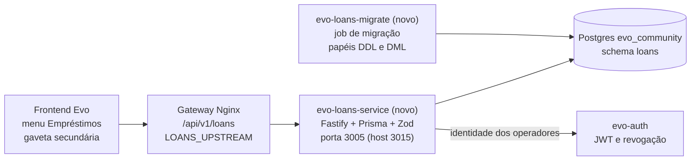

                    w# Plano de Implementação — Módulo Empréstimos do jprOS — v2

Data: 28/10/2026 · Revisão técnica e otimização do planejamento.

**Estado:** plano revisado, sem implementação ou liberação operacional. As decisões de produto pendentes estão na seção final; recomendações ali identificadas não representam aceite do dono.

**Precedência:** este arquivo é a referência de planejamento de Empréstimos. A [v1 preservada](docs/historico/solicitacao-implementacao-emprestimos.v1-20261028.md) é somente histórica. Os [apontamentos da revisão](docs/AVALIACAO-EMPRESTIMOS-v2.md) registram evidências, motivos e limites da análise.

**Separação obrigatória, reafirmada pelo dono:** Empréstimos e Financeiro são módulos diferentes e independentes. Empréstimos não depende de serviços, tabelas, regras, permissões, migrações ou disponibilidade do Financeiro. Não cria lançamentos nele e não usa seus saldos. O compartilhamento permitido é da infraestrutura do jprOS: identidade do Auth, PostgreSQL com isolamento de papéis, gateway e componentes visuais genéricos.

## Resumo executivo

Construir Empréstimos como serviço próprio (`evo-loans-service`, schema `loans`), com domínio e motor de cálculo próprios. A base é a operação demonstrada pela planilha; os recursos adicionais do protótipo entram nas fases correspondentes. A documentação geral do jprOS orienta a integração técnica, sem importar regras de negócio de outros módulos.

A planilha controla a operação em 14 colunas, uma linha por parcela, com duas regras de cálculo que o sistema precisa reproduzir ao centavo: parcela única com taxa fixa sobre o período e parcelas múltiplas pela tabela Price (PMT).

**Decisões centrais do plano**

1. **Dados isolados.** Clientes, contatos e documentos vivem no schema `loans`, sem chave estrangeira para o CRM ou para outros módulos.
2. **Status derivado.** Vencido, a vencer e pago são calculados de datas e pagamentos, nunca digitados. Na planilha isso é a principal fonte de erro.
3. **Pagamento e alocação explícitos.** Cada recebimento identifica os componentes abatidos; rolagem, ajuste e renegociação preservam o histórico.
4. **Migração com reconciliação.** A planilha só é desligada depois que o sistema reproduzir os totais conferidos linha a linha.

O roteiro mantém sete fases (0 a 6), com critérios de saída e evidências próprias em `docs/emprestimos-evidencias.md`, a criar durante a execução. O diagnóstico da importação começa na Fase 0; o corte permanece na Fase 5. Decisões de notificações não bloqueiam o núcleo. Não há dependência de entrega ou aprovação do Financeiro.

## Base técnica verificada e limites

A revisão inspecionou Auth, Projetos, frontend, gateway, manifests e CI. Não existe `evo-loans-service` nem registro de `loans` nos manifests e gateway examinados. Não foram executados serviços, migrações ou testes contra banco real. Os números da planilha e as referências ao protótipo/PRD são informações herdadas da v1: suas fontes não foram localizadas no repositório nem revalidadas nesta revisão.

| Evidência atual | Consequência para Empréstimos |
| --- | --- |
| `evo-projects-service/src/auth/jwt.ts` valida assinatura e claims; `auth-client.ts` consulta o Auth | Adaptar o padrão técnico e testar o contrato real de `sub`, `aud`, revogação e indisponibilidade; não copiar regras de workspace |
| `evo-projects-service/src/services/idempotency.service.ts` chama `operation()` sem entregar seu `tx`; `tasks.routes.ts` chama outro serviço nesse callback | A referência não garante transação única para o novo domínio; Empréstimos deve passar `tx` à operação e persistir pagamento, alocações, auditoria e resultado idempotente juntos |
| `docker-compose.yml` tem job de migração de Projetos e espera por sua conclusão | Criar job próprio e credenciais próprias; em Swarm, definir execução de migração como etapa explícita do deploy |
| `nginx/Dockerfile` filtra variáveis em `NGINX_ENVSUBST_FILTER` | Acrescentar `LOANS_UPSTREAM` ao filtro, defaults e manifests; editar só o template de rota é insuficiente |
| Frontend usa placeholders no Dockerfile e substituição no entrypoint | Entregar `VITE_LOANS_API_URL` junto de cliente HTTP, menu, rotas e i18n |
| Parte dos testes de concorrência de Projetos usa mocks de `$transaction` | Verificar invariantes do novo módulo com PostgreSQL descartável e conexões independentes; mocks não demonstram bloqueio real |

As lacunas dessas referências são limites de reaproveitamento, não autorização para refatorar os outros módulos. Não criar pacote compartilhado, integração MCP, barramento ou arquitetura multi-workspace para atender este plano.

## Operação da planilha relatada na v1

As contagens abaixo são referência do levantamento anterior. Na Fase 0, registrar arquivo, aba, versão, data de referência e hash para torná-las reproduzíveis. Não tratá-las como inventário atual confirmado.

A planilha tem três abas, mas só a EMPRESTIMOS guarda os dados de verdade. A VENCIMENTOS é uma agenda derivada dela, e a aba PAINEL foi deixada de fora desta análise por decisão do dono.

| Aba | Papel | Como se comporta |
| --- | --- | --- |
| EMPRESTIMOS | Base de dados: uma linha por parcela de cada contrato | Digitada à mão; fórmulas só em parte das colunas |
| VENCIMENTOS | Agenda de recebimentos por data, com subtotal por dia | Lista estática a partir de 10/09/2026 |

**Colunas da aba EMPRESTIMOS (14)**

| Coluna | Significado | No sistema |
| --- | --- | --- |
| NOME DO CLIENTE | Nome, muitas vezes com etiqueta livre entre parênteses ("CONTRATO NOVO", "ACORDO 1", apelidos) | Cliente + campos próprios de tipo/etiqueta do contrato |
| CPF | Identificador do tomador | Documento do cliente, único e validado |
| DATA DO EMPRESTIMO | Data de concessão | Contrato |
| VALOR DO EMPRESTIMO | Principal | Contrato (principal) |
| TAXA DE JUROS | Percentual do contrato (ex.: 13,9%, 20%, 30%) | Contrato (taxa e base: período) |
| QTD DE PARCELAS | Número de parcelas | Contrato |
| PARCELA | Numeração no formato "01 03" | Parcela (sequência) |
| VENCIMENTO DA PARCELA | Data de vencimento | Parcela |
| VALOR DA PARCELA | Valor previsto | Parcela (valor devido) |
| VALOR FINAL DO EMPRESTIMO | Parcela × quantidade | Calculado |
| SITUAÇÃO | "PAGO" e similares, digitado | Derivado dos pagamentos |
| DIAS DE VENCIMENTO | Dias até/desde o vencimento, parece depender da data atual | Calculado na consulta |
| STATUS DA PARCELA | Vencido / a vencer | Derivado de data + pagamentos |
| OBSERVAÇÃO | Texto livre com fatos operacionais | Notas e lançamentos estruturados |

**Regras de cálculo relatadas no levantamento original**

- **Parcela única:** parcela = principal × (1 + taxa), com a taxa aplicada ao período inteiro, seja qual for o prazo. Exemplo: R$ 700,00 a 20% vira R$ 840,00. Bate em 460 de 467 contratos desse tipo.
- **Várias parcelas:** parcela fixa pela tabela Price, com taxa por período (mensal ou semanal). Exemplo: R$ 1.000,00 a 13,9% em 3 parcelas dá R$ 430,01 e total de R$ 1.290,03. Bate em 258 de 283 contratos desse tipo.
- **Valor final:** parcela × quantidade em 746 de 750 contratos reconstruídos. As exceções vêm de ajustes manuais e arredondamento.

Segundo o levantamento da v1, o exemplo de 13,9% em três parcelas aparece tanto na planilha quanto na tela Novo Empréstimo do protótipo. Essa correspondência de origem não foi revalidada nesta revisão.

**Práticas operacionais que aparecem nas observações**

- Pagamento só de juros para rolar o contrato (ex.: "PAGOU SO JUROS 140,00" sobre um principal de R$ 700,00).
- Pagamento parcial e encargos embutidos na parcela (multa e itens avulsos).
- Empréstimos semanais (cerca de 54 contratos) e mensais (cerca de 141), com periodicidade inferida das datas.
- Acordos e contratos novos sobre dívidas anteriores, indicados por etiqueta no nome.
- Origem do capital ("aplicação"), origem do cliente e indicação de terceiros.
- Contratos grandes a 0% que na prática são financiamento de bem, não empréstimo.

## Achados e problemas de qualidade de dados

A planilha não pode ser importada como está: o status se contradiz, há linhas de template vazias e os dados de identificação são inconsistentes. Cada item abaixo vira uma regra de validação ou uma etapa da migração.

| Achado | Evidência | Tratamento |
| --- | --- | --- |
| Status contraditório | 25 parcelas futuras marcadas como VENCIDO; 166 parcelas pagas aparecem como "A VENCER"; parcelas pagas antigas aparecem como VENCIDO | Eliminar status digitado; derivar de data e pagamento |
| Linhas vazias de template | 611 linhas com `#NUM!` | Descartar na importação |
| Datas | Formatos mistos e erros de digitação (4 linhas) | Normalizar formatos conhecidos; datas ambíguas ou inexistentes exigem decisão registrada |
| CPF inválido | 84 de 241 CPFs não passam no dígito verificador | Preservar histórico com identidade pendente; não autorizar novo crédito até saneamento |
| Mesmo CPF com rótulos diferentes | 20 CPFs aparecem com mais de um nome ou etiqueta | Propor vínculo pelo CPF validado; revisar conflitos de identidade antes de unificar |
| Etiqueta no nome | Cerca de 41% das linhas usam o nome como campo livre | Extrair para tipo de contrato e notas |
| Parcelas faltando | 95 contratos têm menos linhas que a quantidade de parcelas | Gerar proposta em área de conferência; ausência não prova dívida nem pagamento. Incorporar somente após aceite por contrato |
| Numeração inconsistente | Formatos "01 03" e "2 03" na mesma coluna | Normalizar sequência |
| Sem dados de contato | Nenhum telefone, e-mail ou endereço | Coleta posterior; notificações só após cadastro |

## Escopo e requisitos

O escopo da primeira entrega é o que a planilha já faz, com as correções que ela não consegue fazer; o que o protótipo e o PRD acrescentam entra depois, por fase. Só as funcionalidades do protótipo foram consideradas: cores, marca e layout seguem o padrão Evo dos outros módulos.

| ID | Requisito | Origem | Fase |
| --- | --- | --- | --- |
| RF-01 | Cadastro de cliente isolado (nome, CPF, contatos, endereço, origem, indicador, notas) | Planilha + protótipo | 1 |
| RF-02 | Contrato com tipo (empréstimo, acordo, financiamento de bem), método (parcela única fixa ou Price) e periodicidade (semanal ou mensal) | Planilha | 1 |
| RF-03 | Simulação em tempo real com cronograma antes de confirmar; salvar rascunho | Protótipo | 1 |
| RF-04 | Geração automática das parcelas, com ajuste manual justificado e auditado | Planilha | 1 |
| RF-05 | Registro de pagamento: total, parcial e só juros; meio (PIX, transferência, dinheiro); comprovante | Planilha + protótipo | 2 |
| RF-06 | Multa e juros de mora calculados na data do pagamento, com valor editável e justificativa | Protótipo | 2 |
| RF-07 | Encargos avulsos na parcela (descrição e valor) | Planilha | 2 |
| RF-08 | Status derivado de parcelas, contratos e clientes, separando liquidação de atraso | Planilha (corrige) | 1 e 2 |
| RF-09 | Renegociação e acordo ligados ao contrato de origem | Planilha | 2 |
| RF-10 | Central de parcelas: filtros (todas, vence hoje, vencidas, pagas), período, valor, busca; ações em lote | Protótipo + VENCIMENTOS | 3 |
| RF-11 | Ficha do cliente: contratos, parcelas, pagamentos, notas | Protótipo | 3 |
| RF-12 | Painel com os indicadores-chave K1 a K8 (seção Indicadores-chave) | Protótipo | 4 |
| RF-13 | Relatórios: fluxo de caixa de 6 meses, distribuição por status, maiores devedores, faixas de valor; exportação em Excel e PDF | Protótipo | 4 |
| RF-14 | Importação da planilha com relatório de saneamento e reconciliação | Planilha | Diagnóstico na 0; corte na 5 |
| RF-15 | Notificações automáticas (3 dias antes, no vencimento, 1 e 7 dias após) por WhatsApp e e-mail, com fila, edição e envio manual | Protótipo | 6 |
| RF-16 | Configurações próprias; membros do módulo vinculados ao Auth (administrador, operador, visualizador); backup e auditoria desde a fundação | Protótipo | 0 a 4 |

**Fora de escopo nesta versão**

- Webhook de PIX e portal do tomador (fases 2 e 3 do roadmap do PRD).
- Integração de negócio com CRM, Financeiro, Projetos ou Agenda. Clientes e recebimentos são próprios; não sincronizar cadastros nem consultar saldos externos. Auth é a exceção de infraestrutura para identidade dos operadores.
- Score de crédito automático. As estrelas do protótipo viram, no máximo, uma classificação manual de 1 a 5.
- Módulo de Investimentos (aparece no menu do protótipo). A planilha só pede registrar a origem do capital em cada contrato.
- Carência: aparece no protótipo, mas não há caso demonstrado. Não criar campos ou feature flag para ela nesta versão; eventual inclusão requer decisão de escopo.
- DRE, plano de contas, retenções tributárias, conciliação bancária e saldo de contas bancárias. O fluxo de caixa de RF-13 é um relatório operacional próprio de concessões e recebimentos, sem representar o caixa da empresa.

## Modelo de domínio

A planilha mistura contrato e parcela numa única linha; o modelo separa as duas coisas e trata cada pagamento como um lançamento que se aloca em parcelas. Todas as tabelas ficam no schema `loans`.

| Entidade | Para que serve | Campos principais |
| --- | --- | --- |
| Cliente | Tomador, com cadastro próprio | ID interno, nome, CPF cifrado e índice de unicidade quando saneado, RG, nascimento, contatos, endereço, origem, indicador, classificação manual, estado de identificação |
| Indicador | Quem indicou o cliente ("IND." na planilha) | nome, contato |
| Contrato | Operação de crédito | cliente, tipo, método, periodicidade, principal, taxa por período, nº de parcelas, concessão, 1º vencimento, dia-âncora, origem do capital, etiqueta, estado de ciclo de vida, versão, versão do cálculo e parâmetros confirmados |
| Parcela | Cada vencimento do contrato | contrato, sequência única no contrato, vencimento civil, valor original, principal e juros contratuais previstos, qualidade da composição histórica |
| Encargo avulso | Item embutido na parcela (multa, taxa, produto) | parcela, descrição, valor |
| Pagamento | Recebimento imutável | contrato, data efetiva, data de registro, valor, meio, comprovante, chave de operação, vínculo de estorno; total/parcial é resultado da alocação |
| Alocação | Destino do dinheiro recebido | pagamento, parcela e valores de principal, juros contratuais, multa, mora e encargos; excepcionalmente saldo legado não classificado, sem atribuí-lo a juros/principal; todos do mesmo contrato |
| Ajuste | Alteração justificada do devido, sem simular dinheiro | parcela, componente, diferença assinada, motivo, autor, vínculo de reversão; inclui desconto concedido |
| Prorrogação | Histórico de rolagem, condicionado a D1 | contrato/parcela, pagamento associado, vencimento anterior e novo, componentes anteriores e novos, motivo e versão |
| Renegociação | Transferência de dívida sem recebimento fictício | contrato de origem e novo, composição do saldo transferido, data, motivo, estado e vínculo de reversão |
| Nota e anexo | Observações e documentos | texto estruturado; arquivo com sha256 e tipo verificado |
| Notificação (Fase 6) | Regras, modelos e fila de envio | destinatário próprio, canal, vencimento de referência, deduplicação, status, tentativas e identificação no provedor |
| Auditoria | Histórico de alterações | quem, quando, entidade, antes e depois (com dados sensíveis ocultados) |
| Configuração | Padrões do sistema | taxa padrão, método padrão, multa, mora, dados da empresa |
| Membro | Autorização local do operador | `authUserId` canônico, papel, ativo, versão; sem senha própria e sem FK para o schema do Auth |
| Operação idempotente | Evitar repetição de comandos | ator, operação, chave, hash canônico do pedido, resultado e entidade criada; confirmação transacional |
| Lote e linha de importação | Origem e decisões do histórico | hash do arquivo, aba/linha, grupo proposto, pendências, decisão, destino e identificador estável da fonte |
| Saldo de abertura importado | Histórico sem composição ou pagamento comprovável | contrato/parcela, data de corte, saldo aceito, componentes conhecidos, parcela não classificada e evidência; não equivale a recebimento |

Três decisões de modelagem decorrem da planilha:

1. Observações são preservadas. Extrações de pagamentos, descontos e encargos são sugestões que exigem evidência suficiente e conferência; o parser não decide fatos econômicos.
2. Etiquetas no nome ("CONTRATO NOVO", "ACORDO 1") viram atributos do contrato após conferência. ID interno distingue pessoas com CPF ausente, inválido ou conflitante.
3. Valores monetários usam `Decimal` e `ROUND_HALF_UP` em duas casas. Na API, dinheiro e taxa trafegam como strings decimais; cálculo interno tem precisão superior, com pontos de arredondamento definidos. A taxa `13.9` significa 13,9% por período e é convertida uma única vez para `0.139`.

O cronograma confirmado é persistido; alterações de configuração não recalculam contratos existentes. Saldos atuais podem ser projeções atualizadas na mesma transação dos registros de origem e precisam ser reconciliáveis. Isso não exige contabilidade geral nem event sourcing.

Saldo legado sem composição aceita pode receber alocação explícita em componente `LEGACY_UNCLASSIFIED`, reduzindo o devido total sem fingir amortização de principal ou receita de juros. Esse componente é exclusivo de abertura importada, não está disponível em contratos novos e permanece separado nos indicadores até reconciliação documentada. A reclassificação posterior preserva o recebimento original e não aumenta o caixa.

## Regras de negócio

As regras RN-01 a RN-20 pertencem exclusivamente a Empréstimos. Cada regra tem testes na matriz de aceite. Comportamentos dependentes de D1, D2, D3, D7, D8, D11 ou D12 ficam explicitamente condicionados ao aceite indicado; não podem ser inferidos pela equipe durante a implementação.

**Cálculo do contrato**

- **RN-01 Parcela única fixa.** O valor devido é o principal acrescido da taxa do período inteiro, sem considerar o prazo.

```latex
parcela = P \times (1 + i)
```

- **RN-02 Parcelas múltiplas pela Price.** Parcelas iguais, com a taxa aplicada ao período (mês ou semana).

```latex
PMT = P \cdot \frac{i}{1 - (1 + i)^{-n}}
```

  Para `i = 0`, usar `P / n`, evitando divisão por zero. Exigir principal positivo, taxa não negativa e `n` inteiro positivo; limites máximos explícitos no schema da API, dimensionados na Fase 0. Primeira parcela irregular não cria juros proporcionais automaticamente: método, periodicidade e 1º vencimento são exibidos na simulação.
- **RN-03 Valor final e resíduos.** Exibir separadamente total original, ajustes e total contratado atual. Sem ajustes, total original = parcela arredondada × quantidade, preservando a regra relatada da planilha. Havendo ajuste de parcela, total atual = soma das parcelas ajustadas. **D12 é bloqueante para confirmar novos contratos:** parcelas iguais arredondadas podem deixar resíduo de principal. Proposta: preservar os valores cobrados e ajustar somente a composição da última parcela, exibindo a diferença; não permitir juros ou principal negativos. O caso de taxa zero pode exigir última parcela diferente ou desconto explícito. A migração preserva os valores aceitos, sem correção silenciosa de centavos.
- **RN-04 Ajuste manual.** Permissão administrativa, motivo e auditoria transacional. Preservar valor original e registrar diferença por componente. Não reduzir o devido abaixo do já liquidado. Contrato quitado, cancelado ou renegociado não admite ajuste; correção de pagamento exige estorno. Não reabrir a edição livre dos parâmetros de RN-16.
- **RN-05 Datas.** Datas civis `YYYY-MM-DD` em colunas `@db.Date`; instantes de registro em UTC. Mensal: calcular cada vencimento a partir do dia-âncora original, não da parcela anterior (31/01 → 28/02 → 31/03). Semanal: intervalos de sete dias civis. Validar existência da data e 1º vencimento não anterior à concessão. Sem deslocamento automático por feriado. "Hoje" é a data em `America/Sao_Paulo`, com relógio controlado nos testes.

**Atraso e encargos**

- **RN-06 Multa e mora.** 2% de multa e 1% a.m. de mora simples, base de 30 dias, são sugestões do protótipo, pendentes de D3. D3 deve definir ativação, base após pagamento parcial, início da contagem, incidência única da multa e autorização de alterações/descontos. Proposta: multa uma vez por atraso e mora por intervalos sobre saldo-base remanescente, sem cobrar novamente períodos já liquidados nem capitalizar mora. Persistir base, taxa, dias, valor sugerido, valor confirmado e justificativa. Nunca aplicar percentuais novos retroativamente a contratos confirmados.

```latex
mora = valor \times i_{mora} \times \frac{dias}{30}
```

- **RN-07 Encargo avulso.** Identificar descrição, componente, valor e origem. Não somar novamente um encargo já embutido no valor legado da parcela. A prévia mostra essa composição; remover encargo confirmado exige ajuste inverso com motivo.

**Pagamentos**

- **RN-08 Alocação.** Um pagamento pertence a um contrato e pode atender suas parcelas por vencimento, sequência e ID. A seleção é exibida em prévia. D2 deve fechar a ordem entre multa, mora, encargos, juros contratuais e principal: "valor da parcela" sozinho não permite calcular capital em aberto nem juros recebidos. Desconto reduz dívida por ajuste identificado, sem compor dinheiro recebido. Invariantes: soma das alocações de caixa = pagamento; abatimento por componente não excede seu saldo; nenhum saldo fica negativo. Rejeitar excedente até existir regra aprovada de crédito/devolução. Antecipação, desconto de juros futuros e pagamentos retroativos que alterem encargos posteriores exigem regra em D2; não implantar recálculo silencioso. Parcelas futuras não são recalculadas por pagamento parcial comum.
- **RN-09 Só juros e rolagem.** Alocação de juros não amortiza principal. Prorrogação é operação explícita com antes/depois, distinta do pagamento comum; não ocorre apenas porque o valor recebido coincide com os juros. D1 deve definir elegibilidade (parcela única/Price), novo vencimento, juros do novo período, encargos pendentes e repetição de rolagens. Exemplo a fechar: receber R$ 140,00 sobre principal de R$ 700,00 mantém R$ 700,00 de capital; D1 determina se o próximo devido é R$ 700,00 ou R$ 840,00. Registrar recebimento e efeito da rolagem atomicamente quando acionados juntos.
- **RN-10 Estorno.** Pagamento e alocações confirmados não são editados/apagados. Estorno integral único, com vínculo ao original, motivo e alocações inversas, na mesma transação. Recalcular o saldo e seus estados. Repetição não estorna duas vezes. Se houve rolagem ou renegociação dependente, bloquear o estorno isolado e apresentar a dependência; a operação dependente deve ser desfeita primeiro quando permitido. Estornar o registro do recebimento não comprova devolução bancária.
- **RN-11 Idempotência.** Exigir chave em confirmação de contrato, pagamento, estorno, ajuste, prorrogação, renegociação e confirmação de importação. Chave por ator + operação + identificador enviado pelo cliente; hash do payload validado e normalizado. Mesmo pedido devolve os mesmos IDs e resultado; mesma chave com conteúdo diferente retorna 409. Autorizar novamente antes do replay. Chave, resultado, mutação e auditoria confirmam no mesmo `tx`. Guardar identidade da operação enquanto existir seu efeito; expiração de cache HTTP não autoriza repetir um recebimento. Retry do navegador preserva a chave.

**Status**

- **RN-12 Parcela.** Separar `liquidacao` (aberta, parcial, liquidada) de `prazo` (a vencer, vence hoje, vencida, sem saldo). Uma parcela parcial e vencida aparece nos dois filtros. Saldo zero implica liquidada/sem saldo; manter distinção entre pagamento e desconto que zerou a dívida. Parcelas substituídas por renegociação não entram na cobrança. Não há cron diário para gravar "vencida".
- **RN-13 Contrato.** Ciclo de vida persistido: rascunho, confirmado, cancelado ou renegociado. Para confirmado, situação derivada: quitado quando não há saldo; inadimplente quando há saldo vencido; ativo nos demais casos. Rascunho não gera exposição, cobrança ou indicadores. Confirmação deve registrar se a concessão já ocorreu (D2), sem executar transferência bancária.
- **RN-14 Cliente.** Derivado dos contratos confirmados: inadimplente se algum está inadimplente; ativo se há saldo sem atraso; quitado se houve contrato e todos os saldos elegíveis foram liquidados. Sem contratos elegíveis = sem operação. Não classificar pessoa com cadastro pendente como quitada por ausência de dados.

Para RN-13/RN-14 e os indicadores, contrato elegível exige concessão efetiva registrada ou dívida importada/transferida aceita. D2 deve decidir se a confirmação já registra a concessão ou se haverá etapa própria; uma proposta aprovada mas ainda não concedida não pode gerar exposição nem cobrança.

**Integridade**

- **RN-15 Cliente.** CPF válido normalizado é único. CPF inválido/ausente entra apenas pelo fluxo de importação com identidade pendente e ID próprio. Não deduplicar pessoas automaticamente por CPF inválido repetido ou nome semelhante. Recebimentos do histórico podem ser registrados após conferência do vínculo; novo crédito exige saneamento. Correção de CPF detecta conflito e pede revisão, sem sobrescrever outro cliente.
- **RN-16 Contrato confirmado.** Principal, taxa, método, periodicidade e cronograma original são imutáveis. Ajustes de RN-04 são operações próprias. Cancelamento não representa quitação, perda ou devolução: bloquear se houve concessão efetiva, recebimento, prorrogação ou renegociação, salvo fluxo de reversão explicitamente definido em D2. Preservar histórico e não reduzir capital por simples exclusão.
- **RN-17 Renegociação.** Prévia deve discriminar principal, juros, multa, mora, encargos e descontos transferidos. D2 define o que pode compor o novo principal. Confirmar novo contrato, encerrar cobrança antiga e registrar vínculo na mesma transação. Não criar recebimento nem nova saída de dinheiro para saldo transferido. Manter capital novo efetivamente concedido separado do saldo renegociado; evitar dupla contagem. Reversão só antes de novos eventos no contrato de destino; depois, mostrar impedimento e exigir tratamento explícito.
- **RN-18 Financiamento de bem a 0%.** Tipo próprio; fica fora dos indicadores de juros e pode ser filtrado nos de inadimplência.
- **RN-19 Concorrência.** `expectedVersion` obrigatório nas mutações de contratos existentes; atualização condicional e incremento atômico. Adquirir bloqueio do contrato antes de reler saldo, recalcular encargos e validar estado; pagamento, estorno, ajuste e renegociação usam a mesma disciplina. Prévia não reserva saldo. Usar `tx` em todos os serviços envolvidos; retry limitado apenas para conflitos transitórios. Nenhuma chamada de rede dentro da transação. Lotes bloqueiam contratos em ordem estável ou executam cada item independentemente, conforme contrato de lote abaixo.
- **RN-20 Exclusão.** Exclusão lógica de cadastro/rascunho sem obrigações ativas; janela operacional de restauro de 90 dias, sem purga automática. Recebimentos, alocações, ajustes e auditoria permanecem preservados. Inativar cliente não remove seus contratos dos saldos. Prazo documental de crédito é decisão específica de retenção; a política de Projetos não define por si só a retenção deste domínio.

**Exemplos conferidos por cálculo**

| Caso | Entrada | Resultado |
| --- | --- | --- |
| Parcela única | R$ 700,00 a 20% | R$ 840,00 |
| Price | R$ 1.000,00 a 13,9% em 3 parcelas | R$ 430,01 por parcela; total R$ 1.290,03 |
| Atraso de 21 dias | Parcela de R$ 430,01, multa de 2% e mora de 1% a.m. | Multa R$ 8,60 + mora R$ 3,01 = R$ 441,62 |
| Price com resíduo | R$ 1.000,00 a 1% em 3 parcelas; juros arredondados por período | R$ 340,02 por parcela; resta R$ 0,01 de principal antes da política D12 |
| Taxa zero com resíduo | R$ 100,00 em 3 parcelas iguais arredondadas | 3 × R$ 33,33 = R$ 99,99; D12 deve resolver R$ 0,01 |

Os três primeiros resultados foram reproduzidos nesta revisão. Os dois últimos demonstram casos que a v1 não resolvia. Reprodução independente, com aritmética inteira racional e sem dados reais: `node docs/emprestimos/validar-exemplos.mjs`. Isso verifica os exemplos; não homologa o futuro motor do módulo.

## Indicadores-chave

O painel previsto reúne oito indicadores sobre principal, vencimentos, recebimentos e concentração. Eles alimentam RF-12 a partir dos registros próprios de Empréstimos, incluindo ajustes, estornos e abertura aceita. Qualidade e cobertura da base acompanham cada resultado.

| # | Indicador | Como se calcula | Decisão que apoia |
| --- | --- | --- | --- |
| K1 | Principal contratual em aberto | Principal previsto + ajustes assinados de principal − amortizações líquidas de estornos; inclui pagamentos parciais de parcela única. Renegociações entram só no destino e distinguem capital concedido de componentes capitalizados | Quanto principal ainda é devido; não equivale automaticamente a dinheiro originalmente desembolsado |
| K2 | A receber em 30 dias | Saldo devido das parcelas em aberto com vencimento de hoje (inclusive) até hoje + 30 dias (exclusive), sem multa e mora | Planejar caixa e novas concessões |
| K3 | Vencido por faixa de atraso | Saldo das parcelas vencidas nas faixas de 1 a 7, 8 a 30, 31 a 90 e mais de 90 dias, com número de parcelas e de clientes | Quem cobrar hoje e com que urgência |
| K4 | Carteira em risco (PAR 30) | K1 dos contratos com alguma parcela com saldo vencido há mais de 30 dias ÷ K1 total, sob o mesmo filtro | Risco da carteira; a meta de 10% do protótipo é apenas exemplo |
| K5 | Recebimento do vencido no mês | Caixa alocado ao principal e juros contratuais das parcelas com vencimento entre o início do mês e a data de referência ÷ principal e juros contratuais exigíveis dessas parcelas antes dos descontos de liquidação; incluir antecipações já alocadas e descontar estornos até a referência; mostrar descontos separadamente | Efetividade da cobrança; multa/mora não inflam o numerador |
| K6 | Juros contratuais recebidos no mês | Alocações de juros pela data efetiva do recebimento, menos reversões de juros pela data do estorno; multa e mora separadas | Receita recebida de juros, sem afirmar lucro líquido |
| K7 | Juros recebidos / principal médio | K6 ÷ média dos saldos diários de principal no mês até a data de referência, incluindo dias sem movimento | Retorno bruto observado; não desconta perdas, custos ou tributos |
| K8 | Concentração | K1 dos dez maiores clientes ÷ K1 total, somando todos os contratos elegíveis de cada cliente | Dependência de poucos devedores |

**Como ler**

- Data de referência: hoje, no fuso de São Paulo. Todos os indicadores podem ser filtrados por tipo de contrato e periodicidade; o financiamento de bem a 0% (RN-18) fica fora de K6 e K7.
- K1, K4 e K8 exigem composição confiável de principal; não ficam automaticamente confiáveis pela simples importação. K2 e K3 exigem saldos e vencimentos aceitos. K5 a K7 exigem componentes e datas confiáveis; K7 também precisa de histórico diário reconstruível. Valores não classificados são apresentados à parte, com cobertura da base analisada, sem completar dados por hipótese.
- Datas estimadas não entram nas séries realizadas por padrão. Se D8 autorizar visão estimada, exibi-la separadamente. Após o corte, pagamentos novos são confiáveis apenas quando sua alocação também for conhecida; K7 pode precisar do primeiro mês com base completa.
- K6 mede juros recebidos; não é resultado líquido, mesmo se D11 vier a incluir perdas. Não chamar a carteira de lucrativa com base apenas nesse indicador.
- Denominador zero retorna "não aplicável", não zero nem infinito. Filtros, data de referência e critério de qualidade são idênticos entre painel e exportação.
- Saldos diários de K7 são reconstruídos dos registros próprios com data efetiva e data de registro; otimizações por snapshots somente se o volume medido exigir. Um ajuste posterior não reescreve a origem histórica sem rastro.
- Ficam fora do painel de propósito: total emprestado acumulado, número de clientes e de contratos, e nota de crédito, porque não mudam nenhuma decisão do dia a dia.
- Os demais gráficos do protótipo ficam nos Relatórios (RF-13): fluxo de caixa de concedido e recebido em 6 meses, distribuição por status, maiores devedores e faixas de valor.

## Arquitetura no padrão Evo

Empréstimos usa a estrutura técnica do jprOS: serviço novo, schema e migrações próprios, prefixo de API e menu no frontend. Nenhuma chamada de negócio entre módulos é necessária para simular, conceder, receber, estornar ou consultar a carteira.



Frontend, gateway, auth e Postgres já existem no jprOS; o serviço e o job de migração são os componentes novos. Não há chaves estrangeiras nem consultas entre o schema `loans` e os demais módulos.

| Item | Decisão | Observação |
| --- | --- | --- |
| Serviço | `evo-loans-service`: TypeScript, Fastify, Prisma, Zod e jose; motor próprio com Decimal | Alinhar runtime e versões suportadas na Fase 0; não copiar automaticamente Node 20 do Dockerfile legado. CI atual de Projetos usa Node 22 |
| Banco | Banco `evo_community`, schema `loans` (`?schema=loans`), papéis de DDL e DML separados | Ver decisão D4 |
| Migração | Job `evo-loans-migrate` com `prisma migrate deploy`, que roda antes do serviço | Padrão do `evo-projects-migrate` |
| Porta | 3005 interna; opcional `127.0.0.1:3015` em desenvolvimento; sem publicação direta em produção | Números não encontrados nos manifests examinados; ocupação real deve ser verificada no ambiente de implantação (D9) |
| Gateway | Prefixo delimitado `/api/v1/loans` e `LOANS_UPSTREAM` | Template, Dockerfile, filtro de envsubst e configuração por ambiente entregues juntos |
| Frontend | Item `customer-loans` no menu com gaveta secundária, páginas em `src/pages/loans`, serviços em `src/services/loans`, textos em i18n | Mesma estrutura de Projetos |
| Design | Componentes e tokens do Evo; nada da identidade visual do protótipo | Pedido explícito do dono |
| Liberação | `LOANS_ENABLED=false` inicialmente; piloto autenticado após G3; corte após G5; `LOANS_NOTIFICATIONS_ENABLED=false` até G6 | Flag no servidor e capacidade refletida na interface. API direta também bloqueia operações desabilitadas |
| Evidências | `docs/emprestimos-evidencias.md`, com testes, versões, migrações e limites reais | Documento próprio; referência de organização em `docs/projetos-evidencias.md`, sem herdar sua homologação |

### Entrega técnica mínima por ambiente

1. Provisionar schema `loans`, `loans_migrator` e `loans_app`, com grants de tabelas, sequências e objetos futuros. `?schema=loans` sozinho não impede acesso a outros schemas. Testar negação de leitura/escrita entre módulos e ausência de DDL para o processo da aplicação.
2. Migrações versionadas desde o início, nomes físicos conferidos com `@map`/`@@map` e SQL gerado. Não executar `db push` no startup. Em Compose, aplicação depende de migração bem-sucedida; no ambiente Swarm, executar e conferir a migração antes de atualizar réplicas.
3. Criar `/health`, `/ready` internos e `/api/v1/loans/health` mínimo pelo gateway; readiness verifica banco/migração. Rotas de negócio continuam autenticadas mesmo no desenvolvimento. Não expor configuração ou diagnóstico de banco em health público.
4. Integrar `LOANS_UPSTREAM`, `VITE_LOANS_API_URL`, placeholders do frontend, menu genérico, rotas privadas, cliente HTTP e traduções. Login vem do Auth. Não reutilizar a gaveta específica de workspaces de Projetos.
5. Volume exclusivo de anexos, usuário de container sem root, limites HTTP e CORS explícitos. Backup coerente de banco + anexos; chaves criptográficas recuperáveis por procedimento separado. Ensaiar restauração antes de dados reais.
6. CI do novo serviço com checkout dos submódulos necessários, lockfile, geração Prisma, build, testes unitários e PostgreSQL descartável criado pela própria execução. Não depender de workspace de teste preexistente nem do banco da operação.

A escolha entre manter o serviço na raiz ou registrá-lo como submódulo próprio é técnica e deve ser resolvida em Fase 0, incluindo CI e deploy. Não criar repositório remoto durante esta revisão. A primeira entrega deve validar a topologia escolhida; a segunda topologia só se torna obrigatória quando fizer parte do deploy contratado.

## API, segurança e LGPD

O módulo reaproveita o que os serviços Fastify do jprOS já padronizam, e acrescenta controles específicos para CPF, documentos e dados de crédito, que são o ativo mais sensível deste módulo.

**Padrões herdados dos outros módulos**

- JWT do `evo-auth`: verificar assinatura, algoritmo configurado, emissor, expiração e `sub`; validar audiência conforme o token realmente emitido. O emissor atual permite `aud` como string `[]`, portanto não impor audiência nova sem validar compatibilidade. Rejeitar divergência entre `sub` e ID retornado por `/api/v1/auth/validate`.
- Em leituras comuns, cache positivo local de até 60 segundos; em mutações e acesso a documento completo, consulta atual ao Auth. Token recusado → 401; Auth indisponível ou resposta inesperada → 503, sem usuário de fallback. O Auth possui cache próprio: o limite local não comprova sozinho o prazo de propagação de suspensão; testar revogação e desativação de ponta a ponta.
- `AccessService` próprio, baseado em membro ativo de Empréstimos. JWT válido não concede acesso automático. Não converter papel global do CRM em administrador do módulo. Primeiro administrador vinculado a ID canônico por bootstrap administrativo auditado; proteger a remoção/desativação do último administrador.
- DTOs estritos com Zod; erros no formato `{code, message, requestId}`.
- Controle otimista com `version` (409 em conflito), `Idempotency-Key` nas escritas sensíveis, transações com bloqueio e nova tentativa.
- Auditoria transacional com campos sensíveis substituídos por `[REDACTED]`.
- Anexos com SHA-256, tamanho e tipo verificado (PDF, PNG e JPG; proposta de limite: 5 MiB por arquivo). Magic bytes não garantem conteúdo seguro: armazenamento sem execução, nome gerado pelo servidor, download autenticado por vínculo ao recurso, `nosniff`, `Content-Disposition: attachment` e sem URL pública permanente. Restringir o envelope multipart no gateway com margem para metadados.
- Migrações versionadas por job `evo-loans-migrate` (`prisma migrate deploy`), com papéis de banco separados para DDL e DML.

**Papéis e permissões**

Os três perfis vêm da tela de configurações do protótipo; as permissões sensíveis são proposta deste plano.

| Permissão | Administrador | Operador | Visualizador |
| --- | --- | --- | --- |
| Ver clientes, contratos, parcelas e relatórios | Sim | Sim | Sim |
| Ver CPF e documentos completos | Sim | Sim | Não (mascarado) |
| Criar cliente e contrato | Sim | Sim | Não |
| Registrar pagamento | Sim | Sim | Não |
| Estornar pagamento, ajustar parcela, cancelar contrato | Sim | Não | Não |
| Confirmar renegociação, prorrogação, desconto ou alteração de encargos | Sim | Não | Não |
| Exportar relatórios e dados | Sim | Não | Não |
| Configurações, usuários, auditoria, importação | Sim | Não | Não |

O operador pode preparar prévias das operações administrativas sem efetivá-las. A tela de usuários concede/revoga acesso ao módulo para identidades existentes do Auth; não cria um segundo sistema de senhas. Falha em consultar o diretório deve ser mostrada como falha, não como "usuário inexistente". Exibir documento completo é ação explícita com auditoria; mascarar somente o componente visual é insuficiente, pois o DTO também deve vir mascarado.

**Grupos de endpoints em `/api/v1/loans`**

| Grupo | Operações |
| --- | --- |
| `clients` | listar com busca e filtros, criar, editar, ficha, notas, anexos |
| `contracts` | simular, salvar rascunho, confirmar, cancelar, renegociar, consultar cronograma |
| `installments` | listar com filtros, ajustar valor com motivo, encargos avulsos |
| `payments` | registrar (com `Idempotency-Key`), registrar em lote, estornar, comprovante |
| `dashboard` e `reports` | indicadores, fluxo de caixa, distribuições, maiores devedores, exportação |
| `notifications` | regras, modelos, fila, envio manual |
| `settings` e `users` | padrões do sistema, usuários e papéis |
| `imports` | importar planilha, relatório de reconciliação |

### Contratos necessários para implementar a API

- Endpoints explícitos de prévia e confirmação para contrato, pagamento, prorrogação e renegociação. Prévia retorna componentes, versões utilizadas, data de referência e impedimentos; confirmação recalcula sob bloqueio e recusa divergência, sem aceitar totais calculados apenas pelo navegador.
- Contratos confirmados não recebem `PATCH` de parâmetros econômicos. Ajuste, estorno, cancelamento e renegociação têm rotas próprias com motivo e permissão.
- Listagens paginadas e ordenação estável (`vencimento`, sequência, ID); filtros e `asOf` por data civil no servidor. Teto inicial de 100 itens por página e por lote, ajustável após medição. Exportação usa os mesmos filtros e regras de mascaramento, sob permissão administrativa.
- Pagamento em lote: um comando independente por contrato, com chave persistente por item e resultado individual (confirmado, rejeitado ou repetido). A interface mostra falhas parciais; repetir o lote não refaz itens confirmados. Não prometer atomicidade entre clientes diferentes. Dentro de um contrato, pagamento e todas as alocações são atômicos.
- Códigos esperados: 401 identidade inválida, 403 papel insuficiente, 404 recurso ausente, 409 versão/idempotência concorrente, 422 regra de negócio, 413 tamanho, 429 limite de taxa e 503 dependência indisponível. Erro inclui `requestId` e não traz CPF, SQL ou stack trace.
- Exportação Excel trata texto do usuário como texto, evitando fórmulas executáveis; PDF e comprovantes não publicam arquivo fora das permissões do módulo.

**Proteção de dados pessoais e retenção**

- CPF e RG cifrados em repouso; CPF válido normalizado com índice HMAC para igualdade/unicidade, chave fora do banco. Não prometer busca parcial no CPF cifrado. Guardar versão da chave; prever rotação sem criar duplicidade e restauração com as chaves necessárias. RG não recebe unicidade global automática. Dados legados conflitantes permanecem na área restrita de importação até resolução.
- CPF mascarado por padrão na interface e nos logs; exibição completa exige permissão e gera registro de auditoria.
- Minimização: coletar só o necessário; documentos digitalizados são opcionais.
- Aplicar RN-20; os 90 dias referem-se ao restauro operacional, não a uma ordem de eliminar documentos ou histórico de crédito. Prazo final de retenção deve ser definido para Empréstimos antes de habilitar qualquer purga. Esta seção especifica controles técnicos, não certifica conformidade jurídica.
- Isolamento: papéis de banco do módulo sem acesso a outros schemas e sem chaves estrangeiras para eles.
- Dados reais da planilha não entram em repositório, logs nem testes; os testes usam dados sintéticos com o mesmo formato.

## Migração e reconciliação

A migração é um projeto à parte dentro do plano: a planilha só vira somente leitura quando o sistema reproduzir os valores conferidos e uma operação em paralelo fechar um ciclo de vencimentos sem divergência inexplicada.

1. **Inventariar na Fase 0.** Obter a fonte autorizada, registrar hash SHA-256, nome, aba, versão e data de referência. Conservar original em armazenamento restrito, fora do Git. Validar as contagens herdadas antes de adotá-las como controle.
2. **Extrair para conferência.** Preservar linha/célula de origem, valor exibido, fórmula quando houver e valor normalizado. Não executar macros. Diferenciar linha realmente vazia de linha com dados úteis e fórmula quebrada; descartar template somente com motivo registrado.
3. **Normalizar sem adivinhar.** Formatos e separadores conhecidos podem ser convertidos; data ambígua/inexistente, taxa sem base e valor incoerente geram pendência. Cada correção registra antes/depois e responsável.
4. **Resolver identidades.** Usar CPF válido normalizado para propor vínculos. CPFs inválidos/ausentes e homônimos recebem IDs de origem próprios; conflitos exigem revisão. Nome/etiqueta e CPF errado não autorizam fusão automática de clientes.
5. **Resolver contratos.** Cliente + data + principal + taxa + quantidade é chave de agrupamento candidata, não constraint de unicidade: dois contratos reais podem ter os mesmos atributos. Registrar a decisão de agrupamento, sequências duplicadas e relação de acordo quando comprovada.
6. **Tratar parcelas ausentes.** Gerar cronograma candidato na área de conferência, marcando valores inferidos. Ausência pode ser quitação, erro ou omissão; nenhuma parcela candidata vira cobrança sem decisão por contrato. Ajustes manuais aceitos prevalecem sobre o cálculo teórico e ficam identificados.
7. **Reconstruir histórico com qualidade explícita.** Status e texto livre geram sugestões. Registrar pagamento histórico somente quando valor e vínculo forem aceitos; data incerta fica marcada conforme D8. Quando não houver evidência de pagamento ou composição suficiente, usar saldo de abertura aceito no corte, sem fabricar entrada de caixa ou principal/juros. Parte não classificada fica visível e limita os KPIs dependentes.
8. **Evitar dupla contagem.** Para cada contrato/parcela, definir se a base é histórico reconstruído ou saldo de abertura; este já incorpora pagamentos anteriores. Registros históricos apresentados apenas como evidência não abatem novamente esse saldo. Renegociação transfere dívida, sem simular recebimento ou concessão nova.
9. **Ensaiar e reconciliar.** Comparar (a) fonte original, (b) normalização aceita e (c) destino gerado, por cliente, contrato, parcela, componente conhecido e total. Recálculo teórico é diagnóstico, não substitui dívida aceita. Revisar as divergências relatadas da v1 (7 de parcela única, 25 de Price e 4 de total), sem assumir que são grupos distintos.
10. **Aplicar com identidade estável.** Hash impede repetir o mesmo arquivo; mapeamento persistente de registros de origem impede duplicar o mesmo contrato em arquivo corrigido ou reordenado. Uma nova versão da planilha exige comparação com o lote anterior e decisão sobre alterações, não nova carga cega. Confirmar um contrato e seus dependentes atomicamente; lote interrompido pode continuar pelos itens ainda não aplicados.
11. **Paralelo controlado.** Delimitar coorte, data e responsável pela escrita. Registrar alterações posteriores ao congelamento como delta conciliado; não executar duas cobranças para o mesmo fato. Cobrir um ciclo de vencimentos das periodicidades presentes, comparando saldos e recebimentos. Congelar a escrita durante backup/restauração ou corte final.
12. **Cortar e recuperar.** Após G5, planilha somente leitura e sistema como fonte operacional. Definir retorno antes do corte: com pagamentos novos, restaurar snapshot antigo apagaria eventos; interromper escrita e reconciliar/exportar os eventos novos antes de qualquer recuperação. Nunca fazer rollback do banco vivo por simples exclusão do lote.

**Critério de aceite da migração.** Nenhum contrato com diferença acima de R$ 0,01 sem justificativa aceita; diferenças menores também classificadas pela política de arredondamento, totais conferidos, zero identidade/agrupamento ambíguo liberado para cobrança e nenhuma parcela inferida aprovada implicitamente. Saldo não classificado pode ser aceito explicitamente como abertura, com limitações visíveis de indicadores. Datas estimadas nunca aparecem como fatos exatos.

O vencido calculado pelo sistema vai diferir da coluna STATUS DA PARCELA da planilha, porque ela marca parcelas futuras como vencidas. Vale avisar a operação antes do corte.

## Roadmap por fases

São sete fases (0 a 6). A execução segue a ordem abaixo; o diagnóstico da origem começa na Fase 0 para evitar descobrir incompatibilidade somente na migração. O piloto de G3 é restrito e supervisionado, sem dispensar G4/G5 para corte. P, M e G indicam tamanho relativo, não prazo prometido. A Fase 6 é independente do corte e não bloqueia o núcleo.

| Fase | Tamanho | Entregas | Gate |
| --- | --- | --- | --- |
| 0 · Fundação e diagnóstico | M | Inventário das fontes e casos; D4/D5/D9; contrato Auth e papéis locais; serviço, migrations, gateway, CI descartável, auditoria, storage e backup próprios | G0 Base técnica e fontes delimitadas |
| 1 · Clientes e contratos | G | D7/D12 e regra de concessão de D2; cadastro, simulação no servidor, rascunho, confirmação, cronograma e status sem pagamentos | G1 Cálculo e confirmação conferidos |
| 2 · Pagamentos e status | G | D1/D2/D3; total/parcial/só juros, estorno, composição, encargos, ajustes, rolagem e renegociação | G2 Invariantes de saldo e concorrência conferidos |
| 3 · Parcelas e ficha | M | Central de parcelas com filtros e lote; ficha do cliente com histórico | G3 Cobrança no sistema |
| 4 · Painel e relatórios | M | K1–K8 com qualidade explícita; fluxo operacional de concessões/recebimentos; Excel/PDF; decisão D11 registrada como implementada por escopo aprovado ou adiada | G4 Indicadores e limites conferidos |
| 5 · Migração e paralelo | G | D8; ensaio a partir do diagnóstico da Fase 0, resolução de pendências, importação idempotente, ciclo em paralelo, recuperação e corte | G5 Carteira reconciliada |
| 6 · Notificações | M | D6; contatos próprios, regras e modelos, fila durável, envio manual e automático por canais definidos | G6 Entrega e falhas verificadas |

**Definição de concluído por fase:** implementação do escopo, testes reproduzíveis, migração verificada quando aplicável, interface com erros/conflitos tratáveis e evidência registrada. Documento, teste mockado ou build isolado não demonstram operação completa. A revisão atual não executou nem aprovou nenhum destes gates.

| Gate | Critério de saída | Exemplos de testes numerados |
| --- | --- | --- |
| G0 | D4/D5/D9 resolvidas no nível necessário; fontes inventariadas; infraestrutura própria funcional e restrita | T0.1 health/readiness/gateway, flag desligada e ausência de porta pública; T0.2 JWT, audiência real, identidade divergente, revogação e Auth 5xx/timeout; T0.3 grants de schema e DDL/DML; T0.4 migração em banco vazio, CI descartável e restore de banco/anexos/chaves; T0.5 bootstrap e membro inativo/último ADMIN |
| G1 | RN-01–RN-05, RN-15/RN-16 aplicáveis e D7/D12 aceitas | T1.1 única R$ 840,00; T1.2 Price R$ 430,01 e total R$ 1.290,03; T1.3 taxa zero/resíduos/arredondamento e componentes não negativos; T1.4 31/01→28/02→31/03, bissexto, sete dias e datas inválidas; T1.5 CPF duplicado/pendente; T1.6 confirmar duas vezes, alteração de configuração e imutabilidade; T1.7 rascunho fora de saldos e concessão conforme D2 |
| G2 | RN-06–RN-14 e RN-17/RN-19 verificadas com banco real; todas as decisões de pagamento fechadas | T2.1 atraso R$ 441,62; T2.2 parcial em duas datas, multa única e excesso; T2.3 rolagem e juros novos conforme D1; T2.4 estorno único e dependências; T2.5 mesma chave/mesmo payload, payload divergente e timeout após commit; T2.6 concorrência com mesma e diferentes chaves, sem saldo negativo; T2.7 falha entre mutação e gravação idempotente/auditoria desfaz tudo; T2.8 renegociação e reversão sem caixa fictício/dupla dívida; T2.9 parcial vencida e virada de dia; T2.10 ajuste/desconto/encargo sem duplicar caixa; T2.11 versão obsoleta e cancelamento indevido |
| G3 | Piloto autenticado de um dia de cobrança, com dados aprovados e backup | T3.1 filtros combinados, paginação e totalização; T3.2 lote com falha parcial e retry por item; T3.3 visualizador não escreve e CPF não chega completo no DTO; T3.4 anexos fora de escopo, tamanho e download; T3.5 inativação/exclusão/restauro sem apagar obrigações (RN-20) |
| G4 | K1–K8 conciliados por recálculo independente e com limites explícitos | T4.1 parcial de principal em parcela única, antecipação, renegociação e estorno em outro mês; T4.2 denominador zero, base incompleta e média diária; T4.3 dados estimados separados; T4.4 Excel/PDF com filtros, máscara, valores e textos não executáveis; T4.5 relatório de concessão não conta transferência de saldo como novo desembolso |
| G5 | Reconciliação por registro aceita, ciclo em paralelo e retorno ensaiado | T5.1 mesmo arquivo e arquivo corrigido/reordenado não duplicam; T5.2 diferenças de R$ 0,01 e maiores classificadas; T5.3 totais por cliente/contrato/parcela; T5.4 identidade ambígua, contratos idênticos distintos, datas inválidas e parcela ausente; T5.5 abertura não duplica histórico e recebimento não classificado não inventa principal/juros; T5.6 interrupção de lote, retomada e recuperação com eventos novos |
| G6 | Destinatários e canais definidos; entrega de teste, recuperação e suspensão validadas | T6.1 confirmação do provedor e estado de entrega; T6.2 retry, deduplicação e envio de resultado incerto; T6.3 contato ausente/inválido e bloqueio de comunicação; T6.4 pagamento, estorno e renegociação antes do envio; T6.5 réplicas concorrentes e reinício |

Cobertura: RF-01–RF-04 → G1; RF-05–RF-09 → G2; RF-10/RF-11 → G3; RF-12/RF-13 → G4; RF-14 → diagnóstico G0 e aceite G5; RF-15 → G6; RF-16 → G0–G4. RN-18 é coberta em T1.3 e T4.1, incluindo filtros de financiamento a 0%.

### Notificações da Fase 6

Somente implementar depois de D6, sem acoplar o cadastro ao CRM. Os destinatários e vínculos são do módulo; eventual infraestrutura de transporte compartilhada não concede acesso a cadastros ou conversas externas. Nenhuma tabela de fila ou worker vazio é necessário antes desta fase.

- Regras de 3 dias antes, no vencimento, 1 e 7 dias depois usam data civil de São Paulo, horário de envio definido e versão do vencimento. Contato ausente, inválido ou com bloqueio de comunicação impede agendamento/envio.
- Persistir intenção e chave de deduplicação por regra + parcela + canal + vencimento vigente; adquirir tarefas com bloqueio/lease. Antes de enviar, conferir saldo, contrato, contato e eventual renegociação. Paga/cancelada/substituída deixa de ser elegível.
- Envio manual também usa chave de operação e registra ator. Retry limitado com backoff, falha definitiva visível e possibilidade de intervenção.
- Timeout após o provedor aceitar a mensagem é resultado incerto: consultar o identificador/idempotência do provedor quando disponível; não prometer entrega exatamente uma vez nem reenviar cegamente.
- Desabilitar a flag interrompe novos envios sem apagar fila e histórico. Não acoplar envio externo à transação de pagamento.

## Riscos e decisões em aberto

Os maiores riscos estão nos dados e nas regras de pagamento, não na tecnologia: a planilha guarda muita regra implícita que só o dono conhece.

| Risco | Efeito | Mitigação |
| --- | --- | --- |
| Dados da planilha sujos | Importação com erros silenciosos | Relatório de saneamento e reconciliação com aceite explícito |
| Ausência de data de pagamento histórica | Fluxo de caixa e pontualidade do passado aproximados | Data estimada sinalizada; relatórios históricos rotulados |
| Vazamento de CPF e documentos | Dano ao titular e responsabilidade da operação | Cifração, mascaramento, papéis de banco isolados, auditoria de acesso |
| Regra de rolagem ou de alocação diferente da prática | Saldos que não conferem | Decisões D1 e D2 antes da Fase 2 |
| Expansão de escopo pelo PRD (portal, PIX, score) | Atraso do núcleo | Fora de escopo explícito; entra só por nova fase |
| Capacidade da equipe desconhecida | Calendário incerto | Fases com tamanho relativo; calendário fechado após a Fase 0 |

**Decisões em aberto para o dono**

As decisões abaixo separam escolhas de operação de verificações de engenharia. Não pedir ao dono confirmação de porta, nome técnico ou versão de biblioteca que a equipe pode verificar. Nenhuma delas reabre a independência entre Financeiro e Empréstimos, que já está definida.

| ID | Decisão ou verificação | Responsável / momento | Encaminhamento proposto, ainda não aceito quando envolve produto |
| --- | --- | --- | --- |
| D1 | Rolagem: mesmo contrato ou sucessor; quais modalidades; prazo; juros do novo período; encargos pendentes | Dono, antes de G2 | Preferir evento explícito de prorrogação no mesmo contrato quando representar a prática; fechar exemplo R$ 700/R$ 140 e caso Price antes de codificar |
| D2 | Ordem de alocação por componente; descontos/antecipação; retroatividade; composição da renegociação; confirmação da concessão e cancelamento | Dono, regra de concessão antes de G1 e demais antes de G2 | Apresentar exemplos completos com saldo anterior, caixa recebido e saldo posterior. Não presumir que confirmar rascunho comprova dinheiro entregue nem que saldo renegociado seja desembolso novo |
| D3 | Ativação e base de multa/mora, parcial, isenção e alteração pelo operador | Dono, antes de G2 | 2% e 1% a.m. são sugestões do protótipo; sem decisão, capacidade não é liberada |
| D4 | Isolamento físico e âmbito operacional | Engenharia e dono, antes de G0 | Schema/papéis próprios atendem ao desenho proposto; banco separado somente se requisito operacional exigir. Premissa: uma carteira por instalação, sem multi-workspace; validar o âmbito antes do schema |
| D5 | Operadores, perfis e primeiro administrador | Dono + engenharia, antes de G0 | Vincular IDs do Auth a membros locais; revisar a matriz de permissões, sem conceder acesso global automático |
| D6 | Provedor, remetente, canais, modelos e horário das notificações | Dono + engenharia, antes de G6 | Adiar para Fase 6; não bloqueia contratos, pagamentos, relatórios ou migração |
| D7 | Manter financiamento de bem a 0% no módulo | Dono, antes de G1 | Preservado como requisito proposto até decisão explícita; se retirado, definir destino dos registros legados antes do corte |
| D8 | Evidência de pagamentos históricos e uso de datas estimadas | Dono, antes de G5 | Priorizar fonte comprovável; manter abertura e qualidade explícitas quando faltar evidência, sem inventar caixa histórico |
| D9 | Porta 3005/3015, rotas, runtime, organização Git e topologia do deploy | Engenharia, antes de G0 | Verificar ambiente; `/api/v1/loans`, serviço próprio e nomes dedicados. A ocupação real de porta não foi testada nesta revisão |
| D10 | Capacidade da equipe e calendário | Dono/equipe, após dimensionar Fase 0 | Não é bloqueio para revisar ou testar as regras; evitar promessa de datas sem capacidade conhecida |
| D11 | Baixa por perda e eventual recuperação | Dono, registrar encaminhamento antes de G4 | Sem escopo aprovado, capacidade fica adiada, dívida continua visível e K6/K7 permanecem métricas brutas. Não usar cancelamento/exclusão para simular perda |
| D12 | Resíduo e composição das parcelas, incluindo taxa zero | Dono + engenharia, antes de G1 | Preservar cobrança uniforme onde possível e ajustar composição explicitamente; decidir exceção de centavos em 0%. Exigir principal/juros não negativos, saldo final coerente e exemplos aceitos |

## O que esta revisão simplificou

- Independência de domínio explícita; nenhuma dependência de implementação ou de regras do Financeiro.
- Permissões locais sobre identidades já existentes, sem novo login, workspace ou infraestrutura genérica de agentes.
- Status temporal calculado, sem job diário de reclassificação.
- Diagnóstico da importação antecipado; conferência humana concentrada nas ambiguidades, sem automação que invente obrigações.
- Cálculo único no servidor e prévias reutilizadas pelas telas; parcelas persistidas após confirmação.
- Fila externa e otimização de séries históricas somente quando existir necessidade concreta; notificações adiadas para sua fase.
- Decisões distribuídas pelo momento em que bloqueiam trabalho, com critérios de aceite capazes de demonstrar integridade.
