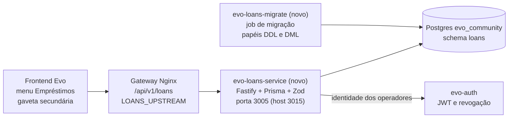

# Plano de Implementação — Módulo Empréstimos do jprOS — v2.1

Data: 28/10/2026 · Revisão técnica e consolidação parcial das decisões do dono.

**Estado:** plano em discussão, sem implementação ou liberação operacional. Decisões já respondidas estão registradas nas regras e na seção final. O [detalhamento e cenários v2.1](docs/emprestimos/REGRAS-E-CENARIOS-v2.1.md) complementa este plano; a ordem de apuração da multa no dia do pagamento foi decidida; condições-limite seguem sujeitas a validação. Propostas técnicas não representam aceite do dono.

**Precedência:** este arquivo é a referência vigente de planejamento de Empréstimos. A [v1](docs/historico/solicitacao-implementacao-emprestimos.v1-20261028.md), a [v2 anterior às decisões](docs/historico/solicitacao-implementacao-emprestimos.v2-antes-decisoes-20261028.md) e os [apontamentos da revisão v2](docs/AVALIACAO-EMPRESTIMOS-v2.md) são históricos; em caso de divergência prevalecem as decisões registradas nesta v2.1.

**Separação obrigatória, reafirmada pelo dono:** Empréstimos e Financeiro são módulos diferentes e independentes. Empréstimos não depende de serviços, tabelas, regras, permissões, migrações ou disponibilidade do Financeiro. Não cria lançamentos nele e não usa seus saldos. O compartilhamento permitido é da infraestrutura do jprOS: identidade do Auth, PostgreSQL com isolamento de papéis, gateway e componentes visuais genéricos.

## Resumo executivo

Construir Empréstimos como serviço próprio (`evo-loans-service`, schema `loans`), com domínio e motor de cálculo próprios. A base é a operação demonstrada pela planilha; os recursos adicionais do protótipo entram nas fases correspondentes. A documentação geral do jprOS orienta a integração técnica, sem importar regras de negócio de outros módulos.

A planilha controla a operação em 14 colunas, uma linha por parcela, com duas regras de cálculo que o sistema precisa reproduzir ao centavo: parcela única com taxa fixa sobre o período e parcelas múltiplas pela tabela Price (PMT).

**Decisões centrais do plano**

1. **Dados isolados.** Clientes, contatos e documentos vivem no schema `loans`, sem chave estrangeira para o CRM ou para outros módulos.
2. **Carteiras isoladas.** Cada carteira tem clientes, contratos, parâmetros e resultados próprios. Cada pessoa vê apenas as carteiras autorizadas; pessoas designadas administram os acessos.
3. **Pagamento e alocação explícitos.** Cada recebimento identifica os componentes abatidos; rolagem, ajuste e renegociação preservam o histórico.
4. **Cadastro manual inicial.** Sem importação da planilha neste momento. Contratos novos e antigos serão cadastrados no sistema; contratos antigos incluem todas as parcelas e exigem data para marcar parcela paga.

O roteiro tem critérios de saída e evidências próprias em `docs/emprestimos-evidencias.md`, a criar durante a execução. Importação e reconciliação em lote ficam fora da entrega inicial; uma futura importação exige planejamento e autorização próprios. Notificações não bloqueiam o núcleo. Não há dependência de entrega ou aprovação do Financeiro.

## Base técnica verificada e limites

A revisão inspecionou Auth, Projetos, frontend, gateway, manifests e CI. Não existe `evo-loans-service` nem registro de `loans` nos manifests e gateway examinados. Não foram executados serviços, migrações ou testes contra banco real. Os números da planilha e as referências ao protótipo/PRD são informações herdadas da v1: suas fontes não foram localizadas no repositório nem revalidadas nesta revisão.

| Evidência atual | Consequência para Empréstimos |
| --- | --- |
| `evo-projects-service/src/auth/jwt.ts` valida assinatura e claims; `auth-client.ts` consulta o Auth | Adaptar o padrão técnico e testar o contrato real de `sub`, `aud`, revogação e indisponibilidade; não copiar regras de workspace |
| `evo-projects-service/src/services/idempotency.service.ts` chama `operation()` sem entregar seu `tx`; `tasks.routes.ts` chama outro serviço nesse callback | A referência não garante transação única para o novo domínio; Empréstimos deve passar `tx` à operação e persistir pagamento, alocações, auditoria e resultado idempotente juntos |
| `docker-compose.yml` tem job de migração de Projetos e espera por sua conclusão | Criar job próprio e credenciais próprias; em Swarm, definir execução de migração como etapa explícita do deploy |
| `nginx/Dockerfile` filtra variáveis em `NGINX_ENVSUBST_FILTER` | Acrescentar `LOANS_UPSTREAM` ao filtro, defaults e manifests; editar só o template de rota é insuficiente |
| Frontend usa placeholders no Dockerfile e substituição no entrypoint | Entregar `VITE_LOANS_API_URL` junto de cliente HTTP, menu, rotas e i18n |
| Parte dos testes de concorrência de Projetos usa mocks de `$transaction` | Verificar invariantes do novo módulo com PostgreSQL descartável e conexões independentes; mocks não demonstram bloqueio real |

As lacunas dessas referências são limites de reaproveitamento, não autorização para refatorar os outros módulos. Não criar pacote compartilhado, integração MCP nem barramento. As carteiras independentes de Empréstimos são requisito deste módulo; não dependem dos workspaces ou de dados de Projetos.

## Operação da planilha relatada na v1

As contagens abaixo são referência do levantamento anterior. Caso a fonte esteja disponível e seja pesquisada, registrar arquivo, aba, versão, data de referência e hash. Sua verificação é opcional e não bloqueia as fases ou a liberação. Não tratá-las como inventário atual confirmado.

A planilha tem três abas, mas só a EMPRESTIMOS guarda os dados de verdade. A VENCIMENTOS é uma agenda derivada dela, e a aba PAINEL foi deixada de fora desta análise por decisão do dono.

| Aba | Papel | Como se comporta |
| --- | --- | --- |
| EMPRESTIMOS | Base de dados: uma linha por parcela de cada contrato | Digitada à mão; fórmulas só em parte das colunas |
| VENCIMENTOS | Agenda de recebimentos por data, com subtotal por dia | Lista estática a partir de 10/09/2026 |

**Colunas da aba EMPRESTIMOS (14)**

| Coluna | Significado | No sistema |
| --- | --- | --- |
| NOME DO CLIENTE | Nome, muitas vezes com etiqueta livre entre parênteses ("CONTRATO NOVO", "ACORDO 1", apelidos) | Cliente + campos próprios de tipo/etiqueta do contrato |
| CPF | Identificador do tomador | CPF válido único por carteira; ausente ou inválido pode permanecer pendente |
| DATA DO EMPRESTIMO | Data de concessão | Contrato |
| VALOR DO EMPRESTIMO | Principal | Contrato (principal) |
| TAXA DE JUROS | Percentual do contrato (ex.: 13,9%, 20%, 30%) | Contrato (taxa e base: período) |
| QTD DE PARCELAS | Número de parcelas | Contrato |
| PARCELA | Numeração no formato "01 03" | Parcela (sequência) |
| VENCIMENTO DA PARCELA | Data de vencimento | Parcela |
| VALOR DA PARCELA | Valor previsto | Parcela (valor devido) |
| VALOR FINAL DO EMPRESTIMO | Parcela × quantidade | Calculado |
| SITUAÇÃO | "PAGO" e similares, digitado | Derivado dos pagamentos |
| DIAS DE VENCIMENTO | Dias até/desde o vencimento, parece depender da data atual | Calculado na consulta |
| STATUS DA PARCELA | Vencido / a vencer | Derivado de data + pagamentos |
| OBSERVAÇÃO | Texto livre com fatos operacionais | Notas e lançamentos estruturados |

**Regras de cálculo relatadas no levantamento original**

- **Parcela única:** parcela = principal × (1 + taxa), com a taxa aplicada ao período inteiro, seja qual for o prazo. Exemplo: R$ 700,00 a 20% vira R$ 840,00. Bate em 460 de 467 contratos desse tipo.
- **Várias parcelas:** parcela fixa pela tabela Price, com taxa por período (mensal ou semanal). Exemplo: R$ 1.000,00 a 13,9% em 3 parcelas dá R$ 430,01 e total de R$ 1.290,03. Bate em 258 de 283 contratos desse tipo.
- **Valor final:** parcela × quantidade em 746 de 750 contratos reconstruídos. As exceções vêm de ajustes manuais e arredondamento.

Segundo o levantamento da v1, o exemplo de 13,9% em três parcelas aparece tanto na planilha quanto na tela Novo Empréstimo do protótipo. Essa correspondência de origem não foi revalidada nesta revisão.

**Práticas operacionais que aparecem nas observações**

- Pagamento só de juros para rolar o contrato (ex.: "PAGOU SO JUROS 140,00" sobre um principal de R$ 700,00).
- Pagamento parcial e encargos embutidos na parcela (multa e itens avulsos).
- Empréstimos semanais (cerca de 54 contratos) e mensais (cerca de 141), com periodicidade inferida das datas.
- Acordos e contratos novos sobre dívidas anteriores, indicados por etiqueta no nome.
- Origem do capital ("aplicação"), origem do cliente e indicação de terceiros.
- Contratos grandes a 0% que na prática são financiamento de bem, não empréstimo.

## Achados e problemas de qualidade de dados

O levantamento anterior identificou inconsistências. Esta tabela é somente contexto histórico: não há importação da planilha na entrega inicial, e nenhum dos tratamentos de importação abaixo é exigido para liberar o módulo.

| Achado | Evidência | Tratamento |
| --- | --- | --- |
| Status contraditório | 25 parcelas futuras marcadas como VENCIDO; 166 parcelas pagas aparecem como "A VENCER"; parcelas pagas antigas aparecem como VENCIDO | Eliminar status digitado; derivar de data e pagamento |
| Linhas vazias de template | 611 linhas com `#NUM!` | Descartar na importação |
| Datas | Formatos mistos e erros de digitação (4 linhas) | Normalizar formatos conhecidos; datas ambíguas ou inexistentes exigem decisão registrada |
| CPF inválido | 84 de 241 CPFs não passam no dígito verificador | CPF pendente pode ser corrigido depois; novo empréstimo é permitido conforme RN-15 |
| Mesmo CPF com rótulos diferentes | 20 CPFs aparecem com mais de um nome ou etiqueta | Propor vínculo pelo CPF validado; revisar conflitos de identidade antes de unificar |
| Etiqueta no nome | Cerca de 41% das linhas usam o nome como campo livre | Extrair para tipo de contrato e notas |
| Parcelas faltando | 95 contratos têm menos linhas que a quantidade de parcelas | Gerar proposta em área de conferência; ausência não prova dívida nem pagamento. Incorporar somente após aceite por contrato |
| Numeração inconsistente | Formatos "01 03" e "2 03" na mesma coluna | Normalizar sequência |
| Sem dados de contato | Nenhum telefone, e-mail ou endereço | Coleta posterior; notificações só após cadastro |

## Escopo e requisitos

O escopo da primeira entrega é o que a planilha já faz, com as correções que ela não consegue fazer; o que o protótipo e o PRD acrescentam entra depois, por fase. Só as funcionalidades do protótipo foram consideradas: cores, marca e layout seguem o padrão Evo dos outros módulos.

| ID | Requisito | Origem | Fase |
| --- | --- | --- | --- |
| RF-01 | Carteiras isoladas e cadastro de cliente próprio por carteira (nome, CPF, contatos, endereço, origem, indicador, notas) | Decisão do dono + planilha + protótipo | 1 |
| RF-02 | Contrato de empréstimo de dinheiro ou acordo, método (parcela única fixa ou Price) e periodicidade (semanal ou mensal) | Planilha + decisão do dono | 1 |
| RF-03 | Simulação em tempo real com cronograma antes de confirmar; salvar rascunho | Protótipo | 1 |
| RF-04 | Geração automática das parcelas, com ajuste manual justificado e auditado | Planilha | 1 |
| RF-05 | Registro de pagamento: total, parcial e só juros; meio (PIX, transferência, dinheiro); comprovante | Planilha + protótipo | 2 |
| RF-06 | Multa e juros de mora calculados na data do pagamento, com valor editável e justificativa | Protótipo | 2 |
| RF-07 | Encargos avulsos na parcela (descrição e valor) | Planilha | 2 |
| RF-08 | Status derivado de parcelas, contratos e clientes, separando liquidação de atraso | Planilha (corrige) | 1 e 2 |
| RF-09 | Renegociação e acordo ligados ao contrato de origem | Planilha | 2 |
| RF-10 | Central de parcelas: filtros (todas, vence hoje, vencidas, pagas), período, valor, busca; ações em lote | Protótipo + VENCIMENTOS | 3 |
| RF-11 | Ficha do cliente: contratos, parcelas, pagamentos, notas | Protótipo | 3 |
| RF-12 | Painel com os indicadores-chave K1 a K8 (seção Indicadores-chave) | Protótipo | 4 |
| RF-13 | Relatórios: fluxo de caixa de 6 meses, distribuição por status, maiores devedores, faixas de valor; exportação em Excel e PDF | Protótipo | 4 |
| RF-14 | Cadastro manual de contratos antigos com todas as parcelas e data obrigatória para cada pagamento já realizado | Decisão do dono | 2 e 3 |
| RF-15 | Avisos automáticos somente por WhatsApp, com dias configuráveis por carteira | Protótipo + decisão do dono | 6 |
| RF-16 | Parâmetros por carteira; acesso por pessoa/carteira e responsáveis designados para administrar acessos; backup e auditoria desde a fundação | Protótipo + decisão do dono | 0 a 4 |

**Fora de escopo nesta versão**

- Webhook de PIX e portal do tomador (fases 2 e 3 do roadmap do PRD).
- Integração de negócio com CRM, Financeiro, Projetos ou Agenda. Clientes e recebimentos são próprios; não sincronizar cadastros nem consultar saldos externos. Auth é a exceção de infraestrutura para identidade dos operadores.
- Score de crédito automático. As estrelas do protótipo viram, no máximo, uma classificação manual de 1 a 5.
- Módulo de Investimentos (aparece no menu do protótipo). A planilha só pede registrar a origem do capital em cada contrato.
- Financiamento de bens, inclusive sem juros. Empréstimos de dinheiro sem juros são permitidos por decisão do dono.
- Importação da planilha ou carga automatizada de dados antigos nesta entrega. Nenhum ciclo de reconciliação com planilha é pré-requisito para usar o módulo.
- Carência: aparece no protótipo, mas não há caso demonstrado. Não criar campos ou feature flag para ela nesta versão; eventual inclusão requer decisão de escopo.
- DRE, plano de contas, retenções tributárias, conciliação bancária e saldo de contas bancárias. O fluxo de caixa de RF-13 é um relatório operacional próprio de concessões e recebimentos, sem representar o caixa da empresa.

## Modelo de domínio

A planilha mistura contrato e parcela numa única linha; o modelo separa as duas coisas e trata cada pagamento como um lançamento que se aloca em parcelas. Todas as tabelas ficam no schema `loans`.

| Entidade | Para que serve | Campos principais |
| --- | --- | --- |
| Carteira | Unidade isolada de operação | ID, nome, estado e versão; parâmetros, membros e resultados próprios |
| Cliente | Tomador com cadastro próprio em cada carteira | ID interno, carteira, nome, CPF cifrado e índice de unicidade por carteira quando válido, sinalizador de CPF pendente, RG, nascimento, contatos, endereço, origem, indicador e classificação manual |
| Indicador | Quem indicou o cliente ("IND." na planilha) | nome, contato |
| Contrato | Operação de crédito | cliente, tipo, método, periodicidade, principal, taxa por período, nº de parcelas, concessão, 1º vencimento, dia-âncora, origem do capital, etiqueta, estado de ciclo de vida, versão, versão do cálculo e parâmetros confirmados |
| Parcela | Cada vencimento do contrato | contrato, sequência única no contrato, vencimento civil, valor original, principal e juros contratuais previstos, qualidade da composição histórica |
| Encargo avulso | Item embutido na parcela (multa, taxa, produto) | parcela, descrição, valor |
| Pagamento | Recebimento imutável | contrato, data efetiva, data de registro, valor, meio, comprovante, chave de operação, vínculo de estorno; total/parcial é resultado da alocação |
| Alocação | Destino do dinheiro recebido | pagamento, parcela e valores de principal, juros contratuais, multa, mora e encargos; excepcionalmente saldo legado não classificado, sem atribuí-lo a juros/principal; todos do mesmo contrato |
| Ajuste | Alteração justificada do devido, sem simular dinheiro | parcela, componente, diferença assinada, motivo, autor, vínculo de reversão; inclui desconto concedido |
| Correção de recebimento | Corrigir registro divergente do dinheiro efetivamente recebido sem editar o original | vínculo ao recebimento, diferenças por componente e no valor recebido, datas, autor, motivo e chave idempotente; não representa transferência nova |
| Devolução e compensação | Distinguir devolução real de principal e valores já compensados no cancelamento | contrato, valor, componente, data efetiva, meio e comprovante quando houver, vínculo ao cancelamento e origem; somente devolução real movimenta dinheiro |
| Prorrogação | Histórico da rolagem | contrato/parcela, pagamento associado, vencimento anterior e novo, taxa escolhida, base, encargos transferidos e tratamento das demais parcelas |
| Renegociação | Transferência de dívida sem recebimento fictício | contrato de origem e novo, composição do saldo transferido, data, motivo, estado e vínculo de reversão |
| Nota e anexo | Observações e documentos | texto estruturado; arquivo com sha256 e tipo verificado |
| Notificação (Fase 6) | Regras, modelos e fila de envio | destinatário próprio, canal, vencimento de referência, deduplicação, status, tentativas e identificação no provedor |
| Auditoria | Histórico de alterações | quem, quando, entidade, antes e depois (com dados sensíveis ocultados) |
| Configuração | Padrões de cada carteira | taxa padrão, método padrão, multa, juros de atraso, frequência das multas e dias de avisos |
| Membro e autorização | Acesso às carteiras e administração dos acessos | `authUserId` canônico, carteira autorizada, estado e capacidade explícita de gerir acessos; sem senha própria e sem FK para o Auth |
| Operação idempotente | Evitar repetição de comandos | ator, operação, chave, hash canônico do pedido, resultado e entidade criada; confirmação transacional |
| Perda e recuperação | Valor que deixou de ser cobrado e eventual recebimento posterior | contrato, valor, data, motivo, autor, valor recuperado e vínculo ao pagamento posterior |

Carteira, cliente, contratos, parcelas, pagamentos, anexos, notificações, auditoria e parâmetros devem carregar ou derivar com segurança a carteira proprietária. Chaves e validações relacionais impedem cruzar registros entre carteiras; CPF válido é único **dentro da carteira**, e pode repetir em outra. Em listagens, relatórios, exportações e indicadores, o servidor filtra pelas carteiras autorizadas, não apenas pela seleção da interface.

Valores monetários usam `Decimal` e `ROUND_HALF_UP` em duas casas. Na API, dinheiro e taxa trafegam como strings decimais; cálculo interno tem precisão superior, com pontos de arredondamento definidos. A taxa `13.9` significa 13,9% por período e é convertida uma única vez para `0.139`.

O cronograma confirmado é persistido; alterações de configuração não recalculam contratos existentes. Saldos atuais podem ser projeções atualizadas na mesma transação dos registros de origem e precisam ser reconciliáveis. Isso não exige contabilidade geral nem event sourcing.

No cadastro manual de contrato antigo, registrar o cronograma completo e os pagamentos efetivamente conhecidos com data. O sistema não cria automaticamente uma entrega de dinheiro ou um recebimento novo na data de cadastro: fatos passados são identificados como históricos e não contam duas vezes. Como preencher componentes e encargos antigos que o operador desconhece continua pendente.

## Regras de negócio

As regras RN-01 a RN-20 pertencem exclusivamente a Empréstimos. As decisões já informadas pelo dono estão refletidas abaixo; escolhas não respondidas permanecem pendentes na seção final e não podem ser inferidas pela equipe.

**Cálculo do contrato**

- **RN-01 Parcela única fixa.** O valor devido é o principal acrescido da taxa do período inteiro, sem considerar o prazo.

```latex
parcela = P \times (1 + i)
```

- **RN-02 Parcelas múltiplas pela Price.** Parcelas iguais, com a taxa aplicada ao período (mês ou semana).

```latex
PMT = P \cdot \frac{i}{1 - (1 + i)^{-n}}
```

  Para `i = 0`, usar `P / n`, evitando divisão por zero. Exigir principal positivo, taxa não negativa e `n` inteiro positivo; limites máximos explícitos no schema da API, dimensionados na Fase 0. Primeira parcela irregular não cria juros proporcionais automaticamente: método, periodicidade e 1º vencimento são exibidos na simulação.
- **RN-03 Valor final e resíduos.** Exibir separadamente total original, ajustes e total atual. Se a divisão gerar diferença de centavos, ajustar a última parcela para fechar o valor do contrato, como decidiu o dono. Em Price, definir também a distribuição entre principal e juros, sem valores negativos e com principal final quitado; esse detalhe técnico ainda precisa de exemplos validados. Total atual = soma das parcelas ajustadas.
- **RN-04 Ajuste manual.** Qualquer pessoa autorizada à carteira tem a mesma permissão operacional para ajustar, com motivo e auditoria transacional. Preservar valor original e registrar diferença por componente. Não reduzir o devido abaixo do já liquidado. Contrato quitado, cancelado ou renegociado não admite ajuste genérico; correções vinculadas a recebimentos e dependências seguem RN-10 e suas validações específicas. Não reabrir a edição livre dos parâmetros de RN-16.
- **RN-05 Datas.** Datas civis `YYYY-MM-DD` em colunas `@db.Date`; instantes de registro em UTC. Mensal: calcular cada vencimento a partir do dia-âncora original, não da parcela anterior (31/01 → 28/02 → 31/03). Semanal: intervalos de sete dias civis. Validar existência da data e 1º vencimento não anterior à concessão. Sem deslocamento automático por feriado. "Hoje" é a data em `America/Sao_Paulo`, com relógio controlado nos testes.

**Atraso e encargos**

- **RN-06 Multa e mora.** Aplicação automática em parcelas atrasadas. Cada carteira define percentuais padrão de multa e juros de atraso, espera até a primeira multa, frequência das multas e método de cálculo dos juros de atraso; taxas são sugeridas no contrato e podem ser alteradas nele. Alterações desses parâmetros e da frequência valem apenas para novos contratos, preservando condições dos existentes. A primeira multa é cobrada após a quantidade de dias configurada por carteira e se repete na frequência configurada. Os juros por atraso contam a partir do dia seguinte ao vencimento. No recebimento, apresentar as opções de incluir ou não o dia efetivo do pagamento no cálculo; incluir o dia vem pré-selecionado, com possibilidade de alterar conforme o acordo, preservando a escolha no histórico. O padrão é proporcional aos dias, usando a quantidade real de dias de cada mês; atrasos que atravessam meses consideram os dias de cada mês correspondente. Como alternativa configurável por carteira, cobrar juros de um mês inteiro a cada 30 dias completos de atraso: a primeira cobrança aos 30 dias e a seguinte aos 60 dias. Se houver pagamento parcial durante o período, apresentar os cálculos pelo saldo ao final do período e pelos saldos proporcionais ao tempo; o operador escolhe em cada caso, conforme o acordo, sem opção pré-selecionada. Multa e juros usam apenas o saldo da parcela após pagamentos parciais, sem incluir multas ou juros de atraso anteriores. Quando houver pagamento no dia de aplicação da multa, aplicar primeiro o pagamento à dívida e aos encargos anteriores seguindo RN-08; então calcular a multa do dia sobre o saldo-base após o pagamento. A multa recém-calculada fica para pagamento posterior e não é abatida pelo mesmo recebimento. Multas anteriores continuam na ordem de RN-08. O tratamento quando o pagamento quita o saldo-base integralmente e o limite para recebimento no mesmo dia permanecem sujeitos a validação explícita. Usuário autorizado pode reduzir/dispensar encargos com valor, motivo e auditoria. Persistir cálculo e condições aplicadas. Percentuais padrão não foram definidos; 2% e 1% a.m. são exemplos, não valores aprovados.

```latex
mora = valor \times i_{mora} \times \frac{dias}{30}
```

A fórmula acima, com base fixa de 30 dias, é apenas o exemplo da v2. No padrão proporcional decidido depois, dividir os dias de cada mês pela quantidade real de dias daquele mês e somar os períodos, usando os saldos correspondentes; arredondar conforme a política de cálculo aprovada.

- **RN-07 Encargo avulso.** Identificar descrição, componente, valor e origem. Não somar novamente um encargo já embutido no valor legado da parcela. A prévia mostra essa composição; remover encargo confirmado exige ajuste inverso com motivo.

**Pagamentos**

- **RN-08 Alocação.** O sistema sugere a parcela mais antiga, mas o operador pode selecionar outra no mesmo contrato. Quando o valor recebido supera o saldo da primeira parcela, quita essa parcela e aplica o restante automaticamente à parcela mais antiga ainda em aberto no contrato, apresentando a distribuição na prévia. Isso vale também quando a primeira parcela foi escolhida manualmente. Ordem dentro da parcela: multa, juros contratuais, juros de atraso, encargos avulsos e principal. Desconto reduz dívida por ajuste identificado, sem compor dinheiro recebido. Na quitação antecipada, o desconto é decidido em cada acordo. Data efetiva e data do registro são ambas preservadas; lançamento com data passada não recalcula automaticamente encargos já calculados, que podem ser ajustados manualmente. Soma das alocações do recebimento = valor recebido; nenhum saldo fica negativo. Não aceitar valor acima do devido no contrato e informar o limite ao operador. Não gerar crédito excedente. Parcelas futuras não são recalculadas por pagamento parcial comum.
- **RN-09 Só juros e rolagem.** Pagamento só de juros não amortiza o principal; a prorrogação inclui novos juros. A prorrogação exige quitação integral dos juros contratuais antigos da parcela, respeitada a ordem de alocação de RN-08; se o pagamento não for suficiente, informar o valor adicional necessário e impedir a prorrogação até sua quitação. Ex.: R$ 700 a 20% com R$ 140 de juros pagos permanece com R$ 700 de principal e, se renovado a 20%, R$ 840 no novo vencimento. Sugerir a taxa anterior e a próxima data da periodicidade, permitindo alterar ambas. Em parcelados, a prorrogação depende do acordo; o operador escolhe a base dos novos juros e se altera as parcelas seguintes. Encargos pendentes são somados ao valor prorrogado e exibidos em separado. Em parcela única, os novos juros incidem apenas sobre o principal, excluindo encargos anteriores. Prorrogação é explícita, com antes/depois e auditoria; o modo de representar internamente a operação e demais detalhes não respondidos permanecem pendentes.
- **RN-10 Estorno.** Pagamento e alocações confirmados não são editados/apagados. Estorno integral único, com vínculo ao original, motivo e alocações inversas, na mesma transação. Recalcular o saldo e seus estados. Repetição não estorna duas vezes. Se houve rolagem ou renegociação dependente, bloquear o estorno isolado e apresentar a dependência; quando houver acordo posterior, a correção do erro pode ser registrada por ajuste justificado no acordo atual, preservando os fatos anteriores e sem simular entrada ou saída de dinheiro; detalhar validações e limites para impedir saldos incoerentes. Quando existirem pagamentos posteriores sem acordo, o operador pode registrar ajuste justificado no contrato atual, preservando os pagamentos anteriores. Se o valor registrado diferir do dinheiro efetivamente recebido, registrar também uma correção do recebimento com vínculo ao original, motivo e auditoria; os relatórios devem mostrar o valor efetivamente recebido e preservar o registro original. Não criar devolução nem entrada de dinheiro fictícia. A prévia deve demonstrar que correção e eventual ajuste de dívida não duplicam seus efeitos. Para outras dependências, definir o procedimento antes de permitir a correção. Estornar o registro do recebimento não comprova devolução bancária.
- **RN-11 Idempotência.** Exigir chave em confirmação de contrato e cadastro histórico, pagamento, estorno, correção de recebimento e data, ajuste, prorrogação, renegociação, cancelamento, devolução, baixa/recuperação e correção de perda. Chave por carteira + ator + operação + identificador enviado pelo cliente; hash do payload validado e normalizado. Mesmo pedido devolve os mesmos IDs e resultado; mesma chave com conteúdo diferente retorna 409. Autorizar novamente antes do replay. Chave, resultado, mutação e auditoria confirmam no mesmo `tx`. Guardar identidade da operação enquanto existir seu efeito; expiração de cache HTTP não autoriza repetir um recebimento. Retry do navegador preserva a chave.

**Status**

- **RN-12 Parcela.** Separar `liquidacao` (aberta, parcial, liquidada) de `prazo` (a vencer, vence hoje, vencida, sem saldo). Uma parcela parcial e vencida aparece nos dois filtros. Saldo zero implica liquidada/sem saldo; manter distinção entre pagamento e desconto que zerou a dívida. Parcelas substituídas por renegociação não entram na cobrança. Não há cron diário para gravar "vencida".
- **RN-13 Contrato.** Ciclo de vida persistido: rascunho, confirmado, cancelado, renegociado ou marcado como perda. Para confirmado, situação derivada: quitado quando não há saldo; inadimplente quando há saldo vencido; ativo nos demais casos. Rascunho não gera exposição, cobrança ou indicadores. Confirmação considera o dinheiro entregue, sem executar transferência bancária.
- **RN-14 Cliente.** Derivado dos contratos confirmados: inadimplente se algum está inadimplente; ativo se há saldo sem atraso; quitado se houve contrato e todos os saldos elegíveis foram liquidados. Sem contratos elegíveis = sem operação. Não classificar pessoa com cadastro pendente como quitada por ausência de dados.

Para RN-13/RN-14 e os indicadores, contrato elegível exige concessão confirmada ou dívida histórica/transferida aceita. Rascunho não gera exposição nem cobrança. Uma dívida marcada como perda permanece no histórico e sai das cobranças; eventual recebimento posterior reduz o valor considerado perdido e conserva os dois registros.

**Integridade**

- **RN-15 Cliente.** CPF válido normalizado é único por carteira; é permitido cadastrar a mesma pessoa separadamente em outra carteira. Permitir cadastro manual com CPF ausente ou inválido e marcar o CPF como pendente para correção posterior. Permitir contratos antigos e novos empréstimos enquanto o CPF estiver pendente, mantendo o aviso visível. Não unificar automaticamente pessoas por CPF inválido, CPF ausente ou nome parecido. Cliente, contrato e pagamento devem pertencer à mesma carteira. Correção de CPF verifica conflito dentro da carteira, sem sobrescrever outro cliente.
- **RN-16 Contrato confirmado.** Principal, taxa, método, periodicidade e cronograma original são imutáveis; ajustes de RN-04 são operações próprias. Contrato confirmado por engano, sem entrega de dinheiro, pode ser cancelado com motivo. Se houve entrega efetiva, permitir cancelamento quando o cliente devolver o principal; valores já recebidos e efetivamente alocados ao principal contam como parte da devolução, restando apenas a diferença. Se houver pagamentos, devem ser estornados primeiro, preservando evidência dos recebimentos reais e registrando sua compensação na devolução, sem simular movimentação de dinheiro. Os juros já recebidos podem ser mantidos, devolvidos integralmente ou devolvidos parcialmente, conforme a escolha em cada cancelamento, registrando o valor e a movimentação real. Multas e juros de atraso já recebidos também podem ser mantidos, devolvidos integralmente ou parcialmente, conforme a escolha em cada cancelamento, registrando o valor e a movimentação real. Encargos avulsos já recebidos também podem ser mantidos ou devolvidos integralmente ou em parte conforme o acordo de cada cancelamento, registrando valores e movimentações reais. Preservar histórico; cancelamento não equivale a quitação ou perda. Outras dependências posteriores permanecem pendentes.
- **RN-17 Renegociação.** Novos juros incidem sobre o principal emprestado ainda devido; juros e multa anteriores entram no novo acordo como componentes separados, sem receber novos juros. O tratamento dos demais encargos pendentes, como juros por atraso, é decidido conforme o acordo com o cliente e deve aparecer na prévia. Confirmar vínculo, novo acordo e encerramento da cobrança antiga atomicamente, sem criar recebimento ou saída de dinheiro para dívida transferida e sem dupla contagem. Reversão com eventos posteriores exige tratamento explícito.
- **RN-18 Perdas.** O operador pode marcar como perda somente o saldo integral da dívida do contrato, com motivo e histórico; não permitir marcação parcial; ela sai das cobranças e o valor fica congelado sem novos juros ou multas enquanto marcada como perda. Se houver pagamento posterior, registrar recebimento e reduzir o valor em perda, preservando os dois fatos e aplicando a mesma ordem de abatimento dos pagamentos normais em RN-08. Quando a marcação de perda for corrigida e a dívida voltar à cobrança, o operador decide em cada caso se o período em perda permanece sem encargos ou se os encargos desse período serão calculados, registrando a escolha e o motivo. Impacto dos componentes e dos indicadores requer especificação e testes; não tratar perda como pagamento ou cancelamento.
- **RN-19 Concorrência.** `expectedVersion` obrigatório nas mutações de contratos existentes; atualização condicional e incremento atômico. Adquirir bloqueio do contrato antes de reler saldo, recalcular encargos e validar estado; pagamento, estorno, ajuste e renegociação usam a mesma disciplina. Prévia não reserva saldo. Usar `tx` em todos os serviços envolvidos; retry limitado apenas para conflitos transitórios. Nenhuma chamada de rede dentro da transação. Lotes bloqueiam contratos em ordem estável ou executam cada item independentemente, conforme contrato de lote abaixo.
- **RN-20 Exclusão.** Exclusão lógica de cadastro/rascunho sem obrigações ativas; janela operacional de restauro de 90 dias, sem purga automática. Recebimentos, alocações, ajustes e auditoria permanecem preservados. Inativar cliente não remove seus contratos dos saldos. Prazo documental de crédito é decisão específica de retenção; a política de Projetos não define por si só a retenção deste domínio.

**Exemplos conferidos por cálculo**

| Caso | Entrada | Resultado |
| --- | --- | --- |
| Parcela única | R$ 700,00 a 20% | R$ 840,00 |
| Price | R$ 1.000,00 a 13,9% em 3 parcelas | R$ 430,01 por parcela; total R$ 1.290,03 |
| Atraso de 21 dias em mês de 30 dias | Base constante de R$ 430,01, uma multa de 2% e mora proporcional de 1% a.m. | Multa R$ 8,60 + mora R$ 3,01 = R$ 441,62; em outros meses o resultado pode variar |
| Price com resíduo | R$ 1.000,00 a 1% em 3 parcelas iguais; juros arredondados por período | R$ 340,02 por parcela; antes de aplicar RN-03, resta R$ 0,01 de principal a resolver |
| Taxa zero com resíduo | R$ 100,00 em 3 parcelas iguais arredondadas | 3 × R$ 33,33 = R$ 99,99; pela decisão D12, ajustar a última para R$ 33,34 |

Os três primeiros resultados foram reproduzidos nesta revisão. Os dois últimos demonstram casos que a v1 não resolvia. Reprodução independente, com aritmética inteira racional e sem dados reais: `node docs/emprestimos/validar-exemplos.mjs`. Isso verifica os exemplos; não homologa o futuro motor do módulo.

## Indicadores-chave

O painel previsto reúne oito indicadores sobre principal, vencimentos, recebimentos e concentração. Eles alimentam RF-12 a partir dos registros próprios de Empréstimos, incluindo ajustes, estornos e abertura aceita. Qualidade e cobertura da base acompanham cada resultado.

| # | Indicador | Como se calcula | Decisão que apoia |
| --- | --- | --- | --- |
| K1 | Principal contratual em aberto | Principal previsto + ajustes assinados de principal − amortizações líquidas de estornos; inclui pagamentos parciais de parcela única. Renegociações entram só no destino e distinguem capital concedido de componentes capitalizados | Quanto principal ainda é devido; não equivale automaticamente a dinheiro originalmente desembolsado |
| K2 | A receber em 30 dias | Saldo devido das parcelas em aberto com vencimento de hoje (inclusive) até hoje + 30 dias (exclusive), sem multa e mora | Planejar caixa e novas concessões |
| K3 | Vencido por faixa de atraso | Saldo das parcelas vencidas nas faixas de 1 a 7, 8 a 30, 31 a 90 e mais de 90 dias, com número de parcelas e de clientes | Quem cobrar hoje e com que urgência |
| K4 | Carteira em risco (PAR 30) | K1 dos contratos com alguma parcela com saldo vencido há mais de 30 dias ÷ K1 total, sob o mesmo filtro | Risco da carteira; a meta de 10% do protótipo é apenas exemplo |
| K5 | Recebimento do vencido no mês | Caixa alocado ao principal e juros contratuais das parcelas com vencimento entre o início do mês e a data de referência ÷ principal e juros contratuais exigíveis dessas parcelas antes dos descontos de liquidação; incluir antecipações já alocadas e descontar estornos até a referência; mostrar descontos separadamente | Efetividade da cobrança; multa/mora não inflam o numerador |
| K6 | Juros contratuais recebidos no mês | Alocações de juros pela data efetiva do recebimento, menos reversões de juros pela data do estorno; multa e mora separadas | Receita recebida de juros, sem afirmar lucro líquido |
| K7 | Juros recebidos / principal médio | K6 ÷ média dos saldos diários de principal no mês até a data de referência, incluindo dias sem movimento | Retorno bruto observado; não desconta perdas, custos ou tributos |
| K8 | Concentração | K1 dos dez maiores clientes ÷ K1 total, somando todos os contratos elegíveis de cada cliente | Dependência de poucos devedores |

**Como ler**

- Data de referência: hoje, no fuso de São Paulo. Resultados são consultados em uma carteira por vez, sempre com autorização do operador. Visão consolidada de carteiras não faz parte do escopo. Não há financiamento de bens neste escopo.
- K1, K4 e K8 exigem composição confiável de principal. K2 e K3 exigem saldos e vencimentos conhecidos. K5 a K7 exigem componentes e datas confiáveis; K7 também precisa de histórico diário reconstruível. Valores não classificados são apresentados à parte, com cobertura da base analisada, sem completar dados por hipótese.
- Os pagamentos históricos cadastrados manualmente exigem data informada, exata ou estimada, com identificação explícita da estimativa. Não apresentar estimativa como fato exato; séries realizadas e estimadas devem ser distintas. K7 pode precisar do primeiro mês com base completa.
- K6 mede juros recebidos; não é resultado líquido e não desconta perdas. Não chamar a carteira de lucrativa com base apenas nesse indicador.
- Denominador zero retorna "não aplicável", não zero nem infinito. Filtros, data de referência e critério de qualidade são idênticos entre painel e exportação.
- Saldos diários de K7 são reconstruídos dos registros próprios com data efetiva e data de registro; otimizações por snapshots somente se o volume medido exigir. Um ajuste posterior não reescreve a origem histórica sem rastro.
- Ficam fora do painel de propósito: total emprestado acumulado, número de clientes e de contratos, e nota de crédito, porque não mudam nenhuma decisão do dia a dia.
- Os demais gráficos do protótipo ficam nos Relatórios (RF-13): fluxo de caixa de concedido e recebido em 6 meses, distribuição por status, maiores devedores e faixas de valor.

## Arquitetura no padrão Evo

Empréstimos usa a estrutura técnica do jprOS: serviço novo, schema e migrações próprios, prefixo de API e menu no frontend. Nenhuma chamada de negócio entre módulos é necessária para simular, conceder, receber, estornar ou consultar a carteira.



Frontend, gateway, auth e Postgres já existem no jprOS; o serviço e o job de migração são os componentes novos. Não há chaves estrangeiras nem consultas entre o schema `loans` e os demais módulos.

| Item | Decisão | Observação |
| --- | --- | --- |
| Serviço | `evo-loans-service`: TypeScript, Fastify, Prisma, Zod e jose; motor próprio com Decimal | Alinhar runtime e versões suportadas na Fase 0; não copiar automaticamente Node 20 do Dockerfile legado. CI atual de Projetos usa Node 22 |
| Banco | Banco `evo_community`, schema `loans` (`?schema=loans`), papéis de DDL e DML separados | Ver decisão D4 |
| Migração | Job `evo-loans-migrate` com `prisma migrate deploy`, que roda antes do serviço | Padrão do `evo-projects-migrate` |
| Porta | 3005 interna; opcional `127.0.0.1:3015` em desenvolvimento; sem publicação direta em produção | Números não encontrados nos manifests examinados; ocupação real deve ser verificada no ambiente de implantação (D9) |
| Gateway | Prefixo delimitado `/api/v1/loans` e `LOANS_UPSTREAM` | Template, Dockerfile, filtro de envsubst e configuração por ambiente entregues juntos |
| Frontend | Item `customer-loans` no menu com gaveta secundária, páginas em `src/pages/loans`, serviços em `src/services/loans`, textos em i18n | Mesma estrutura de Projetos |
| Design | Componentes e tokens do Evo; nada da identidade visual do protótipo | Pedido explícito do dono |
| Liberação | `LOANS_ENABLED=false` inicialmente; piloto autenticado após G3; liberação operacional após G5; `LOANS_NOTIFICATIONS_ENABLED=false` até G6 | Flag no servidor e capacidade refletida na interface. API direta também bloqueia operações desabilitadas; G5 não depende de importação |
| Evidências | `docs/emprestimos-evidencias.md`, com testes, versões, migrações e limites reais | Documento próprio; referência de organização em `docs/projetos-evidencias.md`, sem herdar sua homologação |

### Entrega técnica mínima por ambiente

1. Provisionar schema `loans`, `loans_migrator` e `loans_app`, com grants de tabelas, sequências e objetos futuros. `?schema=loans` sozinho não impede acesso a outros schemas. Testar negação de leitura/escrita entre módulos e ausência de DDL para o processo da aplicação.
2. Migrações versionadas desde o início, nomes físicos conferidos com `@map`/`@@map` e SQL gerado. Não executar `db push` no startup. Em Compose, aplicação depende de migração bem-sucedida; no ambiente Swarm, executar e conferir a migração antes de atualizar réplicas.
3. Criar `/health`, `/ready` internos e `/api/v1/loans/health` mínimo pelo gateway; readiness verifica banco/migração. Rotas de negócio continuam autenticadas mesmo no desenvolvimento. Não expor configuração ou diagnóstico de banco em health público.
4. Integrar `LOANS_UPSTREAM`, `VITE_LOANS_API_URL`, placeholders do frontend, menu genérico, rotas privadas, cliente HTTP e traduções. Login vem do Auth. Não reutilizar a gaveta específica de workspaces de Projetos.
5. Volume exclusivo de anexos, usuário de container sem root, limites HTTP e CORS explícitos. Backup coerente de banco + anexos; chaves criptográficas recuperáveis por procedimento separado. Ensaiar restauração antes de dados reais.
6. CI do novo serviço com checkout dos submódulos necessários, lockfile, geração Prisma, build, testes unitários e PostgreSQL descartável criado pela própria execução. Não depender de workspace de teste preexistente nem do banco da operação.

A escolha entre manter o serviço na raiz ou registrá-lo como submódulo próprio é técnica e deve ser resolvida em Fase 0, incluindo CI e deploy. Não criar repositório remoto durante esta revisão. A primeira entrega deve validar a topologia escolhida; a segunda topologia só se torna obrigatória quando fizer parte do deploy contratado.

## API, segurança e LGPD

O módulo reaproveita o que os serviços Fastify do jprOS já padronizam, e acrescenta controles específicos para CPF, documentos e dados de crédito, que são o ativo mais sensível deste módulo.

**Padrões herdados dos outros módulos**

- JWT do `evo-auth`: verificar assinatura, algoritmo configurado, emissor, expiração e `sub`; validar audiência conforme o token realmente emitido. O emissor atual permite `aud` como string `[]`, portanto não impor audiência nova sem validar compatibilidade. Rejeitar divergência entre `sub` e ID retornado por `/api/v1/auth/validate`.
- Em leituras comuns, cache positivo local de até 60 segundos; em mutações e acesso a documento completo, consulta atual ao Auth. Token recusado → 401; Auth indisponível ou resposta inesperada → 503, sem usuário de fallback. O Auth possui cache próprio: o limite local não comprova sozinho o prazo de propagação de suspensão; testar revogação e desativação de ponta a ponta.
- `AccessService` próprio, baseado em autorização ativa por carteira. JWT válido não concede acesso automático. Pessoas designadas administram acessos; autorização operacional é igual para os membros de cada carteira. Definir bootstrap auditado e recuperação de acessos, sem depender de papéis de outro módulo.
- DTOs estritos com Zod; erros no formato `{code, message, requestId}`.
- Controle otimista com `version` (409 em conflito), `Idempotency-Key` nas escritas sensíveis, transações com bloqueio e nova tentativa.
- Auditoria transacional com campos sensíveis substituídos por `[REDACTED]`.
- Anexos com SHA-256, tamanho e tipo verificado (PDF, PNG e JPG; proposta de limite: 5 MiB por arquivo). Magic bytes não garantem conteúdo seguro: armazenamento sem execução, nome gerado pelo servidor, download autenticado por vínculo ao recurso, `nosniff`, `Content-Disposition: attachment` e sem URL pública permanente. Restringir o envelope multipart no gateway com margem para metadados.
- Migrações versionadas por job `evo-loans-migrate` (`prisma migrate deploy`), com papéis de banco separados para DDL e DML.

**Papéis e permissões**

O dono decidiu que os usuários autorizados terão as mesmas permissões operacionais em suas carteiras: consulta, documentos completos, cadastros, pagamentos, estornos, ajustes, cancelamentos, acordos, relatórios e parâmetros. A pessoa só acessa carteiras explicitamente concedidas. Somente pessoas específicas designadas pelo dono podem criar carteiras e conceder/retirar acesso. Para cada pessoa designada, define-se individualmente quais carteiras pode administrar; administrar acesso a uma carteira também concede a essa pessoa acesso aos dados dela, sem ampliar acesso às demais.

A tela de acesso vincula identidades existentes do Auth; não cria outro sistema de senhas. Falha ao consultar o diretório deve ser mostrada como falha, não como "usuário inexistente". A identificação das pessoas designadas e o procedimento de recuperação do acesso continuam pendentes. Exibição de documento completo é ação explícita com auditoria; o acesso entre carteiras é bloqueado também no servidor.

**Grupos de endpoints em `/api/v1/loans`**

| Grupo | Operações |
| --- | --- |
| `wallets` e `memberships` | selecionar carteira autorizada, administrar seus parâmetros e, quando designado, conceder/revogar acesso |
| `clients` | listar com busca e filtros, criar, editar, ficha, notas, anexos no escopo da carteira |
| `contracts` | simular, salvar rascunho, confirmar, cadastrar histórico, prorrogar, cancelar, registrar devolução/compensação, renegociar, marcar e corrigir perda, consultar cronograma |
| `installments` | listar com filtros, ajustar valor com motivo, encargos avulsos |
| `payments` | registrar (com `Idempotency-Key`), registrar em lote, estornar, corrigir recebimento ou data com histórico, comprovante |
| `dashboard` e `reports` | indicadores, fluxo de caixa, distribuições, maiores devedores, exportação |
| `notifications` | regras configuráveis por carteira, modelos e fila automática de WhatsApp |
| `settings` e `users` | parâmetros da carteira e usuários autorizados |

### Contratos necessários para implementar a API

- Endpoints explícitos de prévia e confirmação para contrato, pagamento, prorrogação e renegociação. Prévia retorna componentes, versões utilizadas, data de referência e impedimentos; confirmação recalcula sob bloqueio e recusa divergência, sem aceitar totais calculados apenas pelo navegador.
- Contratos confirmados não recebem `PATCH` de parâmetros econômicos. Ajuste, estorno, cancelamento e renegociação têm rotas próprias com motivo e permissão.
- Listagens paginadas e ordenação estável (`vencimento`, sequência, ID); filtros e `asOf` por data civil no servidor. Teto inicial de 100 itens por página e por lote, ajustável após medição. Exportação usa os mesmos filtros e limita-se às carteiras autorizadas.
- Pagamento em lote: um comando independente por contrato, com chave persistente por item e resultado individual (confirmado, rejeitado ou repetido). A interface mostra falhas parciais; repetir o lote não refaz itens confirmados. Não prometer atomicidade entre clientes diferentes. Dentro de um contrato, pagamento e todas as alocações são atômicos.
- Códigos esperados: 401 identidade inválida, 403 papel insuficiente, 404 recurso ausente, 409 versão/idempotência concorrente, 422 regra de negócio, 413 tamanho, 429 limite de taxa e 503 dependência indisponível. Erro inclui `requestId` e não traz CPF, SQL ou stack trace.
- Exportação Excel trata texto do usuário como texto, evitando fórmulas executáveis; PDF e comprovantes não publicam arquivo fora das permissões do módulo.

**Proteção de dados pessoais e retenção**

- CPF e RG cifrados em repouso; CPF válido normalizado com índice HMAC para igualdade e unicidade por carteira, chave fora do banco. Não prometer busca parcial no CPF cifrado. Guardar versão da chave; prever rotação sem criar duplicidade e restauração com as chaves necessárias. RG não recebe unicidade global automática.
- CPF mascarado por padrão na interface e nos logs; exibição completa exige permissão e gera registro de auditoria.
- Minimização: coletar só o necessário; documentos digitalizados são opcionais.
- Aplicar RN-20; os 90 dias referem-se ao restauro operacional, não a uma ordem de eliminar documentos ou histórico de crédito. Prazo final de retenção deve ser definido para Empréstimos antes de habilitar qualquer purga. Esta seção especifica controles técnicos, não certifica conformidade jurídica.
- Isolamento: papéis de banco do módulo sem acesso a outros schemas e sem chaves estrangeiras para eles.
- Dados reais da planilha não entram em repositório, logs nem testes; os testes usam dados sintéticos com o mesmo formato.

## Cadastro manual de contratos antigos

Não haverá importação da planilha nem carga automática nesta primeira entrega. A planilha pode continuar servindo de consulta ao operador, mas não é pré-requisito de liberação ou de reconciliação automática do módulo.

- O operador seleciona a carteira autorizada e cadastra o cliente e o contrato nessa carteira.
- O cadastro histórico inclui todas as parcelas, inclusive as já pagas. Registrar os valores e vencimentos efetivamente combinados, mesmo quando diferirem do cronograma calculado; manter o cálculo como referência e registrar as diferenças, sem substituir os dados informados. Para marcar uma parcela como paga, é obrigatório informar manualmente o valor recebido e a data do pagamento; uma data aproximada é permitida se identificada como estimada. Não assumir o vencimento como data. Quando a data exata for descoberta, permitir corrigir a data efetiva antes estimada, preservando a estimativa anterior, a identificação da correção e a auditoria; encargos posteriores não são recalculados automaticamente, conforme RN-08. Quando a divisão entre principal e juros não for conhecida, o sistema sugere com base no contrato e o operador pode corrigir.
- Quando houver desconto histórico, registrar separadamente o valor original da parcela, o desconto e o pagamento efetivo, preservando o motivo quando conhecido. Apresentar uma prévia com histórico e saldo restante antes da confirmação. Confirmar a operação uma única vez e preservar responsável, data de cadastro e distinção entre fatos antigos e novos.
- Não registrar entrega nova de dinheiro na data do cadastro histórico nem duplicar recebimentos; pagamentos antigos são identificados como históricos e vinculados ao contrato.
- Os indicadores devem mostrar limitações quando a composição ou as datas da carteira histórica forem insuficientes. Datas estimadas são sinalizadas; se algum componente do valor recebido permanecer desconhecido após a conferência, o contrato histórico deve permanecer em rascunho até que todos os componentes sejam identificados; não inventar composição. Datas aproximadas informadas continuam permitidas quando identificadas como estimadas.
- Validar em testes sintéticos cadastro de três parcelas com uma paga, data obrigatória, saldo restante, duplicidade e isolamento entre carteiras.

Uma eventual importação futura depende de uma nova decisão de escopo. O detalhamento anterior foi preservado na versão histórica v2 e não deve ser implementado como parte deste plano.

## Roadmap por fases

São sete fases (0 a 6). A execução segue a ordem abaixo, sem importar planilha. O piloto de G3 é restrito e supervisionado; G5 corresponde à consolidação do uso com cadastro manual, não a um corte de importação. P, M e G indicam tamanho relativo, não prazo prometido. A Fase 6 não bloqueia o núcleo.

| Fase | Tamanho | Entregas | Gate |
| --- | --- | --- | --- |
| 0 · Fundação e isolamento | M | Carteiras independentes, identidades e escopo de acesso; contrato Auth; serviço, migrations, gateway, CI descartável, auditoria, storage e backup próprios | G0 Base técnica e isolamento |
| 1 · Clientes e contratos | G | D7/D12 e regra de concessão de D2; cadastro, simulação no servidor, rascunho, confirmação, cronograma e status sem pagamentos | G1 Cálculo e confirmação conferidos |
| 2 · Pagamentos e status | G | D1/D2/D3; total/parcial/só juros, estorno, composição, encargos recorrentes, ajustes, rolagem, renegociação, perda e cadastro histórico manual | G2 Invariantes de saldo e concorrência conferidos |
| 3 · Parcelas e ficha | M | Central de parcelas com filtros e lote; ficha do cliente com histórico | G3 Cobrança no sistema |
| 4 · Painel e relatórios | M | K1–K8 e perdas por carteira com qualidade explícita; fluxo operacional; Excel/PDF | G4 Indicadores e limites conferidos |
| 5 · Consolidação operacional | M | Cadastro manual e conferência de contratos históricos, backup/recuperação, evidências e liberação | G5 Operação manual verificada |
| 6 · Notificações | M | Contatos próprios, regras por carteira e fila durável para envio automático por WhatsApp; provedor/remetente ainda pendentes | G6 Entrega e falhas verificadas |

**Definição de concluído por fase:** implementação do escopo, testes reproduzíveis, migração verificada quando aplicável, interface com erros/conflitos tratáveis e evidência registrada. Documento, teste mockado ou build isolado não demonstram operação completa. A revisão atual não executou nem aprovou nenhum destes gates.

| Gate | Critério de saída | Exemplos de testes numerados |
| --- | --- | --- |
| G0 | Infraestrutura própria funcional e isolamento por carteira demonstrado | T0.1 health/readiness/gateway e flag; T0.2 JWT e indisponibilidade do Auth; T0.3 grants de schema; T0.4 migração em banco vazio e restore; T0.5 concessão/revogação por designados e bloqueio de acesso cruzado |
| G1 | RN-01–RN-05, RN-15/RN-16 aplicáveis e D7/D12 aceitas | T1.1 única R$ 840,00; T1.2 Price R$ 430,01 e total R$ 1.290,03; T1.3 taxa zero/resíduos/arredondamento e componentes não negativos; T1.4 31/01→28/02→31/03, bissexto, sete dias e datas inválidas; T1.5 CPF válido duplicado na mesma carteira e cadastro/novo empréstimo com CPF ausente ou inválido pendente; T1.6 confirmar duas vezes, alteração de configuração e imutabilidade; T1.7 rascunho fora de saldos e concessão conforme D2 |
| G2 | RN-06–RN-14 e RN-17–RN-19 verificadas com banco real; decisões necessárias fechadas | T2.1 encargos automáticos e recorrentes sobre saldo sem capitalizar atraso; T2.2 parcial e seleção de parcela; T2.3 rolagem negociada; T2.4 estorno e dependências; T2.5 mesma chave, payload divergente e timeout; T2.6 concorrência real; T2.7 falha antes da chave/auditoria desfaz tudo; T2.8 acordo sem caixa fictício; T2.9 parcial vencida; T2.10 descontos/encargos com motivo; T2.11 cancelamento após estorno; T2.12 perda, congelamento e recuperação parcial; T2.13 pagamento acima do devido é rejeitado, não gera lançamento nem crédito e apresenta o valor máximo |
| G3 | Piloto autenticado de um dia de cobrança, com dados aprovados e backup | T3.1 filtros e paginação; T3.2 lote e retry; T3.3 mesmo CPF em carteiras distintas e bloqueio de leitura/escrita/exportação cruzada; T3.4 anexos isolados; T3.5 inativação/restauro; T3.6 mesmo poder operacional para membros autorizados e gestão de acesso apenas por designados |
| G4 | K1–K8 conciliados por recálculo independente e com limites explícitos | T4.1 parcial de principal em parcela única, antecipação, renegociação e estorno em outro mês; T4.2 denominador zero, base incompleta e média diária; T4.3 dados estimados separados; T4.4 Excel/PDF com filtros, máscara, valores e textos não executáveis; T4.5 relatório de concessão não conta transferência de saldo como novo desembolso |
| G5 | Cadastro manual histórico, recuperação e operação por carteira verificados | T5.1 três parcelas, uma paga com data e duas em aberto; T5.2 rejeitar marcação de paga sem data; T5.3 histórico não duplica entrega nem caixa; T5.4 cadastro na carteira correta e acesso cruzado negado; T5.5 backup/recuperação sem perda de pagamentos posteriores; T5.6 ausência de importação como dependência de liberação |
| G6 | Destinatários e canais definidos; entrega de teste, recuperação e suspensão validadas | T6.1 confirmação do provedor e estado de entrega; T6.2 retry, deduplicação e envio de resultado incerto; T6.3 contato ausente/inválido e bloqueio de comunicação; T6.4 pagamento, estorno e renegociação antes do envio; T6.5 réplicas concorrentes e reinício |

Cobertura: RF-01–RF-04 → G1; RF-05–RF-09 → G2; RF-10/RF-11 → G3; RF-12/RF-13 → G4; RF-14 → G2/G3/G5; RF-15 → G6; RF-16 → G0–G4. RN-18 é coberta em T2.12 e G4. Os cenários R1–R8 em [detalhamento e cenários](docs/emprestimos/REGRAS-E-CENARIOS-v2.1.md) complementam os gates: os scripts são evidência documental, não testes da implementação. A operação com multa no mesmo dia do pagamento exige validação das condições-limite de R3 antes da liberação.

### Notificações da Fase 6

Envio automático exclusivamente por WhatsApp, com dias configurados em cada carteira, sem acoplar o cadastro ao CRM. Provedor, remetente, modelos e horário ainda precisam de definição. Os destinatários e vínculos são do módulo; eventual infraestrutura de transporte compartilhada não concede acesso a cadastros ou conversas externas. Nenhuma tabela de fila ou worker vazio é necessário antes desta fase.

- As regras configuradas por carteira usam data civil de São Paulo, horário de envio definido e versão do vencimento. Contato ausente, inválido ou com bloqueio de comunicação impede agendamento/envio.
- Persistir intenção e chave de deduplicação por regra + parcela + canal + vencimento vigente; adquirir tarefas com bloqueio/lease. Antes de enviar, conferir saldo, contrato, contato e eventual renegociação. Paga/cancelada/substituída deixa de ser elegível.
- Retry limitado com backoff, falha definitiva visível e possibilidade de intervenção. Envio manual não faz parte da decisão atual.
- Timeout após o provedor aceitar a mensagem é resultado incerto: consultar o identificador/idempotência do provedor quando disponível; não prometer entrega exatamente uma vez nem reenviar cegamente.
- Desabilitar a flag interrompe novos envios sem apagar fila e histórico. Não acoplar envio externo à transação de pagamento.

## Riscos e decisões de produto

**Situação:** as decisões respondidas estão incorporadas nas regras e no detalhamento. Ainda há condições-limite da multa no dia do pagamento e componentes da base de encargos a esclarecer; detalhes técnicos e opções de cada acordo não equivalem a decisões já tomadas. Importação da planilha está fora desta primeira entrega.

| ID | Decisão | Já definido pelo dono | Ainda pendente |
| --- | --- | --- | --- |
| D1 | Prorrogação e pagamento só de juros | A prorrogação exige quitar integralmente os juros contratuais antigos da parcela, respeitando a ordem de alocação; depois gera novos juros sobre a base aplicável. Taxa anterior e próxima data são sugeridas e podem ser alteradas. Em parcelados, prorrogação, base dos juros e mudança das demais parcelas dependem do acordo. Encargos pendentes são somados ao valor prorrogado; em parcela única, novos juros não incidem sobre esses encargos | Representação do histórico e como executar alterações em parcelas seguintes |
| D2 | Pagamentos, acordos e cancelamento | Ordem: multa, juros contratuais, juros de atraso, encargos avulsos e principal. Sugerir parcela mais antiga, mas permitir escolher; valor maior que a primeira quita-a e aplica automaticamente o restante na parcela mais antiga ainda em aberto. Desconto antecipado por acordo. Registrar data real e de lançamento; encargos posteriores não recalculam automaticamente. Confirmação considera dinheiro entregue. Novo acordo aplica juros ao principal, carrega juros/multa anteriores separados e trata os demais encargos conforme o acordo. Cancelamento por engano sem entrega ou, se entregue, após devolução do principal: o principal já recebido conta para a devolução, restando a diferença. Pagamentos devem ser estornados antes, preservando a compensação e os fatos reais; juros já recebidos podem ser mantidos ou devolvidos total ou parcialmente conforme cada acordo; multas e juros de atraso recebidos também podem ser mantidos ou devolvidos total ou parcialmente conforme cada acordo; encargos avulsos recebidos também podem ser mantidos ou devolvidos total ou parcialmente conforme cada acordo. Pagamento acima do devido no contrato não é aceito e não gera crédito | Dependências posteriores e implementação da escolha dos demais encargos sem presumir a decisão de cada acordo |
| D3 | Multa e juros de atraso | Automáticos; cada carteira configura taxas, espera para primeira multa, frequência e cálculo dos juros. Taxas podem ser alteradas no contrato; mudanças de padrões/frequência valem para novos contratos. Juros começam no dia seguinte; padrão proporcional usa dias reais de cada mês; alternativa cobra um mês inteiro a cada 30 dias completos. Multa recorrente e juros incidem sobre saldo da parcela, sem encargos anteriores. Permite reduzir ou dispensar encargos com valor e motivo | Percentuais padrão definidos pelo usuário nos parâmetros de cada carteira; verificar em testes a base após pagamento parcial |
| D4 | Carteiras independentes | Cada carteira tem clientes, contratos, parâmetros e resultados separados; o mesmo cliente tem cadastros separados. Autorização individual. Consulta de resultados em uma carteira por vez, sem visão consolidada | Detalhes técnicos de isolamento |
| D5 | Acessos | Mesmas permissões operacionais nas carteiras autorizadas. Designados pelo dono criam carteiras e gerem acessos; cada designado tem carteiras administrativas definidas individualmente e acesso aos dados das carteiras que administra | Identificar os responsáveis e procedimento de recuperação dos acessos |
| D6 | Notificações | Somente WhatsApp, envio automático e dias configuráveis em cada carteira | Provedor, remetente, horário e mensagens; entrega é fase posterior e não bloqueia o núcleo |
| D7 | Financiamento de bem | Fora do módulo; escopo inicial é empréstimo de dinheiro, inclusive sem juros | Nenhuma decisão sobre importação de financiamentos antigos é necessária nesta entrega |
| D8 | Histórico | Sem importação inicial; cadastrar contratos antigos manualmente com todas as parcelas. Para marcar paga, informar valor e data, exata ou identificada como estimada. Sistema sugere divisão principal/juros e operador pode corrigir. CPF ausente ou inválido é marcado como pendente; é permitido confirmar novo empréstimo nessa condição | Contrato permanece em rascunho enquanto houver componente de recebimento desconhecido; detalhes técnicos de conferência e correção |
| D9 | Porta, nomes, runtime e deploy | Responsabilidade técnica da equipe | Verificar disponibilidade e topologia no ambiente escolhido |
| D10 | Capacidade e calendário | Ainda sem prazo assumido | Dimensionar a equipe e o trabalho depois de fechar o escopo |
| D11 | Perda e recuperação | Marcar somente o saldo integral da dívida do contrato como perda, manter histórico, retirar de cobrança e congelar sem novos encargos; pagamento posterior permitido e reduz perda; ao corrigir a perda e retomar a cobrança, decidir caso a caso sobre encargos do período congelado | Precisar composição, tratamento de recuperação parcial e reflexos nos indicadores |
| D12 | Diferença de centavos | Ajustar a última parcela para que o total feche exatamente | Detalhar composição de principal e juros em Price e validar exemplos sem saldo residual |

**Riscos atuais:** cadastros históricos manuais sem informação suficiente; divergência entre regra de acordo e cálculo; acesso indevido entre carteiras; repetição indevida de cobrança, multa ou pagamento; perda de dados e anexos. Mitigar com prévia, identificação de dados desconhecidos, testes reais de isolamento/concorrência e backup/restauração. O risco de importação de planilha foi adiado junto com a própria importação.

## O que esta revisão simplificou

- Independência de domínio explícita; nenhuma dependência de implementação ou de regras do Financeiro.
- Carteiras isoladas e permissões locais sobre identidades existentes, sem novo login nem dependência dos workspaces de Projetos.
- Status temporal calculado, sem job diário de reclassificação.
- Cadastro histórico manual com conferência humana; importação adiada e sem automação que invente obrigações.
- Cálculo único no servidor e prévias reutilizadas pelas telas; parcelas persistidas após confirmação.
- Fila externa e otimização de séries históricas somente quando existir necessidade concreta; notificações adiadas para sua fase.
- Decisões tomadas e pendentes registradas separadamente, com critérios de aceite capazes de demonstrar integridade.
