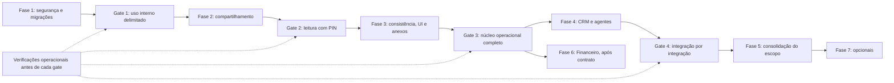

# Planejamento de Ajustes: Módulo de Projetos (`evo-projects-service`)

> **Versão:** 2.0 (revisão 2) · **Data:** 26/10/2026 · **Revisão 2:** 27/10/2026
>
> **Status:** planejamento consolidado com as decisões aceitas pelo dono do produto. Não representa implementação, testes executados ou liberação para produção.
>
> **Escopo:** backend de Projetos, sua interface no frontend, publicação no gateway, contratos indispensáveis com Auth e CRM e integração financeira futura.
>
> **Precedência:** este documento substitui a versão 1.0 de `solicitacao-ajustes-projetos.md`. A solicitação original `solicitacao-implementacao-projetos.md` continua válida somente onde não conflita com este planejamento. **O portal de aprovação foi substituído por compartilhamento do card para leitura após PIN.**
>
> **Base:** análise estática do serviço, frontend, Auth, Compose, Nginx e documentação. Achados observados estão na seção 2; as demais seções especificam o comportamento a construir. Não foram inspecionados os dados do banco nem executados testes de runtime.
>
> **Execução:** esta reescrita autoriza somente a atualização documental. A implementação depende de autorização por fase ou sequência expressamente indicada; dentro desse escopo, executar as etapas e verificações técnicas sem pedir confirmação a cada PR. Consultar o dono do produto diante de mudança relevante de escopo ou operação destrutiva ainda não autorizada. Critério técnico de liberação não se confunde com autorização para iniciar outra fase.
>
> **Revisão 2 (27/10/2026), reescrita a pedido do dono do produto:** mantidas a versão 2.0, a revisão 2 e as decisões de produto. Corrigidas dependências, recuperação segura, liberações por capacidade, armazenamento de anexos, autorização por fase e implementação de estruturas externas somente quando houver consumidor. Os IDs de etapas e entregas foram preservados para rastreabilidade; sua divisão em PRs é uma orientação. Backup integral anterior à reescrita: `solicitacao-ajustes-projetos-v2.0.rev2-backup-20261027-114935.md`. Histórico e hash na seção 19.

---

## 1. Objetivo e decisões consolidadas

Entregar gestão interna de projetos, tarefas e cronogramas por workspace, com identidade integrada ao jprOS, regras consistentes sob concorrência e compartilhamento externo somente para consulta.

O cliente recebe um link, informa um PIN e lê o conteúdo permitido do card. A finalidade é alinhar as definições da tarefa. Dúvidas e ajustes são discutidos pelo canal habitual, como WhatsApp; o portal não registra decisões, comentários ou pedidos de alteração.

### 1.1 Decisões de produto

| ID | Decisão aceita |
|---|---|
| DP01 | Auth é a fonte da identidade; `WorkspaceMember.userId` referencia o ID canônico do usuário, nunca seu e-mail. |
| DP02 | Na primeira entrega, membros são selecionados entre usuários já cadastrados no jprOS e elegíveis segundo o Auth. Cadastro de novas pessoas utiliza o fluxo existente do Auth. Convite externo com aceite fica para evolução futura. |
| DP03 | Workspaces são criados por ação explícita e permissão central específica. Listar workspaces é uma operação sem efeito de escrita. |
| DP04 | Papéis `VIEWER`, `MEMBER` e `ADMIN` são atribuídos por workspace. Administrador global não recebe acesso implícito aos dados dos clientes. |
| DP05 | O portal é exclusivamente de leitura por link + PIN. Não haverá aprovação, rejeição, pedido de ajustes, assinatura, aceite ou movimentação de tarefa pelo cliente. |
| DP06 | Compartilhar a versão **atual** dos campos habilitados. Não criar snapshots ou rodadas de entrega. Mostrar a data da última atualização do conteúdo público. |
| DP07 | PIN de seis dígitos; validade padrão do link de 14 dias, ajustável; link reutilizável até expiração ou revogação. |
| DP08 | A sessão liberada pelo PIN dura no máximo uma hora e nunca ultrapassa a validade do link. Revogação interrompe consultas e downloads posteriores. |
| DP09 | Link e PIN podem ser enviados pela conversa habitual para alinhamentos comuns; canais independentes podem ser usados para conteúdo mais restrito. Não apresentar isso como autenticação multifator nem colocar o PIN na URL. |
| DP10 | Assistente interno usa contexto autenticado do operador. Automação autônoma tem identidade própria e permissões explícitas. O modelo não escolhe quem representar. |
| DP11 | Gantt utiliza datas reais e exibe dependências e conflitos. Sem reagendamento automático na primeira entrega. |
| DP12 | Relações entre tarefas ficam restritas ao mesmo projeto inicialmente. Transferir uma tarefa para outro projeto é uma ação específica, somente no mesmo workspace. |
| DP13 | Arquivamento e exclusão lógica preservam histórico. Excluir coluna não apaga suas tarefas. |
| DP14 | A identificação de workspace via CRM usa vínculos configurados. Ausência ou ambiguidade impede a execução de escrita até resolução. |
| DP15 | Compartilhar ou visualizar um card não altera seu status, não comprova identidade do leitor e não provoca cobrança ou outro efeito financeiro. |
| DP16 | A integração financeira é independente e posterior; não bloqueia a entrega de Projetos. |

### 1.2 Limites e nomenclatura

- Na interface: **Compartilhar com cliente**, **Link de visualização**, **PIN de acesso**, **Revogar acesso**.
- No backend: `TaskShare`, `TaskShareSession`, `ShareService`; ferramenta `create_task_share`.
- Remover do produto os nomes e comportamentos de aprovação. Referências a `approval*`, `approve`, `request-changes` e `request_task_approval` neste documento identificam exclusivamente o legado a desativar ou migrar.
- A conclusão interna de uma tarefa continua existindo pela coluna marcada como concluída. Isso não representa manifestação do cliente.
- Permanecem fora do escopo: Better Auth, projetos inteiros públicos, integração Git/PR, faturamento Creem, login de convidado no portal, comentários externos, convites externos e reagendamento automático de cronograma.
- Templates de projeto/tarefa e notificações externas adicionais são evoluções opcionais, sem impedir o aceite do núcleo.

## 2. Diagnóstico do estado atual

O módulo possui uma base funcional, mas há falhas de autenticação e isolamento e requisitos originais ainda incompletos. A existência de telas ou modelos não significa que o fluxo esteja pronto.

| ID | Evidência observada | Encaminhamento |
|---|---|---|
| S1 | `auth.middleware.ts` decodifica o payload JWT sem verificar assinatura, emissor, audiência ou expiração. Fabrica identidade na falta de claims. | Contrato de autenticação da seção 3. |
| S2 | Ausência de token em ambiente não produtivo gera usuário administrador; Compose define `NODE_ENV: development`. | Remover o bypass em qualquer ambiente de execução. |
| S3 | Rotas MCP executam ferramentas sem autenticação e assumem ator genérico `ai-agent`. | Autenticação e autorização comuns a REST e MCP, seções 3 e 8. |
| S4 | CORS reflete qualquer origem e permite credenciais, ignorando a configuração. | Lista explícita e separação das credenciais do portal, seção 11. |
| S5 | Serviços e rotas não aplicam pertencimento/papel por workspace; operações usam IDs recebidos. | Autorização central e integridade de pais/filhos. |
| S6 | `listUserWorkspaces` cria workspace durante uma consulta para quem não tem vínculos. | Criação explícita, autorizada e idempotente. |
| S7 | `WorkspaceMembersPage.tsx` envia e-mail como `userId`, incompatível com `sub` do Auth. | Corrigir cadastro e reconciliar vínculos existentes. |
| S8 | Consultas de tarefas retornam campos escalares do Prisma, incluindo PIN e token legados; MCP também consome essas respostas. | DTOs com lista explícita de campos permitidos. |
| SH0 | Portal atual usa PIN em texto puro e token sem expiração; preview mostra título/projeto/workspace antes do PIN e existem ações públicas de escrita. | Substituir pelo compartilhamento da seção 5. |
| I0 | Cascatas apagam tarefas ao excluir coluna; há inconsistências possíveis entre workspace, projeto e coluna e efeitos não transacionais. | Modelo, transações e migrações da seção 6. |
| U0 | Gantt atribui datas de exibição a tarefas sem planejamento e não desenha dependências; link do card copia a URL da visão; tela cheia apenas amplia o drawer. | Completar frontend conforme seção 7. |
| U1 | Campos personalizados existem no schema, mas o fluxo completo de configuração/edição não está implementado nos arquivos examinados. | Implementar API, validação e interface conjuntamente. |
| F0 | Dockerfile usa `prisma db push`; porta `3013:3003` está publicada diretamente; serviço não aparece nos manifests prod/swarm examinados. | Baseline/migrações e implantação da seção 11. |
| D0 | Documentação cita Express, MCP SDK/SSE e módulo operacional; o serviço usa Fastify e JSON-RPC parcial. | Atualizar documentação com evidência de aceite. |

**Prioridades:** P0 impede exposição e uso com dados reais por falhas de segurança; P1 cobre consistência e completude do núcleo; P2 cobre integrações/evoluções. A classificação de risco não substitui a sequência de fases da seção 14.

### 2.1 Verificações adicionais em 27/10/2026

Conferência estática do código atual (serviço, frontend, Auth, Compose, Nginx e CI) para a revisão 2. Confirma S1–S8, SH0, I0, U0, U1, F0 e D0 e acrescenta os detalhes abaixo, que alimentam o plano da seção 14. Continuam **não inspecionados** os dados do banco e o comportamento em execução (por exemplo, a resposta de `POST /api/v1/auth/validate` para token revogado), que são verificações da E1.0 e da E1.3.

| ID | Evidência observada | Encaminhamento |
|---|---|---|
| X1 | A imagem do serviço define `NODE_ENV=production`, mas `docker-compose.yml` sobrescreve para `development`; por isso o bypass de S2 está **ativo** na stack local. O bypass também vale quando há token presente porém inválido, e a decodificação sem assinatura aceita qualquer token com três segmentos | E1.2-a, E1.2-f |
| X2 | Portal legado: PIN de **4 dígitos** gerado com `Math.random`, guardado em texto puro; token `nanoid(20)`; nenhuma expiração nem limite de tentativas; `approve` e `request-changes` não verificam o estado anterior; o IP vem de `request.ip` ou `x-forwarded-for`; a prévia anterior ao PIN devolve título, projeto e workspace | E1.2-c, E2.1 a E2.6 |
| X3 | Rotas públicas e MCP devolvem `err.message` ao cliente | E1.5-c |
| X4 | O MCP atual é JSON-RPC parcial (`tools/list`, `tools/call`) mais `/mcp/tools` e `/mcp/call`; não há SDK MCP, `initialize`, `server/discover` nem rota SSE. O `package.json` não depende de Express nem do SDK MCP, ao contrário do que a documentação afirma | E4.3, E5.2-a |
| X5 | `DOORKEEPER_JWT_AUD` tem padrão `'[]'` em `doorkeeper.rb` (emissão de tokens, duas ocorrências) e em `.env.example` | E1.3-b |
| X6 | Nginx: `client_max_body_size 100M` global; `X-Forwarded-Proto` fixo em `https`; repasse de `Cookie` e `Authorization` na rota de Projetos | E1.8-b, E3.7-f |
| X7 | `docker-compose.prod.yml` e `docker-compose.swarm.yaml` não mencionam o serviço de Projetos; a porta `3013:3003` está publicada no Compose de desenvolvimento | E1.8-d, E1.2-f |
| X8 | Schema: `Task.column` e `Activity` (workspace, projeto e tarefa) com `onDelete: Cascade`; `startDate`/`dueDate` como `DateTime`; `estimatedHours` como `Float`; `tags` como `String[]`; `taskNumber` com `autoincrement()` **global** e sem unicidade por projeto; o cliente pode enviar `assigneeName` e `assigneeAvatar` ao criar tarefa | E3.2, E3.3, E3.4, E3.6-a |
| X9 | A rota pública do frontend é `/p/task/:token` (`routes/index.tsx`); a documentação do projeto cita `/p/task-approval/:token` | E5.2-a |
| X10 | `GanttView.tsx` completa datas ausentes com `new Date()` ou "vencimento − 2 dias"; "Copiar link" usa `window.location.href`; a tela cheia apenas amplia o drawer | E3.9-a, E3.10-b |
| X11 | O CI atual (`ci.yml`) valida Compose, Dockerfiles e colisão de migrações; **não** testa nem compila o `evo-projects-service`. O frontend já possui Vitest e Playwright | E1.0-c |
| X12 | Adicionar membro usa `upsert` com papel padrão `MEMBER` também na atualização, o que pode rebaixar alguém em silêncio | E1.6-d |

## 3. Identidade, autenticação e autorização

### 3.1 Contrato com o Auth

1. Usar o token de usuário emitido pelo `evo-auth-service-community`. Validar com biblioteca mantida, como `jose`, e nunca apenas decodificar.
2. Configurar algoritmo permitido no servidor, normalizando o identificador exigido pela biblioteca (`HS256`, por exemplo); não escolhê-lo a partir do token recebido. Validar assinatura, `iss`, audiência destinada a Projetos e `exp` obrigatório; validar `nbf` quando presente. Tolerância de relógio deve ser pequena e configurada.
3. Rotas de operador exigem `sub` não vazio, correspondente a usuário existente e ativo. Tokens de serviço usam fluxo próprio e não se transformam em usuários fictícios.
4. Remover os defaults `user-default`, `user@jpros.local`, papel `operator` e identidade por `x-user-*`. Nenhum bypass por `NODE_ENV`.
5. Alinhar `aud` com o emissor: hoje a configuração lê `DOORKEEPER_JWT_AUD` como texto, com padrão `'[]'`. Definir audiência real como string ou array válido e migrar emissor/consumidor de forma coordenada. Não aceitar ausência de audiência permanentemente para contornar incompatibilidade.
6. Consultar o estado atual da sessão/usuário pelo contrato do Auth. Existe `POST /api/v1/auth/validate`; verificar sua resposta e seu comportamento para token revogado antes de reutilizá-lo. Testar revogação com cache frio e quente no Auth, pois verificar a assinatura localmente não detecta logout/revogação.
7. Padrão inicial de cache positivo no Projetos: até 60 segundos, limitado por `exp`. Operações de membros/papéis, credenciais de integração, compartilhamento e exclusão exigem consulta atual, sem esse cache. Vínculo e papel de workspace são conferidos no banco local em cada operação.
8. Auth indisponível: nenhuma nova autorização é concedida. Operações que exigem consulta atual retornam erro transitório neutro; demais operações só podem aproveitar cache ainda válido pelo limite acima. Não reutilizar dados vencidos. Documentar a janela máxima de revogação de 60 segundos para as leituras/operações comuns.
9. Segredo ausente ou configuração inválida impede o serviço de ficar pronto. Não usar chave padrão. Compartilhar segredo HMAC exige confiança entre os serviços; eventual migração do ecossistema para chaves assimétricas é evolução separada.

### 3.2 Camada única de autorização

- Implementar contexto de ator discriminado: `user`, `service` ou `shareSession`; nunca inferir um usuário de cabeçalhos arbitrários.
- Reutilizar `AccessService` em todas as operações REST/MCP, jobs e serviços. Avaliar **ator + ação + recurso + vínculo/autoria**, não apenas uma comparação numérica de papel.
- Recursos filhos resolvem o workspace pela relação persistida. Aplicar filtros de autorização na própria consulta ou dentro de uma operação transacional segura. Uma resolução interna mínima de ID não autoriza leitura do objeto completo.
- Em rotas com IDs de pai e filho, comprovar que pertencem entre si; conferir também cada ID de listas em operações em lote.
- `401`: credencial ausente/inválida. `404`: recurso inexistente ou fora do alcance do ator. `403`: recurso acessível, mas ação proibida pelo papel. Listagens retornam somente recursos autorizados.
- Notificações são privadas do destinatário, inclusive entre membros do mesmo workspace. Administrador não ganha acesso ao inbox pessoal de outra pessoa.
- Recursos arquivados/excluídos seguem as regras da seção 6; permissões do portal nunca se convertem em acesso a endpoints internos.
- Operações de escrita e concessão de acesso devem revalidar as condições relevantes na transação. Remoção de membro não pode competir com uma concessão de compartilhamento que continue válida indevidamente.

### 3.3 Papéis por workspace

| Operação | VIEWER | MEMBER | ADMIN |
|---|---|---|---|
| Ler projetos, tarefas, calendário e Gantt ativos | Sim | Sim | Sim |
| Ler histórico operacional e comentários internos | Sim | Sim | Sim |
| Ler/alterar estado das próprias notificações | Sim | Sim | Sim |
| Criar/editar tarefas, subtarefas, recursos e relações | Não | Sim | Sim |
| Comentar, mencionar e registrar o próprio tempo | Não | Sim | Sim |
| Editar/excluir comentários e apontamentos | Não | Próprios | Todos, com auditoria |
| Arquivar/restaurar tarefas | Não | Sim | Sim |
| Excluir logicamente/restaurar tarefa excluída | Não | Não | Sim |
| Compartilhar tarefa ativa | Não | Sim | Sim |
| Gerenciar/revogar compartilhamento existente | Não | Os que criou | Todos |
| Transferir tarefa entre projetos do mesmo workspace | Não | Sim, com acesso a ambos | Sim |
| Gerenciar projeto, colunas, etiquetas e campos | Não | Não | Sim |
| Gerenciar membros, papéis e configuração CRM/agentes | Não | Não | Sim |
| Arquivar/excluir logicamente/restaurar projeto ou workspace | Não | Não | Sim |

Arquivamento/restauração de tarefa por MEMBER só é permitido dentro de projeto/workspace ativos; restaurar um pai arquivado exige ADMIN. Ações sobre próprios registros não dispensam vínculo atual com o workspace.

### 3.4 Cadastro e ciclo de vida de membros

- O seletor consulta um diretório autorizado do Auth, com busca paginada. Não expor indiscriminadamente a base global de usuários.
- O backend resolve e valida ID, nome, e-mail e elegibilidade. Não confiar no nome/e-mail enviados pelo navegador como prova de identidade.
- Restrição única `(workspaceId, userId)`. Adicionar membro existente retorna conflito explícito; mudança de papel usa operação dedicada, não um upsert que possa rebaixar alguém silenciosamente.
- Impedir exclusão/rebaixamento do último ADMIN sob concorrência, bloqueando a linha do workspace durante alterações de membros.
- Remoção oferece: reatribuir tarefas a membro ativo ou deixá-las sem responsável. Preservar comentários, apontamentos e o nome histórico do autor.
- Revogar compartilhamentos criados por usuário removido, inativado ou rebaixado para VIEWER; validar a elegibilidade do criador também no acesso público. Compartilhamentos de serviço dependem de integração/grant ativos, e os iniciados em nome de humano também dependem dele.
- Dados atuais de nome/avatar vêm da projeção sincronizada do Auth. Auditoria preserva o nome do ator no momento do evento. A remoção de membership não apaga sua identidade histórica.
- Alterações no Auth devem chegar por contrato de sincronização ou consulta periódica/na autorização. Definir integração testável antes de habilitar links; desativação global invalida elegibilidade de criador em até 60 segundos, sem liberar acesso quando não há estado confiável.
- A reconciliação dos vínculos legados por e-mail segue a seção 12; ambiguidades não criam permissões automaticamente.

### 3.5 Criação e administração global

- Criar permissão central no catálogo do Auth, por exemplo `project_workspaces.create`, seguindo o formato `recurso.ação` existente. O nome final deve constar nos contratos e seeds; não presumir que já existe.
- Usuário autorizado cria workspace explicitamente e se torna ADMIN na mesma transação. Sem workspaces, mostrar estado vazio e a ação somente a quem tem a permissão.
- Criar workspace exige chave de idempotência para evitar duplicatas por duplo clique/repetição. Não tratar a ausência de membership como primeiro login.
- Se suporte global precisar acessar um workspace, conceder membership explícita por fluxo administrativo registrado. Não adicionar bypass por `super_admin`.

## 4. Contratos de API e representação dos dados

### 4.1 Separar persistência de respostas

- `TaskInternalDTO`: campos operacionais permitidos ao papel; nunca token/PIN/hash, credenciais de integração ou segredos de sessão.
- `TaskPublicDTO`: somente campos autorizados no compartilhamento atual, sem comentários, atividades, apontamentos, informações financeiras, contatos dos membros, dados de outras tarefas ou relações navegáveis.
- `TaskCustomerAgentDTO`: dados liberados ao atendimento identificado; não reutilizar o DTO interno para um agente falando com cliente.
- `ShareManagementDTO`: ID de gerenciamento, validade, revogação, criador e seleção de visibilidade, sem segredos. Listar compartilhamentos respeita autoria/ADMIN.
- `ShareIssuedDTO`: link e PIN somente no retorno imediato da criação/reemissão ao chamador autorizado. Não reaparecem em consultas genéricas, logs ou atividades.
- Preview interno do compartilhamento deve usar a mesma transformação do DTO público; evitar duas implementações com regras diferentes.

### 4.2 Entradas, atualizações e erros

- Schemas tipados para `params`, `query` e `body` de **todas** as rotas e ferramentas. Cast TypeScript não valida dados em runtime.
- Lista explícita de campos editáveis; rejeitar campos extras nas escritas para evitar alteração indireta de workspace, autoria, papel ou credenciais.
- Datas civis válidas; minutos inteiros e limites positivos; prioridades/enum válidos; tamanhos máximos de texto e arrays; URLs somente com esquemas permitidos (`https`, e `http` quando a política do ambiente permitir), nunca `javascript:`/`data:`.
- Campo ausente significa manter valor; `null` limpa campo anulável. Aplicar em datas, responsável, estimativa e campos personalizados. Não usar string vazia como substituto universal de `null`.
- Atualização parcial por `PATCH` ou semântica parcial documentada dos endpoints existentes, com versão esperada. Adaptar frontend e MCP conjuntamente.
- Erros internos tipados com código estável e `requestId`; mensagens públicas neutras. Não devolver `err.message` de banco, caminho local ou stack trace.
- Limites iniciais: títulos até 200 caracteres, descrição até 50.000, comentário até 10.000, listas de operações em lote até 100 itens. Centralizar a configuração e espelhá-la na UI.
- Paginação por cursor com ordem estável e limite padrão 50/máximo 100. Gantt/calendário consultam intervalo/projeto com limites próprios explícitos; não carregar toda a base por uma chamada sem limite.

## 5. Compartilhamento externo do card por PIN

### 5.1 Experiência e regras

1. MEMBER/ADMIN abre **Compartilhar com cliente** em tarefa ativa.
2. Confere a prévia, escolhe seções, recursos/anexos e prazo; a interface explica que mudanças futuras nos campos selecionados ficam visíveis.
3. Backend autoriza, cria o compartilhamento e registra atividade transacionalmente; devolve link e PIN uma única vez.
4. Cliente abre a página pública genérica e informa o PIN. Antes disso, não recebe título, nomes de projeto/workspace, checklist, imagens ou arquivos.
5. Após validação, lê o card atual em página responsiva. Não há editor, ações de tarefa, comentário ou submissão de feedback.
6. A cada leitura/download, conferir sessão, validade, revogação, elegibilidade do criador, estado dos pais e visibilidade atual do item.
7. Mostrar **Atualizado em** referente ao conteúdo público, sem revelar conteúdo ou metadados de comentários internos. Atualizar ao abrir/recarregar; atualização em tempo real não é requisito inicial.
8. O cliente pode voltar usando o mesmo link e PIN durante a validade. Encerrar a sessão exige novo PIN no próximo acesso, sem inutilizar o link.

O feedback ocorre pelo canal habitual. Não registrar leitura como concordância, confirmação ou prova de identidade. A página não cria notificações de aprovação nem evento financeiro.

### 5.2 Visibilidade

| Elemento | Regra inicial |
|---|---|
| Título e descrição | Visíveis, apresentados na prévia. Conteúdo reservado deve ficar nos comentários/campos internos. |
| Status, prioridade e datas | Habilitados por padrão; operador pode ocultar cada seção. |
| Checklist | Seção selecionável, somente leitura; novos itens dessa seção selecionada passam a aparecer, conforme aviso da prévia. |
| Links e anexos da tarefa | Seleção explícita por item; itens novos começam privados. |
| Campos personalizados | Campo precisa ser elegível para cliente na configuração do ADMIN e ser selecionado no compartilhamento. Campos novos começam internos. |
| Comentários e anexos de comentários | Sempre internos. Para compartilhar um arquivo, anexá-lo explicitamente à tarefa e selecioná-lo. |
| Atividades, horas, valores, membership, e-mails, avatares internos e relações | Sempre internos. Não incluir títulos/metadados de tarefas relacionadas. |

- Uma seleção pertence ao compartilhamento, não altera a visibilidade de outros links da mesma tarefa. ADMIN e autor elegível podem ajustar essa seleção com controle de versão.
- Remover item da seleção corta seu acesso nas próximas requisições, inclusive com sessão já liberada.
- Recursos externos continuam dependendo das permissões do provedor e podem mudar. O portal não congela versões nem torna um documento privado do Drive/Figma acessível por si só.
- Imagens embutidas em Markdown também respeitam a seleção; reescrever referências de anexos para o endpoint autorizado. Não deixar URLs internas fixas contornarem a verificação.
- Arquivar/excluir a tarefa, projeto ou workspace revoga seus links. Restaurar não reativa links antigos.

### 5.3 Modelagem mínima

| Entidade | Campos e invariantes |
|---|---|
| `TaskShare` | `id`, `workspaceId`, `taskId`, `tokenHash` único, `pinHash`, identificação do criador (`user` ou `service`), `initiatedByUserId?`, `expiresAt`, `revokedAt?`, `revokedByActor?`, `version`, flags das seções, `publicContentUpdatedAt`, timestamps. |
| Seleções do compartilhamento | Tabelas associativas para `resourceId`, `attachmentId` e `customFieldId`, com unicidade por share/item e validação de pertencimento à tarefa/projeto. Não aceitar IDs soltos sem conferir o recurso. |
| `TaskShareSession` | ID público opaco, hash de verificador aleatório, `shareId`, `expiresAt`, `revokedAt?`, timestamps. A expiração é o menor valor entre uma hora após desbloqueio e a validade do link. |
| Controle de tentativas | Estado atômico e compartilhado entre réplicas por share/IP e por IP, com contador, janela e bloqueio. Usar Redis compartilhado; não depender de memória de uma instância. |

O estado exibido é derivado: `ACTIVE`, `EXPIRED` ou `REVOKED`; bloqueio temporário de tentativas é condição de acesso separada. Não criar `TaskApproval`, `decidedAt`, feedback ou status de decisão.

Usar token aleatório de 32 bytes codificado em base64url e guardar SHA-256 do token, nunca seu texto. A implementação antiga `nanoid(20)` tinha aproximadamente 120 bits, não 128+. Gerar PIN com `crypto.randomInt(0, 1_000_000)` e completar seis dígitos; guardar hash com Argon2id ou scrypt com sal, usando verificação da biblioteca. Aplicar rate limit antes da operação custosa de verificação.

Hashes de PIN curto reduzem exposição direta, mas não transformam seis dígitos em um segredo forte contra ataque offline; considerar pepper separado do banco e proteger backups. Não usar hash de senha custoso para o token aleatório de alta entropia.

### 5.4 Credenciais, prazo, tentativas e sessão

- Padrão do link: 14 dias; prazo obrigatório e finito, ajustável na criação dentro do limite configurado pelo ADMIN. Nunca prorrogar automaticamente por visita.
- Bloqueio inicial: cinco PINs incorretos para o par share/IP em janela de 15 minutos bloqueiam aquele par por 15 minutos. Limitar também a taxa por IP e o volume agregado por share para conter ataques distribuídos; parâmetros explícitos de ambiente e teste com pelo menos duas instâncias.
- O limite agregado deve aplicar throttling temporário e não revogação permanente que um terceiro possa acionar. Suprimir notificações repetidas e permitir ao operador revogar/reemitir quando necessário.
- Se o armazenamento de limites estiver indisponível, o desbloqueio retorna erro transitório; não aceitar tentativas ilimitadas silenciosamente.
- Erros de link inexistente/expirado/revogado retornam `404 SHARE_UNAVAILABLE`, com mensagem uniforme. PIN errado em link utilizável retorna `401 PIN_INVALID`; limite atingido retorna `429` com `Retry-After`. DTOs/erros nunca revelam conteúdo da tarefa. Não prometer tempo de rede matematicamente constante; evitar diferenças evitáveis na verificação.
- Sessão pública em cookie `HttpOnly`, `Secure` em HTTPS e `SameSite=Strict`, específico do caminho do compartilhamento. Desenvolvimento local pode ter exceção de transporte claramente delimitada, sem mudar a autenticação.
- Hospedar portal/API pública na mesma origem pelo gateway. Se isso não for possível, definir explicitamente a política CORS/cookies antes da implantação; nunca refletir origem com credenciais.
- Não armazenar PIN/token de sessão em `localStorage`, query string ou parâmetros de telemetria. Verificar `Origin` nas operações de sessão e não aceitar mudanças por GET.
- Checar a revogação e a seleção de campos no banco a cada requisição pública. Comandos de revogação são idempotentes; a próxima requisição após confirmação deve falhar. Conteúdo já entregue ao navegador não pode ser recolhido.
- Arquivos públicos são servidos por endpoint autenticado pela sessão do share, para preservar revogação na próxima requisição. URLs assinadas independentes exigiriam janela de revogação e ficam fora do padrão inicial.
- Usar `Cache-Control: no-store`, `Referrer-Policy: no-referrer`, proteção de enquadramento e indicação de não indexação. Não instalar telemetria que capture conteúdo ou URL secreta do portal.
- Link e PIN aparecem somente na criação. Se forem perdidos, o operador reemite o acesso; o anterior é revogado. Gerenciamento posterior não recupera o PIN em texto.
- O fluxo de geração evita duplicação por repetição. Caso uma repetição idempotente encontre um share criado sem poder recuperar seus segredos, responder com o ID e orientar reemissão; não guardar PIN em texto para devolver a mesma resposta.

### 5.5 Rotas canônicas propostas

Prefixo de API: `/api/v1/projects`. Os caminhos são contratos planejados, não rotas existentes.

| Método e caminho | Finalidade / autorização |
|---|---|
| `POST /tasks/:taskId/shares/preview` | Prévia interna sem criar acesso; MEMBER/ADMIN ou integração com grant de compartilhamento. |
| `POST /tasks/:taskId/shares` | Criar link/PIN; mesma autorização e chave de idempotência. Validar estado/seleção no momento da criação, pois o conteúdo é atual e não congelado. |
| `GET /tasks/:taskId/shares` | Metadados; MEMBER vê os próprios, ADMIN vê todos; nunca segredos. |
| `PATCH /shares/:shareId` | Alterar seleção/validade enquanto ativo; autor elegível ou ADMIN, com versão. Ampliar prazo não prolonga sessões já emitidas. |
| `POST /shares/:shareId/revoke` | Revogar link e impedir novos usos das sessões; autor elegível ou ADMIN. |
| `POST /shares/:shareId/reissue` | Criar novos segredos e revogar o anterior atomicamente; confirmar nova seleção/prazo. |
| `POST /public/shares/:token/unlock` | Validar PIN e emitir sessão restrita; protegido pelos limites. |
| `GET /public/shares/:token/card` | Ler DTO público usando sessão daquele share. |
| `GET /public/shares/:token/attachments/:attachmentId` | Download autorizado por sessão e seleção atuais. |
| `POST /public/shares/:token/logout` | Invalidar a sessão pública atual. |

Página pública: **`/p/task/:token`**, mantendo a forma da rota já usada no frontend. O HTML inicial é genérico. URLs públicas são geradas com origem configurada e validada, nunca a partir de `Host` não confiável.

### 5.6 Desativação do legado

- Remover ações públicas `approve` e `request-changes`, ferramenta `request_task_approval`, botões/badges de aprovação e mensagens prontas correspondentes. Durante transição, as rotas antigas retornam `410 LEGACY_FEATURE_REMOVED` sem conteúdo e sem efeito de escrita; depois podem ser removidas.
- Revogar todos os tokens/PINs antigos; não convertê-los em links novos automaticamente nem redirecioná-los para o conteúdo.
- Inventariar os campos/dados legados antes de retirar colunas. Se houver registros reais, preservar histórico em armazenamento interno de migração/auditoria, sem expô-lo no portal e sem criar um fluxo de aprovação novo.
- Remover campos/enums antigos somente após migração verificada, troca coordenada de frontend/backend/MCP e backup. Não interpretar uma visualização como decisão retroativa.

## 6. Modelo, consistência e concorrência

### 6.1 Invariantes de domínio

| ID | Regra obrigatória |
|---|---|
| I1 | Tarefa pertence a workspace e projeto coerentes; coluna pertence ao projeto. Preferir FKs compostas com chaves candidatas, além da validação central. |
| I2 | Subtarefa, comentário, recurso, anexo, apontamento, valor personalizado e seleção pública pertencem ao recurso autorizado. Validar em cada entrada, inclusive lotes. |
| I3 | Responsável deve ser membro ativo. Remoção/rebaixamento e atribuições concorrentes preservam essa regra. |
| I4 | `startDate`/`dueDate` usam `@db.Date` e API `YYYY-MM-DD`; validar calendário real e `startDate <= dueDate`. Datas podem ser nulas. |
| I5 | `Workspace.timezone` usa identificador IANA, padrão `America/Sao_Paulo`. Determina hoje/atraso; timestamps de eventos permanecem instantes UTC. |
| I6 | `estimatedMinutes` e `durationMinutes` são inteiros não negativos/positivos conforme campo. Estimativa nula significa não informada, e não zero. |
| I7 | Relação entre tarefas do mesmo projeto; impedir autorreferência, ciclos de bloqueio e duplicatas. Guardar `BLOCKS`; exibir inverso como bloqueada por. `RELATES_TO` usa par normalizado para impedir A-B/B-A duplicado. |
| I8 | Campos personalizados têm tipo controlado (`text`, `number`, `select`, `date`), validação de valor e opções com identidade estável. Campo do projeto A não pode receber valor em tarefa do B. |
| I9 | Etiquetas são entidades `Label` por workspace e relações `TaskLabel`. Nome normalizado único no workspace, cor válida e nenhuma associação entre workspaces. |
| I10 | Coluna usada por tarefas não pode ser excluída. Remoção exige destino do mesmo projeto e movimentação transacional, inclusive tarefas arquivadas que ainda dependam dela. |
| I11 | Projeto tem `backlogColumnId` explícito e colunas com `isDoneColumn`; não inferir semântica pelo nome. Configuração inválida é recusada. |
| I12 | `Task.version` é incrementada nas alterações do card, incluindo mudanças de filhos que afetem seu estado. Compartilhamentos e ordenação possuem versões próprias. |

### 6.2 Código legível da tarefa

- Manter `Task.id` estável como identidade e base da URL. `Project.key` é único no workspace e validado; código exibido como `ALF-123`.
- Reservar o próximo número via incremento atômico em transação; restrição única `(projectId, taskNumber)`. Não usar `max + 1` fora de bloqueio.
- Aceitar lacunas de numeração; não renumerar tarefas após exclusões. Código não é mecanismo de controle de acesso.
- Tornar a chave do projeto imutável após criação de tarefas na primeira entrega, evitando renomeação indireta de todos os códigos.
- Na transferência, manter ID/URL, reservar novo número no destino e registrar código anterior/novo na atividade. Código antigo permanece no histórico; pesquisas devem indicar a transferência quando houver correspondência histórica.
- Na migração inicial, preservar os números existentes por projeto quando forem válidos; ajustar o próximo contador ao maior número daquele projeto mais um. Não renumerar dados reais sem necessidade.

### 6.3 Escritas simultâneas e transações

- Edição do card envia versão esperada; atualizar condicionalmente. Versão divergente retorna `409 VERSION_CONFLICT`. UI preserva rascunho e permite recarregar/comparar; não sobrescrever silenciosamente.
- Reordenar tarefas/colunas usa transação, versão da ordenação e bloqueio do escopo pertinente. Ao envolver duas colunas, bloquear ambas em ordem determinística para reduzir deadlocks.
- Para o volume inicial, manter posições inteiras com algoritmo transacional explícito. LexoRank pode ser evolução, não uma segunda implementação concorrente do mesmo contrato.
- Criação/remoção de dependência bloqueia o projeto durante a verificação do grafo e a gravação. Serializar também operações que mudem o conjunto de tarefas/arestas desse grafo. Testar criação simultânea de A bloqueia B e B bloqueia A.
- Usar isolamento/bloqueios proporcionais à operação. Em erro de serialização/deadlock, refazer a transação inteira com tentativas limitadas; não repetir uma chamada externa dentro da transação.
- Alteração sensível e `Activity` são gravadas na mesma transação. Não engolir falha de auditoria e retornar sucesso. Notificação interna exigida pelo fluxo participa da transação; envio externo usa outbox quando habilitado.
- Criação por agente e outros comandos sujeitos a retry usam chave de idempotência, escopada por ator/workspace/operação, hash do pedido e prazo documentado. Mesma chave com conteúdo diferente retorna conflito.
- Operações condicionadas à membership, à autoria e ao último ADMIN devem usar bloqueio/revalidação compatível. Não fazer uma checagem fora da transação e presumir que ela continua verdadeira.

### 6.4 Transferência entre projetos

- Comando específico, sem permitir troca livre de `projectId` no patch genérico.
- Origem e destino ativos no mesmo workspace; conferir permissão em ambos e selecionar coluna de destino válida.
- Prévia informa: mudança de código, relações incompatíveis, valores personalizados sem correspondência e links públicos que serão revogados.
- Relações só podem continuar se ambas as pontas ficarem no mesmo projeto. Bloquear até o operador confirmar remoção das incompatíveis; registrar as remoções.
- Mapear campos por ID e compatibilidade de tipo/opções, nunca apenas por nome. Valores sem destino são preservados no histórico da transferência ou exportação interna, e só deixam de ser ativos após confirmação.
- Preservar comentários, subtarefas, apontamentos e anexos; etiquetas continuam válidas por serem do workspace. Revogar shares para exigir nova conferência da exposição no destino.
- Efetivar mudanças e auditoria em uma transação. Falha reverte tudo; nenhum estado intermediário fica visível.

### 6.5 Arquivamento, exclusão e restauração

- Arquivar preserva o recurso para consulta interna autorizada e retira-o de listas operacionais e métricas padrão. Recurso arquivado fica somente leitura até restauração.
- Exclusão lógica usa `deletedAt`, ator responsável e motivo opcional. Apenas ADMIN restaura recurso excluído. Não reutilizar IDs/números.
- Filtros devem considerar pais arquivados/excluídos: acessar tarefa diretamente não contorna o estado de projeto/workspace.
- Revogar shares na mesma operação de arquivamento/exclusão do recurso ou de seus pais. A restauração não renova esses acessos.
- `Activity` não é apagada em cascata. Para futura purga física, usar referências anuláveis ou representação histórica adequada, preservando ator/objeto conforme política de retenção.
- Não ativar purga automática nesta entrega. Definir retenção e restauração verificadas antes de qualquer rotina irreversível; essa definição não bloqueia desenvolvimento do núcleo.

### 6.6 Apontamentos e indicadores

- Registrar tempo manual com minutos, data civil do trabalho, descrição e autoria. Edição/exclusão somente pelo autor ou ADMIN, com auditoria.
- Não exigir cronômetro, tarifa ou integração financeira para apontar horas. Início/fim e faturamento pertencem à evolução financeira.
- Progresso do projeto: tarefas ativas em colunas concluídas dividido por tarefas ativas; projeto sem tarefas mostra 0%. Checklist tem percentual próprio e não altera automaticamente status da tarefa.
- Excluir arquivados/excluídos das métricas operacionais, inclusive de contadores e consultas agregadas. Visões históricas devem ser explicitamente identificadas.
- “Próximas tarefas” mostra tarefas não concluídas com prazo, ordenadas por atraso/vencimento, prioridade e ID como desempate. Itens sem prazo ficam em agrupamento separado, sem prazo fabricado.

## 7. Frontend e completude funcional

Reutilizar o design system do `evo-ai-frontend-community`. API, serviços e interface de cada fluxo são entregues juntos, incluindo estados de vazio, carregamento, falha, permissão e conflito.

### 7.1 Navegação e contexto

- Manter menu principal Projetos e drawer secundário com workspace, Início, Inbox, Minhas Tarefas, Membros e projetos.
- Rota interna canônica de tarefa: `/projects/tasks/:taskId`. Resolver projeto/workspace no servidor autorizado; não incluir o projeto na identidade da URL, para que o link sobreviva à transferência. Registrar antes das rotas genéricas de projeto/visão e garantir abertura direta/refresh.
- Drawer e página inteira compartilham componente e estado da tarefa; navegação preserva contexto da visão e comportamento de voltar. Copiar link gera a URL da tarefa, não `window.location.href` da visão.
- Ao abrir link direto, resolver workspace pelo projeto autorizado e sincronizar seletor/breadcrumb. Não usar apenas o workspace persistido para rotular outro projeto.
- Trocar workspace navega para destino coerente, fecha drawers incompatíveis e cancela/ignora respostas pendentes. Cache é escopado por usuário, workspace e recurso.
- Logout/troca de usuário limpa dados e seleção persistidos de Projetos. Nunca reutilizar dados de um operador em sessão de outro.
- 401 integra renovação de sessão conforme padrão existente; não implementar loop infinito de refresh. 403/404 limpam contexto indevido e exibem mensagem adequada.

### 7.2 Card e operações

| Área | Entrega e aceite funcional |
|---|---|
| Cabeçalho | Breadcrumb, código legível, copiar link/ID/título/Markdown, alternar drawer/página e ações conforme papel. |
| Título/descrição | Edição inline, Markdown seguro, anexos e preservação do rascunho em falha/conflito. |
| Responsável | Seleção de membro ativo; limpar atribuição com `null`; nunca digitar um ID arbitrário. |
| Etiquetas | Seleção por entidades do workspace; ADMIN gerencia nomes/cores. |
| Datas/estimativa | Datas civis, limpeza de campos, validação de intervalo e estimativa em minutos com apresentação amigável. |
| Checklist | Criar, concluir, editar, ordenar e remover itens; progresso independente do status. |
| Relações | Buscar tarefas do projeto; mostrar bloqueia/bloqueada por/relacionada; erros de ciclo claros. |
| Recursos/anexos | Criar/remover dentro das permissões; indicar privacidade e permitir seleção na prévia de compartilhamento. |
| Comentários | Markdown seguro, menções e anexos internos; editar/excluir conforme autoria/ADMIN. |
| Atividade | Texto legível, autor histórico, mudança pertinente e data/hora; nunca revelar segredos. |
| Campos personalizados | Renderização/edição por tipo; opções estáveis, validação no cliente e servidor. |
| Tempo | Criar/editar/excluir registros permitidos; totais consistentes, sem campos financeiros no portal. |
| Projeto | Transferência dedicada com prévia de impactos e confirmação. |
| Compartilhamento | Prévia real, seleção, prazo, geração, copiar link/PIN no momento da emissão, listar metadados, revogar/reemitir. |

### 7.3 Visões

- **Kanban:** movimentar/reordenar tarefas e, para ADMIN, colunas. Usar versão de ordenação; rollback visual em falha. Coluna concluída só representa status interno.
- **Lista:** filtros por responsável/status/prioridade/etiqueta, ordenação estável e edição rápida com as mesmas regras do card.
- **Gantt:** usar intervalos reais com início/fim inclusivos; exibir setas para `BLOCKS` e avisos de conflitos de prazo. Não criar datas a partir de hoje para preencher campos ausentes e não inverter silenciosamente intervalos inválidos.
- **Gantt sem planejamento:** tarefas com intervalo incompleto ficam em seção própria; quando houver apenas vencimento, pode aparecer um marcador desse prazo, sem inventar duração. Dados inválidos legados são sinalizados até correção.
- **Dependência de cronograma inicial:** término-início; sucessora não deve começar antes do término da predecessora. Com precisão de dia, permitir o mesmo dia e avisar quando começar em dia anterior. Dependência gera aviso visual, sem reagendar ou impedir toda transição de coluna automaticamente.
- **Calendário:** visão mensal/semanal por vencimento, com datas iguais às do card/Gantt. Tarefas sem prazo ficam em lista separada.
- **Backlog:** usar `backlogColumnId`; renomear a coluna não altera sua função. Impedir exclusão da coluna configurada até definir substituta.
- **Home:** estatísticas consistentes, calendário resumido, próximas tarefas, progresso dos projetos e feed paginado.
- **Minhas tarefas:** somente atribuições do operador no workspace ativo, com filtros e acesso direto ao card.
- **Inbox:** leitura individual/em lote, arquivamento individual/em lote, filtro por tipo e acesso ao card. O endpoint de marcar todas como lidas já existe; adaptar/preservar em vez de duplicar.
- **Configurações:** colunas, conclusão/backlog, etiquetas, campos, arquivamento e restauração; ações administrativas escondidas/desabilitadas na UI e também protegidas no backend.
- Todas as visões respeitam ordenação/paginação, carregamento parcial e estados de permissão. Gantt deve manter linhas/títulos alinhados ao rolar e funcionar com quantidade representativa de tarefas.

### 7.4 Anexos, Markdown e menções

- `Attachment`: workspace/tarefa, comentário opcional, chave opaca de armazenamento, nome de exibição, tipo real validado, tamanho, hash, autor e timestamps. Anexo de comentário é sempre interno.
- Armazenamento privado fora do diretório público; upload autenticado; limites por arquivo e workspace configurados e exibidos na interface. Inicialmente 20 MiB por arquivo, ajustável, sem aceitar uploads ilimitados. Definir a topologia antes da E3.7: em servidor único, volume persistente montado por todas as réplicas; em múltiplos servidores, armazenamento de objetos privado ou volume de rede compartilhado. Volume local exige restrição explícita ao nó que contém os arquivos; não representa alta disponibilidade. Testar upload por uma réplica, download por outra e recuperação após reinício; em múltiplos nós, testar também reagendamento entre nós. Backup inclui banco e arquivos com referências reconciliadas.
- Validar assinatura de bytes e extensão/tipo permitido; rejeitar HTML/SVG executável na primeira entrega e tratar formatos não renderizáveis como download. Nome de arquivo não determina caminho de armazenamento.
- Não servir um arquivo antes de concluir validações. Associar somente arquivos finalizados; limpar órfãos por rotina que confira referências e retenção.
- Download interno verifica membership e recurso; download externo verifica share/session/seleção. Não fornecer URL permanente pública do objeto.
- Sanitizar Markdown/HTML e URLs no renderizador; uma imagem embutida não pode expor arquivo privado sem autorização.
- Menções usam IDs de membros ativos selecionados em autocomplete; não extrair qualquer texto com `@` como identidade. Notificação deduplicada por comentário/destinatário; edição notifica apenas novas menções.

## 8. Agentes e MCP

### 8.1 Identidades e concessões

| Modo | Identidade / limites |
|---|---|
| Assistente usado por operador autenticado | Contexto fornecido pelo backend a partir da sessão. Interseção entre permissões do usuário, escopos da ferramenta e recurso solicitado. |
| Automação autônoma | Identidade própria `ServicePrincipal`; concessão explícita por workspace/projeto/ferramenta e perfil de saída. Nenhuma escolha livre de `userId`. |
| Agente atendendo cliente | Além da concessão, exige contexto de conversa/contato validado e acesso ao conjunto de tarefas autorizado para esse atendimento. Só recebe DTO apropriado ao cliente. |

- Modelo mínimo: `ServicePrincipal`, `ServiceCredential` e `IntegrationGrant`, com IDs estáveis, nome, expiração/revogação e escopos explícitos. Guardar hash de segredo aleatório verificável e permitir rotação; nunca um token universal que libere todos os workspaces.
- Grant inclui workspaces/projetos, ferramentas, campos que pode alterar, modo interno/atendimento e possibilidade de gerar compartilhamento. Denegar capacidades não listadas.
- Credenciais ficam no runtime/backend e são injetadas no transporte. Não colocar segredos em prompt, argumentos de ferramenta ou comentários.
- Revogar uma integração/grant também revoga os compartilhamentos e sessões afetados. Reativar a integração ou conceder novo grant não ressuscita links revogados; exige nova emissão autorizada.
- `initiatedByUserId` só existe quando estabelecido por contexto confiável do backend; o usuário também é autorizado. Uma automação agendada pode agir como serviço, sem fingir ser uma pessoa.
- Contexto de ator/conversa vem do runtime autenticado. Identificadores fornecidos pelo modelo são seletores a validar, nunca prova de delegação ou de vínculo com o cliente.
- Se uma operação exige identidade humana, serviço sem delegação válida é recusado. Registrar `actorType`, ID, nome histórico, iniciador quando houver, operação e `requestId`.

### 8.2 Ferramentas e transporte

| Ferramenta | Comportamento planejado |
|---|---|
| `list_workspaces` | Apenas workspaces concedidos ao ator/contexto. |
| `list_projects` / `list_tasks` / `get_task` | Filtros obrigatórios de alcance, paginação e DTO do perfil. |
| `create_task` | Destino validado, campos permitidos e idempotência. |
| `update_task` | Versão esperada, campos permitidos e mesma regra de transição da API. |
| `create_task_share` | Compartilhamento de leitura, grant específico e seleção pública validada. |
| `resolve_workspace` | Resultado encontrado/não encontrado/ambíguo conforme seção 9. Não concede autorização. |

- Não expor exclusão de tarefa/projeto/workspace, administração de membros, transferência de projeto ou mudança de grants como ferramentas genéricas nesta entrega.
- Schemas de argumentos e resultados alinhados à API; limites de tamanho e paginação. `dryRun` quando fizer sentido é simulação, sem registrar mutação e sem substituir a autorização da chamada real.
- Classificar ferramentas de leitura/escrita; anotações MCP ajudam clientes, mas não são controles de segurança.
- Conteúdo de tarefa/comentário é dado não confiável. Separá-lo de instruções no contexto dos agentes, limitar tamanho e impedir que ele redefina workspace, identidade, escopos ou destinatário. Não presumir que JSON elimina prompt injection.
- Compartilhamento por agente pode devolver link/PIN ao runtime autorizado; a entrega deve usar destinatário vinculado ao atendimento. Preferir saída protegida de transporte, sem inserir PIN em histórico geral do modelo. Se o cliente MCP não suportar esse cuidado, restringir a ferramenta a operadores ou ao runtime controlado.
- Fixar versão do SDK oficial compatível com os clientes reais e usar Streamable HTTP. Inventariar `evo-ai-processor`, `evo-bot-runtime` e IDEs antes de escolher versões de protocolo.
- A revisão MCP `2026-07-28` usa metadados por requisição e `server/discover`; revisões `2025-11-25` e anteriores usam inicialização com `initialize`. Não exigir um handshake universal. Aceite é por versão suportada e cliente real.
- SSE legado somente se houver consumidor que o exija, com prazo de compatibilidade documentado. Streamable HTTP também pode usar resposta SSE; não confundir isso com um endpoint legado `/mcp/sse`.
- SDK/transporte não fornecem automaticamente a política de autorização. Para clientes OAuth, implementar o perfil de autorização MCP e audiência adequada; não prometer interoperabilidade completa apenas por aceitar Bearer.
- Manter `/mcp/tools` e `/mcp/call` somente enquanto consumidores existentes precisarem, com os mesmos controles; documentar depreciação. Validar `Origin` no endpoint MCP, sem depender apenas de CORS.
- Rate limit por credencial/ator/ferramenta, limite de concorrência e logs sem segredos. Retries de escrita preservam chave de idempotência e contexto autorizado.

## 9. Integração CRM e resolução de contexto

### 9.1 Modelo de vínculos

- Configurar pelo ADMIN vínculos entre **instância/conta CRM**, contato, inbox, workspace, projeto padrão e coluna de entrada.
- Usar IDs estáveis retornados pelo CRM; telefone é atributo de busca/contato, nunca credencial ou chave única de autorização.
- Separar entidades por finalidade: vínculo de contato (`WorkspaceContactLink`), rota de inbox (`WorkspaceInboxRoute`), contexto da conversa (`ConversationProjectContext`) e vínculo de tarefa ao atendimento (`TaskCrmLink`).
- Cada vínculo inclui namespace da instância e conta CRM, quando o contrato do CRM possui esse nível. Se a implantação não tiver conta, usar identificador explícito de instância; não inventar nem ignorar silenciosamente o namespace.
- Contato pode ter vários vínculos de workspace. Inbox só tem fallback quando configurada como exclusiva de um workspace. Restrições de unicidade devem refletir essas cardinalidades.
- Validar existência, projeto/coluna ativos e pertencimento. Persistir IDs de recursos externos sem FK entre bancos de serviços; sincronizar/invalidar por API/evento.
- Registrar criador e alterações de vínculo. A interface de administração precisa exibir ambiguidades, destinos inválidos e conexões revogadas.

### 9.2 Algoritmo de resolução

1. Autenticar runtime/integração e validar o contexto real da conversa no CRM.
2. Procurar vínculo explícito da conversa, confirmando que ainda é autorizado e válido para conta/contato.
3. Na ausência dele, procurar vínculos do contato na mesma instância/conta. Mais de um vínculo utilizável retorna ambiguidade, sem escolher por ordem de cadastro.
4. Sem vínculo de contato, considerar rota de inbox apenas se exclusiva. Inbox compartilhada não identifica uma empresa sozinha.
5. Responder `FOUND`, `NOT_FOUND` ou `AMBIGUOUS`; somente `FOUND` inclui destino utilizável. Candidatos só podem ser mostrados a quem tem autorização para conhecê-los.
6. Antes da escrita, conferir novamente grant, contexto, projeto e coluna. Resolução bem-sucedida não é permissão para operar.

Em `NOT_FOUND`/`AMBIGUOUS`, nenhuma tarefa ou link é criado. Solicitar informação suficiente pelo atendimento ou encaminhar a operador autorizado, que estabelece o vínculo. Uma resposta do cliente não autoriza vinculá-lo arbitrariamente a qualquer workspace informado.

### 9.3 Dados que o agente pode devolver

- Acesso ao workspace não equivale a acesso do cliente a todas as tarefas dele. `TaskCrmLink` delimita quais tarefas estão associadas ao contato/conversa autorizados.
- Uma tarefa criada pelo atendimento recebe esse vínculo a partir do contexto verificado; não de IDs escolhidos pelo modelo.
- Consulta de prazo pelo agente externo usa DTO e tarefas daquele contexto. Comentários, horas, membros e tarefas de outros contatos permanecem internos.
- Alteração de contato/conta/inbox, fusão de contatos ou revogação de vínculo invalida contexto/cache antes de nova ação. Não manter autorização indefinidamente em memória do bot.
- Testar contas diferentes com contatos de nomes/telefones iguais, inbox compartilhada, contato multiempresa, vínculo removido e projeto/coluna arquivados.

## 10. Notificações, auditoria e eventos

- `Notification` inclui `archivedAt`, leitura, destinatário e identificador de origem para deduplicação. Nenhuma operação sobre inbox aceita destinatário arbitrário no corpo.
- Notificar atribuição, menção e comentário pertinente conforme preferências; não notificar o próprio autor desnecessariamente. Retentativas não duplicam notificações.
- `Activity` registra criação/edição/movimentação, compartilhamento/revogação, membros/papéis, transferência e operações administrativas. Usar nomes de ação estáveis e representação legível no frontend.
- Guardar identidade e nome histórico do ator; detalhes suficientes para auditoria sem PIN, token, cookie ou segredo. Somente registrar campos alterados permitidos, com valores sensíveis excluídos.
- Registros de acesso público, se habilitados, indicam uso de um link, não identidade de pessoa nem concordância. Minimizar dados; agregação de último acesso é opcional. IP serve a controles de abuso conforme retenção configurada.
- Eventos externos, quando implementados, saem de outbox gravada junto à alteração. Consumidor deduplica por `eventId`. A indisponibilidade de um canal não desfaz uma alteração válida já confirmada. Criar tabela, worker, retentativas e monitoramento junto do primeiro consumidor concreto que exija entrega assíncrona confiável (por exemplo, integração financeira ou notificação externa). Sem consumidor, registrar a decisão de adiamento; não criar infraestrutura ociosa nem bloquear o núcleo. Auditoria e notificações internas continuam transacionais.
- Eventos de compartilhamento/visualização não geram cobrança. Não publicar `task.approved`.

## 11. Infraestrutura, configuração e operação

| ID | Entrega |
|---|---|
| F1 | Substituir `prisma db push` por migrações versionadas antes da primeira alteração de schema. Preparar baseline existente e caminho de banco vazio. |
| F2 | Executar `migrate deploy` em etapa controlada de implantação, antes das réplicas novas; não em cada réplica concorrente. Separar identidade de migração da identidade de runtime. |
| F3 | `projects_app` acessa somente o schema necessário, sem superusuário/DDL de outros módulos. Incluir banco/schema, arquivos e configurações necessárias no plano de restauração. |
| F4 | CORS com lista explícita. REST interno por Bearer não precisa de cookies; portal usa sessão própria na mesma origem. Nenhum wildcard com credenciais. |
| F5 | Produção publica somente o gateway. Remover a porta direta do serviço nesse ambiente; desenvolvimento, se necessário, usa bind em `127.0.0.1`. Verificar rede/firewall efetivos. |
| F6 | Helmet/cabeçalhos, limites explícitos de corpo/tempo e rate limit no serviço. Fastify já possui limite padrão de corpo; parametrizar por rota, incluindo uploads, em vez de afirmar que não existe limite algum. |
| F7 | Limites complementares no Nginx para portal/MCP, sem depender deles como única proteção. Confiar em `X-Forwarded-*` apenas de proxies definidos; não usar `trustProxy: true` irrestrito nem forçar `https` em requisições HTTP. |
| F8 | Omitir/redigir tokens de caminhos e credenciais nos logs do Fastify, Nginx, tracing e relatórios de erro. Verificar o conteúdo real dos logs em testes. |
| F9 | `/health` pode ser público com resposta mínima; readiness verifica dependências locais relevantes sem expor credenciais. Validar indisponibilidade do Auth conforme seção 3, não apenas ordem de `depends_on`. |
| F10 | Adicionar e validar o serviço nos manifests local, prod e swarm, com mesmos contratos, URLs públicas, banco, storage, Redis e segredos. Guardar segredos fora das imagens/repositório. |
| F11 | Build reproduzível com gerenciador e lockfile coerentes; evitar `npm install` ignorando o lock pnpm. Imagem de runtime sem dependências/ferramentas desnecessárias, usuário não privilegiado e encerramento gracioso. |
| F12 | Backup e restauração de Projetos testados antes de uso real. Não usar `down -v`, `clean` destrutivo ou reset de banco como caminho normal de atualização. |

Configurações documentadas: origem pública do frontend, prefixo/API, audiência/emissor/algoritmo JWT, URL interna do Auth, cache de validação, origens CORS, proxies confiáveis, banco/runtime/migração, Redis, armazenamento, limites de upload/texto/paginação, validade de share, duração de sessão e limites de tentativas. Cada parâmetro tem valor padrão seguro ou exigência de preenchimento; configuração inválida falha de forma explícita.

Para testes e desenvolvimento, usar tokens reais do Auth local ou identidade injetada somente pelo harness de teste. Health/readiness não devolvem dados de negócio; o frontend público inicial pode ser acessado sem PIN, mas nunca inclui o card.

## 12. Migração e compatibilidade

### 12.1 Preparação

1. Inventariar banco e arquivos reais: quantidade de workspaces, membros, projetos, tarefas, anexos legados e registros de aprovação. Não assumir base vazia.
2. Preparar backup restaurável e executar a migração em cópia/snapshot. Preservar alterações locais e submódulos de outros trabalhos.
3. Estabelecer baseline Prisma correspondente ao schema real. `migrate resolve` só marca migração comprovadamente aplicada; não serve para ocultar divergências.
4. Aplicar abordagem de expansão, preenchimento, troca do consumidor e retirada do legado. Coordenar frontend/backend/MCP para não reintroduzir bypass durante compatibilidade.

### 12.2 Transformações

- **Membership por e-mail:** resolver no diretório autorizado do Auth; consolidar duplicatas com revisão explícita de papéis. Vínculo sem correspondência única permanece pendente/inativo. Nunca escolher o primeiro usuário retornado nem promover silenciosamente.
- **Referências de usuário:** revisar responsável, autores e registros associados; manter identidade histórica quando não houver usuário atual. Resolver pendências antes de afirmar que o workspace está operacional.
- **Datas:** antes de converter para `DATE`, identificar convenção usada nos dados existentes; verificar amostras no fuso do workspace. Não truncar todos os timestamps cegamente se isso mudar o dia pretendido.
- **Estimativas:** converter horas para minutos com regra explícita de arredondamento e relatório de inválidos/negativos; não converter ausência em zero.
- **Etiquetas:** normalizar e deduplicar por workspace, atribuir cor padrão e gerar associações sem perder o texto original necessário para reconciliação.
- **Numeração:** atribuir chaves de projeto únicas, preservar números válidos e inicializar contadores. URLs continuam usando IDs estáveis.
- **Relações:** normalizar inversos/pares, identificar ciclos e referências cruzadas; isolar inconsistências para correção, sem apagar relações silenciosamente.
- **Compartilhamento:** revogar credenciais legadas, preservar dados históricos necessários e emitir novos links apenas por ação autorizada na funcionalidade nova.
- **Constraints:** preencher/corrigir dados antes de `NOT NULL`, FKs compostas e índices únicos. Migração deve produzir relatório de reconciliação por entidade.

### 12.3 Liberação e reversão

- Antes da fase 2 estar pronta, desativar as rotas públicas legadas e esconder a ação correspondente; não manter uma aprovação insegura funcionando durante a migração.
- MCP legado pode ficar temporariamente indisponível se ainda não cumprir segurança. Não manter endpoint anônimo por compatibilidade.
- Rollback de aplicação só é permitido para uma versão comprovadamente segura e compatível com o schema. Nunca restaurar bypass de autenticação, MCP anônimo, porta direta pública ou credenciais/links revogados. Sem versão segura compatível, bloquear os fluxos afetados e corrigir adiante. Restauração de banco/arquivos exige procedimento planejado, reconciliação e reaplicação das revogações posteriores ao backup antes de reabrir acessos; se não for possível reconstruí-las, invalidar todas as credenciais/sessões de compartilhamento afetadas e exigir nova emissão. Não presumir migração reversa destrutiva automática.
- Conferir totais, amostras de conteúdo, vínculos, datas e registros históricos após migração. Não aprovar somente porque o comando saiu com código zero.

## 13. Integração financeira futura e independente

A documentação financeira disponível já inclui `solicitacao-implementacao-financeiro-v3.1.md`, que declara substituir v2/v3. Esta seção não presume que o endpoint ou schema da antiga v2 continue vigente; o contrato precisa ser confirmado com a versão financeira implementada antes desta evolução.

- Projetos e Financeiro funcionam separadamente. Compartilhar, visualizar, expirar ou revogar um card não cria obrigação financeira.
- Não implementar `TaskApproval` nem evento `task.approved` para sustentar faturamento.
- Consulta interna de projeto, se necessária: credencial de serviço própria, escopo explícito, sem exposição pelo Nginx e sem acesso irrestrito a todos os workspaces.
- Faturamento por horas só entra em uma fase própria após validação do contrato do Financeiro. `TimeEntry` básico continua utilizável sem tarifa, lote ou cronômetro.

Contrato mínimo dessa evolução:

| Tema | Definição exigida antes de implementar |
|---|---|
| Pagador | Vínculo explícito com a pessoa/empresa no Financeiro; workspace ou contato CRM não é automaticamente o pagador. |
| Apontamentos | Elegibilidade cobrável, minutos, período, tarifa aplicável e moeda. Definir fonte de tarifa e impedir sobreposição de reserva dos mesmos apontamentos em dois lotes. |
| Lote | `BillingBatch` e itens preservam minutos, tarifa e valores calculados no momento da preparação; usar Decimal/centavos com regra de arredondamento, sem Float monetário. |
| Autorização | ADMIN do workspace e permissão financeira efetiva para enviar; preparar rascunho local não equivale a registrar título financeiro. |
| Idempotência | Identidade estável do lote e `sourceModule/sourceRef` ou equivalente aceito pelo contrato vigente. Reenviar mantém a mesma chave e conteúdo. |
| Falha/resultado incerto | Diferenciar falha confirmada de timeout após possível criação. Estado `UNKNOWN`/reconciliação impede liberar horas para outro lote até resolver o recebível original. |
| Imutabilidade | Apontamentos reservados/enviados não são editados/excluídos livremente. Correção/cancelamento exige fluxo coordenado, preservando histórico. |
| Entrega | Outbox/job com retries controlados; resultado recuperável por chave idempotente e referência financeira. Não fazer a disponibilidade do Financeiro bloquear tarefas comuns. |

Modelo de estados candidato para essa fase: `DRAFT`, `PENDING_SEND`, `SENT`, `FAILED`, `UNKNOWN`, `CANCELED`. Transições e compensações serão fechadas junto ao contrato financeiro; não inserir este modelo na primeira migração do núcleo.

## 14. Plano de execução incremental

> **Revisão 2 reescrita (27/10/2026).** O planejamento mantém sete fases e os identificadores de etapas/entregas. As Fases 1–4 organizam segurança, compartilhamento, completude e integrações; cada capacidade tem sua própria liberação técnica na seção 14.14. A Fase 5 consolida o escopo completo, sem impedir o uso das capacidades já verificadas. As Fases 6 e 7 permanecem evoluções independentes. A matriz da seção 14.11 indica onde implementar e verificar cada requisito; associação na matriz não equivale a implementação nem a aceite.
>
> Este plano **não autoriza a implementação**. Depois de autorizada uma fase ou sequência, o executor conduz o trabalho técnico previsto sem nova confirmação por etapa/PR. Os controles de liberação, segurança e operações destrutivas continuam obrigatórios (seção 14.1).

### 14.1 Regras comuns de execução

1. **Autorização por fase.** Apresentar objetivo, escopo, riscos e critério de saída da fase ou sequência e obter autorização para esse conjunto. Ela cobre as etapas, testes, ajustes técnicos e PRs necessários dentro do escopo acordado; não pedir confirmação repetida para cada entrega. Consultar o dono do produto apenas quando houver nova decisão de produto, mudança relevante de escopo/custo operacional ou ação destrutiva sem autorização prévia. Autorização para uma fase não inclui automaticamente a seguinte. Aprovação de trabalho técnico nunca é aprovação de tarefa pelo cliente.
2. **Unidade de entrega.** As linhas identificadas nas tabelas como PR são entregas rastreáveis e sugestões de divisão, não quantidade obrigatória de PRs. Agrupar entregas coesas quando isso facilitar revisão, testes e implantação; separar quando o risco ou a compatibilidade exigir. Uma migração aditiva e seu consumidor podem estar no mesmo PR, mantendo a ordem segura de implantação. Cada PR registra os IDs cobertos, testes e riscos. Separação de PRs não substitui compatibilidade entre versões durante o deploy.
3. **Repositórios e ordem.** Serviço de Projetos, frontend, ajustes necessários no Auth e runtimes do bot, além de gateway/manifests/docs, podem estar em repositórios ou submódulos distintos. Coordenar mudanças de contrato: disponibilizar primeiro o provedor compatível, depois seus consumidores; registrar commits e ponteiros usados no conjunto. Usar branches por conjunto coeso quando necessário, sem obrigatoriedade de uma branch por etapa. Registrar o `git status` antes de editar e preservar alterações locais não relacionadas.
4. **Definition of Ready (etapa).** Pré-requisitos concluídos; verificações listadas na etapa realizadas e registradas; backup restaurável disponível quando houver migração; ambiente de teste disponível; critério de saída escrito.
5. **Definition of Done (PR).** Tipagem TypeScript sem `any` novo em fronteiras de entrada/saída; validação e política nas rotas/ferramentas tocadas; testes dos requisitos alterados verdes; nenhum segredo em DTO/log/atividade; documentação e evidência atualizadas. Quando houver migração, testá-la em banco vazio e cópia do estado atual. Não repetir ensaios sem relação com a mudança; revalidar quando houver alteração, falha ou risco novo.
6. **Migração e recuperação.** Para substituir estruturas ou converter dados, expandir → preencher → trocar consumidor → contrair, conforme risco e compatibilidade. Migração puramente aditiva não exige inventar quatro entregas. Aplicar migrações por etapa controlada, nunca `db push` em implantação. Contração exige backup verificado, janela e autorização para a ação destrutiva. Todo rollback obedece à seção 12.3: manter autenticação, autorização, rede e revogações; sem versão segura compatível, manter o fluxo fechado e corrigir adiante.
7. **Chaves de recurso (feature flags).** `PROJECTS_SHARING_ENABLED`, `PROJECTS_MCP_ENABLED`, `PROJECTS_UPLOADS_ENABLED` e, por integração, o próprio `IntegrationGrant`. Padrão desligado até o aceite da etapa que as liga. Uma chave **não substitui** autorização: com a chave ligada, toda checagem continua valendo.
8. **Ambientes.** Local: Compose restrito a loopback. Homologação: topologia equivalente à capacidade que será liberada (HTTPS, proxies, Redis, armazenamento e réplicas quando aplicável). Uso real: somente para capacidades explicitamente liberadas pela seção 14.14, com base operacional verificada antes de cada liberação. A Fase 5 não é condição para usar uma capacidade já liberada. Teste dependente de topologia não é considerado cumprido apenas em ambiente local.
9. **Evidência.** Toda etapa encerra com registro em `docs/projetos-evidencias.md` (modelo na seção 14.14): commit, testes executados e resultado, migrações aplicadas, limitações e decisões. Build verde e telas existentes não bastam para declarar etapa ou fase concluída.
10. **Achados durante a execução.** Registrar divergências e resolver ajustes técnicos dentro do escopo autorizado, atualizando a evidência e o planejamento. Suspender somente o fluxo dependente quando faltar informação indispensável, houver risco de perda de dados, necessidade de enfraquecer segurança ou decisão de produto não autorizada. Consultar o dono do produto nesses casos e continuar trabalhos independentes. Nunca contornar uma falha com identidade fictícia ou acesso aberto.
11. **Esforço relativo.** P = mudança localizada; M = várias camadas ou migração simples; G = migração de dados reais, concorrência complexa ou coordenação entre serviços. A classificação é indicativa e deve ser revista após inventário; quantidade de PRs não mede esforço nem constitui compromisso de prazo.
12. **Prioridade.** P0 = impede exposição e uso com dados reais; P1 = consistência e completude do núcleo; P2 = integrações e evoluções (conforme seção 2).

### 14.2 Visão geral das fases

| Fase | Nome | Prioridade | Etapas | Depende de | Aceite (testes) | Esforço |
|---|---|---|---|---|---|---|
| 1 | Identidade, segurança e base de migrações | P0 | E1.0–E1.8 | — | T01–T07, T15 e T17 aplicáveis | G |
| 2 | Compartilhamento de leitura | P1 | E2.1–E2.7 | Fase 1 | T07–T10 (anexos na Fase 3), migração do legado | G |
| 3 | Consistência e interface completa | P1 | E3.1–E3.11 | Fase 1; E3.4 em diante também da Fase 2 | T10–T15, T18 + regressão aplicável | G |
| 4 | CRM e agentes interoperáveis | P2 (integração) | E4.0–E4.6 | Fases 1–3 | T16, T19, T20 + suítes de segurança | G |
| 5 | Consolidação do escopo completo | P1 | E5.1–E5.4 | Fases 1–4 para fechamento; verificações operacionais realizadas desde cada liberação | T01–T20 consolidados em homologação | M |
| 6 | Integração financeira (evolução independente) | P2 | E6.0–E6.5 | Fase 3 + contrato financeiro confirmado | Suíte própria (seção 14.8) | G |
| 7 | Evoluções opcionais e registro de itens fora do escopo | P2 | E7.1–E7.3 | Fase 5 | Por item | M |

O **núcleo operacional** é liberado por capacidade nas Fases 1–3, com os critérios da seção 14.14. CRM e agentes permanecem no escopo da Fase 4 e são ativados separadamente; não bloqueiam o uso manual já verificado. A Fase 5 encerra o **escopo completo das Fases 1–4**, sem adiar backup, restauração, documentação ou testes necessários às liberações anteriores. Fases 6 e 7 não condicionam esses aceites (DP16 e seção 1.2).

### 14.3 Fase 1 — Identidade, segurança e base de migrações (P0)

**Meta:** nenhum acesso anônimo a dados de negócio; identidade real do Auth; autorização por workspace; portal legado e MCP contidos; migrações versionadas; configuração e rede seguras. Uso interno só depois de E1.8 e da base operacional da seção 14.14, limitado aos fluxos efetivamente verificados. Segurança isoladamente não comprova correção funcional de todas as operações existentes.

**Ordem:** E1.0 → E1.1 → E1.2 → E1.3 → E1.4 → E1.5 → E1.6 → E1.7 → E1.8. A contenção sem mudança de schema (1.2-a/b/d/e/f/g e bloqueio do portal em 1.2-c) pode começar após E1.0 em paralelo à E1.1. O arquivamento/revogação persistida em **1.2-h depende da E1.1 concluída**. E1.2 só encerra após ambas as partes. Nenhuma migração é aplicada antes da base versionada.

> **Janela fechada entre E1.2 e E1.3.** Ao remover o bypass (S2) antes de existir validação completa de JWT, o serviço fica *fechado* (retorna 401 em tudo o que exige identidade) e o uso pelo frontend é interrompido em desenvolvimento. Isso é intencional: o estado inseguro anterior não é mantido nem por compatibilidade. Se a interrupção for inaceitável para o dia a dia, E1.2 e E1.3 são entregues juntas ao mesmo ambiente.

#### Etapa E1.0 — Linha de base, inventário e ambiente de testes

**P0 · Esforço M · Depende de:** — · **Cobre:** seção 12.1 (itens 1 e 2), F12, seção 15 (preâmbulo), seção 15.1, seção 17 (dados reais).

**Objetivo:** saber o que existe antes de alterar e ter como provar cada mudança.

| PR | Entrega | Áreas | Verificação |
|---|---|---|---|
| 1.0-a | **Inventário somente leitura** do banco (schema `projects`) e dos arquivos reais: contagem de workspaces, membros, projetos, colunas, tarefas, subtarefas, relações, recursos, comentários, atividades, notificações, apontamentos, campos e valores personalizados; tarefas com `approvalStatus` diferente de `NONE`; valores distintos de `userId`/`assigneeId` (quantos parecem e-mail); distribuição de `estimatedHours` (negativos, nulos, frações); amostras de `startDate`/`dueDate` por horário para descobrir a convenção usada; `tags` distintas. Script SQL versionado em `evo-projects-service/scripts/inventory/` | `evo-projects-service/scripts/`, `docs/projetos-evidencias.md` | Relatório anexado à evidência; se a base estiver vazia, registrar "base vazia confirmada" (não assumir) |
| 1.0-b | **Backup e restauração testados**: `pg_dump` do schema `projects` (e do storage de arquivos, se existir hoje), restauração em banco descartável, conferência de contagens contra o inventário. Documentar comandos | `scripts/`, `docs/SETUP-GUIDE.md` (rascunho) | Restauração reproduzida por segunda pessoa/execução; totais coincidem |
| 1.0-c | **Ambiente de testes** do serviço: Vitest, PostgreSQL descartável e Redis reais (Compose de teste ou container efêmero), fixtures de dois workspaces e três papéis, harness de identidade (tokens reais do Auth local ou identidade injetada **somente pelo harness**), scripts `test`, `test:db`; job de CI para `evo-projects-service` (hoje `.github/workflows/ci.yml` só valida Compose, Dockerfiles e colisão de migrações) | `evo-projects-service/package.json`, `vitest.config.ts`, `test/`, `.github/workflows/` | CI executa a suíte (vazia/verde) em PR; reprodutível do zero |
| 1.0-d | **Inventário estruturado de rotas e ferramentas**: hook `onRoute` listando método, caminho, ação e política (todas "pendente"); inventário equivalente das ferramentas MCP | `src/app.ts`, `src/mcp/tools.ts`, `test/route-inventory.test.ts` | Lista gerada em CI; o teste ainda não falha (a falha é ligada na E1.4-e) |
| 1.0-e | **Estado do working tree**: registrar `git status` do monorepo e dos submódulos, política de branches por etapa, congelamento de mudanças não relacionadas | `docs/projetos-evidencias.md` | Registro presente |
| 1.0-f | **Registro de evidências** criado (`docs/projetos-evidencias.md`) com o modelo da seção 14.14 | `docs/` | Arquivo versionado |

**Saída:** inventário publicado; backup restaurado com sucesso; CI roda testes; lista de rotas/ferramentas gerada. **Risco:** descobrir dados reais inesperados (por exemplo, e-mails em `userId` já referenciados em atividades); tratar na E1.6.

#### Etapa E1.1 — Migrações versionadas, build reprodutível e imagem

**P0 · Esforço M · Depende de:** E1.0 · **Cobre:** F1, F2, F3 (parte), F11, F12 (parte), seção 12.1 (item 3), T15 (parte).

| PR | Entrega | Áreas | Verificação |
|---|---|---|---|
| 1.1-a | **Baseline Prisma.** Gerar a migração inicial a partir do schema atual (`prisma migrate diff`), comparar com o banco real em cópia; marcar como aplicada (`migrate resolve --applied`) **somente após comprovar equivalência**; divergências viram PR de correção, não são ocultadas. Caminho de banco vazio (`migrate deploy` do zero) | `prisma/migrations/`, `prisma/schema.prisma` | Banco vazio e cópia chegam ao mesmo schema (diff vazio); T15 parte |
| 1.1-b | **Migração fora do start.** Remover `prisma db push` do `CMD`; criar serviço/job de migração (`evo-projects-migrate`) executado uma vez antes das réplicas; identidade de migração (DDL) distinta da de runtime | `Dockerfile`, `docker-compose*.yml` | Subida de duas réplicas sem corrida de migração |
| 1.1-c | **Papéis do PostgreSQL.** `projects_migrator` (DDL no schema `projects`) e `projects_app` (DML, sem superusuário, sem acesso a outros schemas). Hoje o `DATABASE_URL` usa o usuário administrador compartilhado | scripts de provisionamento, `.env.example`, manifests | Teste: `projects_app` não lê schema `public`/outros módulos e não executa DDL |
| 1.1-d | **Build reproduzível e imagem enxuta.** `pnpm install --frozen-lockfile` (o Dockerfile atual usa `npm install` e ignora o `pnpm-lock.yaml`), poda de dependências de desenvolvimento, usuário não privilegiado, encerramento gracioso (`SIGTERM` → `app.close()` + `prisma.$disconnect()`), healthcheck sem depender de ferramentas extras | `Dockerfile`, `src/server.ts`, `package.json` | Build repetido gera as mesmas versões; container roda como não-root; parada limpa |
| 1.1-e | **Operação segura.** Documentar que `down -v`, `clean` e reset de banco não são caminho de atualização; scripts de backup/restauração da 1.0-b incorporados | `docs/SETUP-GUIDE.md`, `Makefile` | Revisão |

**Saída:** nenhum `db push` em qualquer caminho de implantação; migrações aplicadas por etapa controlada. **Recuperação:** preservar o job controlado e a separação de permissões do banco; não restaurar o antigo bootstrap com `db push`. A baseline só pode ser marcada como aplicada após equivalência verificada; banco vazio executa o DDL correspondente. Em falha, suspender implantação e corrigir o procedimento ou restaurar conjunto compatível conforme seção 12.3.

#### Etapa E1.2 — Contenção imediata da exposição

**P0 · Esforço M · Depende de:** E1.0 para contenção sem schema; E1.1 para 1.2-h e conclusão da etapa · **Cobre:** S2, S3, S4 (parte), S8 (parte), SH0 (contenção), F5 (parte), F8 (parte), seção 5.6, seção 12.3 (itens 1 e 2).

| PR | Entrega | Áreas | Verificação |
|---|---|---|---|
| 1.2-a | **Remover o bypass.** Excluir o ramo "token ausente em ambiente não produtivo", os padrões `user-default`, `user@jpros.local`, `default-operator-id`, papel `operator`/`admin` fabricado e a leitura de `x-user-*`. Sem validador configurado (ainda não existe), as rotas autenticadas respondem 401 (**fail-closed**). A decodificação sem verificação de assinatura sai do código | `src/middlewares/auth.middleware.ts`, `src/types/index.ts` | T02 (parte): ausência de `Authorization` e `x-user-*` falham com `NODE_ENV` = `development`, `test` e `production` |
| 1.2-b | **Desativar o MCP legado.** `/mcp/tools`, `/mcp/call` e `/mcp` respondem `503 MCP_DISABLED` (chave `PROJECTS_MCP_ENABLED` desligada por padrão); remover o ator fixo `ai-agent`; remover a ferramenta `request_task_approval`. As ferramentas voltam na E1.7-d, autenticadas | `src/routes/mcp.routes.ts`, `src/mcp/tools.ts` | Chamadas anônimas não executam nada; teste de regressão |
| 1.2-c | **Bloquear portal legado sem migrar.** `preview`, `validate-pin`, `approve` e `request-changes` retornam `410 LEGACY_FEATURE_REMOVED` sem conteúdo nem escrita; ocultar no frontend a ação e estados de aprovação. O bloqueio não depende de alteração no banco; tratamento persistido das credenciais em 1.2-h | `src/routes/public.routes.ts`, frontend | Rotas antigas não leem nem alteram tarefas |
| 1.2-d | **DTO de emergência (S8).** Seleção explícita de campos nas consultas de tarefa e no MCP: `approvalToken`, `approvalPin`, `approvalFeedback`, `approvedIp` nunca saem em resposta alguma. O modelo definitivo de DTOs vem na E1.5 | `src/services/task.service.ts`, `src/mcp/tools.ts` | Teste de contrato: nenhuma resposta contém essas chaves |
| 1.2-e | **CORS explícito (S4).** `CORS_ORIGINS` como lista; sem `origin: true`, sem curinga com credenciais; usar de fato a configuração (`config.corsOrigin` hoje é ignorada) | `src/app.ts`, `src/config/env.ts`, `docker-compose.yml` | T17 (parte): origem não listada recebe resposta sem `Access-Control-Allow-Origin` |
| 1.2-f | **Rede.** Remover a publicação `3013:3003` em produção; em desenvolvimento, `127.0.0.1:3013:3003`; retirar `NODE_ENV: development` do serviço no Compose (a imagem já define `production`; o Compose sobrescreve) e `CORS_ORIGIN: "*"` | `docker-compose.yml`, `docker-compose.prod.yml`, `docker-compose.swarm.yaml` | `docker compose config`; verificação de portas efetivas por varredura |
| 1.2-g | **Logs sem segredo.** Redigir `Authorization`, `Cookie` e `Set-Cookie`; substituir segmentos de token em caminhos de API e página pública; remover query string sensível. Aplicar ao Fastify, Nginx e tracing; apenas remover query string não oculta token presente no caminho | `src/app.ts`, `nginx/default.conf.template` | Teste de log em requisições reais sem token, PIN ou cabeçalho sensível |
| 1.2-h | **Arquivar e revogar credenciais antigas, após E1.1.** Migração aditiva cria `legacy_task_approval_archive`; script idempotente preserva status/feedback/datas/IP conforme inventário, guarda somente hash de token/PIN e zera os segredos nas tarefas. Portal permanece bloqueado durante e após a migração | `prisma/migrations/`, `scripts/` | T15: banco vazio/cópia, contagens reconciliadas, retomada do script não duplica registros |

**Saída:** nenhuma rota de negócio responde sem credencial; portal legado e MCP inertes; nenhum segredo legado em resposta, log ou tarefa; porta direta fechada. **Recuperação:** não reverter os bloqueios de autenticação, portal, MCP ou rede. Reverter apenas alterações comprovadamente compatíveis e seguras; caso contrário, manter os fluxos indisponíveis e corrigir adiante. Arquivo histórico aditivo não justifica reativar código vulnerável. Restauração segue seção 12.3 e nunca ressuscita credenciais revogadas.

#### Etapa E1.3 — Autenticação JWT e contrato com o Auth

**P0 · Esforço G · Depende de:** E1.2 · **Cobre:** S1, seção 3.1 (itens 1 a 9), T01, T02, seção 17 (contrato Auth).

| PR | Entrega | Áreas | Verificação |
|---|---|---|---|
| 1.3-a | **Verificação de contrato (documento/ADR, sem código de produção).** Emitir tokens reais no Auth local e registrar: algoritmo, `iss`, `aud`, `exp`, `nbf`, claims (`sub`, e-mail, nome); resposta de `POST /api/v1/auth/validate` para token válido, expirado e **revogado**, com cache frio e quente; existência de consulta de usuário ativo e de diretório; efeito de `DOORKEEPER_JWT_AUD` (padrão `'[]'` em `doorkeeper.rb` e `.env.example`). Decisão: o que o Auth já cumpre e o que precisa de ajuste pontual | `docs/adr/` ou `docs/projetos-evidencias.md` | Resultados reproduzíveis; lacunas listadas. **Parada obrigatória** se o Auth não detectar revogação e não houver alternativa |
| 1.3-b | **Ajuste coordenado no Auth (se a 1.3-a exigir).** Audiência real (string ou array válido) no emissor e no consumidor; expor o estado atual do usuário/sessão e, se faltar, um diretório paginado e autorizado. Aceitação temporária de token sem `aud` apenas com chave, prazo de remoção definido e registro; **não** é permanente | `evo-auth-service-community/config/initializers/doorkeeper.rb`, `.env.example`, controllers | Testes do Auth; emissor e consumidor trocados na mesma janela |
| 1.3-c | **Configuração validada na subida.** Módulo `env` com schema (zod): segredo/chave JWT, algoritmos permitidos **no servidor**, `iss`, `aud`, tolerância de relógio pequena, URL interna do Auth, TTL de cache (máximo 60 s), limites. Sem valor padrão para segredo; configuração inválida impede o serviço de ficar pronto | `src/config/env.ts`, `.env.example` | T17 (parte): segredo ausente ⇒ não sobe |
| 1.3-d | **Verificação de JWT com `jose`.** Algoritmo fixo por configuração; valida assinatura, `iss`, `aud`, `exp` obrigatório, `nbf`; exige `sub` não vazio; sem identidade por defaults. Contexto `Actor` do tipo `user` | `src/middlewares/auth.middleware.ts`, `src/auth/` | **T01** completo: válido, adulterado, expirado, sem `exp`, sem `sub`, `iss`/`aud` errados, `none`, algoritmo inesperado, `nbf` futuro; token de serviço não vira usuário |
| 1.3-e | **Adaptador do Auth e cache.** Cliente com timeout e retentativa limitada; confirma usuário existente e ativo; cache positivo ≤ 60 s e ≤ `exp`; rota marcada como *sensível* (membros/papéis, credenciais de integração, compartilhamento, exclusão) exige consulta atual; Auth indisponível ⇒ nenhuma nova autorização, erro transitório neutro, sem reutilizar dado vencido | `src/auth/auth-client.ts`, política de rota | **T02**: revogação com cache frio/quente, janela máxima de 60 s, consulta atual nas operações sensíveis, Auth fora do ar |
| 1.3-f | **Credencial de serviço reconhecida, sem concessões.** Esquema distinto de autenticação detectado e roteado ao fluxo de serviço (vazio até a E1.7) | `src/auth/` | Token de serviço nunca produz `Actor` de usuário |
| 1.3-g | **Frontend mínimo.** Garantir o envio do token do Auth e integrar o 401 à renovação de sessão existente (sem laço de refresh) para o módulo voltar a operar após a remoção do bypass; o restante do contexto/cache fica na E3.9-b | `evo-ai-frontend-community/src/services/projects/` | Navegação básica funciona com sessão real |

**Saída:** T01 e T02 verdes; frontend opera com identidade real. **Risco:** segredo HMAC compartilhado exige confiança entre serviços (seção 3.1, item 9); migração para chaves assimétricas é evolução separada.

#### Etapa E1.4 — Autorização central

**P0 · Esforço G · Depende de:** E1.3 · **Cobre:** S5, seção 3.2, seção 3.3, I1/I2 (validação central), seção 15.1 (parte), T03, T04.

| PR | Entrega | Áreas | Verificação |
|---|---|---|---|
| 1.4-a | **Tipos de ator e contexto.** `Actor` discriminado em `user`, `service` ou `shareSession`; `AccessContext` com workspace resolvido; nenhuma inferência de usuário a partir de cabeçalhos | `src/types/`, `src/auth/` | Revisão de tipos |
| 1.4-b | **`AccessService`.** `can(ator, ação, recurso)` baseado em **ator + ação + recurso + vínculo/autoria**, com a matriz da seção 3.3 como tabela de políticas versionada; vínculo e papel lidos do banco local em cada operação; resolução do workspace pela relação persistida | `src/services/access.service.ts` | Testes unitários da matriz (papéis × ações) |
| 1.4-c | **Aplicação nos serviços e rotas, por domínio**, com divisão em PRs conforme coesão e risco: (i) workspaces e membros; (ii) projetos e colunas; (iii) tarefas e filhos (subtarefas, relações, recursos, comentários, apontamentos, atividades); (iv) dashboard, "minhas tarefas" e inbox. Filtros de autorização **na própria consulta** (ou transação segura); em rotas com pai e filho, provar que pertencem entre si; conferir cada ID em listas e lotes. Semântica `401`/`404`/`403` da seção 3.2 | `src/routes/*`, `src/services/*` | **T03** por rota: usuário A com IDs do workspace B em cada operação e lote; status, corpo sem vazamento, nenhum efeito no banco |
| 1.4-d | **Inbox privado.** Notificações do destinatário autenticado; nenhum endpoint aceita `userId` de destinatário no corpo; ADMIN não lê inbox alheio | `src/routes/inbox.routes.ts`, `src/services/notification.service.ts` | T04: inbox privado |
| 1.4-e | **Registro de políticas e porta de build.** Cada rota declara `config.policy` (ação, recurso, papel mínimo, sensível/não); o teste da 1.0-d passa a **falhar** quando uma rota de negócio não tem política ou caso de teste. Exceções declaradas: health/readiness, HTML público genérico e desbloqueio por token+PIN. Inventário MCP equivalente | `src/app.ts`, `test/route-inventory.test.ts` | Build falha ao incluir rota sem política |
| 1.4-f | **Matriz T04.** Papéis VIEWER/MEMBER/ADMIN em cada linha da seção 3.3, autoria de comentários/horas, ausência de bypass por `super_admin` | `test/` | **T04** verde |

**Saída:** T03 e T04 verdes; nenhum endpoint usa ID recebido sem provar pertencimento. **Nota:** vínculos legados com e-mail como `userId` ficam sem acesso até a reconciliação da E1.6 (comportamento seguro).

#### Etapa E1.5 — DTOs, validação de entrada e modelo de erros

**P0 · Esforço M · Depende de:** E1.4 · **Cobre:** S8, seção 4.1, seção 4.2 (parte), T07 (parte).

| PR | Entrega | Áreas | Verificação |
|---|---|---|---|
| 1.5-a | **DTOs por finalidade.** `TaskInternalDTO` implementado; `ShareManagementDTO`, `ShareIssuedDTO`, `TaskPublicDTO` e `TaskCustomerAgentDTO` declarados como tipos (implementação nas E2.2 e E4.2). Mapeadores com lista explícita de campos substituem o retorno direto de entidades Prisma; o MCP usa os mesmos mapeadores | `src/dto/`, `src/services/*`, `src/mcp/tools.ts` | **T07** (parte): snapshot que proíbe chaves `pin`, `token`, `hash`, credenciais e segredos de sessão |
| 1.5-b | **Validação em todas as entradas.** Schemas para `params`, `query` e `body` de todas as rotas e ferramentas; campos extras rejeitados (`strict`); enums de prioridade e papel; datas civis válidas (`YYYY-MM-DD`, calendário real); inteiros positivos; tamanhos máximos (título 200, descrição 50.000, comentário 10.000, lotes 100) em configuração central; URLs só `https` (e `http` se a política do ambiente permitir), nunca `javascript:`/`data:` | `src/schemas/`, `src/config/limits.ts` | Testes de rejeição por rota |
| 1.5-c | **Erros tipados.** Código estável + `requestId` em toda resposta de erro; mensagens públicas neutras; nenhuma devolução de `err.message` de banco, caminho local ou stack (hoje as rotas públicas e o MCP devolvem `err.message`) | `src/errors/`, handler global | Teste: erro de banco não vaza texto interno |

**Saída:** nenhuma resposta expõe campo sensível; nenhuma entrada sem schema. **Observação:** semântica de `PATCH`, `null` e versão esperada, e a paginação por cursor, entram na E3.1 porque exigem adaptar frontend e MCP em conjunto.

#### Etapa E1.6 — Workspaces, membros e criação explícita

**P0 · Esforço G · Depende de:** E1.4, E1.5; contrato do Auth da 1.3-a · **Cobre:** S6, S7, DP01, DP02, DP03, DP04, seção 3.4, seção 3.5, seção 12.2 (membership e referências de usuário), T04, T05.

| PR | Entrega | Áreas | Verificação |
|---|---|---|---|
| 1.6-a | **Diretório do Auth.** Consumir (ou, se faltar, criar de forma mínima e autorizada no Auth) busca paginada de usuários elegíveis; o backend resolve ID, nome, e-mail e elegibilidade, sem confiar nos dados do navegador | Auth + `src/auth/directory.ts` | Contrato testado; não expõe a base global sem autorização |
| 1.6-b | **Permissão central de criação.** Adicionar `project_workspaces.create` ao `ResourceActionsConfig` do Auth no formato `recurso.ação` (as chaves são atribuídas aos papéis em `db/seeds/rbac.rb`) e atribuí-la a quem deve criar; checar no Projetos por consulta atual. A permissão **não existe hoje** e não deve ser presumida | `evo-auth-service-community` (config de recursos/ações e seeds), `src/auth/` | Usuário sem a permissão recebe 403; com ela, cria |
| 1.6-c | **Criação explícita e idempotente.** `POST /workspaces` com chave de idempotência; criador vira ADMIN **na mesma transação**; remover o *bootstrap* de `listUserWorkspaces` (S6); listar workspaces é leitura pura; estado vazio na interface, com ação visível só a quem tem a permissão | `workspace.service.ts`, `workspaces.routes.ts`, frontend | Duplo clique cria um só; listar nunca escreve |
| 1.6-d | **Membros.** Adição por ID real (selecionado do diretório); restrição única `(workspaceId, userId)`; `409` ao repetir; mudança de papel por operação dedicada (hoje `upsert` pode rebaixar em silêncio); impedir remoção/rebaixamento do **último ADMIN** sob concorrência (bloqueio da linha do workspace); remoção com opção de reatribuir tarefas a membro ativo ou deixá-las sem responsável; preservar comentários, apontamentos e nome histórico do autor; retirada imediata do acesso | `workspace.service.ts`, `prisma/migrations/` | **T05**: duplicatas, e-mails ambíguos, reatribuição, remoção/rebaixamento concorrentes do último ADMIN |
| 1.6-e | **Projeção de usuários.** Tabela `UserProjection` (ID, nome, e-mail, avatar, ativo, `syncedAt`) alimentada na autorização e por rotina periódica; desativação global invalida elegibilidade em até 60 s; sem estado confiável ⇒ nada é liberado. Auditoria guarda o nome do ator no momento do evento | `prisma/`, `src/auth/projection.ts`, job | Teste: usuário desativado perde elegibilidade dentro da janela |
| 1.6-f | **Reconciliação dos vínculos legados.** Script em modo *dry-run* e modo aplicar: e-mail → usuário único do Auth atualiza `userId`; sem correspondência única, o vínculo fica **pendente/inativo**; duplicatas consolidadas com **revisão explícita de papéis**; revisar `assigneeId`, autores de comentários/apontamentos e atividades, mantendo identidade histórica. Nunca escolher "o primeiro usuário" nem promover papel | `scripts/reconcile-members/`, `WorkspaceMember.status` | Relatório de reconciliação por entidade; pendências visíveis ao ADMIN |
| 1.6-g | **Frontend de membros e workspaces.** `WorkspaceMembersPage.tsx` deixa de enviar e-mail como `userId` (linha 43); seletor com busca paginada; papéis; remoção com reatribuição; lista de pendências; criação de workspace; estado vazio | `evo-ai-frontend-community/src/pages/projects/WorkspaceMembersPage.tsx`, serviços | Fluxo ponta a ponta manual + e2e básico |

**Saída:** T05 verde; nenhum workspace criado em leitura; nenhum vínculo por e-mail ativo; relatório de reconciliação limpo ou com pendências explícitas. **Ligação futura:** a revogação de compartilhamentos de usuário removido/rebaixado entra na E2.4-b.

#### Etapa E1.7 — Identidade de serviço, concessões e proteção do MCP existente

**P0 · Esforço M · Depende de:** E1.4, E1.6 · **Cobre:** DP10 (parte), seção 8.1 (modelo mínimo), seção 8.2 (restrições), T06 (parte).

| PR | Entrega | Áreas | Verificação |
|---|---|---|---|
| 1.7-a | **Modelo.** `ServicePrincipal`, `ServiceCredential` (segredo aleatório de alta entropia, **somente o hash** guardado, identificador/prefixo, expiração, revogação, rotação com sobreposição limitada) e `IntegrationGrant` (workspaces/projetos, ferramentas, campos alteráveis, modo interno/atendimento, permissão de gerar compartilhamento, expiração/revogação). Sem token universal | `prisma/migrations/`, `src/services/integration.service.ts` | Migração em banco vazio e cópia |
| 1.7-b | **Autenticação de serviço.** O ator `service` tem ID próprio; nenhum usuário fictício; auditoria registra `actorType`, ID, nome histórico, iniciador (quando houver) e `requestId` | `src/auth/`, `activity.service.ts` | Registros sem ator fabricado |
| 1.7-c | **Administração.** Endpoints de ADMIN para criar principal, emitir/rotacionar/revogar credencial (segredo mostrado uma vez) e conceder/revogar grants por workspace; interface completa na E3.10 | `src/routes/integrations.routes.ts` | Autorização e idempotência |
| 1.7-d | **MCP legado reativado só autenticado.** Com `PROJECTS_MCP_ENABLED`, as rotas aceitam token de usuário (ferramentas limitadas ao papel) ou credencial de serviço (limitada ao grant), sempre via `AccessService`; exclusão, administração de membros, transferência e mudança de grants **não** são expostas como ferramentas | `src/routes/mcp.routes.ts`, `src/mcp/tools.ts` | **T06** (parte): integração não escolhe outro usuário, workspace, projeto, campo ou ferramenta fora do grant |

**Saída:** nenhum ator fictício na auditoria; automações externas continuam **desabilitadas** até a aceitação da Fase 4.

#### Etapa E1.8 — Configuração, rede, manifests e gate da Fase 1

**P0 · Esforço M · Depende de:** E1.1–E1.7 · **Cobre:** F4 a F10, F0 (parte), D0 (parte), seção 11, T15 (parte), T17.

| PR | Entrega | Áreas | Verificação |
|---|---|---|---|
| 1.8-a | **Serviço.** Cabeçalhos de segurança (Helmet), limites de corpo e tempo por rota (Fastify já tem limite padrão; parametrizar, inclusive uploads), `@fastify/rate-limit` com armazenamento compartilhado, `trustProxy` restrito a proxies definidos (nunca `true` irrestrito) | `src/app.ts`, `src/config/` | T17: limites e IP não falsificável por acesso direto |
| 1.8-b | **Gateway.** `limit_req` para portal e MCP; `client_max_body_size` por *location* (hoje 100 MB global; alinhar com o limite de 20 MiB de anexos e limites menores nas demais rotas); `X-Forwarded-Proto` conforme o esquema real (hoje fixo em `https`); repassar só os cabeçalhos necessários; logs sem tokens | `nginx/default.conf.template` | Teste de configuração do Nginx e requisições reais |
| 1.8-c | **Health e readiness.** `/health` mínimo e público; `/ready` verifica banco, Redis e configuração; indisponibilidade do Auth tratada por requisição (seção 3), não só por ordem de `depends_on` | `src/app.ts` | T17: Auth/Redis fora do ar |
| 1.8-d | **Manifests dos três ambientes.** Incluir serviço, job de migração, Redis, segredos e `PROJECTS_UPSTREAM`; uploads desabilitados até E3.7. Registrar se a implantação é de nó único ou múltiplos nós. Só provisionar armazenamento de arquivos conforme a topologia definida na E3.7; se já houver arquivos, preservá-los com backup desde E1.0. Documentar parâmetros e valores seguros | `docker-compose*.yml`, `.env*.example` | Configuração válida; porta direta inacessível em produção; nenhum volume local tratado como compartilhado entre nós |
| 1.8-e | **Teste de topologia.** Segredo ausente impede subir; Auth e Redis indisponíveis; origem/CORS; gateway versus porta direta; configuração de cada ambiente | `test/`, homologação | **T17** verde |
| 1.8-f | **Documentação da Fase 1.** `docs/DOCUMENTACAO-COMPLETA-JPROS.md` (Fastify em vez de Express, estado real, exposição de rede, rota pública `/p/task/:token`), README do serviço, `SETUP-GUIDE.md`, `TROUBLESHOOTING.md` (parcial) | `docs/`, README | Revisão contra o código |
| 1.8-g | **Gate 1 — uso interno delimitado.** T01–T07, T15 e T17 aplicáveis verdes; vínculos reconciliados; fluxos internos liberados listados com testes funcionais e de integridade; demais ações e integrações desabilitadas. Cumprir base operacional da seção 14.14, inclusive backup/recuperação segura e documentação. Portal legado inerte e nenhum segredo exposto | `docs/projetos-evidencias.md` | Registrar capacidade liberada e limitações; início da Fase 2 segue autorização por fase |

### 14.4 Fase 2 — Compartilhamento de leitura (P1)

**Meta:** o cliente abre o link, informa o PIN e **lê** o conteúdo permitido do card; nada mais. Nenhum comportamento ou evento de aprovação, rejeição, pedido de ajustes ou cobrança (DP05, DP15).

**Ordem:** E2.1 → E2.2 → E2.3 → E2.4 → E2.5 → E2.6 → E2.7. **Dependências:** Fase 1 concluída (identidade, autorização, DTOs, Redis, manifests, grants). Os fluxos de **anexos** e a seleção de **campos personalizados** só são habilitados quando suas etapas existirem (E3.7 e E3.8); até lá a interface não exibe suporte fictício.

#### Etapa E2.1 — Modelo, migração e utilitários de credencial

**P1 · Esforço M · Depende de:** Fase 1 · **Cobre:** DP06, DP07, DP08 (parâmetros), seção 5.3, seção 5.4 (parâmetros), seção 6.1 (I12 para shares).

| PR | Entrega | Áreas | Verificação |
|---|---|---|---|
| 2.1-a | **Migração (expandir).** `TaskShare` (`id`, `workspaceId`, `taskId`, `tokenHash` único, `pinHash`, tipo e ID do criador, `initiatedByUserId?`, `expiresAt`, `revokedAt?`, `revokedByActor?`, `version`, indicadores de seção, `publicContentUpdatedAt`, carimbos); `TaskShareResource` com unicidade por share+item; `TaskShareSession` (ID público opaco, hash do verificador, `shareId`, expiração/revogação). **Adiar `TaskShareAttachment` para E3.7-a e `TaskShareCustomField` para E3.8-a**, junto das estruturas/validações que utilizam. Não criar `TaskApproval`, decisão ou feedback | `prisma/migrations/`, `schema.prisma` | Banco vazio e cópia; nenhuma FK/tabela dependente de estrutura futura; T15 |
| 2.1-b | **Invariantes no banco.** `expiresAt` obrigatório e posterior à criação; seleções de recursos referenciam somente itens da própria tarefa (chave composta ou validação central + teste); índices por tarefa/workspace/expiração; estado derivado. Invariantes das seleções de anexos e campos entram em E3.7-a/E3.8-a antes de habilitar seus fluxos | migração + `ShareService` | Testes de integridade das estruturas existentes |
| 2.1-c | **Configuração.** Validade padrão 14 dias e teto por workspace (definido por ADMIN), sessão pública de 60 min, parâmetros de tentativas (5 por share+IP em 15 min, bloqueio de 15 min, limites por IP e agregado por share), *pepper* do PIN separado do banco, origem pública validada (`PUBLIC_BASE_URL`; nunca derivada de `Host` não confiável) | `src/config/env.ts`, `.env.example` | Configuração inválida falha na subida |
| 2.1-d | **Credenciais.** Token aleatório de 32 bytes em base64url, guardando só o SHA-256; PIN de seis dígitos por `crypto.randomInt(0, 1_000_000)` com zeros à esquerda; hash do PIN com Argon2id ou scrypt, sal e *pepper*, verificação pela própria biblioteca; token de alta entropia **não** usa hash de senha custoso | `src/share/crypto.ts` | Testes unitários: distribuição do PIN, comparação, sem texto claro persistido |

**Saída:** esquema e utilitários prontos e testados; nenhuma rota exposta ainda.

#### Etapa E2.2 — Serviço de compartilhamento e rotas internas

**P1 · Esforço G · Depende de:** E2.1 · **Cobre:** DP05, DP06, DP07, DP15, seções 5.1, 5.2 e 5.5 (rotas internas), seção 4.1 (DTOs de share), T07, T09 (parte), T10 (parte).

| PR | Entrega | Áreas | Verificação |
|---|---|---|---|
| 2.2-a | **`ShareService`.** Criar, prévia, listar, alterar, revogar e reemitir. Autorização: MEMBER/ADMIN em tarefa **ativa** (projeto e workspace ativos); MEMBER vê e gerencia os que criou, ADMIN todos; serviço com grant `canShare`. Criação e `Activity` na mesma transação; atividade sem link, PIN ou token | `src/services/share.service.ts` | Matriz de papéis; atomicidade |
| 2.2-b | **Idempotência.** Criar/reutilizar tabela e serviço único com chave por ator/workspace/operação, hash do pedido, referência de resultado e retenção inicial de 72 h, documentada e ajustável. Aplicar unicidade e teste concorrente. Repetição de share sem segredos recuperáveis retorna ID e orienta reemissão; nunca persistir PIN em texto. E3.5-d amplia consumidores sem criar outra tabela | `src/services/idempotency.service.ts`, migração | Repetições sequenciais e concorrentes não duplicam; mesmo identificador com corpo diferente gera conflito |
| 2.2-c | **Construtor único do conteúdo público.** Mesma transformação para a **prévia interna** e para o DTO público (`TaskPublicDTO`). Regras da seção 5.2: título e descrição visíveis; status, prioridade e datas habilitados por padrão e ocultáveis; checklist como seção somente leitura; links/anexos por **item** (novos itens começam privados); campos personalizados só se *elegíveis ao cliente* e selecionados (novos começam internos); **sempre internos**: comentários, anexos de comentários, atividades, horas, valores, membership, e-mails, avatares e relações. Reescrever imagens embutidas em Markdown para o endpoint autorizado do share | `src/share/public-card.ts` | **T10** (DTO): nada interno aparece; item novo nasce privado |
| 2.2-d | **Rotas internas** (seção 5.5): `POST /tasks/:taskId/shares/preview`, `POST /tasks/:taskId/shares`, `GET /tasks/:taskId/shares`, `PATCH /shares/:shareId` (versão esperada; ampliar prazo não prolonga sessões já emitidas), `POST /shares/:shareId/revoke` (idempotente), `POST /shares/:shareId/reissue` (novos segredos e revogação do anterior de forma atômica). `ShareIssuedDTO` devolve link e PIN **uma única vez** | `src/routes/shares.routes.ts` | **T07**: link/PIN nunca em listagens, logs ou atividades |
| 2.2-e | **Atualização do conteúdo público.** `publicContentUpdatedAt` recalculado, na mesma transação, quando mudam campos/itens expostos pelo share; exibido como "Atualizado em" sem revelar metadados de comentários internos | `ShareService.touch…` + serviços de tarefa | Teste: alteração pública muda a data; comentário interno não |

**Saída:** serviço e rotas internas completos, atrás de `PROJECTS_SHARING_ENABLED`.

#### Etapa E2.3 — Superfície pública, sessão e limites de tentativa

**P1 · Esforço G · Depende de:** E2.2, Redis (E1.8) · **Cobre:** DP08, seção 5.4, seção 5.5 (rotas públicas), F4, F6, F7, F8, T08, T09.

| PR | Entrega | Áreas | Verificação |
|---|---|---|---|
| 2.3-a | **Controle de tentativas em Redis.** Contadores atômicos compartilhados entre réplicas por share+IP e por IP; throttling agregado por share que **não revoga** de forma permanente (um terceiro não pode inutilizar o link); parâmetros por ambiente; indisponibilidade do Redis ⇒ erro transitório (nunca tentativas ilimitadas) | `src/share/attempts.ts` | **T08** com pelo menos duas instâncias |
| 2.3-b | **`POST /public/shares/:token/unlock`.** Busca por hash; verifica existência, validade, revogação, elegibilidade do criador e estado dos pais; link inexistente/expirado/revogado ⇒ `404 SHARE_UNAVAILABLE` uniforme; limite aplicado **antes** da verificação custosa; PIN errado ⇒ `401 PIN_INVALID`; limite ⇒ `429` com `Retry-After`. Emite sessão com expiração = menor valor entre 60 min e a validade do link; cookie `HttpOnly`, `Secure` em HTTPS, `SameSite=Strict`, restrito ao caminho do share; verificação de `Origin`; nada por GET | `src/routes/public-shares.routes.ts` | T08, T09 |
| 2.3-c | **Leitura e saída.** `GET /public/shares/:token/card`, `GET …/attachments/:attachmentId` (rota presente; devolve `404` até a E3.7) e `POST …/logout`. A **cada requisição**: sessão, validade, revogação, elegibilidade do criador, estado dos pais e seleção atual. Cabeçalhos: `Cache-Control: no-store`, `Referrer-Policy: no-referrer`, proteção contra enquadramento, `X-Robots-Tag: noindex`. Sem CORS (mesma origem pelo gateway) | idem | T09: troca de token/ID de sessão rejeitada; revogação em sessão aberta |
| 2.3-d | **Registro e logs.** Exceções de política declaradas (HTML público genérico e desbloqueio); redação de tokens no caminho em Fastify, Nginx, tracing e relatórios de erro; nenhuma telemetria que capture conteúdo ou URL secreta | `src/app.ts`, `nginx/` | Inspeção dos logs reais de um teste (F8) |
| 2.3-e | **Notificações de abuso.** Alerta interno **deduplicado** ao operador quando o limite é atingido, com atalho para revogar/reemitir; sem notificar a cada tentativa | `notification.service.ts` | Repetição não gera enxurrada |
| 2.3-f | **Gateway.** `limit_req` das rotas públicas, mesma origem para HTML e API pública, política de cookies documentada; se não for possível usar a mesma origem em algum ambiente (hoje o frontend em `:5173` e o gateway em `:3030` diferem), definir CORS/cookies **antes** de implantar | `nginx/`, `docs/` | T17 na topologia real |

**Saída:** T08 e T09 verdes nas partes desta etapa.

#### Etapa E2.4 — Revogação, elegibilidade e efeitos em cascata

**P1 · Esforço M · Depende de:** E2.2, E1.6, E1.7 · **Cobre:** seção 3.2 (último item), seção 3.4 (compartilhamentos), seção 5.2 (revogação), seção 6.5 (revogação), seção 8.1 (revogação de grants), T09.

| PR | Entrega | Áreas | Verificação |
|---|---|---|---|
| 2.4-a | **Elegibilidade do criador no acesso público.** Criador humano precisa estar ativo (projeção ≤ 60 s) e com papel MEMBER/ADMIN no workspace; compartilhamento de serviço depende de integração e grant ativos; o usuário iniciador (`initiatedByUserId`) também precisa ser elegível | `ShareService.assertEligible` | Criador removido/inativado/rebaixado ⇒ `404 SHARE_UNAVAILABLE` |
| 2.4-b | **Revogação em cascata.** Função `revokeSharesForScope` chamada ao: remover/rebaixar membro; arquivar ou excluir tarefa, projeto ou workspace; transferir tarefa; revogar credencial/grant/integração. **Restaurar não reativa** links antigos. Chamada incluída já nos fluxos existentes de exclusão (os de arquivamento completo chegam na E3.6) | `workspace.service.ts`, `task.service.ts`, `project.service.ts`, `integration.service.ts` | Testes por gatilho |
| 2.4-c | **Concorrência.** Remoção de membro versus concessão de compartilhamento revalida na transação (bloqueio da membership); não há janela em que a concessão fique válida indevidamente | idem | Teste de corrida |
| 2.4-d | **Rotina de expiração.** Limpeza de sessões e contadores expirados; links expirados permanecem consultáveis só como metadado interno | job | Sem acúmulo de linhas |

**Saída:** T09 completo (criador removido/desativado, grant revogado, revogação com sessão aberta).

#### Etapa E2.5 — Frontend: modal de compartilhamento e página pública

**P1 · Esforço G · Depende de:** E2.2, E2.3 · **Cobre:** DP05, DP07, DP09 (texto de interface), seção 1.2 (nomenclatura), seção 5.1, seção 7.2 (linha Compartilhamento), T18 (parte).

| PR | Entrega | Áreas | Verificação |
|---|---|---|---|
| 2.5-a | **Serviços e tipos** de share; remoção dos tipos `approval*` | `src/services/projects/`, `src/types/projects/` | Compila sem referências a aprovação |
| 2.5-b | **Modal "Compartilhar com cliente"** no card: prévia real (chama a prévia interna), escolha de seções, itens (recursos/anexos, e campos personalizados quando existirem), prazo (padrão 14 dias, dentro do teto), aviso de que **mudanças futuras nos campos escolhidos ficam visíveis**, geração, cópia de link e PIN **no momento da emissão**, lista de compartilhamentos (próprios ou todos, conforme papel) com estado derivado, revogar e reemitir; estados de vazio, carregamento, falha, permissão e conflito; VIEWER não vê a ação. Termos da interface: *Compartilhar com cliente*, *Link de visualização*, *PIN de acesso*, *Revogar acesso*; a mensagem pronta para envio **não** promete aprovação nem apresenta o PIN como segundo fator (DP09) | `TaskDetailDrawer.tsx` e novos componentes | Fluxo manual e e2e |
| 2.5-c | **Página pública `/p/task/:token`** (`PublicTaskSharePage.tsx`): HTML inicial genérico (sem título, projeto, workspace, checklist, imagens ou arquivos antes do PIN); formulário de PIN com mensagens para 401/404/429; leitura responsiva e somente leitura; "Atualizado em"; botão de sair; `noindex`; rota pública **sem** a guarda de login (preservar a proteção já existente de rotas públicas); sem PIN/token em `localStorage`, query string ou telemetria; limpar o PIN do estado após o desbloqueio | `src/pages/projects/public/`, `src/routes/index.tsx` | T08, T18 (parte) |
| 2.5-d | **Remoção do legado na interface.** Excluir `PublicTaskApprovalPage.tsx`, selos/estados de aprovação em quadro, lista e card, e a mensagem pronta antiga que cita "validação da entrega" | frontend | `grep` de `approval` só encontra o necessário à migração |

**Saída:** fluxo completo manual (gerar → abrir → PIN → ler → revogar → falhar na próxima requisição).

#### Etapa E2.6 — Desativação definitiva e migração do legado

**P1 · Esforço M · Depende de:** E2.5 · **Cobre:** SH0, seção 5.6, seção 12.2 (compartilhamento), seção 12.3, T15 (parte).

| PR | Entrega | Áreas | Verificação |
|---|---|---|---|
| 2.6-a | **Conferência do arquivo histórico** criado na E1.2-h contra o inventário da E1.0-a (contagens e amostras). Histórico fica em armazenamento interno, **sem** exposição no portal e sem novo fluxo de aprovação; visualização não é reinterpretada como decisão retroativa | `scripts/`, relatório | Totais coincidem |
| 2.6-b | **Rotas `410`.** Manter `410 LEGACY_FEATURE_REMOVED` durante um período configurável e removê-las quando os logs não mostrarem chamadas | `public.routes.ts` | Logs |
| 2.6-c | **Contração do schema.** Após backup, verificação e troca coordenada de frontend/backend/MCP: remover `approvalStatus`, `approvalToken`, `approvalPin`, `approvalFeedback`, `approvedAt`, `approvedIp`, o enum `ApprovalStatus` e os tipos de notificação de aprovação *para novos registros*; registros históricos permanecem legíveis com rótulo "legado" | `prisma/migrations/` | Migração em cópia; reconciliação |
| 2.6-d | **Código.** Excluir `ApprovalService`; remover dependências sem uso (`nanoid`, se nada mais depender); rótulo "legado" para atividades antigas `delivery_approved`/`changes_requested` | `src/services/approval.service.ts`, frontend | Portão de CI: nenhum símbolo `approval*`, `request_task_approval`, `approve`, `request-changes` fora de migração/arquivo documentado |

**Saída:** nenhum caminho de código com aprovação; tokens/PINs antigos inutilizados e não convertidos em links novos.

#### Etapa E2.7 — Aceite e gate da Fase 2

**P1 · Esforço P · Depende de:** E2.1–E2.6 · **Cobre:** T07 a T10 (partes aplicáveis), T17 (portal), seção 16 (documentação do portal).

| PR | Entrega | Verificação |
|---|---|---|
| 2.7-a | Suíte T08, T09, T10 (sem anexos) e T07 de ponta a ponta em homologação, com Redis real e duas réplicas; verificação de cookie/origem na topologia real; confirmação de que visitar um card não altera status nem gera evento financeiro (DP15) | Resultados anexados |
| 2.7-b | Documentação: `DOCUMENTACAO-COMPLETA-JPROS.md` (portal de leitura), README do serviço, `SETUP-GUIDE.md` (parâmetros de share, Redis), `TROUBLESHOOTING.md` | Revisão |
| 2.7-c | **Gate 2 — compartilhar sem anexos/campos personalizados.** Somente leitura após PIN; revogação com sessão aberta; sem aprovação/cobrança; fluxos internos que alteram conteúdo publicado verificados. Base operacional da seção 14.14 atualizada para portal/Redis/segredos, com recuperação segura. Casos de anexos/campos registrados como pendentes e respectivos fluxos desabilitados | Evidências e capacidade liberada registradas; início da Fase 3 conforme autorização por fase |

### 14.5 Fase 3 — Consistência e interface completa (P1)

**Meta:** dados consistentes sob concorrência, ciclo de vida completo e **cada requisito essencial da seção 7 representado por fluxo funcional**, não apenas por modelo ou botão. API, serviço e interface de cada fluxo são entregues juntos, incluindo estados de vazio, carregamento, falha, permissão e conflito.

**Ordem:** E3.1 → E3.2 → E3.3 → E3.4 → E3.5 → E3.6 → E3.7 → E3.8 → E3.9 → E3.10 → E3.11. Somente E3.1–E3.3 podem avançar após Fase 1 em paralelo à Fase 2, coordenando contratos e migrações para evitar colisões. **E3.4 e E3.5 também dependem da Fase 2**, pois tratam seleções, idempotência e revogação de shares. Não criar FKs de anexos antes da E3.7 nem de seleção de campos antes da E3.8. Aplicar expansão/conversão/contração conforme necessidade e registrar reconciliação.

#### Etapa E3.1 — Contratos de API: versão, atualização parcial, paginação e limites

**P1 · Esforço M · Depende de:** Fase 1 · **Cobre:** seção 4.2 (restante), I12, seção 6.3 (edição com versão), T11 (parte).

| PR | Entrega | Áreas | Verificação |
|---|---|---|---|
| 3.1-a | **`Task.version`.** Coluna inteira; incrementada em toda alteração do card, **incluindo** mudanças de filhos que afetem seu estado (subtarefas, recursos, etiquetas, valores personalizados, anexos, relações); atualização condicional com a versão esperada; divergência ⇒ `409 VERSION_CONFLICT` com a versão atual. Versões próprias para ordenação e compartilhamentos | `prisma/migrations/`, `task.service.ts` | T11: conflito preserva a edição concorrente |
| 3.1-b | **Semântica de atualização parcial.** `PATCH` (ou semântica parcial documentada): campo ausente mantém; `null` limpa campo anulável (datas, responsável, estimativa, campos personalizados); string vazia **não** substitui `null`. Frontend, serviços e MCP (`update_task`) adaptados no mesmo PR | `tasks.routes.ts`, `src/mcp/tools.ts`, `projectsService.ts` | Testes de contrato; nenhuma regressão no frontend |
| 3.1-c | **Paginação por cursor.** Ordem estável, limite padrão 50 e máximo 100, aplicada a tarefas, comentários, atividades, notificações, membros, projetos e shares. Gantt e calendário consultam por **intervalo e projeto** com limite próprio explícito; nenhuma chamada sem limite carrega toda a base | rotas e serviços de listagem | Testes de ordem/cursor; limite aplicado |
| 3.1-d | **Limites centralizados e espelhados.** Um módulo de limites (texto, listas, anexos, paginação) exposto ao frontend para validação coerente | `src/config/limits.ts`, endpoint de metadados | UI e API rejeitam igualmente |
| 3.1-e | **Frontend.** Preservar rascunho em conflito, oferecer recarregar/comparar; nunca sobrescrever em silêncio | `TaskDetailDrawer.tsx` | e2e de conflito |

#### Etapa E3.2 — Datas civis, fuso do workspace e estimativas

**P1 · Esforço M · Depende de:** E3.1 · **Cobre:** I4, I5, I6, seção 12.2 (datas e estimativas), T13.

| PR | Entrega | Áreas | Verificação |
|---|---|---|---|
| 3.2-a | **Datas.** Hoje `startDate`/`dueDate` são `DateTime`. Expandir para `@db.Date`; **antes de converter**, usar o inventário da E1.0-a para descobrir a convenção dos dados existentes e conferir amostras no fuso do workspace (não truncar timestamps às cegas); relatório de inválidos; validar calendário real e `startDate <= dueDate`; datas podem ser nulas; API em `YYYY-MM-DD` | migração + script, `schema.prisma` | T13: mesmas datas em São Paulo, UTC e outro fuso; intervalo inválido recusado |
| 3.2-b | **Fuso do workspace.** `Workspace.timezone` com identificador IANA (padrão `America/Sao_Paulo`), validado; determina "hoje" e "atraso"; timestamps de eventos permanecem instantes UTC; configuração por ADMIN | `schema.prisma`, `workspace.service.ts`, frontend (configurações) | Testes de virada de dia |
| 3.2-c | **Estimativa.** Hoje `estimatedHours` é `Float`. Substituir por `estimatedMinutes` inteiro, nulo = não informada (nunca zero), conversão com regra de arredondamento explícita e relatório de inválidos/negativos; `TimeEntry.durationMinutes` revisado quanto a limites positivos | migração + script | T13: estimativas e minutos validados |
| 3.2-d | **Interface.** Seletor de datas civis, limpeza de campos, validação de intervalo e apresentação amigável de estimativa (por exemplo, "1h 30min") | frontend | e2e |

#### Etapa E3.3 — Etiquetas, colunas, chave do projeto e numeração

**P1 · Esforço G · Depende de:** E3.1 · **Cobre:** I9, I10, I11, DP13 (colunas), seção 6.2, seção 12.2 (etiquetas e numeração), T12 (numeração), T14 (colunas).

| PR | Entrega | Áreas | Verificação |
|---|---|---|---|
| 3.3-a | **Etiquetas como entidades.** `Label` por workspace e `TaskLabel`; nome normalizado e único no workspace, cor válida, nenhuma associação entre workspaces. Migração do `tags String[]`: normalizar, deduplicar, cor padrão, gerar associações e guardar o texto original até a contração | migração + script, `schema.prisma` | Relatório de reconciliação; sem perda de texto |
| 3.3-b | **Semântica de colunas.** `Project.backlogColumnId` explícito e `Column.isDoneColumn`; a função **não** é inferida pelo nome; configuração inválida é recusada (backlog pertence ao projeto e não é coluna de conclusão; ao menos uma coluna de conclusão). Trocar o `onDelete: Cascade` de `Task.column` por restrição; **excluir coluna ocupada é recusado** e exige destino do mesmo projeto com movimentação transacional, inclusive tarefas arquivadas | `schema.prisma`, `columns.routes.ts` | **T14**: excluir coluna ocupada recusado; mover e excluir atomicamente |
| 3.3-c | **Chave e código legível.** `Project.key` única no workspace, validada, imutável após existirem tarefas; contador por projeto reservado por incremento atômico em transação; restrição única `(projectId, taskNumber)`; lacunas aceitas, sem renumerar. Hoje `taskNumber` é `autoincrement()` **global**, sem unicidade por projeto: preservar números válidos, gerar chaves únicas por projeto com resolução de colisão e revisão, e inicializar o contador em (maior número do projeto + 1). URLs continuam usando o ID estável | migração + script, `project.service.ts`, `task.service.ts` | **T12**: cinquenta criações paralelas sem colisão |
| 3.3-d | **Interface.** Chave na criação do projeto, código `ALF-123` no card, listas, breadcrumb e busca; configuração de colunas (conclusão/backlog) | frontend | e2e |

#### Etapa E3.4 — Integridade relacional e relações entre tarefas

**P1 · Esforço G · Depende de:** E3.3 e Fase 2 · **Cobre:** I0, I1, I2, I3, I7, DP12 (relações), seção 12.2 (relações e constraints), T12.

| PR | Entrega | Áreas | Verificação |
|---|---|---|---|
| 3.4-a | **Chaves compostas das estruturas existentes.** Projeto `(id, workspaceId)`, coluna `(id, projectId)`; tarefa referencia projeto/workspace e coluna/projeto; filhos existentes e seleções de recursos do share amarrados ao pai. Corrigir inconsistências com relatório antes de validar constraints. Criar chaves candidatas exigidas pelas FKs antes delas; aplicar `NOT VALID` apenas onde suportado e validar após reconciliação. FKs de `Attachment`/`TaskShareAttachment` ficam na E3.7-a; `TaskShareCustomField` na E3.8-a | migrações + scripts | Dados incoerentes reportados; nenhum vínculo depende de tabela futura |
| 3.4-b | **Responsável ativo (I3).** Chave composta `(workspaceId, assigneeId)` para `WorkspaceMember` ou validação transacional equivalente; remoção/rebaixamento e atribuições concorrentes preservam a regra; `assigneeName`/avatar vêm da projeção, não do navegador | `schema.prisma`, `task.service.ts` | Teste de corrida |
| 3.4-c | **Relações.** `BLOCKS` guardada em um sentido (inverso exibido como "bloqueada por"); `RELATES_TO` com par normalizado; sem autorreferência e sem duplicatas; **mesmo projeto**; ciclos detectados dentro de transação que **bloqueia o projeto** e serializa mutações do conjunto de tarefas e arestas; nova tentativa limitada em erro de serialização/deadlock. Migração: normalizar inversos e pares, identificar ciclos e referências cruzadas e **isolá-los em quarentena** para correção, sem apagar nada | migração + script, `task.service.ts` | **T12**: `A bloqueia B` e `B bloqueia A` simultâneos recusados; relações cruzadas/autorreferência/duplicatas bloqueadas |
| 3.4-d | **Interface de relações.** Buscar tarefas **do projeto**; exibir bloqueia / bloqueada por / relacionada; erros de ciclo claros | frontend | e2e |

#### Etapa E3.5 — Concorrência, transações e idempotência

**P1 · Esforço G · Depende de:** E3.1, E3.4 e Fase 2 · **Cobre:** seção 6.3, seção 10 (entrega externa condicional), T11, T12.

| PR | Entrega | Áreas | Verificação |
|---|---|---|---|
| 3.5-a | **Utilitário transacional.** Isolamento e bloqueios proporcionais; refazer a transação **inteira** em erro de serialização ou deadlock (poucas tentativas); nenhuma chamada externa dentro da transação | `src/db/tx.ts` | Teste com falhas injetadas |
| 3.5-b | **Reordenação.** Posições inteiras com algoritmo transacional explícito; versão de ordenação por projeto/coluna; quando envolve duas colunas, bloquear ambas em ordem determinística; falha ⇒ *rollback* visual. LexoRank fica como evolução, não como segunda implementação | `columns.routes.ts`, `tasks.routes.ts`, frontend | **T11**: movimentos simultâneos mantêm ordem válida |
| 3.5-c | **Auditoria transacional.** Alteração sensível e `Activity` na mesma transação; falha de auditoria **não** é engolida; notificação interna exigida pelo fluxo participa da transação | `activity.service.ts`, serviços | T11: falha de auditoria reverte a alteração |
| 3.5-d | **Idempotência geral.** Reutilizar a estrutura entregue em E2.2-b e eventuais mecanismos compatíveis da Fase 1; ampliar para demais comandos sujeitos a retentativa, incluindo tarefas por agente quando habilitadas. Retenção documentada, unicidade por ator/workspace/operação e conflito quando o corpo muda. Nenhuma tabela ou política concorrente para o mesmo comando | `src/services/idempotency.service.ts` | Retentativas concorrentes não duplicam; regressão de criação de workspace/share |
| 3.5-e | **Decisão sobre entrega externa; implementação adiada.** Registrar se há consumidor concreto autorizado que exige entrega assíncrona confiável. Sem consumidor, marcar a decisão como concluída e a implementação como adiada/não aplicável ao gate do núcleo; não criar tabela, worker ou serviço vazio. Ao surgir o primeiro consumidor, implementar conjuntamente `OutboxEvent`, gravação transacional, retries, deduplicação por `eventId`, falhas persistentes e monitoramento. Sem evento `task.approved` nem cobrança por visualização | registro de decisão; código junto do primeiro consumidor (E4 se necessário, E6.3 ou E7.2) | Sem consumidor: evidência do adiamento; com consumidor: falha/reentrega não perde nem duplica efeito e canal indisponível não desfaz transação confirmada |
| 3.5-f | **Membership e último ADMIN.** Revisão final dos bloqueios/revalidações dentro da transação (revisão da E1.6-d e E2.4-c) | `workspace.service.ts` | T05 e T09 permanecem verdes |

#### Etapa E3.6 — Auditoria, notificações, menções, ciclo de vida e transferência

**P1 · Esforço G · Depende de:** E3.3–E3.5, Fase 2 · **Cobre:** DP12, DP13, DP15, seção 6.4, seção 6.5, seção 10, seção 17 (retenção), T14.

| PR | Entrega | Áreas | Verificação |
|---|---|---|---|
| 3.6-a | **`Activity` definitiva.** `actorType`, `actorId`, nome histórico, `initiatedByUserId`, `requestId`; nomes de ação estáveis; detalhes por lista de campos permitidos, nunca PIN, token, cookie ou segredo; texto legível no frontend. Hoje `Activity` é apagada em **cascata** com workspace/projeto/tarefa: trocar por referências anuláveis/representação histórica | migração, `activity.service.ts` | Excluir pai não apaga o histórico |
| 3.6-b | **Notificações.** `archivedAt`, destinatário, identificador de origem para deduplicação; notificar atribuição, menção e comentário pertinente conforme preferências mínimas; não notificar o próprio autor; retentativas não duplicam; preservar `marcar todas como lidas` existente | `notification.service.ts`, `inbox.routes.ts` | Teste de deduplicação |
| 3.6-c | **Menções.** IDs de membros ativos escolhidos no autocomplete (não extrair qualquer `@`); `CommentMention`; edição notifica só novas menções | `comment` service, frontend | Testes |
| 3.6-d | **Arquivar, excluir logicamente e restaurar.** Arquivo preserva o recurso, retira de listas e métricas e o deixa somente leitura; `deletedAt`, ator e motivo opcional; só ADMIN restaura recurso excluído; MEMBER arquiva/restaura tarefa em projeto/workspace ativos; restaurar pai arquivado exige ADMIN; acesso direto por ID respeita o estado dos pais; revoga shares; restauração não os reativa; IDs e números não são reutilizados. **Nenhuma purga automática** | serviços + helper de escopo ativo em todas as consultas | **T14**: pais arquivados/excluídos respeitados por link direto |
| 3.6-e | **Transferência entre projetos.** Prévia (`…/transfer/preview`) e comando (`…/transfer`) dedicados; **sem** troca livre de `projectId` no PATCH. Mesmo workspace, origem e destino ativos, permissão em ambos, coluna de destino válida. A prévia mostra mudança de código, relações incompatíveis, valores personalizados sem correspondência e shares que serão revogados. Relações só continuam se ambas as pontas ficarem no mesmo projeto; campos mapeados por ID e compatibilidade de tipo/opção; valores sem destino ficam no histórico; preservar comentários, subtarefas, apontamentos e anexos; novo número no destino com ID/URL mantidos e códigos antigo/novo na atividade; tudo em **uma** transação | `src/services/transfer.service.ts`, frontend | T14: relações/campos/código e histórico preservados; falha reverte tudo |
| 3.6-f | **Retenção.** Registrar a política pendente (histórico, logs, arquivos órfãos); nenhuma rotina irreversível ativada | `docs/` | Item aberto documentado (seção 17) |

#### Etapa E3.7 — Anexos, Markdown seguro e armazenamento

**P1 · Esforço G · Depende de:** E3.6-d, E2.3 · **Cobre:** seção 7.4, seção 5.2 (anexos), F3 (arquivos no restore), T03 (anexos), T10 (anexos).

| PR | Entrega | Áreas | Verificação |
|---|---|---|---|
| 3.7-a | **Modelo e armazenamento.** Criar `Attachment` (workspace/tarefa, comentário opcional, chave opaca, nome, tipo real, tamanho, hash, autor, carimbos) e depois `TaskShareAttachment`, com unicidade share+anexo e invariantes de pertencimento. Armazenamento privado com interface substituível: nó único usa volume persistente comum às réplicas; múltiplos nós usam objetos privados ou volume de rede. Se houver volume local, impor afinidade ao nó e documentar a ausência de failover automático. Registrar backend escolhido, credenciais, cotas e recuperação antes de habilitar upload | schema/migração, `src/storage/`, manifests | T03/T10/T15: pertencimento, path traversal, upload na réplica A/download na B, reinício e, em múltiplos nós, reagendamento entre nós |
| 3.7-b | **Upload.** Autenticado; limites por arquivo (20 MiB, ajustável) e por workspace (cota exibida na interface); *streaming* para área temporária → validação de assinatura de bytes e extensão/tipo permitido → promoção; rejeitar HTML e SVG executável; não servir antes de validar; associar somente arquivos finalizados | `attachments.routes.ts` | Testes com arquivos maliciosos, poliglotas e extensão enganosa |
| 3.7-c | **Download.** Interno: membership e recurso; formatos não renderizáveis como download com `nosniff`; **sem** URL pública permanente. Externo: rota do share (habilita a 2.3-c) com sessão, validade, revogação e seleção atuais | rotas interna e pública | **T10** (anexos): item não selecionado inacessível; retirar seleção corta acesso; comentário/anexo interno inacessível |
| 3.7-d | **Markdown seguro.** Sanitização de HTML e de URLs no renderizador; imagem embutida não expõe arquivo privado sem autorização (referências reescritas para o endpoint autorizado, interno ou do share); editor com upload/colar imagem | frontend | Testes de XSS e de imagem |
| 3.7-e | **Órfãos, cotas e recuperação.** Job só remove após política de retenção definida, referências verificadas e proteção contra uploads em andamento; sem política, apenas relata órfãos. Recomputar cota e testar backup/restauração de banco + arquivos, com contagens, amostras de conteúdo e referências. Revalidar transferência/arquivamento/revogação agora que anexos existem | job, scripts, testes de transferência | T14/T15: arquivo preservado na transferência, acesso revogado corretamente e recuperação sem referências quebradas |
| 3.7-f | **Gateway.** Limite de arquivo validado pela aplicação em 20 MiB; limite total da requisição no gateway inclui margem explícita para multipart e metadados limitados. Demais rotas mantêm limite baixo | `nginx/`, configuração do upload | Arquivo válido de exatamente 20 MiB aceito; acima do limite recusado; corpo total e metadados também limitados |

#### Etapa E3.8 — Campos personalizados, apontamentos e indicadores

**P1 · Esforço M · Depende de:** E3.4, E3.1 e Fase 2 · **Cobre:** U1, I8, seção 5.2 (campos personalizados), seção 6.6, T13 (campos).

| PR | Entrega | Áreas | Verificação |
|---|---|---|---|
| 3.8-a | **Campos personalizados (API e seleção pública).** Tipos `text`, `number`, `select`, `date`; opções com identidade estável; elegibilidade ao cliente somente por ADMIN e padrão interno; validar tipo, opção e projeto. Criar `TaskShareCustomField` depois das estruturas referenciadas, com unicidade, pertencimento e testes; definir tratamento de opções em uso. Revalidar transferência e exclusão de campos antes da habilitação pública | schema/migração, rotas e serviço | T10/T13/T14: campo de outro projeto recusado, novo campo privado, seleção e transferência coerentes |
| 3.8-b | **Campos personalizados (UI).** Configuração por ADMIN e edição no card por tipo, com validação no cliente e no servidor; habilita a seleção de campos na modal de share (E2.5-b) | frontend | e2e |
| 3.8-c | **Apontamentos.** Minutos, data civil do trabalho, descrição e autoria; editar/excluir só o autor ou ADMIN, com auditoria; totais consistentes; **sem** cronômetro, tarifa ou campo financeiro | `time-entries`, frontend | T04 (autoria); T13 |
| 3.8-d | **Indicadores.** Progresso do projeto = tarefas ativas em colunas de conclusão ÷ tarefas ativas (0% sem tarefas); checklist com percentual próprio, sem alterar status; arquivadas/excluídas fora das métricas operacionais; "Próximas tarefas" por atraso/vencimento, prioridade e ID, com tarefas sem prazo em grupo separado | `dashboard.routes.ts`, serviços | Testes de agregação |

#### Etapa E3.9 — Frontend: navegação, contexto e card completo

**P1 · Esforço G · Depende de:** E3.1–E3.8 (consumo das APIs) · **Cobre:** U0 (link e tela cheia), seção 7.1, seção 7.2, T18.

| PR | Entrega | Áreas | Verificação |
|---|---|---|---|
| 3.9-a | **Rota da tarefa.** `/projects/tasks/:taskId`, registrada **antes** das rotas genéricas de projeto/visão, com abertura direta e *refresh*; o servidor resolve projeto/workspace de forma autorizada (o projeto não entra na identidade da URL, para sobreviver à transferência); seletor de workspace e breadcrumb sincronizados com o recurso. Hoje "Copiar link" usa `window.location.href` e a tela cheia só alarga o drawer: passar a copiar a URL da tarefa e a usar um **único componente** para drawer e página inteira, preservando estado e contexto da visão ao voltar | `src/routes/index.tsx`, `TaskDetailDrawer.tsx`, `ProjectDetailsPage.tsx` | T18: link e *refresh* da tarefa |
| 3.9-b | **Contexto e cache.** Chaves de cache por usuário, workspace e recurso; troca de workspace navega para destino coerente, fecha drawers incompatíveis e cancela/ignora respostas pendentes; logout e troca de usuário limpam dados e seleção persistidos de Projetos (`workspaceStore`); 401 integra a renovação existente sem laço; 403/404 limpam contexto indevido com mensagem adequada | `src/store/workspaceStore.ts`, serviços | T18: troca rápida de workspace/usuário sem dados antigos |
| 3.9-c | **Cabeçalho e propriedades.** Breadcrumb, código legível, copiar link/ID/título/Markdown, alternar drawer/página, ações por papel; título e descrição inline com rascunho preservado; responsável (membro ativo, `null` limpa); etiquetas (ADMIN gerencia); datas/estimativa | frontend | e2e por área |
| 3.9-d | **Conteúdo do card.** Checklist (criar, concluir, editar, ordenar, remover; progresso independente do status); relações; recursos/anexos com indicação de privacidade; comentários (Markdown seguro, menções, anexos internos, editar/excluir conforme autoria); atividade legível com autor histórico; campos personalizados; tempo; transferência com prévia; compartilhamento | frontend | e2e por área |
| 3.9-e | **Estados.** Vazio, carregamento, falha, permissão e conflito em cada área do card | frontend | Revisão por lista de verificação |

#### Etapa E3.10 — Frontend: visões, Home, Inbox e Configurações

**P1 · Esforço G · Depende de:** E3.9 · **Cobre:** DP11, U0 (Gantt), seção 7.3, seção 3.3 (ações administrativas), T18.

| PR | Entrega | Áreas | Verificação |
|---|---|---|---|
| 3.10-a | **Kanban e Lista.** Kanban com mover/reordenar tarefas e, para ADMIN, colunas, usando a versão de ordenação e *rollback* visual; a coluna de conclusão representa só status interno. Lista com filtros (responsável, status, prioridade, etiqueta), ordenação estável e edição rápida pelas mesmas regras do card | `views/KanbanView.tsx`, `ListView.tsx` | e2e |
| 3.10-b | **Gantt.** Corrigir `GanttView.tsx`, que hoje preenche datas ausentes com `new Date()` ou "vencimento − 2 dias": usar intervalos reais com início e fim inclusivos; setas para `BLOCKS`; avisos de conflito término-início (sucessora não começa antes do término da predecessora; mesmo dia permitido, dia anterior avisa), **sem** reagendar nem bloquear transição; tarefas sem intervalo completo em seção própria, com marcador de vencimento quando só houver prazo; não inverter intervalos inválidos em silêncio e sinalizar dados legados inválidos; linhas e títulos alinhados ao rolar; desempenho com volume representativo (valor de referência a confirmar; proposta: 500 tarefas por projeto) | `views/GanttView.tsx`, `gantt/timeline.ts` | T18: Gantt com dependências e sem datas |
| 3.10-c | **Calendário e Backlog.** Calendário mensal/semanal por vencimento, datas iguais às do card e do Gantt, tarefas sem prazo em lista separada. Backlog por `backlogColumnId` (renomear a coluna não altera a função; excluir a configurada é recusado até haver substituta) | `views/CalendarView.tsx`, `BacklogView.tsx` | e2e |
| 3.10-d | **Home e Minhas Tarefas.** Estatísticas consistentes, mini-calendário, próximas tarefas, progresso dos projetos e feed paginado; "Minhas tarefas" só com atribuições do operador no workspace ativo, com filtros e acesso ao card | páginas de Projetos | e2e |
| 3.10-e | **Inbox.** Leitura individual e em lote, arquivamento individual e em lote, filtro por tipo, acesso ao card; adaptar o endpoint existente de marcar todas como lidas | `inbox` pages | e2e |
| 3.10-f | **Configurações.** Colunas, conclusão/backlog, etiquetas, campos personalizados, arquivamento/restauração, membros, integrações e credenciais de serviço (E1.7), vínculos CRM (reservado à E4.1); ações administrativas escondidas ou desabilitadas na interface **e** protegidas no backend | `ProjectSettingsView.tsx`, páginas de administração | T04 + e2e |

#### Etapa E3.11 — Aceite e gate da Fase 3

**P1 · Esforço M · Depende de:** E3.1–E3.10 · **Cobre:** T10 a T15, T18, seção 16.

| PR | Entrega | Verificação |
|---|---|---|
| 3.11-a | Suíte T10 (agora com anexos), T11, T12, T13, T14, T15 e T18 em homologação, mais regressão das Fases 1 e 2; reconciliação final de todas as migrações (totais, amostras, vínculos, datas e histórico); conferência de que nenhum requisito essencial da seção 7 existe só como modelo ou botão sem fluxo | Resultados e relatórios anexados |
| 3.11-b | Documentação: `DOCUMENTACAO-COMPLETA-JPROS.md`, README do serviço, `SETUP-GUIDE.md` (migrações, storage, backup de arquivos), `TROUBLESHOOTING.md` | Revisão |
| 3.11-c | **Gate 3 — núcleo operacional completo.** Base operacional da seção 14.14 aplicada a anexos e novas visões; T01–T15/T17/T18 aplicáveis verdes, incluindo migrações, recuperação e acesso entre réplicas. CRM/agentes seguem desabilitados até seu gate; isso não impede o uso manual | Evidências e limites de uso registrados; início da Fase 4 conforme autorização por fase |

### 14.6 Fase 4 — CRM e agentes interoperáveis (P2 de integração)

**Meta:** agentes (operador assistido, automação autônoma e atendimento a cliente) operam Projetos com identidade e escopo explícitos; o workspace é resolvido de forma determinística; ambiguidade ou ausência de vínculo **nunca** escreve. Ativação **por integração**, somente após configuração e teste do seu alcance.

**Ordem:** E4.0 → E4.1 → E4.2 → E4.3 → E4.4 → E4.5 → E4.6. **Dependências:** Fases 1–3 para habilitação (grants, DTOs, idempotência, shares, anexos). E4.0 pode antecipar inventário durante Fase 3. Outbox não é pré-requisito de chamadas síncronas REST/MCP; se uma integração exigir entrega assíncrona confiável, implementá-la junto do respectivo consumidor, conforme E3.5-e. O uso manual já liberado não aguarda esta fase.

#### Etapa E4.0 — Verificações técnicas e matriz de compatibilidade

**P2 · Esforço P · Depende de:** Fase 1; inventário pode ocorrer durante Fase 3, sem ativar integrações · **Cobre:** seção 17 (MCP e CRM), seção 8.2 (inventário de consumidores).

| PR | Entrega | Verificação |
|---|---|---|
| 4.0-a | **Matriz de consumidores MCP.** Para `evo-ai-processor-community`, `evo-bot-runtime` e as IDEs usadas: versão do protocolo, transportes aceitos (Streamable HTTP, SSE legado), forma de autenticação (Bearer, OAuth), suporte a `server/discover` (revisão `2026-07-28`) ou a `initialize` (revisões `2025-11-25` e anteriores). Fixar a versão do SDK oficial compatível com os clientes reais. Não exigir um *handshake* universal | Matriz anexada; decisão sobre SSE legado só se houver consumidor que o exija |
| 4.0-b | **Contrato do CRM.** APIs de diretório e de contexto de conversa: IDs estáveis de instância/conta, contato, inbox e conversa; existência de namespace de conta; fonte confiável desses IDs no runtime do bot; mecanismo de invalidação (evento ou consulta). Se a implantação não tiver conta, usar identificador explícito de instância, sem inventar nem ignorar o namespace | ADR do contrato; **parada obrigatória** se a fonte do ID não for confiável |

#### Etapa E4.1 — Vínculos CRM e administração

**P2 · Esforço G · Depende de:** E4.0 · **Cobre:** DP14, seção 9.1, T16 (parte).

| PR | Entrega | Áreas | Verificação |
|---|---|---|---|
| 4.1-a | **Modelo.** `WorkspaceContactLink` (contato pode ter vários vínculos de workspace), `WorkspaceInboxRoute` (fallback só se a inbox for exclusiva de um workspace), `ConversationProjectContext` e `TaskCrmLink`; cada um com namespace de instância/conta, criador e histórico de alterações; unicidades que refletem as cardinalidades; telefone é atributo de busca, nunca credencial ou chave de autorização; sem FK entre bancos de serviços | `schema.prisma`, migração | Constraints testadas |
| 4.1-b | **Validação e sincronização.** Existência no CRM, projeto/coluna ativos e pertencimento ao workspace; invalidação por API/evento quando contato, conta, inbox ou conversa mudam ou são mesclados | adaptador CRM | Teste com destino arquivado e vínculo removido |
| 4.1-c | **Administração (ADMIN).** API e tela de vínculos que exibem ambiguidades, destinos inválidos e conexões revogadas | `crm-links` routes, frontend (Configurações) | e2e |

#### Etapa E4.2 — Resolução de contexto e DTO de atendimento

**P2 · Esforço M · Depende de:** E4.1 · **Cobre:** DP14, seção 9.2, seção 9.3, seção 4.1 (`TaskCustomerAgentDTO`), T16.

| PR | Entrega | Áreas | Verificação |
|---|---|---|---|
| 4.2-a | **Algoritmo determinístico** da seção 9.2: autenticar o runtime, validar o contexto real da conversa no CRM, vínculo explícito da conversa, vínculos do contato na mesma instância/conta (mais de um utilizável ⇒ `AMBIGUOUS`, **sem** escolher por ordem de cadastro), rota de inbox só se exclusiva; resposta `FOUND`, `NOT_FOUND` ou `AMBIGUOUS`, e só `FOUND` traz destino; candidatos apenas a quem pode conhecê-los; reconferência de grant, contexto, projeto e coluna **antes** de qualquer escrita | `src/crm/resolve.ts` | **T16**: conta/instância diferente, telefone igual, contato multiempresa, inbox compartilhada/exclusiva, conversa vinculada, rota obsoleta, grant removido |
| 4.2-b | **`TaskCrmLink` e escopo do atendimento.** Tarefas criadas pelo atendimento recebem o vínculo a partir do contexto verificado (não de IDs escolhidos pelo modelo); consultas do agente externo só alcançam as tarefas daquele contato/conversa | `task.service.ts` | T16: tarefa de outro contato inacessível |
| 4.2-c | **`TaskCustomerAgentDTO`.** Dados liberados ao atendimento identificado (prazo, status e o necessário); comentários, horas, membros e tarefas de outros contatos permanecem internos | `src/dto/` | T07/T20: nenhum campo interno |
| 4.2-d | **Invalidação.** Alteração de contato/conta/inbox, fusão de contatos ou revogação de vínculo invalida contexto e cache antes da próxima ação; nada de autorização indefinida em memória do bot | adaptador, runtime | Teste de revogação |

#### Etapa E4.3 — Servidor MCP e ferramentas

**P2 · Esforço G · Depende de:** E4.0, E1.7, E3.5 · **Cobre:** seção 8.2, T19.

| PR | Entrega | Áreas | Verificação |
|---|---|---|---|
| 4.3-a | **Transporte.** SDK oficial com versão fixada; Streamable HTTP; suportar apenas as versões de protocolo declaradas (a revisão `2026-07-28` usa metadados por requisição e `server/discover`; as `2025-11-25` e anteriores usam `initialize`); SSE legado somente se a matriz da 4.0-a exigir, com prazo de compatibilidade documentado (Streamable HTTP responder por SSE não é o endpoint legado `/mcp/sse`). Validar `Origin` no endpoint MCP, sem depender só de CORS | `src/mcp/server.ts` | **T19** por versão e cliente real |
| 4.3-b | **Autorização do transporte.** SDK e transporte não trazem a política: aplicar token de usuário, credencial de serviço e perfil de autorização MCP com audiência adequada para clientes OAuth; não prometer interoperabilidade completa só por aceitar Bearer | `src/mcp/auth.ts` | Testes de autenticação |
| 4.3-c | **Ferramentas.** `list_workspaces` (só os concedidos), `list_projects`, `list_tasks`, `get_task` (filtros de alcance obrigatórios, paginação, DTO do perfil), `create_task` (destino validado, campos permitidos, idempotência), `update_task` (versão esperada, mesma regra de transição da API), `create_task_share` (compartilhamento de leitura, grant específico, seleção validada) e `resolve_workspace` (resultado `FOUND`/`NOT_FOUND`/`AMBIGUOUS`; não concede autorização). Schemas de argumentos e resultados alinhados à API; `dryRun` onde fizer sentido, sem mutação e sem substituir a autorização da chamada real; classificação leitura/escrita (anotações MCP são dica, não controle de segurança). **Não** expor exclusão, administração de membros, transferência de projeto nem mudança de grants | `src/mcp/tools.ts` | Cada ferramenta com política e teste |
| 4.3-d | **Legado `/mcp/tools` e `/mcp/call`.** Manter somente enquanto consumidores existentes precisarem, **com os mesmos controles**, e documentar a depreciação | `mcp.routes.ts` | Equivalência de controles |
| 4.3-e | **Limites operacionais.** Rate limit por credencial, ator e ferramenta; limite de concorrência; logs sem segredos; retentativas de escrita preservam a chave de idempotência e o contexto autorizado | `src/mcp/limits.ts` | Testes de limite |

#### Etapa E4.4 — Contexto de ator, resistência a injeção e entrega de link e PIN

**P2 · Esforço M · Depende de:** E4.3 · **Cobre:** DP09, DP10, seção 8.1, T06, T20.

| PR | Entrega | Áreas | Verificação |
|---|---|---|---|
| 4.4-a | **Três modos de ator.** Assistente de operador (contexto fornecido pelo backend a partir da sessão; interseção entre permissões do usuário, escopos da ferramenta e recurso); automação autônoma (`ServicePrincipal` com concessão explícita; **nenhuma** escolha livre de `userId`); agente atendendo cliente (grant + contexto de conversa/contato validado + conjunto de tarefas autorizado). `initiatedByUserId` só existe quando estabelecido por contexto confiável e o usuário também é autorizado; automação agendada age como serviço, sem fingir ser pessoa | `src/auth/`, `src/mcp/` | **T06** completo |
| 4.4-b | **Conteúdo de tarefa como dado não confiável.** Separado de instruções no contexto dos agentes, com limite de tamanho; identificadores informados pelo modelo são apenas seletores a validar, nunca prova de delegação nem de vínculo; JSON não elimina *prompt injection* | `src/mcp/`, runtimes | **T20**: conteúdo malicioso não muda identidade, escopos nem destinatário |
| 4.4-c | **Entrega de link e PIN.** Destinatário vinculado ao atendimento; preferir saída protegida do transporte, sem o PIN no histórico geral do modelo; se o cliente MCP não suportar esse cuidado, restringir a ferramenta a operadores ou ao runtime controlado; link e PIN por canais independentes quando o conteúdo for mais restrito (sem apresentar isso como autenticação multifator) | `create_task_share`, runtimes | T20: envio restrito ao destinatário configurado |
| 4.4-d | **Revogação.** Revogar integração/grant revoga shares e sessões afetados; reativar ou conceder novo grant **não** ressuscita links; nova emissão autorizada | `integration.service.ts` | T09/T20 |

#### Etapa E4.5 — Integração ponta a ponta com `evo-ai-processor` e `evo-bot-runtime`

**P2 · Esforço G · Depende de:** E4.2–E4.4 · **Cobre:** seção 8, seção 9, T16, T19, T20.

| PR | Entrega | Áreas | Verificação |
|---|---|---|---|
| 4.5-a | **Adaptadores nos runtimes.** Credenciais ficam no backend/runtime e são injetadas no transporte (nunca em prompt, argumentos de ferramenta ou comentários); contexto da conversa fornecido pelo runtime autenticado | `evo-ai-processor-community`, `evo-bot-runtime` | Revisão + teste |
| 4.5-b | **Fluxos de WhatsApp.** Identificar o workspace pelo contato/canal, criar tarefa vinculada ao projeto correto, consultar prazo no projeto/Gantt, gerar e enviar link e PIN ao destinatário correto; ambiguidade e ausência encaminham a operador autorizado | runtimes | Roteiros ponta a ponta |
| 4.5-c | **Cenários adversos.** Retentativas do agente sem duplicar tarefa, notificação ou share; vínculo removido; projeto/coluna arquivados; grant revogado no meio da conversa | testes | **T16, T19, T20** verdes com clientes reais |

#### Etapa E4.6 — Habilitação gradual e gate da Fase 4

**P2 · Esforço P · Depende de:** E4.5 · **Cobre:** seção 14 (saída original da Fase 4), seção 16.

| PR | Entrega | Verificação |
|---|---|---|
| 4.6-a | Ativar `PROJECTS_MCP_ENABLED` e os grants **uma integração por vez**, após configuração e teste do alcance de cada uma; registro do que foi habilitado | Evidências |
| 4.6-b | Documentação: matriz de compatibilidade MCP, vínculos CRM, política de entrega de link/PIN, depreciações | Revisão |
| 4.6-c | **Gate 4.** T16/T19/T20 e regressões de segurança verdes; aplicar base operacional e recuperação da seção 14.14 a cada integração antes de ativá-la. Se houver outbox, consumidor e operação devem estar testados; sem consumidor, ausência de outbox não bloqueia | Evidência por integração e ativação dentro do escopo autorizado |

### 14.7 Fase 5 — Consolidação do escopo completo (P1)

**Meta:** consolidar evidências das Fases 1–4, revisar a documentação e confirmar o conjunto final. **Depende de:** Fases 1–4 para fechamento. Testes, documentação, backup, restauração e recuperação segura necessários a uma capacidade são executados **antes de seu próprio gate**, não adiados para esta fase. E5.1–E5.3 reúnem as evidências já produzidas e revalidam o que mudou; E5.4 registra o escopo completo. Fases 6/7 e outbox sem consumidor não bloqueiam a consolidação.

#### Etapa E5.1 — Regressão completa e portão de cobertura

**P1 · Esforço M · Cobre:** seção 15, seção 15.1, T01–T20.

| PR | Entrega | Verificação |
|---|---|---|
| 5.1-a | Consolidar T01–T20 e executar regressão integrada do conjunto em homologação, na topologia efetiva, com duas ou mais réplicas quando exigido, Redis/storage e contratos Auth/CRM reais. Reutilizar evidência ainda válida para o mesmo código/configuração; reexecutar mudanças e cenários de interação. Requisitos futuros desabilitados ficam explicitamente adiados, nunca verdes por omissão | Relatório final com versão/configuração e resultados por teste |
| 5.1-b | **Portão de cobertura de endpoints.** Inventário de rotas e ferramentas MCP completo e sem lacuna: toda rota de negócio com política e quatro casos (sem credencial, usuário autorizado, papel insuficiente, recurso de outro workspace) com verificação de efeitos e campos retornados; exceções apenas as declaradas; recursos opcionais desabilitados não deixam endpoint aberto nem botão aparentando funcionar | Build falha em lacuna |
| 5.1-c | Varredura de segredos em DTOs, logs do serviço e do gateway, tracing e relatórios de erro durante uma execução real | Resultado anexado |

#### Etapa E5.2 — Documentação

**P1 · Esforço M · Cobre:** seção 16 (atualizações documentais 1 a 5), D0.

| PR | Entrega | Verificação |
|---|---|---|
| 5.2-a | `docs/DOCUMENTACAO-COMPLETA-JPROS.md`: Fastify (não Express), estado real de implementação, portal de **leitura**, transporte MCP efetivamente validado (sem citar `/mcp/sse` ou MCP SDK onde não houver), exposição de rede e a rota pública `/p/task/:token` (a documentação cita `/p/task-approval/:token`) | Conferido contra o código |
| 5.2-b | `solicitacao-implementacao-projetos.md`: apontar a precedência deste plano, substituir os requisitos antigos de aprovação e alinhar URLs (`/api/v1/projects`, `/p/task/:token`) | Revisão |
| 5.2-c | `solicitacao-implementacao-tasks.md`: o conteúdo é idêntico ao de projetos (confirmado por hash e reconferido em 27/10/2026); transformar em **índice/redirecionamento** para evitar duas especificações vivas | Revisão |
| 5.2-d | `docs/README.md`, `SETUP-GUIDE.md`, `TROUBLESHOOTING.md` e README do serviço: fontes atuais, configuração, migrações, recuperação, autenticação e diagnóstico | Revisão |
| 5.2-e | Financeiro: qualquer referência a eventos de aprovação tratada **na Fase 6**; nenhuma regra financeira é alterada por esta revisão | Revisão |

#### Etapa E5.3 — Consolidação da prontidão operacional

**P1 · Esforço M · Cobre:** F3, F12, seção 12.3, seção 17 (retenção e topologia).

| PR | Entrega | Verificação |
|---|---|---|
| 5.3-a | **Backup e restauração.** Consolidar ensaios realizados antes dos gates 1–4. Repetir quando schema, armazenamento, topologia ou procedimento tiver mudado; comparar totais, conteúdo e referências entre banco/arquivos. Estes ensaios não podem esperar a Fase 5 para a primeira liberação | Evidências vinculadas à configuração efetiva |
| 5.3-b | **Recuperação segura.** Consolidar ensaios de retorno para versão segura compatível e de restauração, conforme seção 12.3. Provar que autenticação, autorização, restrição de rede e revogações continuam válidas; sem versão segura, bloquear fluxo e corrigir adiante. Reaplicar revogações ou invalidar os acessos afetados antes de reabrir uma restauração | Testes de acesso indevido recusado após rollback/restore |
| 5.3-c | **Procedimentos.** Consolidar runbooks já necessários às capacidades liberadas: rotação de segredos, revogação emergencial, bloqueios de tentativas, monitoramento, alertas e responsáveis. Não exigir rotação de componente futuro ainda não implantado | Runbooks atuais por capacidade |
| 5.3-d | **Configuração e retenção.** Consolidar topologia de HTTPS/proxies/origens/storage já validada em cada gate. Retenção pode permanecer adiada com purga automática desligada; configuração indispensável ao recurso liberado não pode ficar indefinida | Pendências classificadas como impeditivas ou adiáveis |

#### Etapa E5.4 — Aceite do escopo completo

**P1 · Esforço P · Cobre:** seção 16 (status), seção 1.

| PR | Entrega | Verificação |
|---|---|---|
| 5.4-a | Conferência da matriz de rastreabilidade: requisitos das Fases 1–4 concluídos com evidência; implementações condicionais sem consumidor e Fases 6/7 identificadas como adiadas. Decisão registrada não equivale a código implementado | Matriz preenchida com estados distintos |
| 5.4-b | Troca do status do módulo de "Base funcional — segurança e completude em implementação" para o estado comprovado por evidência (por fase, com testes, migrações e clientes suportados registrados) | Aprovação do dono do produto |
| 5.4-c | Fechamento do escopo completo na seção 14.14; não é a primeira autorização de uso real nem substitui gates anteriores | Registro final do aceite |

### 14.8 Fase 6 — Integração financeira (evolução independente, P2)

**Premissas (DP15, DP16, seção 13):** Projetos e Financeiro funcionam separadamente; compartilhar, visualizar, expirar ou revogar um card **não** cria obrigação financeira; não existe `TaskApproval` nem `task.approved`; o `TimeEntry` básico continua utilizável sem tarifa, lote ou cronômetro; a disponibilidade do Financeiro nunca bloqueia tarefas comuns. **Depende de:** Fase 3 (apontamentos e idempotência) e do **contrato financeiro vigente confirmado**. A outbox é criada/reutilizada em E6.3 junto do consumidor financeiro. A documentação financeira disponível inclui `solicitacao-implementacao-financeiro-v3.1.md`, que declara substituir v2/v3; o endpoint e o schema da antiga v2 **não** são presumidos.

#### Etapa E6.0 — Gate de contrato

| PR | Entrega | Verificação |
|---|---|---|
| 6.0-a | Confirmar com o `evo-finance-service` implementado: recebível, `sourceModule`/`sourceRef` (ou equivalente aceito), chaves de idempotência, moeda, arredondamento, autorização e comportamento em timeout. Decidir **pagador** (vínculo explícito com pessoa/empresa no Financeiro; workspace ou contato CRM não é automaticamente o pagador) e a **fonte de tarifa** | ADR com o contrato; **parada obrigatória** se divergir do requisito |

#### Etapa E6.1 — Elegibilidade e tarifa

| PR | Entrega | Verificação |
|---|---|---|
| 6.1-a | Marcar apontamentos como cobráveis; minutos, período, tarifa aplicável e moeda; vínculo explícito workspace → pagador | Testes de elegibilidade |

#### Etapa E6.2 — Lote de cobrança

| PR | Entrega | Verificação |
|---|---|---|
| 6.2-a | `BillingBatch` e itens que preservam minutos, tarifa e valores calculados **no momento da preparação**; `Decimal`/centavos com regra de arredondamento explícita, **sem `Float` monetário**; reserva exclusiva (um apontamento não entra em dois lotes); estados candidatos `DRAFT`, `PENDING_SEND`, `SENT`, `FAILED`, `UNKNOWN`, `CANCELED`, com transições fechadas junto ao contrato | Teste de sobreposição de reserva |

#### Etapa E6.3 — Envio, idempotência e resultado incerto

| PR | Entrega | Verificação |
|---|---|---|
| 6.3-a | Implementar/reutilizar outbox e consumidor financeiro, conforme E3.5-e: registro atômico com a operação, retries controlados, identidade estável do lote e `sourceModule`/`sourceRef`, deduplicação, tratamento de falhas persistentes e monitoramento. Reenvio mantém chave e conteúdo; não depender de infraestrutura que tenha sido adiada no núcleo | Testes de repetição, recuperação e indisponibilidade do Financeiro |
| 6.3-b | Falha confirmada **diferente** de timeout após possível criação; estado `UNKNOWN`/reconciliação impede liberar horas a outro lote até resolver o recebível original | Teste de timeout simulado |
| 6.3-c | Credencial de serviço própria, escopo explícito, **sem exposição pelo Nginx** e sem acesso irrestrito a todos os workspaces | Teste de escopo |

#### Etapa E6.4 — Imutabilidade, permissão e interface

| PR | Entrega | Verificação |
|---|---|---|
| 6.4-a | Apontamentos reservados/enviados não são editados nem excluídos livremente; correção/cancelamento por fluxo coordenado que preserva histórico | Testes |
| 6.4-b | Autorização: ADMIN do workspace **e** permissão financeira efetiva para enviar; preparar rascunho local não equivale a registrar título financeiro | Testes de papéis |
| 6.4-c | Interface mínima: preparar rascunho, revisar, enviar e acompanhar estado | e2e |

#### Etapa E6.5 — Aceite e documentação financeira

| PR | Entrega | Verificação |
|---|---|---|
| 6.5-a | Testes de contrato com o Financeiro; confirmação de que compartilhar/visualizar um card não gera cobrança; documentação; tratamento de qualquer referência remanescente a eventos de aprovação | Gate próprio |

### 14.9 Fase 7 — Evoluções opcionais e registro do que permanece fora do escopo (P2)

Estas evoluções **não impedem o aceite do núcleo** (seção 1.2) e cada uma só começa por decisão explícita do dono do produto.

#### Etapa E7.1 — Templates de projeto e de tarefa (opcional)

| PR | Entrega | Verificação |
|---|---|---|
| 7.1-a | Modelo de template (colunas, etiquetas, campos, tarefas-modelo) criado e aplicado dentro do workspace, respeitando papéis (ADMIN gerencia; MEMBER aplica) e todas as invariantes de integridade | Testes de integridade e permissão |

#### Etapa E7.2 — Notificações externas adicionais (opcional)

| PR | Entrega | Verificação |
|---|---|---|
| 7.2-a | Implementar/reutilizar a outbox e o consumidor do canal autorizado, conforme contrato de E3.5-e: `eventId`, retries, deduplicação e monitoramento. Canal indisponível não desfaz alteração confirmada. Sem consumidor aprovado, manter esta evolução adiada; nenhum evento de aprovação ou cobrança por visualização | Testes de entrega repetida e recuperação |

#### Etapa E7.3 — Registro de evoluções posteriores (sem etapas detalhadas)

Permanecem **fora do escopo** deste planejamento e **sem etapas**: integração financeira além da Fase 6, convites externos com aceite, login de convidado no portal, comentários ou ações do cliente no portal, cronômetro de tempo, dependências entre projetos, reagendamento automático de cronograma, projetos inteiros públicos, integração Git/PR, faturamento Creem, Better Auth e migração do ecossistema para chaves assimétricas (seção 3.1, item 9). Cada uma exige nova decisão de produto e documento próprio; **nenhuma delas substitui os gates por capacidade nem o fechamento do escopo das Fases 1–4**.

### 14.10 Sequência recomendada e paralelismo

**Sequência linear (um único executor):** Fase 1 (E1.0–E1.8) → base operacional + gate 1 (uso interno delimitado) → Fase 2 (E2.1–E2.7) → base operacional atualizada + gate 2 (leitura por PIN, sem anexos/campos personalizados) → Fase 3 (E3.1–E3.11) → base operacional atualizada + gate 3 (núcleo operacional completo) → Fase 4 (E4.0–E4.6) → gate 4 por integração → Fase 5 (E5.1–E5.4, consolidação). Fases 6/7 seguem suas dependências e autorização específica. O uso de capacidade liberada não aguarda etapas posteriores.

**Paralelismo permitido, somente se houver executores autorizados:** contenção sem schema da E1.2 em paralelo à E1.1; **1.2-h apenas após E1.1**. E3.1–E3.3 podem avançar durante Fase 2 com coordenação de contratos/schema; E3.4–E3.5 aguardam Fase 2. E4.0 pode inventariar contratos durante Fase 3 sem ativar integrações. Documentação e preparação de testes acompanham cada entrega. Serializar migrações no mesmo banco e operações conflitantes; nunca aplicar contração enquanto um consumidor ainda exigir o schema antigo. Paralelismo não altera os pré-requisitos nem o escopo autorizado.

**Dependências críticas entre etapas**

| Etapa | Só começa depois de | Motivo |
|---|---|---|
| E1.2-h | E1.1 | Arquivamento/revogação persistida exige migração versionada |
| E1.4 | E1.3 | Autorização exige ator verificado |
| E1.6 | E1.3-a (contrato Auth) | Diretório e permissão dependem do Auth |
| E2.2 | E2.1 e Fase 1 | Modelos de share, autorização, DTOs, grants e Redis existentes |
| E2.4-b | E1.6 | Gatilhos de remoção/rebaixamento de membro |
| E3.2-a | E1.0-a | Convenção real das datas vem do inventário |
| E3.3-c | E3.3-b | Contador por projeto depende da semântica de colunas e do projeto |
| E3.4-a | E3.3 e Fase 2 | Colunas/projetos coerentes e seleções de recursos do share existentes; anexos/campos públicos ficam para E3.7/E3.8 |
| E3.5 | E3.1, E3.4 e Fase 2 | Reutiliza idempotência de E2.2 e revisa revogação de E2.4 |
| E3.6 | E3.3–E3.5 e Fase 2 | Revogação de shares, idempotência e transação única |
| E3.7 | E3.6-d, E2.3 e topologia definida | Criar Attachment antes de TaskShareAttachment; validar storage antes de habilitar upload |
| E3.8-b | E3.8-a e E2.5-b | Associação/validação de campos públicos antes da seleção na interface |
| E4.2 | E4.1 | Resolução usa os vínculos |
| E4.3 | E1.7, E3.5 e E4.0 | Grants, idempotência e contratos de transporte; outbox só com consumidor assíncrono concreto |
| E6.* | E3.8-c, E3.5, contrato financeiro | Apontamentos e idempotência; criar/reutilizar outbox junto do consumidor em E6.3 |

### 14.11 Matriz de rastreabilidade (requisito → etapa)

Legenda: `E1.2-c` = entrega "c" da etapa 1.2; entregas podem ser agrupadas em PRs conforme seção 14.1. "Tudo" significa a etapa inteira. Atualizar evidências a cada gate e consolidá-las na E5.4-a.

**Decisões de produto (seção 1.1)**

| ID | Etapas |
|---|---|
| DP01 | E1.3-d, E1.6-d, E1.6-f |
| DP02 | E1.6-a, E1.6-d, E1.6-g |
| DP03 | E1.6-b, E1.6-c |
| DP04 | E1.4-b, E1.4-f, E1.6-b, E2.2-a |
| DP05 | E1.2-c, E2.2, E2.3, E2.5, E2.6 |
| DP06 | E2.1-a, E2.2-c, E2.2-e |
| DP07 | E2.1-c, E2.2-a, E2.5-b |
| DP08 | E2.1-c, E2.3-b, E2.3-c |
| DP09 | E2.5-b, E4.4-c |
| DP10 | E1.7, E4.4-a |
| DP11 | E3.10-b |
| DP12 | E3.4-c, E3.6-e |
| DP13 | E3.3-b, E3.6-d |
| DP14 | E4.1, E4.2 |
| DP15 | E2.3-c, E2.7-a, E3.5-e, E6 (premissas) |
| DP16 | E6 (Fase inteira) |

**Diagnóstico (seção 2)**

| ID | Etapas |
|---|---|
| S1 | E1.3 |
| S2 | E1.2-a, E1.2-f |
| S3 | E1.2-b, E1.7-d |
| S4 | E1.2-e, E1.8-a |
| S5 | E1.4 |
| S6 | E1.6-c |
| S7 | E1.6-f, E1.6-g |
| S8 | E1.2-d, E1.5-a |
| SH0 | E1.2-c/h, E2.2–E2.6 |
| I0 | E3.3-b, E3.4-a, E3.5, E3.6-a |
| U0 | E3.9-a, E3.10-b |
| U1 | E3.8-a, E3.8-b |
| F0 | E1.1, E1.8-d |
| D0 | E1.8-f, E5.2-a |
| X1 a X12 (seção 2.1) | Cada item remete à etapa que o corrige |

**Invariantes de domínio (seção 6.1)**

| ID | Etapas |
|---|---|
| I1 | E3.4-a |
| I2 | E1.4-c, E3.4-a |
| I3 | E1.6-d, E3.4-b |
| I4 | E3.2-a |
| I5 | E3.2-b |
| I6 | E3.2-c |
| I7 | E3.4-c |
| I8 | E3.8-a |
| I9 | E3.3-a |
| I10 | E3.3-b |
| I11 | E3.3-b |
| I12 | E3.1-a |

**Infraestrutura (seção 11)**

| ID | Etapas |
|---|---|
| F1 | E1.1-a |
| F2 | E1.1-b |
| F3 | E1.1-c, E3.7-e, base operacional de cada gate (14.14); consolidação E5.3-a |
| F4 | E1.2-e, E1.8-a, E2.3-f |
| F5 | E1.2-f, E1.8-d |
| F6 | E1.8-a |
| F7 | E1.8-a, E1.8-b |
| F8 | E1.2-g, E2.3-d |
| F9 | E1.8-c |
| F10 | E1.8-d |
| F11 | E1.1-d |
| F12 | E1.0-b, E1.1-e, base operacional de cada gate (14.14); consolidação E5.3-a |

**Seções do documento**

| Seção | Etapas |
|---|---|
| 3.1 (itens 1 a 9) | E1.3-a a E1.3-f (item 5: E1.3-b; item 9: E1.3-c) |
| 3.2 | E1.4 (e E2.4-c para a corrida de remoção × concessão) |
| 3.3 | E1.4-b, E1.4-f, E3.10-f |
| 3.4 | E1.6-d, E1.6-e, E2.4-a, E2.4-b |
| 3.5 | E1.6-b, E1.6-c |
| 4.1 | E1.5-a, E2.2-c, E2.2-d, E4.2-c |
| 4.2 | E1.5-b, E1.5-c, E3.1 |
| 5.1 a 5.5 | E2.1 a E2.5; anexos/seleções em E3.7 e campos/seleções em E3.8 |
| 5.6 | E1.2-c/h, E2.6 |
| 6.2 | E3.3-c |
| 6.3 | E3.1, E3.5 |
| 6.4 | E3.6-e |
| 6.5 | E3.6-d, E3.6-a |
| 6.6 | E3.8-c, E3.8-d |
| 7.1 | E3.9-a, E3.9-b |
| 7.2 | E3.9-c, E3.9-d, E3.9-e, E2.5-b |
| 7.3 | E3.10 |
| 7.4 | E3.7, E3.6-c |
| 8.1 | E1.7, E4.4 |
| 8.2 | E1.7-d, E4.0-a, E4.3 |
| 9.1 a 9.3 | E4.1, E4.2 |
| 10 | E3.5-c, E3.6-a/b, E2.3-e; E3.5-e registra decisão, implementação externa junto do primeiro consumidor |
| 12.1 | E1.0 |
| 12.2 | Membership e referências: E1.6-f · datas: E3.2-a · estimativas: E3.2-c · etiquetas: E3.3-a · numeração: E3.3-c · relações: E3.4-c · compartilhamento: E2.6 · constraints: E3.4-a |
| 12.3 | E1.2-c/h, E1.1, recuperação segura em cada gate (14.14), consolidação E5.3-b |
| 13 | Fase 6 |
| 15 / 15.1 | E1.0-c, E1.0-d, E1.4-e, E5.1 |
| 16 (documentação) | E1.8-f, E2.7-b, E3.11-b, E4.6-b, E5.2 |
| 17 (verificações) | Dados reais: E1.0-a · Contrato Auth: E1.3-a · Consumidores MCP: E4.0-a · CRM: E4.0-b · Storage/Redis/origens/HTTPS: E1.8, E2.3-f, E5.3-d · Retenção: E3.6-f, E5.3-d · Financeiro: E6.0-a |

**Itens de consistência incorporados (revisão 2, seção 19)**

| Item | Etapa |
|---|---|
| Nginx com `client_max_body_size` global de 100 MB × limite de 20 MiB | E1.8-b, E3.7-f |
| `X-Forwarded-Proto` fixo em `https` | E1.8-b |
| Portal e API em origens diferentes no desenvolvimento (`:5173` × `:3030`) | E2.3-f |
| Permissão `project_workspaces.create` inexistente no Auth | E1.6-b |
| `taskNumber` global (`autoincrement`) | E3.3-c |
| CI não cobre o `evo-projects-service` | E1.0-c |
| Documento v1.0 citado e ausente do repositório | Seção 19 |

### 14.12 Matriz de testes (T01–T20 por etapa)

"Criação" é onde o teste passa a existir; "Verde obrigatório" é o gate a partir do qual não pode regredir.

| Teste | Criação | Verde obrigatório | Observação |
|---|---|---|---|
| T01 | E1.3-d | Gate 1 | JWT: todos os casos da seção 15 |
| T02 | E1.2-a (bypass), E1.3-e (revogação) | Gate 1 | Cache frio/quente, limite de 60 s |
| T03 | E1.4-c | Gate 1 | Por rota e por lote; anexos acrescentados na E3.7 |
| T04 | E1.4-f, E1.6 | Gate 1 | Matriz de papéis e inbox privado |
| T05 | E1.6-d | Gate 1 | Concorrência do último ADMIN |
| T06 | E1.7-d (parte), E4.4-a (completo) | Gate 1 (parte) / Gate 4 | Sem ator fictício |
| T07 | E1.5-a, E2.2-d | Gate 1 / Gate 2 | DTO, logs, listagens, MCP |
| T08 | E2.3-a, E2.3-b | Gate 2 | Duas instâncias e Redis |
| T09 | E2.3-c, E2.4 | Gate 2 | Sessão, revogação, criador removido |
| T10 | E2.2-c (DTO), E3.7-c (anexos), E3.8-a/b (campos) | Gate 2 parcial / Gate 3 completo | Anexos/campos públicos só após E3.7/E3.8 |
| T11 | E3.1-a, E3.5-b, E3.5-c | Gate 3 | Conflito de versão, reordenação, auditoria |
| T12 | E3.3-c, E3.4-c | Gate 3 | 50 criações paralelas, ciclos simultâneos |
| T13 | E3.2, E3.8-a | Gate 3 | Fusos, `null`, intervalos |
| T14 | E3.3-b, E3.6-d, E3.6-e | Gate 3 | Coluna ocupada, pais arquivados, transferência |
| T15 | E1.0-b/E1.1-a (início), E1.2-h, E2.6, E3.2–E3.4, E3.7-e; consolidação E5.3 | Antes de cada liberação | Banco vazio/cópia, backup/restore e revogações preservadas |
| T16 | E4.1, E4.2-a | Gate 4 | CRM |
| T17 | E1.2-e (início), E1.8-e, E2.3-f | Gate 1 / Gate 2 | Topologia real |
| T18 | Fluxos internos em E1.8-g; portal E2.5; visões E3.9/E3.10 | Gate correspondente à capacidade | Só liberar os fluxos cuja interface e regras tenham sido verificadas |
| T19 | E4.3-a | Gate 4 | Cliente MCP real por versão |
| T20 | E4.4-b, E4.5-c | Gate 4 | Retentativas e injeção |

### 14.13 Riscos globais e mitigação

| Risco | Efeito | Mitigação |
|---|---|---|
| Janela fechada entre E1.2 e E1.3 interrompe o uso em desenvolvimento | Frustração, tentação de reabrir o bypass | Entregar as duas juntas ao mesmo ambiente; nunca reativar o bypass |
| O Auth não detecta revogação de token ou não oferece diretório | Contrato de identidade incompleto | Suspender fluxo dependente e realizar ajuste mínimo dentro do escopo; consultar dono do produto se mudar escopo/custo ou exigir nova decisão; nunca liberar estado inseguro |
| Dados reais incoerentes (e-mails em `userId`, relações cruzadas, ciclos, datas ambíguas) | Migração bloqueia ou corrompe | Inventário (E1.0-a), cópia/snapshot, quarentena e relatórios; nada é apagado em silêncio |
| Migrações em quatro tempos alongam a Fase 3 | Atraso | Contração só depois da verificação; migrações pequenas e independentes |
| Segredo HMAC compartilhado entre serviços | Comprometimento de um serviço compromete a validação nos outros | Segredo por ambiente, rotação documentada (E5.3-c); migração para chaves assimétricas é evolução separada |
| Hash de PIN de seis dígitos não impede ataque offline se o banco vazar | Exposição de PINs | Expiração curta, limite distribuído de tentativas, *pepper* fora do banco, proteção de backups; documentado em 5.3 |
| Redis indisponível | Portal fora do ar | Falha fechada (erro transitório); nunca tentativas ilimitadas |
| Clientes MCP sem suporte a saída protegida | PIN no histórico do modelo | Restringir `create_task_share` a operadores ou a runtime controlado (E4.4-c) |
| Mudança de contrato do Financeiro | Retrabalho da Fase 6 | Gate de contrato (E6.0) antes de qualquer código; Fase 6 não bloqueia o núcleo |
| Esforço total elevado | Fases inacabadas | Liberações por capacidade, autorização por fase, PRs por coesão/risco e estruturas externas junto do consumidor |
| Alterações locais não relacionadas no working tree | Mistura de mudanças | Registro do estado (E1.0-e), branches por etapa, PRs por assunto |

### 14.14 Liberação por capacidade e registro de evidências

**Regra única de uso:** uma capacidade pode entrar em uso real quando seu gate técnico e a base operacional abaixo estiverem cumpridos, dentro da autorização existente para implantação. As demais permanecem desabilitadas. Iniciar uma fase, concluir um PR ou ter build verde não equivale a liberar a capacidade. A Fase 5 consolida o escopo completo; não retém as liberações anteriores.

**Base operacional obrigatória antes de cada liberação**

1. Registrar versão/commits, configuração, capacidades liberadas, endpoints habilitados, limitações e responsável pela operação. Testar regras funcionais, integridade, autorização e interface dos fluxos que serão usados; falha conhecida nesses fluxos impede sua liberação. Funcionalidades futuras desabilitadas ficam como não aplicáveis ao gate, nunca como testes aprovados.
2. Aplicar e verificar migrações, reconciliar dados e vínculos; ensaiar backup/restauração do banco e arquivos existentes com conferência de contagens, conteúdo e referências. Documentar janela do backup, perda máxima de dados aceita e tempo de recuperação esperado para a operação real; medir o ensaio. Revalidar quando dados, schema, topologia ou procedimento mudarem.
3. Definir retorno para versão segura e compatível. Provar que rollback/restore preserva bloqueios, papéis e revogações; não restaurar bypass, portal antigo ou porta direta. Se o backup anteceder revogações, reaplicá-las ou invalidar os acessos afetados antes de reabrir o serviço. Sem caminho seguro, manter o fluxo fechado e corrigir adiante.
4. Verificar HTTPS/origens/proxies, rede, segredos, logs sem credenciais, limites e comportamento quando Auth/Redis/storage necessário falhar. Em arquivos, testar acesso entre réplicas e topologia conforme E3.7. Componente ainda não usado não exige infraestrutura ociosa.
5. Disponibilizar instruções de operação, recuperação e revogação, monitoramento/alertas mínimos e forma de desabilitar somente a capacidade afetada. Mudanças posteriores revalidam os critérios atingidos e regressões de segurança; não repetir verificações sem mudança relevante.

**Gates e alcance exato**

| Gate | Condição para passar, além da base operacional | Libera | Continua desabilitado |
|---|---|---|---|
| 1 — uso interno delimitado | E1.8-g; T01–T07/T15/T17 aplicáveis; teste funcional/integridade/UI de cada fluxo interno listado. Se uma operação depender de correção da Fase 3, mantê-la desabilitada ou antecipar a correção e sua evidência | Somente fluxos internos nominados no registro de liberação | Compartilhamento público, uploads novos, agentes/CRM e operações internas não verificadas |
| 2 — leitura externa por PIN | E2.7-c; T07–T10 aplicáveis ao portal sem anexos/campos personalizados; sessões, limites, elegibilidade do criador e revogação testados; edição interna do conteúdo publicado verificada | Compartilhar conteúdo permitido do card com clientes reais, em modo somente leitura | Anexos e campos personalizados no portal; agentes/CRM; demais operações pendentes |
| 3 — núcleo operacional completo | E3.11; testes aplicáveis T01–T15/T17/T18 verdes, incluindo concorrência, transferência, arquivos e seleção pública; recuperação com arquivos e acesso entre réplicas comprovados | Fluxos internos completos, anexos, campos personalizados e visões previstas, incluindo compartilhamento desses itens selecionados | Agentes/CRM ainda sem gate 4; integrações futuras |
| 4 — integrações | E4.6, por integração; T06/T09/T16/T19/T20 pertinentes e regressões anteriores; identidade, destinatário e grants verificados; outbox testada somente se o consumidor exigir entrega assíncrona | Cada integração CRM/agente explicitamente registrada como habilitada | Outras integrações ainda não verificadas |
| 5 — consolidação | E5.1–E5.4; requisitos das Fases 1–4 com evidência e documentação final; pendências condicionais classificadas | Declarar o escopo das Fases 1–4 concluído | Fases 6/7 até seus próprios critérios e autorização |

As Fases 6/7 têm liberação própria e usam a mesma base operacional. Uma falha específica de integração desabilita essa integração; não exige desligar o uso manual seguro, salvo se a falha comprometer uma dependência compartilhada.

**Registro de evidências** (`docs/projetos-evidencias.md`, agrupado por entrega ou PR, sem duplicar o mesmo relatório)

| Etapa/entrega | Data | Commit(s)/configuração | Testes e resultado | Migrações/reconciliação | Backup/recuperação | Capacidade e limitações | Estado/decisão |
|---|---|---|---|---|---|---|---|
| Exemplo: E1.2-a/c | | | T02 parcial | Sem mudança de schema | Procedimento de manutenção | Serviço fechado até JWT; portal legado bloqueado | Contenção concluída; etapa aguarda 1.2-h |

Estados distintos: **planejado**, **em execução**, **concluído com evidência**, **adiado condicionalmente** e **não aplicável ao gate atual**. Teste não executado não é verde. E3.5-e pode ter a decisão concluída e a implementação da outbox adiada; isso deve ficar explícito. Autorização já concedida para a fase/sequência cobre seus trabalhos técnicos; o gate registra verificação, sem criar confirmação extra por PR.

## 15. Testes e critérios de aceite

Usar Vitest com PostgreSQL real em ambiente descartável para regras de dados; Redis real para limites/sessões distribuídos quando usado. Testes de UI ponta a ponta com o framework adotado pelo frontend. Fixtures de Auth/CRM devem respeitar os contratos e haver pelo menos um teste integrado com serviços reais de desenvolvimento.

| ID | Cobertura obrigatória |
|---|---|
| T01 | JWT válido, adulterado, expirado, sem `exp`, sem `sub`, emissor/audiência incorretos, `none`, algoritmo inesperado e `nbf` futuro; token de serviço não vira usuário. |
| T02 | Ausência de Authorization e tentativa de identidade por `x-user-*` falham em qualquer NODE_ENV. Revogação testada com caches frios/quentes, limite de 60 s e consulta atual nas operações sensíveis. |
| T03 | Usuário A usa IDs do workspace B em cada operação e lote; incluir todos os filhos, parâmetros de pai/filho contraditórios, dashboards e anexos. Verificar status, corpo sem vazamento e ausência de efeito no banco. |
| T04 | Matriz de papéis, autoria de comentários/horas, inbox privado, criação de workspace autorizada e ausência de bypass global. |
| T05 | Cadastro pelo ID real do Auth, duplicatas, e-mails ambíguos, reatribuição, remoção/rebaixamento concorrentes do último ADMIN e retirada imediata da membership. |
| T06 | Integração não pode escolher outro usuário, workspace, projeto, campo ou ferramenta fora do grant; nenhum ator fictício em auditoria. |
| T07 | DTO interno/MCP/listagens nunca contêm PIN, token/hash ou credencial. Logs do serviço/gateway não contêm segredos de uma execução real de teste. |
| T08 | HTML/rotas públicas antes do PIN sem dados da tarefa; PIN de seis dígitos, expiração, limites distribuídos, recuperação após bloqueio e falha segura se rate limit estiver indisponível. |
| T09 | Sessão restrita ao share, troca de token/ID rejeitada, cookie correto, expiração de sessão/link, revogação em sessão aberta, criador removido/desativado e grant revogado. |
| T10 | Seleção pública aplicada a DTO, Markdown e downloads; anexos novos privados; comentário/anexo interno inacessível; retirar seleção corta acesso; alteração pública aparece ao recarregar; nenhum status/evento financeiro muda pela visita. |
| T11 | Conflito de versão preserva edição; movimentos/reordenações simultâneos mantêm ordem válida; falha de auditoria reverte alteração sensível. |
| T12 | Cinquenta criações paralelas sem colisão de código; ciclos simultâneos recusados; relações cruzadas/autorreferência/duplicatas bloqueadas; FKs de projeto/coluna/workspace coerentes. |
| T13 | Datas iguais em São Paulo, UTC e outro fuso; limpar com null; intervalo inválido recusado; estimativas e minutos validados; campos e opções do projeto correto. |
| T14 | Excluir coluna ocupada recusado; mover/excluir atomicamente; pais arquivados/excluídos respeitados por link direto; restauração não reativa share; transferência trata relações/campos/código e preserva história. |
| T15 | Migrações em banco vazio/cópia; reconciliação; backup/restauração de banco/arquivos antes de cada liberação; deploy compatível e sem reset; rollback/restore não reabre acesso indevido nem revive credenciais revogadas. Anexos acessíveis entre réplicas e após reinício/reagendamento conforme topologia. |
| T16 | CRM: conta/instância diferente, telefone igual, contato multiempresa, inbox compartilhada/exclusiva, conversa vinculada, rota obsoleta, tarefa de outro contato e grant removido. NOT_FOUND/AMBIGUOUS não escrevem. |
| T17 | CORS/origem, proxy/IP não falsificável por acesso direto, limites, segredo ausente, Auth/Redis indisponíveis, gateway/porta direta e configuração de cada ambiente. |
| T18 | UI: link/refresh da tarefa, drawer/página inteira, troca rápida de workspace/usuário sem dados antigos, card completo, inbox, Gantt com dependências/sem datas e calendário coerente. |
| T19 | Cliente MCP real por versão suportada; autenticação, descoberta/inicialização aplicável, listagem/chamada, erros, limites e compatibilidade apenas dos transports declarados. |
| T20 | Retries do agente não duplicam tarefa/notificação/share; conteúdo malicioso de tarefa não muda identidade/escopos; envio de link/PIN restrito ao destinatário configurado. |

### 15.1 Cobertura verificável de endpoints

- Construir inventário estruturado em registro `onRoute` ou contrato OpenAPI, incluindo método, caminho, ação, política e fixtures de teste; `printRoutes` pode ajudar na revisão, mas não gera testes semânticos sozinho.
- Build falha quando uma rota de negócio nova não tem política e caso correspondente. Exceções explícitas: health/readiness mínimo, HTML público genérico e desbloqueio controlado por token/PIN.
- Para cada rota protegida testar: sem credencial, usuário autorizado, papel insuficiente e recurso de outro workspace. Testar também efeitos em dados e campos retornados.
- Ferramentas MCP entram em inventário equivalente, inclusive as que reutilizam serviço REST.
- Recursos ou integrações opcionais não habilitados não podem deixar endpoints abertos ou botões aparentando estar operacionais.

## 16. Mapa de arquivos e documentação

Os caminhos abaixo são relativos à raiz do repositório/submódulo indicado. Novos nomes são orientação de organização, não obrigação de criar arquivos vazios.

| Área | Arquivos/módulos |
|---|---|
| Autenticação Projetos | `evo-projects-service/src/middlewares/auth.middleware.ts`, `src/config/env.ts`, `src/types/index.ts`; adaptador do Auth. |
| Autorização | Novo `src/services/access.service.ts`; todas as rotas, serviços, jobs e `src/mcp/tools.ts`. |
| Membros | `src/services/workspace.service.ts`, `src/routes/workspaces.routes.ts`; frontend `WorkspaceMembersPage.tsx`, criação/seleção de workspace. |
| Compartilhamento | Substituir `src/services/approval.service.ts` por serviço de share; `src/routes/public.routes.ts`, rotas internas e DTOs; schema/migrações. |
| Frontend público | Substituir `PublicTaskApprovalPage.tsx` por `PublicTaskSharePage.tsx`; tipos, serviços e rota `/p/task/:token`. |
| Dados e concorrência | `prisma/schema.prisma`, migrações SQL/scripts de reconciliação; task/project/activity/notification services. |
| Card e visões | `TaskDetailDrawer.tsx`, `ProjectDetailsPage.tsx`, componentes em `components/projects/views/`, `gantt/timeline.ts` e páginas de Projetos. |
| Contratos frontend | `src/services/projects/projectsService.ts`, `projectsApi.ts`, `src/types/projects/index.ts`, `src/store/workspaceStore.ts`, `src/routes/index.tsx`. |
| Anexos/campos/etiquetas | Novos serviços/rotas/DTOs e componentes de gestão correspondentes, com integração ao armazenamento. |
| Agentes/MCP | `src/mcp/tools.ts`, `src/routes/mcp.routes.ts`; adaptadores dos runtimes e configuração de credenciais/grants. |
| CRM | Serviços/rotas e tela de vínculos; adaptador de API; integração confiável com contexto do bot-runtime. |
| Auth | Ajustes mínimos no contrato de audiência, catálogo de permissão, diretório e estado/revogação conforme necessário; sem redesenho global do login. |
| Infra | `Dockerfile`, lockfile, `docker-compose.yml`, `docker-compose.prod.yml`, `docker-compose.swarm.yaml`, `nginx/default.conf.template`, imagem/configuração do Nginx e scripts de operação. |
| Testes | Configuração Vitest/fixtures/banco descartável, contratos Auth/CRM, testes MCP e ponta a ponta do frontend. |

Atualizações documentais acompanham a implementação:

1. `docs/DOCUMENTACAO-COMPLETA-JPROS.md`: Fastify, estado real de implementação, portal de leitura, transporte MCP validado e exposição de rede.
2. `solicitacao-implementacao-projetos.md`: apontar a precedência deste plano; substituir os requisitos antigos de aprovação e alinhar URLs.
3. `solicitacao-implementacao-tasks.md`: conteúdo idêntico à solicitação original foi confirmado por hash; transformar em índice/redirecionamento documental, evitando duas especificações vivas.
4. `docs/README.md`, `SETUP-GUIDE.md`, `TROUBLESHOOTING.md` e README do serviço: fontes atuais, configuração, migrações, recuperação, autenticação e diagnóstico.
5. Financeiro: qualquer referência a eventos de aprovação deve ser tratada na evolução de integração, conforme a especificação financeira vigente; não alterar regras financeiras por consequência desta revisão.

Enquanto houver lacunas no escopo completo, manter status **Base funcional — segurança e completude em implementação**, acompanhado da lista de capacidades já liberadas e suas limitações (seção 14.14). Não apresentar o módulo inteiro como pronto por causa de um gate parcial. A Fase 5 consolida a conclusão das Fases 1–4; fases futuras e implementação de outbox sem consumidor permanecem identificadas separadamente.

## 17. Verificações técnicas antes e durante a implementação

As decisões de produto da seção 1 estão fechadas. Os itens abaixo são inventários e contratos a verificar, não perguntas para reabrir o escopo:

| Verificação | Momento / resultado esperado |
|---|---|
| Dados e arquivos reais existentes | Antes da primeira migração: relatório, inconsistências e backup restaurável. |
| Contrato Auth de audiência, usuário ativo, revogação e diretório | Fase 1: testes de contrato, cache e indisponibilidade; correções pontuais se o contrato atual não cumprir as garantias. |
| Runtime, SDK e versões dos consumidores MCP | Antes de implementar transporte na fase 4: matriz de compatibilidade e versões fixadas. |
| APIs/contexto de conta e conversa do CRM | Fase 4: adaptador validado, cardinalidade dos vínculos e fonte confiável dos IDs. |
| Storage, Redis, origens, HTTPS, proxies e ambientes | Antes da liberação da capacidade que utiliza cada componente: configuração, topologia e testes reais. Storage de anexos definido na E3.7, com acesso entre réplicas e backup/restore; verificações não ficam adiadas até Fase 5. |
| Retenção de históricos e logs | Antes de ativar purga ou retenção automatizada: política documentada; não apagar dados por suposição. |
| Contrato financeiro vigente | Somente na evolução financeira: pagador, valores, idempotência, reconciliação e compensação confirmados. |

## 18. Referências técnicas e substituições da versão anterior

Referências consultadas durante a revisão, em 26/10/2026; conferir compatibilidade com as versões adotadas na implementação:

- [OWASP — Authorization Cheat Sheet](https://cheatsheetseries.owasp.org/cheatsheets/Authorization_Cheat_Sheet.html): menor privilégio, autorização por requisição e recurso.
- [OWASP — REST Security Cheat Sheet](https://cheatsheetseries.owasp.org/cheatsheets/REST_Security_Cheat_Sheet.html): validação de tokens, escopos e tratamento de erros.
- [OWASP — Session Management Cheat Sheet](https://cheatsheetseries.owasp.org/cheatsheets/Session_Management_Cheat_Sheet.html): cookies, verificadores e ciclo de sessão.
- [RFC 8725 — JWT Best Current Practices](https://www.rfc-editor.org/rfc/rfc8725.html): algoritmo, emissor e audiência.
- [PostgreSQL 16 — Transaction Isolation](https://www.postgresql.org/docs/16/transaction-iso.html): concorrência, isolamento e repetição transacional.
- [MCP — Versioning and Compatibility, revisão 2026-07-28](https://modelcontextprotocol.io/specification/2026-07-28/basic/versioning): compatibilidade entre metadados por requisição e inicialização legada.
- [MCP — Streamable HTTP, revisão 2026-07-28](https://modelcontextprotocol.io/specification/2026-07-28/basic/transports/streamable-http): transporte, origem e comportamento do gateway.
- [MCP — Authorization](https://modelcontextprotocol.io/specification/2026-07-28/basic/authorization): perfil de autorização para clientes HTTP compatíveis.

Rastreabilidade da revisão:

| Grupo antigo | Destino nesta versão |
|---|---|
| S1–S6 | Seções 2–4 e fase 1, complementadas por identidade dos membros e DTOs. |
| A1–A11 / D3 | Substituídos integralmente pela seção 5. Retirados TaskApproval, decisão única, feedback e movimentação pública. |
| D1–D9 | Seções 7, 8, 12 e 16; duplicação documental confirmada. |
| M1–M8 | Seções 8–9, com identidade própria de serviço, grants e versões reais do protocolo. |
| I1–I10 | Seção 6 e testes de concorrência; billing separado do apontamento básico. |
| F1–F9 | Seções 11–12; migrações antecipadas para a primeira fase. |
| P2-1…P2-9 | Núcleo funcional incorporado à fase 3; CRM na fase 4; evoluções opcionais explicitamente adiadas. |
| Seção financeira antiga | Seção 13; sem evento de aprovação e sem pressupor vigência do contrato financeiro v2. |
| Decisões em aberto antigas | Decisões aceitas na seção 1 e verificações técnicas delimitadas na seção 17. |

## 19. Registro de revisões

### 19.1 Histórico

| Revisão | Data | Alteração |
|---|---|---|
| 1 | 26/10/2026 | Versão 2.0: decisões de produto aceitas (DP01–DP16), diagnóstico, contratos, compartilhamento por PIN somente leitura, modelo, frontend, agentes/MCP, CRM, infraestrutura, migração, integração financeira futura, plano em quatro fases, testes e referências |
| 2 | 27/10/2026 | Planejamento detalhado reescrito na própria revisão 2, por solicitação do dono do produto, após backup integral. Mantidas DP01–DP16 e as funcionalidades; corrigidas dependências, recuperação segura, liberações por capacidade, topologia dos anexos, autorização por fase e outbox condicional. Seções 7.4, 10, 12.3, 14, 15, 16, 17 e este histórico alinhados às regras de execução. Não representa implementação nem testes de runtime executados. |

O nome do arquivo permanece `solicitacao-ajustes-projetos-v2.0.md`, versão **2.0, revisão 2**. Não foi criada revisão 3. A cópia da revisão 1 permanece em `.solicitacao-ajustes-projetos-v2.0.rev1.bak` (hash histórico registrado: `04132900222191822058207e4a2d399b749b6fc725eb4db71d69b3cfec3a6f88`). Antes desta reescrita foi criado e conferido byte a byte o backup `solicitacao-ajustes-projetos-v2.0.rev2-backup-20261027-114935.md` (SHA-256 `63722e38821d46c3b813be22239a181b9316ba3cf697c9a5177126183afba8fb`). Esse backup preserva integralmente a redação anterior da revisão 2; não é o planejamento vigente.

### 19.2 Observações de consistência da revisão 2

Pontos encontrados ao conferir o documento com o repositório. Nenhum altera uma decisão de produto; todos foram incorporados ao plano.

| Observação | Tratamento |
|---|---|
| A seção 18 e o cabeçalho citam `solicitacao-ajustes-projetos.md` (v1.0), que **não existe** na pasta do repositório em 27/10/2026. A tabela de rastreabilidade da seção 18 (A1–A11, M1–M8 etc.) permanece como registro histórico, sem fonte consultável; nenhum requisito desta versão depende dela | Registrado aqui; se a v1.0 for localizada, anexá-la ao histórico |
| `client_max_body_size 100M` global no Nginx versus limite de 20 MiB para anexos e limites menores nas demais rotas | E1.8-b, E3.7-f |
| `X-Forwarded-Proto` fixo em `https` no Nginx, que afeta cookies `Secure` e o desenvolvimento local | E1.8-b |
| A regra de "mesma origem" para portal e API não vale hoje no desenvolvimento (frontend em `:5173`, gateway em `:3030`) | E2.3-f |
| A permissão central `project_workspaces.create` não existe no catálogo do Auth e precisa ser criada no formato `recurso.ação` | E1.6-b |
| `taskNumber` é uma sequência global; a numeração por projeto da seção 6.2 exige contador próprio e chave de projeto | E3.3-c |
| O CI não executa testes nem build do serviço de Projetos | E1.0-c |
| A janela entre a remoção do bypass (E1.2) e a validação completa do JWT (E1.3) deixa o serviço fechado; isso é intencional e está explicado na seção 14.3 | Seção 14.3 |

### 19.3 Ajustes aplicados na reescrita da revisão 2

| Ponto aceito | Tratamento no planejamento vigente |
|---|---|
| Corrigir ordem das etapas | Contenção sem schema separada de 1.2-h; associações de anexos/campos criadas em E3.7/E3.8; E3.4/E3.5 dependem da Fase 2; matriz e paralelismo alinhados |
| Retorno seguro | Seção 12.3, E1.1/E1.2, base operacional e E5.3 vedam reabrir vulnerabilidades; restore preserva ou invalida acessos revogados |
| Liberar por partes | Gates 1–4 liberam capacidades verificadas; backup, testes e operação antes de cada gate; Fase 5 consolida, sem bloquear capacidades já liberadas |
| Definir anexos | Seção 7.4/E3.7 definem escolha por topologia, compartilhamento entre réplicas, restrições de volume local e recuperação banco + arquivos |
| Simplificar acompanhamento | Autorização por fase/sequência; entregas podem compor PRs coesos; decisões técnicas rotineiras não exigem nova confirmação |
| Adiar estrutura sem uso | E3.5-e registra a decisão; outbox implementada com primeiro consumidor concreto; Fases 4/6/7 não presumem estrutura criada antecipadamente |

Preservado em toda a revisão: cliente apenas visualiza o conteúdo permitido após PIN; não há aprovação, feedback no portal, alteração pública da tarefa ou cobrança por visualização.
