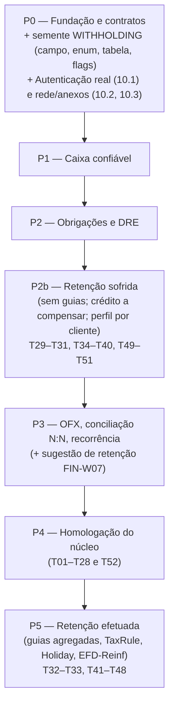

# Planejamento v3.1 — Módulo Financeiro do jprOS
## Retenções Tributárias na Fonte (`WITHHOLDING`) e Correções Operacionais da v3

> **Versão:** 3.1 (revisão 2) — 26/10/2026  
> **Natureza:** **extensão da v3.** Este documento **não substitui** a v3 (`solicitacao-implementacao-financeiro-v3.md`).  
> **Precedência:** a v3 é a especificação base do núcleo. A v3.1 altera **somente** o que está listado na Seção 3 ("Seções da v3 afetadas"). Em qualquer ponto não listado ali, vale a v3. Onde a v3.1 declara divergência, vale a v3.1.  
> **Objeto:** (a) especificação completa das retenções tributárias na fonte em serviços B2B no Brasil; (b) correções de plataforma identificadas na revisão da v3.1 rev. 1 e do scaffold `evo-finance-service` (autenticação, exposição de rede, armazenamento de anexos).  
> **Escopo desta revisão:** especificação gerencial. **Não é parecer tributário**: toda regra fiscal marcada com ⚠ deve ser validada com o contador responsável antes de uso produtivo (Seção 13).

### Histórico

| Revisão | Mudança |
|---|---|
| rev. 1 | Primeira versão: modelo `WITHHOLDING`, fórmulas, T29–T35. Declarava "substituir a v2 e a v3". |
| rev. 2 | Reposicionada como extensão da v3; seção de seções afetadas; semente da funcionalidade no P0; retenção sofrida separada da efetuada; tratamento por tributo; `TaxRule` (fato gerador, vencimento, feriados); guia agregada N:1; valor confirmado pelo operador; regime tributário; DIRF substituída por EFD-Reinf; testes T29–T52; correções de autenticação, rede e anexos; checklist do scaffold. |

---

## 1. Contexto e problema

Na prestação de serviços B2B no Brasil, o depósito bancário raramente coincide com o valor da Nota Fiscal de Serviço, porque o tomador pode ter de reter tributos na fonte.

### 1.1 Retenção sofrida (Contas a Receber)

- A empresa emite NFSe de R$ 1.000,00 (`Schedule.originalAmount`).
- O cliente retém, por exemplo, IRRF 1,5% = R$ 15,00 e CRF (PIS/COFINS/CSLL) 4,65% = R$ 46,50, e deposita **R$ 938,50**. Se o ISS (2% = R$ 20,00) também for retido, o depósito cai para R$ 918,50.
- **Sem `WITHHOLDING` na v3:** o título fica `PARTIALLY_PAID` com saldo falso de R$ 61,50, ou o operador lança a diferença como "Desconto Concedido". A v3 proíbe esse disfarce (FIN-02: "Retenção na fonte não pode ser disfarçada como desconto ou taxa"), e o desconto distorceria a margem e a DRE.

### 1.2 Retenção efetuada (Contas a Pagar)

- A empresa contrata um prestador (NF de R$ 2.000,00) e retém **IRRF 1,5% = R$ 30,00 e CRF 4,65% = R$ 93,00 (total R$ 123,00)**, pagando R$ 1.877,00.
- O título do fornecedor é quitado em R$ 2.000,00 e nasce uma obrigação nova: recolher R$ 123,00 à União (DARFs distintos por código de receita) até o vencimento legal.

> Correção da rev. 1: os R$ 123,00 de exemplo eram atribuídos só ao IRRF, mas 1,5% de R$ 2.000,00 é R$ 30,00. O valor de R$ 123,00 corresponde a IRRF + CRF e gera **duas** guias.

---

## 2. Escopo e faseamento

A retenção **sofrida** (recebimento) é simples e urgente para quem fatura B2B. A retenção **efetuada** (pagamento) exige geração de guias, regras de vencimento e agregação. Por isso a v3.1 separa as duas, e planta a "semente" já no P0 para que nenhuma fase exija refatoração destrutiva.

| Fase | Entrega | Observação |
|---|---|---|
| **P0 (semente)** | `SchedulePayment.withholdingAmount NOT NULL DEFAULT 0`; `LineKind.WITHHOLDING` reservado; tabela `ScheduleWithholding` vazia; fórmula de baixa e CHECKs já com o termo de retenção (valor zero); flags de funcionalidade desligadas | Sem tela, sem guias. Torna verdadeira a promessa de migração sem quebra de schema. |
| **P2b — Retenção sofrida** | Retenção em baixa de `RECEIVABLE`; linha `WITHHOLDING`; relatório de créditos a compensar; perfil de retenção por cliente | Sem guias. Flag `WITHHOLDING_RECEIVABLE_ENABLED`. |
| **P5 — Retenção efetuada** | Retenção em baixa de `PAYABLE`; guias agregadas; `TaxRule` completo com feriados; relatórios para EFD-Reinf | Flag `WITHHOLDING_PAYABLE_ENABLED`. |

**Flags.** Com a flag desligada, qualquer `withholdings` no payload retorna **422 `UNSUPPORTED_TAX_WITHHOLDING`** (o erro da v3 mantém seu significado).

> O scaffold atual já contém código de ambas as pontas. Ele deve ser mantido atrás das flags (padrão `false`), não removido.

---

## 3. Seções da v3 afetadas por esta extensão

| Seção da v3 | O que muda na v3.1 |
|---|---|
| Revisão socrática (tabela, "impostos dentro de qualquer baixa") | A decisão "retenção fica para especificação posterior" é cumprida por esta extensão. |
| **FIN-01** (matriz de sinais) | Duas linhas novas para o componente `WITHHOLDING` (Seção 5.3). |
| **FIN-02** (fórmulas) | `grossAmount` passa a subtrair `WITHHOLDING`. O item "TAX não integra LineKind" é substituído por `WITHHOLDING`. `UNSUPPORTED_TAX_WITHHOLDING` passa a ser o erro de flag desligada. |
| **FIN-04** (título) | `settledPrincipal` e `remainingPrincipal` consideram a retenção como amortização de principal. |
| **FIN-06** (baixa) | `totalPaid = principalSettled + juros + multa − desconto − retenção`. Lote exige mesma regra de retenção por título. |
| **FIN-08** (estorno) | A linha `WITHHOLDING` é copiada com sinal invertido; guias geradas são reduzidas/canceladas (FIN-W03). |
| **FIN-10** (DRE) | Linha `WITHHOLDING` segue o `dreGroup` do mapeamento; crédito a compensar é `NOT_IN_DRE` (Seção 4). |
| **FIN-11** (fechamento) | Competência da linha `WITHHOLDING` e da guia gerada devem estar em período aberto. |
| **FIN-12** (conciliação) | Sem mudança de regra: a conciliação continua em `netAmount`. Ganha sugestão por perfil de retenção (FIN-W07). |
| **FIN-15** (recibo) | Recibo de baixa mostra o desembolso real e a retenção como linha informativa. |
| **FIN-16** (projeção) | Caixa esperado de recebível = saldo − taxa esperada − retenção esperada pelo perfil (quando houver). |
| **Seção 5** (modelo) | Novas entidades `TaxRule`, `Holiday`; `ScheduleWithholding`; campos em `Schedule`, `SchedulePayment`, `CompanySettings`, `Person` (Seção 7). |
| **Seção 6.4** (erros) | Novos códigos (Seção 8.3). |
| **Seção 7.1** (identidade) | Reafirmada e detalhada (Seção 10.1). Nenhuma exceção de desenvolvimento implícita. |
| **Seção 7.3** (persistência) | Detalhamento de volume e backup de anexos (Seção 10.3). |
| **Seção 10** (cenários) | Testes T29–T52. |

---

## 4. Decisões conceituais

| Tema | Decisão |
|---|---|
| **Natureza** | `WITHHOLDING` é componente **redutor do valor bancário** (como `DISCOUNT` na fórmula de caixa) mas **satisfativo do principal**: quita a dívida sem movimentar caixa. |
| **Diferença de desconto** | Desconto reduz faturamento. Retenção mantém a receita bruta integral e tem tratamento próprio por tributo. Nunca registrar retenção como desconto, taxa ou saída compensatória. |
| **Tratamento por tributo (retenção sofrida)** ⚠ | **Crédito a compensar** (`NOT_IN_DRE`, ativo): `IRRF`, `PIS`, `COFINS`, `CSLL`, `CRF_CONSOLIDADO`, `INSS_RETIDO`. **Dedução de receita** (`DEDUCTION`): `ISS_RETIDO`, porque o ISS retido extingue o imposto sobre o serviço, não gera crédito. |
| **Opção "redutora" da rev. 1** | **Removida** para IRRF, CRF e INSS: eles são antecipação de tributos apurados à parte, e deduzi-los da receita duplicaria o imposto. |
| **Retenção efetuada** | Sempre `NO_RESULT` / passivo "Tributos retidos a recolher". Não é despesa nova: é repasse. |
| **Valor da retenção** | É um fato externo (o tomador decide o que retém). O sistema **sugere** o cálculo e o operador **confirma** o valor efetivo, como na FIN-07. Divergência exige motivo. |
| **Extrato bancário** | A transação reflete estritamente o valor que transitou na conta (`netAmount`). |
| **Estorno** | Contra-lançamento integral por cópia invertida (FIN-08). Nada é apagado nem "anulado". |
| **Regime tributário** ⚠ | A existência de cada retenção depende do regime das partes. O sistema guarda o regime e alerta, mas **não decide** juridicamente (FIN-W05). |

---

## 5. Fórmulas e invariantes

### 5.1 Baixa de um título (`SchedulePayment`)

```
totalPaid         = principalSettled + interestAmount + fineAmount
                    - discountAmount - withholdingAmount        (= cashAllocated)
principalSettled  = cashAllocated + withholdingAmount + discountAmount
                    - (interestAmount + fineAmount)
withholdingAmount = soma(ScheduleWithholding.amount) do pagamento
```

Restrições (por título): `withholdingAmount >= 0`; `principalSettled` dentro do saldo; `discountAmount + withholdingAmount <= principalSettled + interestAmount + fineAmount` (o caixa alocado deve ser positivo).

### 5.2 Operação de baixa (`Settlement` / `Transaction`)

```
grossAmount       = soma(totalPaid)           # valor bruto BANCÁRIO, antes da taxa
feeAmount         = soma(feeAmount)
netAmount         = grossAmount - feeAmount   # bate com o extrato; deve ser > 0
totalWithholding  = soma(withholdingAmount)
```

Garantia de fechamento:

```
soma(principalSettled) + juros + multa = grossAmount + totalWithholding + desconto
```

> **Nome na API:** `grossAmount` agora é menor que o valor nominal da nota (ex.: 938,50 contra 1.000,00). A API e as telas devem rotular como **"Valor bruto bancário"** e expor também `totalPrincipalSettled` e `totalWithholding`, para não confundir com o valor da NF.

### 5.3 Matriz de sinais (acréscimo à FIN-01)

| Operação | Componente | Efeito no resultado | Classificação |
|---|---|---|---|
| Entrada | `WITHHOLDING` (IRRF, PIS, COFINS, CSLL, CRF, INSS) | Nenhum | `NO_RESULT` / `NOT_IN_DRE` (crédito a compensar) |
| Entrada | `WITHHOLDING` (`ISS_RETIDO`) | Diminui | `DEDUCTION` ("ISS retido por tomadores") ⚠ |
| Saída | `WITHHOLDING` | Nenhum | `NO_RESULT` / `NOT_IN_DRE` (passivo "tributos retidos a recolher") |

`AccountMapping` ganha chaves separadas (em vez da chave única `TAX_WITHHOLDING`): `WITHHOLDING_CREDIT`, `WITHHOLDING_ISS_DEDUCTION`, `WITHHOLDING_LIABILITY`. Mudanças no mapeamento afetam apenas novos registros (regra da v3).

### 5.4 Invariantes de serviço

- `soma(linhas WITHHOLDING da transação) = soma(SchedulePayment.withholdingAmount)`.
- Linha `WITHHOLDING` pertence à mesma transação da baixa, com `schedulePaymentId` preenchido, e **reduz** o bruto como o `DISCOUNT`.
- Retenção só existe em baixa (`Settlement`); movimento avulso não aceita `WITHHOLDING`.
- O serviço recalcula todos os totais; valores calculados enviados pelo cliente não são autoridade (FIN-02).

---

## 6. Regras de negócio (`FIN-W`)

### FIN-W01 — Retenção sofrida (Contas a Receber)

1. Na baixa de `Schedule.type = RECEIVABLE`, o operador informa as retenções do depósito. Cada uma tem `taxType`, `baseAmount`, `ratePercent` e **`amount` confirmado**.
2. O sistema **sugere** `amount = baseAmount × rate` (`ROUND_HALF_UP`) a partir da `TaxRule` e do perfil do cliente. Se `amount` divergir da sugestão, o motivo é obrigatório (`divergenceReason`); sugestão e valor final são persistidos.
3. Exclusão mútua: `CRF_CONSOLIDADO` **não** coexiste com `PIS`, `COFINS` ou `CSLL` no mesmo pagamento (`WITHHOLDING_TAX_OVERLAP`).
4. `baseAmount` padrão = `principalSettled`; pode ser alterado (ex.: base é a NF e a baixa é parcial).
5. O título é amortizado em `principalSettled`; se o saldo zera, transita para `PAID`.
6. A linha `WITHHOLDING` nasce com conta pelo mapeamento (Seção 5.3) e competência: `paidAt` para créditos; **`Schedule.competenceDate` para `ISS_RETIDO`** (o operador pode escolher outra competência aberta).
7. **Crédito a compensar:** o saldo por tributo é um relatório derivado das linhas `WITHHOLDING` de crédito (estornos incluídos, com sinal). A **compensação** (usar o crédito para abater tributo próprio) continua **fora do escopo**, como na v3; o saldo apenas fica rastreável.

### FIN-W02 — Retenção efetuada (Contas a Pagar)

1. Na baixa de `Schedule.type = PAYABLE`, o operador registra retenções do fornecedor. Desembolso bancário = `principalSettled − withholdingAmount`; o título do fornecedor quita pelo principal.
2. **Guia agregada (N:1).** Cada retenção alimenta **uma guia aberta por chave** `taxGuideKey = <código de receita>|<mês do vencimento>`:
   - se não existe guia aberta para a chave, cria um `Schedule PAYABLE` (guia) com o valor da retenção;
   - se existe, **soma** o valor à guia (`action: INCREASE`);
   - guia paga, parcialmente paga ou conciliada **fecha a chave**; a próxima retenção abre a sequência seguinte (`taxGuideSeq`).
3. Atributos da guia: beneficiário configurável (cadastro de `Person` marcado como órgão arrecadador; **sem CNPJ fictício em seed**), conta de passivo `WITHHOLDING_LIABILITY`, `resultNature = NO_RESULT`, vencimento e competência vindos da `TaxRule` (FIN-W04).
4. Mudanças na guia usam `version` (concorrência otimista da v3) e bloqueio de linha: duas baixas simultâneas não podem perder soma.
5. Idempotência: repetir a baixa com a mesma `Idempotency-Key` não gera nem soma guia duas vezes.

### FIN-W03 — Estorno de baixa com retenção

1. O estorno do `Settlement` é integral e atômico (FIN-08): inverte caixa, linhas `WITHHOLDING` e reabre o título; os registros `ScheduleWithholding` permanecem imutáveis (estado derivado do `Settlement`).
2. **Recebível:** devolve o saldo original e reverte o crédito/dedução; datas de impacto seguem a FIN-08.
3. **Pagável:** para cada guia afetada, **subtrai** a retenção estornada. Guia chega a zero → `CANCELLED` com auditoria; senão permanece com o saldo restante.
4. **Bloqueios (422):** guia `PAID` ou `PARTIALLY_PAID` → `WITHHOLDING_TAX_GUIDE_ALREADY_PAID`; guia com vínculo de conciliação ativo → `WITHHOLDING_TAX_GUIDE_RECONCILED`; período da guia ou da linha fechado → `PERIOD_CLOSED`. O operador resolve a guia primeiro (estorna o pagamento/desconcilia) e depois estorna a baixa.

### FIN-W04 — Regras fiscais parametrizáveis (`TaxRule`) ⚠

Cada tributo tem regra própria, com vigência (leis mudam). Campos: `taxType`, `revenueCode`, `factGenerator` (`PAYMENT` | `INVOICE_ISSUE`), `dueMonthOffset`, `dueDay`, `dueAdjust` (`PREVIOUS_BUSINESS_DAY` | `NONE` | `MANUAL`), `receivableTreatment` (`TAX_CREDIT` | `REVENUE_DEDUCTION`), `defaultRatePercent`, `minWithholdingAmount`, `beneficiaryPersonId`, `municipalityIbge` (para ISS), `validFrom`, `validTo`.

Valores iniciais sugeridos (seed editável, a validar com o contador):

| Tributo | Código | Fato gerador | Vencimento |
|---|---|---|---|
| `IRRF` (serviços PJ) | 1708 | Pagamento | Dia 20 do mês seguinte, antecipando para dia útil anterior |
| `CRF_CONSOLIDADO` | 5952 | Pagamento | Dia 20 do mês seguinte, antecipando para dia útil anterior |
| `INSS_RETIDO` (11%) | 2631 | **Emissão da NF** | Dia 20 do mês seguinte **à emissão**, antecipando para dia útil anterior |
| `ISS_RETIDO` | por município | Prestação/NF | **Definido pelo município**: operador informa a data (`MANUAL`) até haver regra cadastrada |

- Antecipação usa a tabela `Holiday` (feriados nacionais e bancários, editável). Dia 20 **fixo** é incorreto: em 2026, 20/11 é sexta-feira e feriado nacional (Consciência Negra) ⚠, então o vencimento seria 19/11.
- Para `INVOICE_ISSUE`, a guia usa a data da NF: novo campo `Schedule.fiscalDocumentDate` (obrigatório quando houver retenção desse tipo). A retenção pode ser sugerida sobre a **NF inteira** na primeira baixa, e não proporcional ao pagamento (T36).
- Regra de valor mínimo: `minWithholdingAmount` (padrão 0) permite configurar dispensa por valor ⚠.

### FIN-W05 — Regime tributário e elegibilidade ⚠

- `CompanySettings.taxRegime` (`SIMPLES`, `PRESUMIDO`, `REAL`, `MEI`) e `Person.isSimplesNacional` (optante).
- Alertas (não bloqueios absolutos): retenção de IRRF/CRF em título de prestador optante pelo Simples; CRF gerada por empresa tomadora optante pelo Simples; `INSS_RETIDO` fora de cessão de mão de obra. O operador confirma com motivo (`WITHHOLDING_NOT_APPLICABLE_CONFIRMED`) e a decisão fica na auditoria.
- Fundamentos para validação do contador na Seção 13.

### FIN-W06 — Relatórios e obrigações acessórias

1. **Retenções sofridas** por cliente, tributo e período, com base, alíquota, valor, código de receita e CNPJ do tomador.
2. **Créditos a compensar** por tributo (saldo derivado, FIN-W01.7).
3. **Retenções efetuadas** e situação das guias (aberta, paga, vencida).
4. **Conferência para a EFD-Reinf.** A DIRF foi extinta para fatos geradores a partir de 2025; as retenções são informadas **mensalmente** por EFD-Reinf e eSocial. O relatório lista por competência mensal: CNPJ do beneficiário/tomador, código de receita, base e imposto retido. O módulo **não transmite** obrigação acessória; apenas organiza o conferível.
5. Comprovantes de retenção emitidos pelo cliente podem ser anexados à `Person` ou ao título (anexo com um único proprietário, FIN-15).

### FIN-W07 — Perfil de retenção e sugestão na conciliação

1. `Person` (cliente) pode ter **perfil de retenção** padrão (lista de tributos e alíquotas) que pré-preenche a baixa.
2. Na conciliação OFX, quando um crédito é **menor** que o saldo do título em uma diferença igual à retenção típica do perfil, o sistema propõe "baixa com retenção" já preenchida. A decisão continua sendo do operador.
3. Sem perfil, o sistema mostra apenas a diferença e sugere registrar retenção.

### FIN-W08 — Notas de UX

- Telas de baixa mostram sempre: valor bruto bancário, retenções, taxa, valor líquido, saldo restante do título e, no pagável, a guia que será criada ou incrementada, com vencimento.
- Ao criar títulos e parcelamentos (v3 FIN-04, sem rascunho persistente), um **modal de conferência** exibe datas, valores e efeito em projeção e competência antes de salvar.

---

## 7. Modelo de dados (extensão Prisma)

```prisma
enum WithholdingTaxType {
  IRRF
  PIS
  COFINS
  CSLL
  CRF_CONSOLIDADO   // exclusivo com PIS/COFINS/CSLL no mesmo pagamento
  ISS_RETIDO
  INSS_RETIDO
}

enum TaxFactGenerator   { PAYMENT  INVOICE_ISSUE }
enum TaxDueAdjust       { PREVIOUS_BUSINESS_DAY  NONE  MANUAL }
enum WithholdingTreatment { TAX_CREDIT  REVENUE_DEDUCTION }

model TaxRule {
  id                   String               @id @default(uuid()) @db.Uuid
  taxType              WithholdingTaxType   @map("tax_type")
  revenueCode          String?              @map("revenue_code") @db.VarChar(10)
  factGenerator        TaxFactGenerator     @map("fact_generator")
  dueMonthOffset       Int                  @default(1) @map("due_month_offset")
  dueDay               Int?                 @map("due_day")
  dueAdjust            TaxDueAdjust         @map("due_adjust")
  receivableTreatment  WithholdingTreatment @map("receivable_treatment")
  defaultRatePercent   Decimal?             @map("default_rate_percent") @db.Decimal(7, 4)
  minWithholdingAmount Decimal              @default(0) @map("min_withholding_amount") @db.Decimal(14, 2)
  beneficiaryPersonId  String?              @map("beneficiary_person_id") @db.Uuid
  municipalityIbge     String?              @map("municipality_ibge") @db.VarChar(7)
  validFrom            DateTime             @map("valid_from") @db.Date
  validTo              DateTime?            @map("valid_to") @db.Date
  version              Int                  @default(1)
  @@index([taxType, validFrom], name: "idx_tax_rule_type_valid")
  @@map("tax_rules")
}

model Holiday {
  date        DateTime @id @db.Date
  description String   @db.VarChar(120)
  @@map("holidays")
}

model ScheduleWithholding {
  id                 String             @id @default(uuid()) @db.Uuid
  schedulePaymentId  String             @map("schedule_payment_id") @db.Uuid
  taxType            WithholdingTaxType @map("tax_type")
  taxRuleId          String?            @map("tax_rule_id") @db.Uuid
  baseAmount         Decimal            @map("base_amount") @db.Decimal(14, 2)
  ratePercent        Decimal            @map("rate_percent") @db.Decimal(7, 4)
  suggestedAmount    Decimal            @map("suggested_amount") @db.Decimal(14, 2)
  amount             Decimal            @map("amount") @db.Decimal(14, 2)   // confirmado pelo operador
  divergenceReason   String?            @map("divergence_reason") @db.VarChar(255)
  taxGuideScheduleId String?            @map("tax_guide_schedule_id") @db.Uuid  // N:1 (NÃO unique)
  transactionLineId  String?            @unique @map("transaction_line_id") @db.Uuid
  notes              String?            @db.VarChar(255)
  createdAt          DateTime           @default(now()) @map("created_at") @db.Timestamptz
  createdById        String             @map("created_by_id") @db.VarChar(100)

  schedulePayment    SchedulePayment    @relation(fields: [schedulePaymentId], references: [id], onDelete: Restrict)
  taxGuideSchedule   Schedule?          @relation("TaxGuideOrigin", fields: [taxGuideScheduleId], references: [id], onDelete: Restrict)

  @@index([schedulePaymentId], name: "idx_schedule_withholding_payment")
  @@index([taxGuideScheduleId], name: "idx_schedule_withholding_guide")
  @@index([taxType], name: "idx_schedule_withholding_type")
  @@map("schedule_withholdings")
}
```

CHECKs: `amount > 0`, `baseAmount >= 0`, `suggestedAmount >= 0`.

### 7.1 Alterações em entidades existentes

- **`SchedulePayment`:** `withholdingAmount Decimal @default(0)`; CHECK de `totalPaid` com o termo de retenção; relação `withholdings`.
- **`Schedule`:** **remover** `originWithholdingId` (vínculo duplicado da rev. 1). Adicionar `fiscalDocumentDate DateTime? @db.Date`, `taxGuideKey String?`, `taxGuideSeq Int?`, com `@@unique([taxGuideKey, taxGuideSeq])`, e a relação inversa **1:N** `taxGuideWithholdings ScheduleWithholding[] @relation("TaxGuideOrigin")`. Uma guia é um `Schedule` com `taxGuideKey` preenchido.
- **`CompanySettings`:** `taxRegime`, flags `withholdingReceivableEnabled` e `withholdingPayableEnabled` (ou variáveis de ambiente equivalentes).
- **`Person`:** `isSimplesNacional Boolean?`, `withholdingProfile Json?` (lista de tributos/alíquotas), `taxAuthority Boolean @default(false)`.
- **`AccountMappingKey`:** substituir `TAX_WITHHOLDING` por `WITHHOLDING_CREDIT`, `WITHHOLDING_ISS_DEDUCTION`, `WITHHOLDING_LIABILITY`.
- **`LineKind`:** mantém `WITHHOLDING`.

---

## 8. Contratos de API

Permissões: baixa com retenção exige `finance.settle`; edição de `TaxRule`, `Holiday` e regime tributário exige `finance.manage`; relatórios de retenção exigem `finance.read` (CNPJ completo exige `finance.pii`, como na v3). Cabeçalho `Idempotency-Key` obrigatório nas escritas.

### 8.1 Retenção sofrida — prévia

`POST /api/v1/finance/settlements/preview`

```json
{
  "accountId": "9b1deb4d-3b7d-4bad-9bdd-2b0d7b3dcb6d",
  "paidAt": "2026-10-27",
  "paymentMethodId": "3fa85f64-5717-4562-b3fc-2c963f66afa6",
  "payments": [
    {
      "scheduleId": "a1b2c3d4-e5f6-7a8b-9c0d-1e2f3a4b5c6d",
      "principalSettled": "1000.00",
      "discountAmount": "0.00",
      "interestAmount": "0.00",
      "fineAmount": "0.00",
      "withholdings": [
        { "taxType": "IRRF", "baseAmount": "1000.00", "ratePercent": "1.5000", "amount": "15.00" },
        { "taxType": "CRF_CONSOLIDADO", "baseAmount": "1000.00", "ratePercent": "4.6500", "amount": "46.50" }
      ]
    }
  ]
}
```

Resposta:

```json
{
  "grossAmount": "938.50",
  "feeAmount": "0.00",
  "netAmount": "938.50",
  "totalPrincipalSettled": "1000.00",
  "totalWithholding": "61.50",
  "payments": [
    {
      "scheduleId": "a1b2c3d4-e5f6-7a8b-9c0d-1e2f3a4b5c6d",
      "cashAllocated": "938.50",
      "withholdingAmount": "61.50",
      "principalSettled": "1000.00",
      "remainingScheduleBalance": "0.00",
      "resultingScheduleStatus": "PAID",
      "withholdings": [
        { "taxType": "IRRF", "suggestedAmount": "15.00", "amount": "15.00", "diverges": false },
        { "taxType": "CRF_CONSOLIDADO", "suggestedAmount": "46.50", "amount": "46.50", "diverges": false }
      ]
    }
  ],
  "taxGuidesToGenerate": [],
  "warnings": []
}
```

### 8.2 Retenção efetuada — resposta da prévia

Fornecedor de R$ 2.000,00 pago em 27/10/2026 com IRRF R$ 30,00 e CRF R$ 93,00:

```json
{
  "grossAmount": "1877.00",
  "netAmount": "1877.00",
  "totalPrincipalSettled": "2000.00",
  "totalWithholding": "123.00",
  "taxGuidesToGenerate": [
    { "taxType": "IRRF", "revenueCode": "1708", "guideKey": "1708|2026-11", "action": "CREATE",
      "amount": "30.00", "dueDate": "2026-11-19", "dueDateRule": "PREVIOUS_BUSINESS_DAY" },
    { "taxType": "CRF_CONSOLIDADO", "revenueCode": "5952", "guideKey": "5952|2026-11", "action": "CREATE",
      "amount": "93.00", "dueDate": "2026-11-19", "dueDateRule": "PREVIOUS_BUSINESS_DAY" }
  ],
  "warnings": []
}
```

`action` é `CREATE` (nova guia) ou `INCREASE` (soma a guia aberta da mesma chave). No exemplo não havia guias abertas, então ambas são `CREATE`; uma segunda baixa no mesmo mês geraria `INCREASE` (T41).

### 8.3 Efetivação e erros

`POST /api/v1/finance/settlements` efetiva atomicamente: `Settlement`, `Transaction` (valor líquido), `SchedulePayment`, linhas `WITHHOLDING`, `ScheduleWithholding` e, no pagável, criação/incremento de guias.

Endpoints novos: `GET|PUT /api/v1/finance/tax-rules`, `GET|PUT /api/v1/finance/holidays`, `GET /api/v1/finance/reports/withholdings`, `GET /api/v1/finance/reports/tax-credits`.

| Código | HTTP | Quando |
|---|---|---|
| `UNSUPPORTED_TAX_WITHHOLDING` | 422 | Flag da ponta (receber/pagar) desligada |
| `WITHHOLDING_TAX_OVERLAP` | 422 | `CRF_CONSOLIDADO` junto com `PIS`/`COFINS`/`CSLL` |
| `WITHHOLDING_EXCEEDS_CASH` | 422 | Retenção + desconto deixam o caixa alocado ≤ 0 |
| `WITHHOLDING_DIVERGENCE_REASON_REQUIRED` | 422 | `amount` ≠ sugestão sem motivo |
| `TAX_RULE_NOT_FOUND` | 422 | Sem regra vigente para o tributo/município (ISS: exige data manual) |
| `WITHHOLDING_TAX_GUIDE_ALREADY_PAID` | 422 | Estorno com guia `PAID` ou `PARTIALLY_PAID` |
| `WITHHOLDING_TAX_GUIDE_RECONCILED` | 422 | Estorno com guia conciliada |
| `PERIOD_CLOSED` | 422 | Competência da linha ou da guia em período fechado |
| `WITHHOLDING_NOT_APPLICABLE_CONFIRMED` | warning | Alerta de regime confirmado pelo operador com motivo |

---

## 9. Casos de teste (T29 a T52)

Complementam T01–T28 da v3.

| ID | Cenário | Resultado esperado |
|---|---|---|
| **T29** | Recebível R$ 1.000 com IRRF 15,00 e CRF 46,50 | Entrada bancária de R$ 938,50; título amortiza 1.000,00 e vai a `PAID`; 2 linhas `ScheduleWithholding`; linha `WITHHOLDING` de 61,50 `NOT_IN_DRE`. |
| **T30** | T29 com taxa de gateway R$ 5,00 | `grossAmount` 938,50; `feeAmount` 5,00; `netAmount` 933,50; título liquidado em 1.000,00. |
| **T31** | Estorno da baixa de T29 | Extrato estorna 938,50; linha `WITHHOLDING` invertida; título volta a `PENDING` com saldo 1.000,00. |
| **T32** | Pagável R$ 2.000 com IRRF 30,00 e CRF 93,00 | Saída bancária de 1.877,00; fornecedor `PAID`; duas guias (1708: 30,00; 5952: 93,00); linhas `NO_RESULT`. |
| **T33** | Estornar baixa de T32 com guia 1708 já paga | 422 `WITHHOLDING_TAX_GUIDE_ALREADY_PAID`; nada muda. |
| **T34** | DRE: NF de outubro com retenção paga em novembro (IRRF/CRF 61,50 e ISS 20,00) | Competência outubro: receita 1.000,00 e dedução ISS 20,00; novembro: nenhuma linha de resultado dos créditos; caixa novembro +918,50; saldo de créditos a compensar +61,50. |
| **T35** | NF de R$ 2.000 paga em 2 × R$ 1.000, com IRRF/CRF proporcionais | Cada baixa retém 61,50 sobre base 1.000; após a 1ª, saldo 1.000,00 exatos. |
| **T36** | Mesma NF com `ISS_RETIDO` 2% (fato gerador NF) | 1ª baixa sugere ISS 40,00 sobre a NF inteira (caixa 960,00); 2ª baixa sugere 0 (caixa 1.000,00). |
| **T37** | `CRF_CONSOLIDADO` e `PIS` no mesmo pagamento | 422 `WITHHOLDING_TAX_OVERLAP`. |
| **T38** | Retenção + desconto ≥ principal + encargos | 422 `WITHHOLDING_EXCEEDS_CASH`; nenhuma gravação. |
| **T39** | Valor confirmado diferente da sugestão | Sem motivo: 422; com motivo: grava sugestão, valor e motivo. |
| **T40** | ISS com competência da NF em mês fechado | 422 `PERIOD_CLOSED`; com competência aberta escolhida, grava. |
| **T41** | Dois fornecedores no mesmo mês, IRRF 30,00 cada | Uma guia 1708 de 60,00 (segunda baixa é `INCREASE`). |
| **T42** | Estornar uma das duas baixas de T41; depois a outra | Guia vai a 30,00; depois `CANCELLED`, com auditoria. |
| **T43** | Estornar baixa com guia parcialmente paga | 422 `WITHHOLDING_TAX_GUIDE_ALREADY_PAID`. |
| **T44** | Duas baixas simultâneas incrementando a mesma guia | Soma final correta; nenhuma atualização perdida. |
| **T45** | Retry com mesma `Idempotency-Key` | Uma baixa, um incremento de guia; mesmo resultado. |
| **T46** | IRRF/CRF pagos em 15/10/2026 | Vencimento 19/11/2026 (20/11 é feriado nacional ⚠; feriados vêm de `Holiday`). |
| **T47** | `INSS_RETIDO` com NF emitida em 10/09/2026, paga em 05/10 | Vencimento 20/10/2026 (mês seguinte à **emissão**), não à data de pagamento. |
| **T48** | Retenção de CRF em título de prestador optante pelo Simples | Alerta; só efetiva com motivo confirmado e auditoria. |
| **T49** | Flag da ponta desligada com `withholdings` no payload | 422 `UNSUPPORTED_TAX_WITHHOLDING`. |
| **T50** | Crédito OFX de 938,50 contra título de 1.000,00 de cliente com perfil IRRF+CRF | Sugestão de baixa com retenção pré-preenchida; decisão do operador. |
| **T51** | Relatório de créditos a compensar após T29 e T31 | Saldo líquido zero (estorno incluído com sinal). |
| **T52** | Autenticação (Seção 10.1) | Token forjado/sem assinatura válida → 401; sem token → 401 em qualquer `NODE_ENV`; `x-user-id`/`x-user-role` ignorados; boot recusado com `NODE_ENV=production` e modo dev ativo. |

---

## 10. Correções de plataforma (v3 §7.1 e §7.3)

Estas correções valem para o Financeiro **desde o P0**, independentemente das retenções.

### 10.1 Autenticação e autorização (reafirma v3 §7.1)

A v3 é explícita: validar a credencial, consultar a autorização existente, **não aceitar `x-user-id` nem usuário de desenvolvimento implícito** e **não usar o papel do token como liberação alternativa**. O scaffold atual contraria isso (Seção 11). Especificação:

1. **Validação real.** Validar a credencial junto ao `evo-auth` (o mesmo contrato de sessão usado pelo CRM e pelos demais serviços), verificando assinatura, algoritmo, expiração, emissor e `sub`. **Decodificar o payload sem verificar assinatura é proibido**, inclusive em produção.
2. **Permissões** vêm somente da fonte de autorização. Remover atalhos como `role === 'admin'` em `requirePermission` e permissões padrão concedidas por papel lido do token.
3. **Sem fallback implícito.** Nenhuma rota aceita requisição sem credencial válida em nenhum ambiente. Os cabeçalhos `x-user-id`, `x-user-email`, `x-user-name` e `x-user-role` são sempre ignorados.
4. **Desenvolvimento local:** o `evo-auth` roda no mesmo `docker-compose`, então o caminho padrão é **login real**. Se for indispensável um modo de desenvolvimento, ele é **opt-in explícito** (`FINANCE_DEV_AUTH=1`), com usuário fixo de UUID conhecido e permissões mínimas listadas em `FINANCE_DEV_PERMISSIONS` (padrão: `finance.read`). O serviço **recusa iniciar** se `FINANCE_DEV_AUTH=1` com `NODE_ENV=production`, ou se o serviço estiver escutando fora de `127.0.0.1`.
5. Indisponibilidade do `evo-auth` → **503**, sem liberação alternativa (T23 da v3).

### 10.2 Exposição de rede e ambiente

- No `docker-compose.yml` (desenvolvimento), publicar a porta apenas em loopback (`127.0.0.1:3014:3004`) e definir `CORS_ORIGIN` com a origem real do frontend, não `*`.
- O ambiente de produção/Swarm (`docker-compose.prod.yml`, `docker-compose.swarm.yaml`) deve definir o serviço `evo-finance` com `NODE_ENV=production`, sem porta publicada (acesso só via Nginx), segredos por variáveis/secrets e `FINANCE_DEV_AUTH` ausente.
- A rota `/api/v1/finance` no Nginx não substitui a autenticação do serviço.

### 10.3 Anexos e comprovantes (v3 FIN-15 e §7.3)

- Trocar o bind mount relativo (`./storage/finance/uploads`) por **volume nomeado** (`finance_uploads`) em desenvolvimento e **volume externo/nomeado** em Swarm. Bind mount relativo não é portável entre nós e, em host Windows, não aplica permissões restritas.
- Se mantiver diretório do host em desenvolvimento, adicionar `storage/` ao `.gitignore` (hoje **não está ignorado**: anexos financeiros poderiam ir para o Git).
- Diretório fora de público, chave opaca, download por endpoint autenticado com auditoria e streaming, limite configurável de 25 MB, tratamento seguro de nomes.
- Backup diário criptografado com cópia externa e **conferência de hash dos anexos na restauração** (T25 da v3). O volume precisa sobreviver a rotinas de manutenção do ambiente.

### 10.4 Serviço de Projetos

O `evo-projects-service` tem o mesmo fallback de desenvolvimento (`auth.middleware.ts`, `NODE_ENV !== 'production'` aceitando `x-user-id` e `default-operator-id`) e `NODE_ENV: development` fixo no compose. Fora do escopo do Financeiro, mas deve ser tratado com a mesma correção em tarefa própria.

---

## 11. Estado do scaffold `evo-finance-service` × especificação

Conferido no repositório em 26/10/2026 (legenda: ✔ verificado no código; ? a verificar na implementação).

| # | Ponto | Estado atual | Ação |
|---|---|---|---|
| 1 | `src/middlewares/auth.middleware.ts` | ✔ Decodifica JWT sem verificar assinatura; sem token em `NODE_ENV !== 'production'` vira admin com todas as permissões; aceita `x-user-role` | Reescrever conforme 10.1 |
| 2 | `requirePermission` | ✔ `role === 'admin'` libera tudo | Remover atalho (10.1.2) |
| 3 | `docker-compose.yml` `evo-finance` | ✔ `NODE_ENV: development` fixo, `CORS_ORIGIN: "*"`, porta `3014:3004` publicada | Corrigir conforme 10.2 |
| 4 | Serviço nos compose de produção/Swarm | ✔ Não encontrado | Criar conforme 10.2 |
| 5 | Anexos | ✔ Bind mount `./storage/finance/uploads`; `storage/` fora do `.gitignore` | Corrigir conforme 10.3 |
| 6 | `calculateTaxGuideDueDate` (`settlement.service.ts`) | ✔ Dia 20 do mês seguinte, fixo, para todo tributo | Substituir por `TaxRule` + `Holiday` (FIN-W04) |
| 7 | `getOrCreateTaxBeneficiary` | ✔ Cria beneficiários por nome com CNPJ fixo; para ISS usa documento fictício `00.000.000/0001-00` | Beneficiário configurável, sem documento fictício (FIN-W02.3) |
| 8 | Guia por retenção | ✔ 1:1 (`taxGuideScheduleId @unique` e `Schedule.originWithholdingId`) | Agregação N:1 e remoção do campo duplicado (FIN-W02, 7.1) |
| 9 | Estorno | ✔ Bloqueia guia `PAID` ou com `settledPrincipal > 0`; cancela guia | Subtrair valor da guia agregada; bloquear conciliada (FIN-W03) |
| 10 | Linha `WITHHOLDING` | ✔ Criada na baixa; pagável usa `NO_RESULT`/`NOT_IN_DRE`; recebível usa o mapeamento | Mapeamento por tributo (5.3); competência do ISS (FIN-W01.6) |
| 11 | Saldo, extrato, OFX, conciliação, relatórios | ? | Conferir que linhas `WITHHOLDING` reduzem o bruto, mas não geram saldo, nem duplicam DRE, nem consomem capacidade de conciliação indevida |
| 12 | Flags de funcionalidade | ? | Implementar (Seção 2) |
| 13 | `ERROR_CODES` | ✔ Já tem `WITHHOLDING_TAX_GUIDE_ALREADY_PAID` e `UNSUPPORTED_TAX_WITHHOLDING` | Acrescentar códigos da Seção 8.3 |
| 14 | Registro como submódulo | ✔ `evo-finance-service` não consta no `.gitmodules` | Decidir: submódulo próprio (padrão do monorepo) ou pasta versionada |
| 15 | Confirmação do valor retido | ? | Garantir `suggestedAmount`, `amount` e motivo de divergência (FIN-W01.2) |

---

## 12. Roteiro de execução



Critério de saída de cada fase: testes listados passando, sem regressão em T01–T28, e validação do contador para as regras ⚠ da fase.

---

## 13. Pontos a validar com o contador e fundamentos ⚠

Esta especificação organiza o controle gerencial. As regras abaixo vieram de pesquisa e **devem ser validadas** para o regime e as atividades da empresa antes de uso produtivo:

1. **Tratamento por tributo (Seção 4):** crédito a compensar para IRRF, CRF e INSS; dedução para ISS retido.
2. **Regime e Simples Nacional:** prestador optante pelo Simples é, em regra, dispensado de retenção de IR e contribuições; tomador optante do Simples não retém CSLL/PIS/COFINS (Lei 10.833/2003, art. 30, § 2º), mas pode ter de reter IRRF de prestador não optante; ISS retido continua aplicável; INSS 11% só em cessão de mão de obra.
3. **Prazos:** IRRF e CRF (fato gerador = pagamento); INSS retido vence no dia 20 do mês seguinte **à emissão da NF**, antecipando para dia útil anterior; ISS depende de cada município. Confirmar códigos de receita (1708, 5952, 2631) e a regra de antecipação.
4. **Feriados:** confirmar 20/11 como feriado nacional e o calendário bancário usado.
5. **Valor mínimo de retenção:** confirmar dispensa por valor e preencher `minWithholdingAmount`.
6. **EFD-Reinf/eSocial:** a DIRF foi extinta para fatos geradores a partir de 2025; confirmar com o contador quais eventos e prazos mensais se aplicam.

Referências consultadas (informativas, não normativas):

- [DIRF: extinta e substituída por eSocial e EFD-Reinf (InfinitePay)](https://www.infinitepay.io/blog/dirf-o-que-e)
- [INSS retido na fonte: 11% e vencimento dia 20 do mês seguinte à emissão (Contábeis)](https://www.contabeis.com.br/artigos/3565/aspectos-importantes-que-voce-precisa-saber-sobre-o-inss-retido-na-fonte-pelas-pessoas-juridicas/)
- [Retenção de IR e contribuições por empresas do Simples Nacional](https://tributodevido.com.br/portal/retencao-de-ir-na-fonte-por-empresas-do-simples-nacional/)
